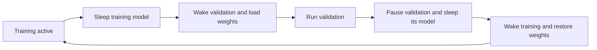

# Resource Elasticity and Worker Memory

> **Core idea:** an idle worker can release GPU memory and restore it when needed. PSRL has explicit sleep/wake paths, including a switch between training and validation on the training allocation. GPU placement, memory lifecycle and automatic pool resizing are separate controls.

For the overall workflow in Chinese, start with [PSRL入门：从一道题到模型更新](../overview/01-PSRL入门_从一道题到模型更新.md). This page explains the narrower memory lifecycle.

## Contents

- [Concept](#concept)
- [TMS (torch_memory_saver)](#tms-torch_memory_saver)
- [Configuration](#configuration)
- [Scope Options](#scope-options)
- [CUDA Graph Management](#cuda-graph-management)
- [NIXL Buffer Management](#nixl-buffer-management)
- [Verification Scope](#verification-scope)

## Concept

Training changes model weights. Validation uses a model to answer held-out questions. When these two roles share the training GPUs, both model copies may be too large to keep resident together. PSRL switches which role holds the required memory.

<!-- figure:training-memory-peak -->
这张图沿同一个场景解释：平时显存还够，为什么长序列的一次更新仍会 OOM？

[](../_static/img/document-figures/training-memory-peak.png)

[](../_static/img/document-figures/training-memory-peak.png)

教学容量 100 格，常驻状态占 60。短序列临时状态 25，长序列临时状态 50。 准入要看执行峰值和未兑现承诺，不能只读静止时的实占。缩小微批也不等于缩短单条序列。 相对格数为教学假设。真实峰值还包含模型、缓存、工作区和分配器状态。 [查看矢量图](../_static/img/document-figures/training-memory-peak.svg)。
<!-- /figure:training-memory-peak -->

The regular asynchronous generation pool uses its own allocation and can keep generating while training runs. A validation/training switch is therefore different from alternating the whole training job between generation and training.

The following describes the implemented switch, with some transport details omitted:



Source legend and reading order:

| Step | Entry | State change |
|---|---|---|
| Training → validation | [switch_to_rollout_mode](../../psrl/trainer/ppo/ray_trainer.py#L2298) | Sleep training, wake validation, refresh NIXL peers, synchronize weights, resume validation routing |
| Validation → training | [switch_to_trainer_mode](../../psrl/trainer/ppo/ray_trainer.py#L2369) | Pause validation, sleep it, wake training, refresh peers and restore model weights |
| Training memory | [sleep_model](../../psrl/workers/train/engine_train_worker.py#L237), [wake_up_model](../../psrl/workers/train/engine_train_worker.py#L264) | Use TMS or backend-specific memory helpers; wakeup is followed by weight restoration |
| Generation memory | [sleep](../../psrl/workers/gen/vllm_async_server.py#L726), [wake_up](../../psrl/workers/gen/vllm_async_server.py#L735) | Invoke the engine's sleep/wake methods and manage eligible cache memory |

For a **teaching example**, suppose each role needs 30 GiB on a 40 GiB GPU. Keeping both full copies resident would require 60 GiB. Releasing the inactive copy may make alternating roles possible, provided the remaining buffers and temporary allocations fit. Switching also costs time for memory operations and weight restoration. These numbers illustrate capacity, not measured usage.

To explore the state transition without a GPU, run this CPU teaching simulation:

```python
# Model storage only. Actual workers also own caches and transport state.
capacity = 40
resident = {"train": 30, "validate": 0}
for active in ("validate", "train"):
    resident = {role: 30 if role == active else 0 for role in resident}
    print(active, sum(resident.values()), sum(resident.values()) <= capacity)
```

Expected output: `validate 30 True`, then `train 30 True`. In the real source, pause, wakeup, peer registration and model restoration must complete before work resumes. These code paths can be read in the order shown above, and any individual transition can be explored further.

## TMS (torch_memory_saver)

TMS is the optional memory-management library used by covered workers. It supports pausing allocations and resuming them through the integrated lifecycle. Some paths release reconstructible storage and later restore weights from the Parameter Server; "sleep" does not always mean every tensor value was copied to CPU and kept there.

| Component | Checked lifecycle scope |
|---|---|
| Training | The training worker group switches together |
| Generation and validation | Engine instances expose sleep/wake methods |
| Reward and auxiliary models | Follow their own deployment/lifecycle configuration; the `tms.range` flag alone does not define their scheduling |

Changing the training group's world size, meaning the number of cooperating training ranks, also requires handling sharded model and optimizer state. Memory sleep/wake by itself preserves the existing worker layout.

## Configuration

The shipped defaults are in [tms.yaml](../../psrl/trainer/config/psrl/tms.yaml). An opt-in example is:

```yaml
psrl:
  tms:
    range: all
    enable_cuda_graph: true
    enable_nixl: false
```

GPU placement is configured separately. In particular, `colocate_validate_and_train` controls the training/validation placement relationship; `tms.range=all` selects which workers use TMS.

## Scope Options

| `range` | Meaning |
|---|---|
| `null` | TMS disabled, the shipped default. Covered code may still use backend-specific sleep/wake helpers |
| `train` | Enable TMS management for training workers |
| `all` | Enable TMS management for training and rollout-side workers on integrated paths |

Choose based on the lifecycle you need, then measure peak memory and switch latency. A larger scope is not automatically faster.

## CUDA Graph Management

CUDA graphs record GPU work for replay and may retain device allocations. `enable_cuda_graph` includes graph memory in the configured management path. Its shipped default is `False`. Check the pinned inference backend when changing this setting.

## NIXL Buffer Management

NIXL moves model parameters between registered memory regions. `enable_nixl` includes eligible temporary transfer buffers in TMS management. After workers wake, the explicit training/validation switch exchanges updated client information and restores weights. Registration, transfer and wakeup overhead should be measured separately.

## Verification Scope

The lifecycle entries and defaults above were read from local commit `6aa328d` plus the main directory's existing uncommitted changes on 2026-11-16. The CPU exercise produced `validate 30 True` and `train 30 True`, as explained above. This review did not measure memory savings or switching speed. The tiny example illustrates a capacity calculation; it does not validate CUDA memory behavior or automatic resource scaling.
