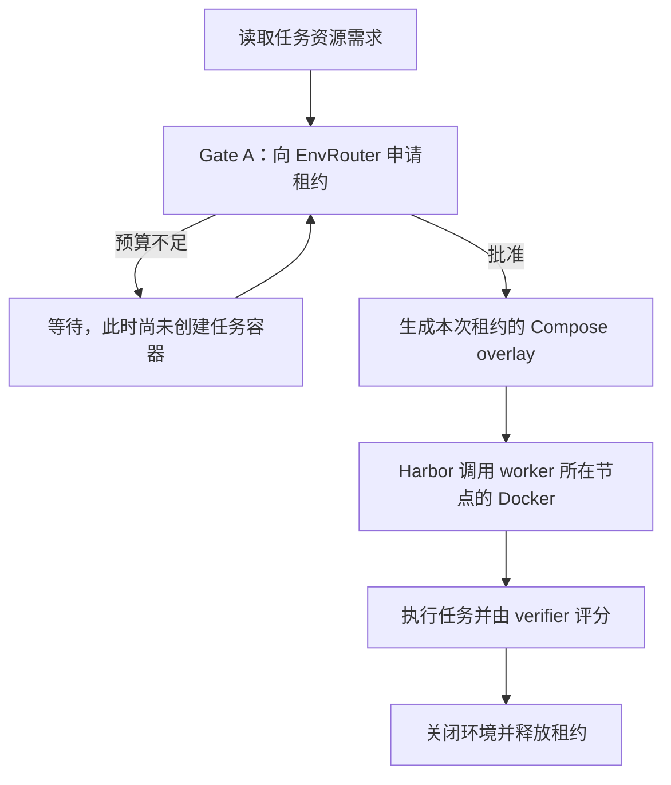

# Env Service 设计与修复验证报告（补充验证至 2026-10-13）

## 结论

**真实 Docker / Harbor、GPU 设备身份、跨节点 Gate B、资源预算和 worker 崩溃清理均已在修复后复测通过。完整训练链路已两次跑通，其中 v6 使用非零首步学习率。不过 v6 两条样本的修复奖励都是零，策略梯度为零，有效策略学习不属于本次功能验证的验收要求，没有据此宣称模型效果提升。** 最新修复与验收边界见 §11。§1 至 §10 保留修复前的原始实验，不能把其中的失败或通过直接当成当前实现的状态。

10 月 12 日的进程实验仍成立：同样 2 张 H20、10 个并发 episode，改动前静态设备方案出现 6 次显存溢出，整卡独占方案耗时 109.7 秒；env service 方案每卡最多 4 个进程、0 溢出、耗时 60.1 秒。**这些数字来自进程实验，不是本次真实容器的吞吐测试。**

原先未覆盖项目的修复前状态见 §6，修复后结果见 §11。原有测试与文档偏差见 [§5](#5-发现的问题与文档偏差)。

**当前训练状态**：位置编码拆包崩溃和全零训练掩码组已修复，v3 完成了旧策略概率、反向传播、优化器步骤和权重推送，但首步实际学习率为 0。v4 因多轮补采超过总时间预算退出，v5 因前次遗留路由器占用监控端口而启动失败。补充修复子进程生命周期与端口配置后，v6 退出 0，完成全部训练阶段，详见 §11.10。v7 的额外学习信号实验已按用户收缩范围的要求停止，不再为功能验证继续补采训练。

## 目录

- [结论](#结论)
- [1. 验证环境与方法](#1-验证环境与方法)
- [2. 文档声明逐项核对](#2-文档声明逐项核对)
- [3. 前后对比实验](#3-前后对比实验)
- [4. Ray 与训练器接入（`scripts/ray_actor_checks.py`、`scripts/trainer_integration_check.py`）](#4-ray-与训练器接入scriptsray_actor_checkspyscriptstrainer_integration_checkpy)
- [5. 发现的问题与文档偏差](#5-发现的问题与文档偏差)
- [6. 原先未覆盖项目的补测状态（修复前）](#6-原先未覆盖项目的补测状态修复前)
- [7. 复现](#7-复现)
- [8. 真实 Harbor 与多节点补测（2026-10-13）](#8-真实-harbor-与多节点补测2026-10-13)
- [9. 如何从 results 理解设计验证（2026-10-13 解读）](#9-如何从-results-理解设计验证2026-10-13-解读)
- [10. 继续在其他机器上做真实 Docker 实验（2026-10-13）](#10-继续在其他机器上做真实-docker-实验2026-10-13)
- [11. 修复已复现的问题并继续训练验证（2026-10-13）](#11-修复已复现的问题并继续训练验证2026-10-13)

## 1. 验证环境与方法

| 项 | 内容 |
|---|---|
| 改动后 | 新克隆的仓库，提交 `00db595` |
| 改动前 | `git archive 72ca50c` 导出到 `/tmp/psrl_before`（有 `GpuDeviceGate`，没有 `env_service`）；静态 override 则取自旧仓库 `c00354c` |
| 硬件 | 8 张 H20（每张 97871 MiB），实验时全部空闲，实验用 0、1 号卡 |
| 解释器 | 项目环境 `psrl_smg_new`（Python 3.12.13，Ray 2.49.1，torch 2.11，真实 `harbor` 0.22.0、`verl`、`vllm`） |
| Ray | 每个实验另起一个隔离的本地小集群（独立 `_temp_dir`）。机器上原有的 Ray 集群没有被触碰，前后指针文件和修改时间一致 |
| "容器" | **用进程模拟**：每个 episode 是一个真实占用 22 GiB 显存的进程，用 `CUDA_VISIBLE_DEVICES` 固定它能看到的卡。显存、利用率、OOM 都是真实的，但不是 Docker 容器 |

## 2. 文档声明逐项核对

| 文档声明 | 结果 | 依据 |
|---|---|---|
| 新增 136 个测试全过 | **部分成立**：无 Harbor 时成立；真实 Harbor 下 131 过、5 败 | §5.1 |
| 原有 SciAccel 测试无回归 | **成立**：改动前后都是 60 通过、27 跳过 | 同一环境对两棵源码树各跑一遍 |
| 演示脚本期望全部成立 | **成立** | `RESULT: all expectations held` |
| `EnvRouter` 作为真实 Ray actor | **成立**（文档说没跑过） | 13/13 项，见 §4 |
| `ray_trainer` 接入 | **成立**（文档说只做过语法检查） | 能导入；`_init_env_service` 21/21 项 |
| 一卡共享、显存求和准入 | **进程实验成立**；真实容器共享另见 §8.2 | 场景 C 是进程；真实容器第三次申请由数量上限拦截 |
| 实测显存优先于声明 | **成立** | 场景 D1 / D2 |
| 每租约 overlay、设备跟租约走 | **配置生成成立，但物理设备身份有缺陷** | compose 合并通过；§8.2 发现 index / minor 混用 |
| 两份 `labels` overlay 如何合并（文档列为未验证风险） | **已确认合并为并集** | 同上 |
| `override_gpus: 0` 绕过 Harbor 的 GPU 校验 | **成立** | 真实 `DockerEnvironment` |
| 共享卡 Gate B 只看利用率 | **单节点实验成立**；跨节点有缺陷 | §3.3、§8.3 |
| TTL 回收、心跳续期 | **租约账本层成立**；完整容器回收存在缺陷 | §10.3 实测下一次准入才清理过期容器，且 worker 崩溃后 verifier 残留 |
| 关闭时与旧路径等价 | **成立** | 差分测试通过，且原有测试结果不变 |

## 3. 前后对比实验

### 3.1 并发冲突：10 个 episode 同时到达，2 张卡

每个 episode 真实分配 22 GiB 并持有 12 秒。脚本：`scripts/gpu_conflict_experiment.py`。

| 方案 | 成功 | 显存溢出 | 每卡同时运行峰值 | 卡显存峰值（MiB / 97871） | 总耗时 |
|---|---|---|---|---|---|
| **A 改动前：静态 override**（所有容器都挂 `/dev/nvidia0`） | 4 | **6** | 卡0: 4，卡1: 0 | 93557 / 3 | 34.4 s（6 个已崩溃，不可比） |
| **B 改动前：`GpuDeviceGate`**（整卡独占） | 10 | 0 | 1 / 1 | 22909 | 109.7 s |
| **C 改动后：env service**（真实 Ray actor） | 10 | 0 | **4 / 4** | 91625 | **60.1 s** |

- A 复现了"之前会冲突"：1 号卡全程空着，0 号卡被塞满，第 5 个起全部溢出。
- B 不冲突，但每张卡只用了 23% 的显存，10 个任务排了 5 轮。
- C 每卡放 4 个：$4 \times 24000 = 96000 \le 97871$。结束后租约全部归还。

### 3.2 实测优先于声明：有陌生进程占了 80 GiB

0 号卡上有一个没人声明的进程占 80 GiB，3 个 episode 到达。

| 方案 | 被放行 | 显存溢出 | 结果 |
|---|---|---|---|
| D1 客户端上报真实 `nvidia-smi` | 0 | 0 | 3 个都在 8 秒等待上限内未被放行 |
| D2 客户端不上报（只看声明） | 3 | **3** | 声明 $3 \times 24000$ 放得下，实际只剩约 15 GiB，全部溢出 |

### 3.3 Gate B：邻居在同一张卡上时，回复要等多久

等待上限设为 8 秒。脚本：`scripts/gate_b_experiment.py`。

| 邻居状态 | 改动前 | 改动后（共享卡） | 改动后（非共享，对照） |
|---|---|---|---|
| 常驻 22.9 GiB、利用率 0% | 8.4 s（撞上限被迫放行） | **0.0 s** | 8.4 s |
| 利用率 100%，持续 5 秒 | 5.2 s | 3.9 s（仍等邻居算完） | - |

共享卡不再被邻居的常驻权重卡住，同时邻居真正在算时仍会等待。

### 3.4 compose 合并结果（真实 `docker compose config`）

| | 挂载的 GPU 设备 | 容器标签 |
|---|---|---|
| 改动前，3 个 episode | 全部 `/dev/nvidia0` | 仅 `psrl.actor_id` |
| 改动后，租约 0 / 1 / 0（共享） | `nvidia0` / `nvidia1` / `nvidia0` | `psrl.actor_id` + `psrl.env_lease` + `psrl.env_unit`，三者共存 |

这次进程实验所在机器的内核驱动恰好是静态文件写死的 535.247.01，当时没有验证出动态解析的收益。真实容器和不同版本库的补测见 §8.4。

## 4. Ray 与训练器接入（`scripts/ray_actor_checks.py`、`scripts/trainer_integration_check.py`）

- 24 个来自 7 个不同 worker 进程的并发申请，容量 4：恰好 4 个被放行、20 个等待，没有超订。
- 心跳续期：TTL 3 秒，每秒心跳，存活 6 秒不被回收。停止心跳后在 3.02 秒时被 actor 自己的后台回收循环收回。
- `pop_reaped` 只交付一次；已回收租约上再心跳返回 `False`；`get_if_exists` 复用同一个 actor；`EnvServiceClient.from_config` 能找到具名 actor。
- `_init_env_service`：从真实 placement group 推导训推节点；`cpu_only` 下 GPU episode 被拒、CPU episode 放行；`avoid` 且只剩训推节点时启动直接报错；GPU unit 声明在训推节点上给出警告。
- 6 种错误配置（无 unit、缺字段、两 unit 抢同一张卡、心跳超过 TTL 一半、GPU unit 装不下一个任务、未知策略）都在启动时被拦下，错误信息指出了具体键。

## 5. 发现的问题与文档偏差

### 5.1 5 个测试在真实 Harbor 下失败，原因在测试替身

`tests/env_service/test_runner_env_service.py` 里的假 `Job.create` 把 `job_config.environment` 当 dict 用（`env.get(...)`、`env["override_gpus"]`）。真实 Harbor 里它是 pydantic 的 `EnvironmentConfig`，所以报 `'EnvironmentConfig' object has no attribute 'get'`。该文件的文档字符串写明"仅在未安装 Harbor 时用桩"，所以文档里的 136 个是在桩下跑的。

**这 5 个失败由测试替身引起**：在 `/tmp` 的副本里只把三处 dict 访问改成 `model_dump(exclude_unset=True)`，13 个测试全过（`scripts/make_patched_tests.py`）。这说明真实的 `JobConfig` 接受了 `override_gpus` 和 `extra_docker_compose`，不代表真实容器路径不存在其他缺陷。

**建议**：把这三处改成兼容两种形态，让测试在真实环境和桩环境下都能跑。我没有改仓库里的任何文件。

### 5.2 文档 §2.5 对回收时机的描述不准确

文档说"每次 `try_admit` / `heartbeat` / `release` 进来时先跑一次 `_reap`"。代码里只有 `try_admit`（`ledger.py:127`）和后台回收循环会调用 `_reap`；`heartbeat`、`release`、`snapshot` 都不会。

影响：没有新申请时，过期租约完全靠 router 的后台回收循环收回。实测这条路径正常工作（3.02 秒回收），所以不是功能缺陷，只是文档需要改。

### 5.3 两处小偏差

- 文档 §10 说在 Python 3.14 下运行；项目实际环境是 3.12.13，在其上测试和实验都通过。
- 文档引用 `config_check.py:49` 作为"心跳不超过 TTL 一半"的校验位置，实际在第 53 行。其余抽查的行号引用都准确。

### 5.4 一个值得注意的配置点（观察，不是缺陷）

`gpu_memory_mb`、`default_gpu_memory_mb` 以 "MB" 命名，但和 `nvidia-smi` 的 `memory.used`（MiB）直接比较，没有换算，实际使用时应按 MiB 填写。另外账本只做准入，运行中不会限制容器的显存：声明值必须不小于任务的真实峰值，否则同卡邻居会溢出。本次实验里真实占用 22 GiB 小于声明的 24000，所以 4 个同卡共存时峰值是 91625 MiB（93.6%），只剩约 6 GiB 余量。

## 6. 原先未覆盖项目的补测状态（修复前）

| 项目 | 10 月 13 日补测状态 | 边界 |
|---|---|---|
| 真实 science 容器 | **通过**：LAPS oracle 修复、编译、模拟、独立 verifier 评分全部完成 | 使用 `examples/sciaccel_rl` 对应任务库，不依赖模型生成 |
| 容器内 GPU | **通过计算，发现设备标识缺陷**：真实 CUDA 分配、PTX 内核输出 42、Harbor 奖励 1.0 | 不能把 `/dev/nvidiaN` 的 N 当作 `nvidia-smi` 序号 |
| 一卡多容器 | **通过**：两个真实 Harbor 容器同卡运行，第三个申请等待 | 本次是小显存功能验证，不重做 22 GiB 吞吐基准 |
| 真实容器资源边界 | **通过**：显存、CPU、主机内存分别成为唯一约束，释放后可继续创建容器 | §10.1；容器名额上限为 8，排除名额限制干扰 |
| 现有 EnvWorker 执行路径 | **通过**：真实 manager / coordinator / worker，状态保持、文件传输、满额等待、销毁归还 | §10.2；CPU 路径，不等于已完成 Harbor 后端统一 |
| 崩溃回收 | **缺陷复现**：真实 agent worker 被杀后，独立 verifier 主容器和辅助容器仍在 | §10.3；记录后已人工清理实验残留 |
| 多节点 | **Gate A 通过，Gate B 缺陷复现** | 两台物理节点，不是单机伪造两个 IP |
| worker 放置 | **通过**：两个真正的 `PSRL_AgentLoopWorker` 初始化并落在策略指定节点 | 使用相同筛选与 affinity 路径，非完整 `init_workers` 的差分测试 |
| 驱动库解析收益 | **部分验证**：选中的 535 库支持真实 PTX 执行；未复现错误库失败 | 强制加载本机 570 库时 `cuInit=0`，不能宣称避免了 803 |
| 完整训练 | **部分推进**：显式 Ray 地址后，两个真实模型驱动的 science episode 完成且无 trial 异常；随后旧策略对数概率计算遇到嵌套张量尺寸错误 | §10.4；rollout / 评分已通过，优化器更新仍未完成 |

发起验证的原节点仍存在 Docker 无响应问题：沙箱外复查同样 20 秒超时。本次通过示例脚本配置中的两台可用节点完成补测，没有重启或清理原节点的 Docker。

## 7. 复现

脚本在 `scripts/`，结果在 `results/`。脚本里写死了本机路径（项目解释器、`/tmp/psrl_before`、Harbor 站点包路径），换机器需要调整。

```bash
PY=${WORKSPACE_ROOT}

# 导出改动前的代码
mkdir -p /tmp/psrl_before && (cd psrl && git archive 72ca50c | tar -x -C /tmp/psrl_before)

# 改动后：在新克隆的仓库根目录执行
cd psrl
PYTHONPATH=. $PY -m pytest tests/env_service -q
PYTHONPATH=. $PY <scripts>/gpu_conflict_experiment.py --scenario C      # 也可选 A、D1、D2
PYTHONPATH=. $PY <scripts>/ray_actor_checks.py
PYTHONPATH=. $PY <scripts>/trainer_integration_check.py

# 改动前（场景 B 和 Gate B）：在 /tmp/psrl_before 里执行
cd /tmp/psrl_before
PYTHONPATH=/tmp/psrl_before $PY <scripts>/gpu_conflict_experiment.py --scenario B
PYTHONPATH=/tmp/psrl_before $PY <scripts>/gate_b_experiment.py
```

运行 GPU 实验前要确认 0、1 号卡空闲，脚本开头会断言这一点。

## 8. 真实 Harbor 与多节点补测（2026-10-13）

该轮源码为 `00db595`，未修改 PSRL 实现。后续生产修复见 §11。本次新增验证脚本与结果保存在本目录。Ray 实验使用独立临时目录与 namespace，仅关闭实验创建的进程和 actor。

### 8.1 真正运行一个 science 修复任务

任务为 `sciaccel/laps-repair-coef-2d-rktmod-l17k1`，取自 SciAccel 示例使用的已编译任务库。这是 LAPS 二维模拟的系数修复任务，不是临时编写的 hello-world 容器。

脚本 [real_harbor_check.py](scripts/real_harbor_check.py) 实际执行：

1. 用 SciAccel 的 `demand_from_task` 读取资源声明，并向真实 Ray `EnvRouter` 申请租约。
2. 调用 SciAccel 的 `_apply_env_lease` 生成 overlay，交给真实 `Harbor Job.create/run`。
3. oracle 执行任务自带的参考修复，真实编译 Fortran，运行 `aw-2d-256` 和 `aw-2d-512` 两组模拟。
4. Harbor 启动独立 verifier，比较输出与参考轨迹，产生 reward 文件。
5. 容器正常关闭，再归还租约，检查账本归零。

| 运行 | 结果 | 证据 |
|---|---|---|
| oracle | 两个检查均为 1，`equivalence_pass=1`，`reward_repair=1.0`，无 trial 异常；约 236.7 秒 | [Harbor 原始结果](results/real-laps-oracle/harbor-result.json)、[容器与租约记录](results/real-laps-oracle/evidence.json) |
| nop 对照 | 两个检查均为 0，`reward_repair=0.0`，无 trial 异常；约 204.0 秒 | [原始结果](results/real-laps-nop/harbor-result.json)、[容器记录](results/real-laps-nop/evidence.json) |

此处验证的是 oracle + science grader，不是大模型学会修复。脚本接入了 SciAccel 的资源需求与 overlay 实现，但没有把这一项说成整个 `run_harbor_episode` / 训练器已通过。

### 8.2 真实 GPU 与共享容器

[GPU Harbor 任务](results/real-gpu-oracle/harbor-result.json) 使用一个明确标为验证用途的最小任务：通过 Python `ctypes` 调用 CUDA 驱动接口，分配 64 MiB，编译 PTX，执行写入整数 42 的 GPU 内核，再把结果复制回 CPU 断言。最终 Harbor verifier 给出 `reward=1.0`。

[real_gpu_containers.py](scripts/real_gpu_containers.py) 进一步启动两个真实 `DockerEnvironment`，同一个 EnvRouter 给出两份共享租约。两容器读取到相同 GPU UUID，内核输出都为 42，同时持有分配约 20 秒；第三个申请返回 `wait`；正常关闭后账本占用归零。见 [完整记录](results/real-gpu-shared-v3/evidence.json)。这验证了真实容器同卡运行及数量准入，没有声称显存使用被硬限制在声明额度内。

**发现缺陷：GPU 序号与设备 minor number 被混用。** GPU UUID 是稳定的设备身份；`nvidia-smi` 的 index 是枚举序号，`/dev/nvidiaN` 的 N 则是设备 minor number，二者在本节点并不相同：

| 宿主机 `nvidia-smi` 序号 | 设备 minor number | 对应设备路径 |
|---|---|---|
| 0 | 0 | `/dev/nvidia0` |
| 1 | 2 | `/dev/nvidia2` |
| 2 | 3 | `/dev/nvidia3` |
| 3 | 1 | `/dev/nvidia1` |

本次租约 `gpu_indices=[1]` 挂载 `/dev/nvidia1`，容器 UUID 对应宿主机 **index 3**。两个容器运行时 index 3 使用 **774 MiB**，index 1 为 **0 MiB**。而 `probe.py` 按 `nvidia-smi index` 给遥测编号，账本又直接用 `gpu_indices` 查它，因此资源声明和实测显存可能针对不同物理卡。Gate B 也直接从 `/dev/nvidiaN` 提取 N 查询 index，同样受影响。

这是本次观察与现有代码共同确认的标识错误，不是 CUDA 在容器内把单卡重新编号为 0 的正常现象。修复方向应统一 GPU 身份，再显式转换为设备路径与遥测键，不能继续假设两个序号相等。

### 8.3 两台真实节点与真实 worker

[multinode_check.py](scripts/multinode_check.py) 在节点 A 启动隔离 Ray head，在节点 B 启动该集群的 worker。两个探针 actor 分别硬绑定两台节点。结果见 [evidence.json](results/real-multinode/evidence.json)。

- **Gate A 正确使用申请节点的实测显存。** 在 B 的 GPU 0 分配 512 MiB，加上驱动上下文后，768 MiB 的 unit 无法再接纳 512 MiB 需求。B 的 `EnvServiceClient.acquire` 超时，A 的同类申请成功。
- **Gate B 的跨节点缺陷已复现。** 保持 B 的分配，在 A 调用现有 `_wait_for_gpu_idle('/dev/nvidia0', shared=False)`，约 **0.23 秒**就返回；在 B 调用相同函数则等待约 **2.33 秒**，撞到实验设置的 2 秒上限。两边传入相同设备字符串，但函数只读取执行它的机器，无法识别远端仍占用的卡。本实验调用真实函数及真实遥测，没有伪造返回值；没有声称已通过完整 SessionRouter HTTP 响应链路。
- **真实 worker 放置通过。** 把 A 视为训练节点，使用 `avoid` 策略且只在 B 声明 unit。按训练器相同的节点筛选和硬 affinity 参数创建两个真正的 `PSRL_AgentLoopWorker`，两者均在 B 处于 `ALIVE` 状态，已初始化实际 tokenizer、TransferQueue 和 HTTP 客户端。没有用空壳 actor 替代 worker。

### 8.4 驱动库：执行可用，收益仍不能下结论

节点内核为 535.247.01，而用户环境的 `libcuda.so.1` 指向 570.133.20。overlay 选择完整版本路径 535.247.01，真实 GPU / PTX 实验成功，证明这条选择和挂载路径在本节点可工作。

对照实验把 570 库的实际文件复制到共享实验目录，再明确加载容器内的 `/usr/lib64/libcuda.so.1`，避免只根据文件名推测加载了什么。结果 `cuInit=0`，`cuDriverGetVersion=12080`，没有出现预期的 803。载入地址记录也保存在 [实验结果](results/real-gpu-shared-v3/evidence.json)。

因此，**本次没有证明“570 一定失败、535 才成功”**，也没有证明所有不同版本组合都兼容。两个早期对照尝试把 803 作为断言而失败，记录保留于 `real-gpu-shared/` 与 `real-gpu-shared-v2/`；最终脚本如实记录实际结果，不把未复现的错误写成验证通过。

### 8.5 独立 verifier 和 sidecar 没有回收标签

在 LAPS nop 对照中，实际观察到四类容器：

| 容器 | `psrl.actor_id` / `psrl.env_lease` / `psrl.env_unit` |
|---|---|
| agent 的 `main` | 三个标签都存在 |
| agent 的网络 sidecar | 都不存在 |
| 独立 verifier 的 `main` | 都不存在 |
| verifier 的网络 sidecar | 都不存在 |

来源是 [related_containers 实测记录](results/real-laps-nop/evidence.json)，并能在当前 Harbor 的 `Trial._separate_verifier_env` 找到原因：它通过 `model_copy(update={"extra_docker_compose": []})` 清空了 verifier 的额外 overlay。网络 sidecar 也不是 overlay 覆盖的 `services.main`。

**影响：按租约或 actor 标签的兜底回收无法覆盖这些容器。** 本次正常关闭没有留下它们，但不能据此证明 TTL / actor 崩溃时也能完整清理。没有执行崩溃注入，也没有实测 GPU 独立 verifier 的设备透传，因此这两种情况仍属于未验证边界。

### 8.6 单步训练检查

使用 [one_step_science.sh](scripts/one_step_science.sh) 调用示例的真实训练入口，选择同一个 LAPS 任务、Qwen3.5-4B、2 张训练 GPU + 2 张推理 GPU、一个 worker、两条 rollout，打开 env service 的 CPU unit，目标只执行一个训练 step。**两次尝试均未完成优化器更新，完整训练仍未验证通过。**

第一轮已完成配置校验、真实训练器及 EnvRouter / agent worker 创建、训练模型加载，但 vLLM 在初始化阶段报错：`custom_all_reduce.cuh:455 'invalid argument'`，对应 `cudaIpcGetMemHandle`。随后推理进程退出，训练器抛出 `Engine core initialization failed`，没有完成训练 step。见 原始日志（本地资料，未随仓库发布）。仅凭该错误不能认定是 env service 导致。

第二轮使用引擎已有的 `enforce_eager=True` 与 `disable_custom_all_reduce=True` 配置，结果另存 one-step-training-eager（本地资料，未随仓库发布），未修改 PSRL 或 vLLM 源码。推理引擎启动成功并注册到网关，但随后 vLLM 子进程在连接 Ray 时反复超时，未进入有效 rollout。

进一步检查发现，子进程没有显式 `RAY_ADDRESS`，读取到节点原有 `/tmp/ray/ray_current_cluster` 中的旧集群地址，未连接本次隔离目录下的新集群。这是本次训练实验的集群发现阻塞，**不能算作 env service 功能失败**。没有为绕过它去改动原集群的发现文件。若继续端到端验证，需要给所有子进程明确传递同一个隔离集群地址，再重新检查 rollout、评分、优化器更新和租约回收。

第二轮达到脚本的 1200 秒上限后退出，退出码 124。收尾检查两节点均无残留 Docker 容器或实验 Ray 集群进程，显存恢复至驱动级的 0～3 MiB。没有把超时退出写成完整训练成功。

### 8.7 补测复现入口

在 PSRL 仓库根目录执行，并先按项目要求激活环境。以下变量分别指向本验证目录、编译后的 LAPS 任务、另一台节点、模型目录和环境激活脚本，需按部署设置：`VERIFY_DIR`、`TASK`、`PEER_IP`、`MODEL`、`ACTIVATION`。选择 Docker 正常且相关 GPU 空闲的节点。

```bash
PYTHONPATH=. python "$VERIFY_DIR/scripts/real_harbor_check.py" \
  --task "$TASK" --output "$VERIFY_DIR/results/new-oracle"

PYTHONPATH=. python "$VERIFY_DIR/scripts/real_harbor_check.py" \
  --agent nop --task "$TASK" --output "$VERIFY_DIR/results/new-nop"

PYTHONPATH=. python "$VERIFY_DIR/scripts/real_harbor_check.py" \
  --task "$VERIFY_DIR/results/gpu-smoke-task" --gpu 1 \
  --output "$VERIFY_DIR/results/new-gpu-oracle"

PYTHONPATH=. python "$VERIFY_DIR/scripts/real_gpu_containers.py" \
  --environment "$VERIFY_DIR/results/gpu-smoke-task/environment" \
  --output "$VERIFY_DIR/results/new-shared"

PYTHONPATH=. python "$VERIFY_DIR/scripts/multinode_check.py" \
  --peer "$PEER_IP" --activation "$ACTIVATION" --model "$MODEL" \
  --output "$VERIFY_DIR/results/new-multinode"
```

每次使用新的输出目录。多节点脚本需要两节点共享代码、模型与结果目录，SSH 可连接，且 GPU 0 空闲。共享容器脚本使用设备号 1，驱动对照部分沿用本验证节点的 `/usr/lib64` 路径，换环境时应先确认文件布局。

## 9. 如何从 results 理解设计验证（2026-10-13 解读）

本节解读的是 §8 完成时的结果集；后续新实验补齐或改变的验证边界以 §10 和 §6 当前状态为准。

**这些结果支持“资源准入与 Harbor 执行可以接起来，且真实 CPU science 任务和 GPU 小任务能运行”，不支持“整份 Env Service 设计已完整验收”。** 当前证据同时包含通过的实验、明确复现的缺陷，以及没有完成的训练尝试。

本节对照原始设计（本地资料，未随仓库发布） §6、§7、§9、§10 和[当前实现说明](../knowledge/env-service-implementation.md)。设计中的独立 EnvWorker actor、完整借还状态机等是提案内容；不能因为某个 Harbor 实验成功就把它们也算成已实现、已验证。

### 9.1 本机 Docker 为什么没有用于真实容器实验

本次复查，本机默认 Docker 服务仍没有响应。检查结果保存在 local-docker-recheck.txt（本地资料，未随仓库发布）：

| 检查 | 实际结果 | 能说明什么 |
|---|---|---|
| `timeout 15 docker info` | 退出码 124 | 命令在 15 秒内未完成，被外层 timeout 终止 |
| 直接向 `/var/run/docker.sock` 请求 `/_ping`，最多等 6 秒 | curl 退出码 28，收到 0 字节 | 连 Docker 服务最基本的探活接口也没有正常返回 |
| `ps` 检查 | `dockerd` PID 3763725、`containerd` PID 3763752 都为 `<defunct>`，状态含 `Z` | 这两个服务进程已经退出，只剩待父进程回收的进程记录 |
| socket 文件 | 仍存在 | 文件存在不等于背后的服务还活着 |

调用关系是 **Harbor → Docker Compose 客户端 → 本地 dockerd 服务 → 创建容器**。现在阻塞在 Docker 服务这一层，尚未进入 science 任务内部。可以准确地说“当前无法通过本机默认 Docker 服务正常启动容器”；没有证据说明这台机器修复 Docker 后仍不能运行容器，也不能只凭这些现象判定服务当初退出的根因。

`real-laps-*`、`real-gpu-*` 的记录显示它们运行在 `192.168.1.10`；`real-multinode` 另用了 `192.168.1.13`。结果写回共享目录，因此从本机能看到结果，不代表容器在本机运行。原设计 §10 已记录本机相关节点 `192.168.1.11` 的 dead dockerd 问题，本次现象与该历史记录一致。

### 9.2 先弄清被验证的调用关系

一次 episode 是一次完整任务尝试。unit 是预先声明的资源单元，包含节点、CPU、主机内存、GPU 和并发额度；lease（租约）是账本给这次尝试发放的资源预留凭证。租约存在，不等于 Docker 容器已经存在。



overlay 是追加到 Docker Compose 配置上的一段配置，用来指定此次运行的 GPU 设备、驱动库挂载和标签。verifier 是评分程序，LAPS 任务中它在独立环境里检查产物。

这是本次直接 Harbor 实验走通的链路。大模型训练还会加入模型请求、会话路由、轨迹收集及优化器更新；本图没有表示这些部分已通过。当前实现的容器生命周期仍由 agent loop worker 调用 Harbor 管理，也没有在实验里变成“每个 unit 一个独立 EnvWorker actor”。

Gate B 是另一道门：容器已经存在，模型请求返回边界处按 GPU 状态短暂等待，避免多任务的计算和测量相互干扰。它不能代替 Gate A 的显存预留，因为这时任务已经占着资源。设计要求它有等待上限，超时后放行，避免一直占用模型请求的超时预算。

### 9.3 文件和设计的一一对应

| 文件或目录 | 对应的设计意图 | 实际证据与判定 |
|---|---|---|
| `result_A.json` | §10 B3：固定设备会造成冲突 | 10 个进程都去 GPU 0，4 成功、6 次显存溢出；GPU 1 空闲。旧方案反例 |
| `result_B.json` | §6.2：整卡独占过于保守，共享应按资源预算判断 | 旧 `GpuDeviceGate` 每卡并发 1，10 个都成功，109.7 秒。正确但串行程度高的对照 |
| `result_C.json` | §6.2 / §6.3 Gate A：显存相加、统一账本准入 | 真实 Ray actor 管理 10 个显存进程，每卡并发峰值 4，10 个成功、0 溢出，60.1 秒，结束租约数 0。进程层通过 |
| `result_D1.json`、`result_D2.json` | §6.6：实际占用不能只靠声明推导 | 外部进程占 80 GiB 时，有遥测的 3 个申请均等待超时；无遥测则 3 个都被放行并溢出。验证遥测参与准入的价值 |
| `real-laps-oracle/`、`real-laps-nop/` | §7.1 L1 包装接入：先准入，再交 Harbor 执行 | 真实 science 参考解编译、模拟、评分成功，reward 1；不提交产物的 nop 得 0。正常关闭与租约归还完成 |
| `gpu-smoke-task/` | GPU 测试的输入定义 | 包含任务、环境、解法、测试。它本身不是一次成功运行的证据 |
| `real-gpu-oracle/` | §7.3 / Phase 2：GPU 需求、设备 overlay、驱动库能接入 Harbor | 真实 CUDA 分配、PTX 即时编译、内核输出 42，reward 1。计算链路通过，同时发现设备身份问题 |
| `real-gpu-shared-v3/` | §6.2：同一个 unit 的多个租约可以共享整卡 | 两个真实容器同 GPU UUID，均计算出 42，第三次申请等待，正常结束后账本归零。共享和名额约束通过 |
| `real-gpu-shared/`、`real-gpu-shared-v2/` | 驱动版本对照实验的前两次尝试 | 共享计算完成，但期待驱动错误的断言失败。保留失败记录，不能当作两次全通过 |
| `real-multinode/` | §6.4、§6.6 和当前实现的节点策略：本地执行、多节点准入与放置 | A 空闲能申请，B 有实际占用不能申请；两个真实 agent worker 均放在指定 B 节点。Gate A 和放置通过；Gate B 跨节点问题复现 |
| `one-step-training/`、`one-step-training-eager/` | 原设计 Phase 0 验收项中的“现有 recipe 训练一步” | 真实训练启动尝试，两次均未完成训练一步。分别阻塞于 vLLM 初始化和子进程发现错误 Ray 集群 |
| `supplement-summary.json` | 汇总入口 | 对上述结果的整理，不是另一组独立实验；细节应回查原始结果和日志 |
| `local-docker-recheck.txt` | 本次执行环境诊断 | 本机 Docker 探活失败、服务进程僵死；没有验证自动健康检查或自动修复能力 |

### 9.4 用实测数字理解 Gate A 到底证明了什么

场景 C 中一张卡的预算为 **97871 MiB**，每个任务声明 **24000 MiB**，实际分配 **22 GiB = 22528 MiB**，另有 CUDA 上下文开销。MiB / GiB 是按 1024 进位的容量单位。

1. 第一个申请批准后，账本预留 24000；四个批准后预留 `4 × 24000 = 96000`。
2. 第五个也进去会变成 120000，超过 97871，因此不能继续在同一 unit 上放行；可使用另一张卡的 unit，或等资源归还。
3. 两张卡上各最多 4 个并行，10 个任务最终全部完成；本次实际峰值每卡 91625 MiB，没有发生显存溢出。
4. 相比同样完成 10 个任务的整卡独占方案，耗时从 109.7 秒降至 60.1 秒。只对这组进程负载成立，不能推出所有 science 容器都有相同比例的吞吐提升。

当前代码使用的有效 GPU 占用为：

```text
已有有效占用 = max(已有租约的显存声明总和, 新鲜遥测中的实测显存)
已有有效占用 + 新申请显存 <= unit 显存预算，才满足显存条件
```

不是把声明和实测直接相加，否则同一份显存可能重复记账。CPU、主机内存、名额也有各自的条件；上述 GPU 结果不能代替对其他条件逐一做边界实验。

D1 / D2 补的是“有人不经过这个账本也在用卡”的情况：外部进程实测约 82301 MiB，账本可能认为没有租约，但 `82301 + 24000 > 97871`，必须等待。D1 的 `other=3` 配合 `not_admitted=3` 表示三个申请等不到资源，不是三个未知计算故障；D2 的 `oom=3` 才是实际放行后显存不足。

该机制是**启动前的资源预留**，不是运行中的显存硬隔离。任务超过声明值、遥测过期、设备身份映射错误，都可能使保护失效。本次 C 证明的是按给定声明、给定工作负载可以安全共享。

真实共享容器实验的预算则为 **2048 MiB、最多 2 个租约、每次声明 512 MiB**。第三个申请时显存声明只会到 `3 × 512 = 1536 MiB`，尚未到 2048；真正挡住它的是 `max_containers=2`。因此，真实 Docker 的“同卡并存”和“名额限制”已证实，但“真实容器恰好撞显存预算边界”尚未由这一组实验单独证明。

另外，snapshot 的 `containers_running` 是当前有效租约数，不能直接理解为 `docker ps` 的物理容器总数。一次 Harbor episode 还可能有网络 sidecar（辅助容器）及独立 verifier；本次没有证明这些额外容器都分别占一个账本槽位。

### 9.5 真正的 science 任务与 GPU 任务各自证明什么

`real-laps-oracle` 的输入是示例任务库里的 `laps-repair-coef-2d-rktmod-l17k1`。oracle 表示执行任务自带的已知参考解，不需要大模型生成修复。它修改系数后编译 Fortran，再运行 `aw-2d-256`、`aw-2d-512`，把模拟轨迹交给独立 verifier，两组检查均通过，`reward_repair=1.0`。

对应的 nop 什么都不做，未生成所需产物，最终 reward 为 0。这说明该路径能区分“参考解的有效产物”和“没有提交产物”；不能扩展为“验证器对所有错误解都准确”，也不是未修复程序完整执行后数值误差的对照。

这两组是 **CPU science 实验**。`real-gpu-oracle` 才是另外定义的 GPU 小任务：分配 64 MiB 显存，使用 PTX（GPU 中间指令）即时编译一个内核，让 GPU 写入 42，再把值读回 CPU 检查。它证明容器里的 GPU 真能执行计算，比只看到 `nvidia-smi` 成功更强；但没有验证完整 GPU science benchmark，也没有完成大模型训练。

GPU 容器里 CUDA 可用设备数为 1，但 `/dev` 下能列出多个设备文件名。判断实际授权和使用的是哪张卡，应结合 CUDA 设备枚举、UUID（设备唯一标识）和 Docker 的设备配置，不能只数文件名。

### 9.6 三个缺陷分别违反了哪个设计要求

**一、租约、设备挂载、遥测必须指向同一张物理卡，目前没有保证。**

本次租约写 `[1]`，overlay 生成 `/dev/nvidia1`，它却是宿主机 `nvidia-smi` 的 index 3。两个容器占用 index 3 的 774 MiB，账本查询的 index 1 为 0。说明配置虽然“用了租约里的数字”，物理意义已经错位。它影响 Phase 2 的设备精确分配，也影响 Gate A 的实测占用保护。这不是容器内部把唯一可见 GPU 编成 0 的正常重编号现象。

**二、Gate B 必须读到任务所在节点的 GPU 状态，目前函数读的是自身所在节点。**

多节点实验中 B 的 GPU 0 实测占用 841 MiB，A 的 GPU 0 空闲。对同一字符串 `/dev/nvidia0`，在 A 执行等待函数约 0.23 秒返回，在 B 执行约 2.33 秒返回并触及 2 秒等待上限。该实验使用非共享模式下的显存条件，直接证明函数缺少跨节点定位；没有完成共享模式下的跨节点繁忙计算归因，也没有执行完整 HTTP 响应钩子链路。

**三、回收需要能找齐属于一次任务的所有容器，目前标签只覆盖了部分。**

agent main 有 `psrl.actor_id`、`psrl.env_lease`、`psrl.env_unit`；agent 网络 sidecar、独立 verifier main 和其 sidecar 没有这些标签。按这些标签回收就选不中后三类。它对应设计 B5 / B6 的生命周期与标签要求。当前正常关闭成功，但没有做杀 worker 的故障注入，因此不能声称已实测“崩溃必然泄漏”或“崩溃能全部回收”。

驱动版本对照属于**没有证实原先预期**，不要混成第四个已确认实现缺陷。匹配 535 的库运行 PTX 成功；强制加载 570 后 `cuInit` 仍返回 0。原设计 B1 记载的旧测量返回码是 304，补测脚本曾预期 803，两者都不是本次观察结果。不能用这些结果宣布 B1 的历史问题在当前环境被重新复现，也没有证据说明 570 在所有后续 CUDA 操作中都可用。

### 9.7 不能据此签收的设计范围

| 设计要求 | 当前证据边界 |
|---|---|
| 完整训练闭环 | 两个训练目录均没有完成有效 rollout → science 评分 → 优化器更新；启动部分组件成功不等于完成一步 |
| Phase 0 合并旧 EnvWorker 路径与 Harbor 路径 | 当前实现未完成该后端统一；也没有验证多轮 shell 状态保持 |
| Phase 1 崩溃后释放槽位并停止全部容器 | 旧实验记录支持心跳与租约 TTL（超过有效期自动作废），新实测发现标签缺口；缺少完整崩溃回收实验 |
| Phase 2 验证式借还 | 未实现完整 `LEASE_PENDING` / `RETURNING` 借还状态机；结束时显存变空的观察不等于每次归还都执行了空卡核验 |
| Phase 2 GPU 利用率归因 | 缺少“一个任务后台遗留计算，另一个任务不得错误计入自己工作”的完整实验；未验证按进程的 GPU 遥测 `pmon` |
| Phase 3 负载驱动的派发与重派发 | 真实 worker 的节点约束已验证，但不代表动态负载均衡、失败重试、重派发都通过 |
| 注册健康检查、Docker 故障自动隔离 | 本机 Docker 故障是人工诊断结果；这次没有证明调度器会自动发现并绕过它，当前实现也未完成注册健康探测 |
| 多训练作业共用同一个全局账本 | 一个实验内多个 worker 共用 actor，不等于互相独立的训练任务共用资源也不会冲突 |

### 9.8 打开结果文件时优先看哪里

- `harbor-result.json`：看 `trial_results` 中的 reward、异常和阶段时间，回答“任务执行和评分是否完成”。
- `evidence.json`：看 `lease`、`containers` / `related_containers`、`samples`、结束快照；共享实验看 `during`、`shared_probes`、`third_admission`、`final_snapshot`；多节点看 `admission`、`gate_b`、`real_workers`。这些字段回答“用的什么资源、在哪运行、账本是否释放”。
- `jobs/.../agent/oracle.txt`、verifier 日志和 reward 文件：查参考解具体做了什么、为什么得这个分数。`artifacts/.../out*.dat` 是数值模拟产物，不是模型训练权重。
- `live.json`、`lease.json`、`actor-label.yaml`：分别是中间记录、租约记录和配置输入，不要把每个文件都算成独立的一次通过。
- `launcher.log` 和训练主日志：追踪失败发生在哪一层。`one-step-training*` 中有目录或配置文件不表示已产生训练 checkpoint。
- `real-multinode/telemetry.json` 是阶段性记录，最终还需看 `evidence.json` 的 worker 信息；`known-hosts`、`stop` 是 SSH / 编排辅助文件。

此前 §2、§4 所述单元测试数量、单节点心跳 TTL 和 Gate B 计时，在当前 `results/` 中没有对应的独立完整原始测试输出；它们属于此前报告记载并提供脚本的验证项。只审计这个目录时，不应假定这些日志也已经存档。

## 10. 继续在其他机器上做真实 Docker 实验（2026-10-13）

本轮在 Docker 正常的两节点继续实测。`192.168.1.10` 用于资源边界、EnvWorker 和故障注入；`192.168.1.13` 用于 science 训练入口。该轮 PSRL 源码为 `00db595`，没有修改生产实现；新增或调整的是本目录验证脚本。§11 记录之后实施的修复。

### 10.1 真实容器：分别验证显存、CPU、主机内存预算

脚本：[real_admission_boundaries.py](scripts/real_admission_boundaries.py)。结果：[summary.json](results/real-admission-boundaries/summary.json)。每个场景都使用真实 EnvRouter、EnvServiceClient、Harbor DockerEnvironment 与 Docker 服务。

为避免“实际被名额上限挡住，却误以为是显存不足”，三个场景均把 `max_containers` 设为 **8**，其余资源留足，只让一种预算不足。

| 场景 | unit 预算与每个任务声明 | 满额时实测 | 释放之后 |
|---|---|---|---|
| GPU 显存 | 预算 1200 MiB，每任务 512 MiB；CPU 8、主机内存 8192 MiB | 两个容器已运行，声明总和 1024 MiB，实际 GPU 占用 774 MiB；第三个会到 1536 MiB，申请等待超时 | 关闭一个容器并归还租约后，新申请成功，新容器执行 CUDA 内核得到 42 |
| CPU | 预算 1.5，每任务 1；主机内存 8192 MiB | 第一个真实容器运行，第二个申请等待超时，未创建新容器 | 归还后，新容器启动并计算出 42 |
| 主机内存 | 预算 768 MiB，每任务 512 MiB；CPU 8 | 第一个真实容器运行，第二个申请等待超时，未创建新容器 | 归还后，新容器启动并计算出 42 |

各场景证据分别在 [gpu-memory](results/real-admission-boundaries/gpu-memory/evidence.json)、[cpu](results/real-admission-boundaries/cpu/evidence.json)、[host-memory](results/real-admission-boundaries/host-memory/evidence.json)。`before_wait` / `while_blocked` 同时记录账本与实际 Docker 容器列表，证明等待期间没有新建任务容器；`resumed` 记录释放后新租约和实际执行结果。三个场景最终账本与实验容器均归零。

这里验证的是资源声明的准入边界，CPU / 主机内存场景没有制造真实满载或物理内存耗尽。GPU 选用事先确认 index 和 minor 都为 0 的设备，以单独验证预算规则；这不是修复或绕过不记录此前 GPU 身份缺陷，该缺陷仍存在。

### 10.2 现有 EnvWorker：直接运行 manager、coordinator、worker

脚本：[real_env_worker.py](scripts/real_env_worker.py)。结果：[evidence.json](results/real-env-worker/evidence.json)。这次直接调用 `EnvWorkerManager` 创建两个真正的 `EnvWorker` actor，由 `EnvWorkerCoordinator` 分配 sandbox（独立容器工作环境），没有拿自定义空壳替代 worker。

每个 worker 配一个 CPU 槽位，使用真实 `python:3.13-slim` 容器，依次验证：

1. 两次创建分别落在 worker 0、1；两个槽位满后，第三次创建因容量不足等待超时。
2. 第一次命令执行 `export VERIFY_STATE=42`、切到 `/tmp` 并写文件；第二次命令仍读到变量 42、目录 `/tmp` 和文件内容 `original`。证明使用同一个持久 shell，跨调用保留状态。
3. 通过 handle 写入含 `00`、`ff` 字节的二进制文件，再读回，字节完全一致。
4. 执行 `false` 返回退出码 1，随后仍能执行 `echo still-alive`，普通命令失败没有销毁工作环境。
5. 同一个 handle 连续调用两次 `destroy()`，只释放一次容量；随后 replacement 容器成功创建并执行命令。
6. 正常收尾后两个 worker 的 `used_cpu` 都为 0，无实验容器残留。

这验证的是原有 **Path A 执行路径**。它和 `EnvRouter + Harbor` 的 Path B 仍是不同路径；“两条分别能跑”不能算作原设计 Phase 0 的后端统一已经完成。本轮也没有测试旧 EnvWorker 的 GPU 挂载路径。

### 10.3 真正杀进程：账本归零不代表容器已清理

脚本：[real_crash_recovery.py](scripts/real_crash_recovery.py)。最终有效记录：[real-crash-recovery-v2/evidence.json](results/real-crash-recovery-v2/evidence.json)。实验分两部分，分别隔离两种清理机制。

**第一部分：仅测试租约到期与下一次准入触发的清理。** 一个最小 Ray 租约持有者启动真实 Harbor DockerEnvironment，TTL 设为 4 秒，每秒心跳。然后直接杀死该 actor：

- 等待 7 秒，账本的租约数变成 0，但原容器仍存在。
- 同一节点的新 `EnvServiceClient.acquire()` 先执行生产代码 `reap_local()`，原容器被删除，再发出新租约。
- 说明自动到期释放的是账本；物理容器的这条清理路径依赖同节点后续申请，不是到期时同步删除。

该持有者特意不启动 actor 回收进程，因此只证明租约清理机制的时序，不能把“等待下一次申请”扩展到有其他回收机制的所有任务。

**第二部分：实际 agent worker 在独立 verifier 运行时崩溃。** 验证脚本继承真实 `PSRL_AgentLoopWorker` 的实现类，完整执行原构造函数，使用真实 tokenizer、TransferQueue、actor 回收进程；仅增加一个启动固定 Harbor 测试任务的方法。测试任务让独立 verifier 写入就绪标记后睡眠，以便在明确的运行阶段杀死 worker。

在确认 verifier 就绪后执行 `ray.kill(..., no_restart=True)`，结果为：

| 检查时刻 | 租约账本 | 实际容器 |
|---|---|---|
| 杀 worker 前 | 持有租约 | 独立 verifier 主容器及网络辅助容器运行，均无 PSRL 标签 |
| worker 死亡，等待约 15 秒 | 租约已到期归零 | 上述两个容器仍运行 |
| 显式再调用生产代码 `reap_local()` 后 | 仍为 0 | 上述两个容器仍运行 |
| 记录证据后按本实验 Compose project 人工清理 | 0 | 无实验容器残留 |

这次把 §8.5 的“标签缺口可能导致回收遗漏”推进为**真实 worker 崩溃后 verifier 残留的复现**。actor 回收日志显示它已检测到父进程死亡，但没有匹配标签的容器可删。

必须注意：到杀 worker 的时刻，agent 主容器已经不在采样列表中，因此不能用本实验声称“actor 回收进程成功删掉了 agent 主容器”。初始控制台输出中的 `tagged_main_reaped` 命名过宽；最终 JSON 已改为准确记录 `tagged_containers_present_at_kill=0`、`tagged_containers_remaining=false`，并保留解释备注和原始日志。容器原始采样数据未改动。

`real-crash-recovery/` 是先前测试夹具准备错误的记录：独立 verifier 镜像未包含 `/tests/test.sh`，评分提前失败，没有到达目标崩溃阶段。已在夹具 Dockerfile 中加入 COPY 后重跑，判断崩溃行为应使用 `-v2` 目录。

### 10.4 训练入口已跑到真实模型驱动的 science episode

脚本：[isolated_training.py](scripts/isolated_training.py) 和 [one_step_science.sh](scripts/one_step_science.sh)。有效运行目录：one-step-training-explicit-ray-v2（本地资料，未随仓库发布）。

本次由外层脚本拥有一个独立 Ray 集群，将它的确定地址同时传入训练器配置、进程环境和 Ray 的 worker 环境。日志确认 vLLM 的两个子进程连接的是本次新集群；[cluster.json](results/one-step-training-explicit-ray-v2/cluster.json) 确认原 `/tmp/ray/ray_current_cluster` 的内容及修改时间均未改变。`one-step-training-explicit-ray/` 是配置准备阶段的一次失败：新增 runtime env 后，结构化配置禁止临时添加 `TRANSFER_QUEUE_ENABLE`；在启动参数中预声明该键后完成重跑。

这次越过了之前的 Ray 地址阻塞，实际完成：

```text
真实训练器创建 EnvRouter / agent worker
→ Qwen3.5-4B 的 vLLM 推理进程接收模型请求
→ 两次 run_harbor_episode 启动 LAPS science 容器
→ 独立 verifier 评分
→ 轨迹进入训练侧，开始计算旧策略对数概率
→ 嵌套张量拆分报错，未执行完训练一步
```

两次任务的 agent 均为模型驱动的 `TruncatingTerminus2`，不是 oracle / nop。为验证链路，配置限制为一个交互回合；两次都产生真实模型输出并完成评分，`exception_info=null`，`reward_repair=0.0`。两次分别记录 342、391 个输出 token（模型生成的文本片段计数）。零奖励表示这次提交没有通过修复检查，不等于容器或评分流程失败，也不说明模型已经学会修复。

每次的 `harbor-jobs/**/config.json` 保留实际 SessionRouter 地址、模型配置及租约 overlay 路径；`harbor-jobs/**/result.json` 保留 reward、模型 token 数和 trial 异常状态。完整日志：launcher.log（本地资料，未随仓库发布）。

最终失败发生在 `_compute_old_log_prob → prepare_micro_batches → index_select_tensor_dict → tensor.unbind()`：

```text
RuntimeError: split_with_sizes expects split_sizes to sum exactly to 2407
(input tensor's size at dimension 1), but got split_sizes=[4]
```

这是模型轨迹送到训练侧后，计算旧策略对数概率时遇到的嵌套张量尺寸问题。当前已定位失败阶段，尚未确认最初是哪一步构造了不一致张量；不能把它归因于 EnvWorker，也不能把退出码 1 写成训练成功。**真实模型 rollout、Harbor 执行和评分已验证到；优化器更新仍未完成。**

### 10.5 复现与结果索引

在 Docker 正常的节点激活项目环境，从 PSRL 根目录运行；`VERIFY_DIR` 为本验证目录，`MODEL` 为模型路径，`DATASET` 为示例 LAPS 的训练 parquet。每次用未存在的新输出目录：

```bash
PYTHONPATH=. python "$VERIFY_DIR/scripts/real_admission_boundaries.py" \
  --environment "$VERIFY_DIR/results/gpu-smoke-task/environment" \
  --output "$VERIFY_DIR/results/new-boundaries"

PYTHONPATH=. python "$VERIFY_DIR/scripts/real_env_worker.py" \
  --output "$VERIFY_DIR/results/new-env-worker"

PYTHONPATH=. python "$VERIFY_DIR/scripts/real_crash_recovery.py" \
  --environment "$VERIFY_DIR/results/gpu-smoke-task/environment" \
  --model "$MODEL" --output "$VERIFY_DIR/results/new-crash"

PYTHONPATH=. python "$VERIFY_DIR/scripts/isolated_training.py" \
  --repo . --dataset "$DATASET" --model "$MODEL" \
  --output "$VERIFY_DIR/results/new-training" --timeout 1800
```

边界实验要求 GPU 0 空闲且 index / minor 均为 0；训练脚本按 8 卡节点启动隔离 Ray，实际配置 2 卡训练与 2 卡推理，应先确认相关资源空闲。崩溃实验只杀自己创建的 actor，记录残留之后只删除本实验 Compose project 的容器和网络。

本轮汇总见 [followup-summary.json](results/followup-summary.json)。最终两节点的 Docker、GPU 和 Ray 进程检查分别保存在 [节点 A](results/followup-cleanup-192.168.1.10.json)、[节点 B](results/followup-cleanup-192.168.1.13.json)。


## 11. 修复已复现的问题并继续训练验证（2026-10-13）

本节修复从 `00db595` 的 EnvService 实现开始，当前工作树基线为包含该提交的 `90a4178`。可审查的改动快照和文件摘要见 [source.patch](results/fixed-validation/source.patch) 与 [source-manifest.json](results/fixed-validation/source-manifest.json)。前文的失败日志保留，不能用修复后的结果倒推旧实现已经正确。训练验证使用独立 verl 包副本，补丁保存为 `psrl/patch/verl/d613affc.patch`，没有直接修改其他项目共用的 editable 安装。

### 11.1 GPU 编号必须在准入、挂载和遥测之间对应同一块卡

GPU 有两种容易混淆的编号：`nvidia-smi` 的枚举 index，以及 Linux 设备文件的 minor 编号。两者不保证相等。旧代码给枚举编号 1 发租约，却直接挂载 `/dev/nvidia1`，可能把另一块卡交给容器，随后又查询编号 1 的显存。这会让账本和实际占用指向不同设备。

修复后读取 `nvidia-smi -q -x` 的 GPU 清单，以枚举编号解析 UUID 和 minor。租约和遥测继续使用枚举编号，设备挂载使用 minor。例如实测节点上的枚举编号 1 对应 minor 2，容器应拿到 `/dev/nvidia2`。

fixed-gpu-oracle（本地资料，未随仓库发布） 中，租约 `[1]` 对应的实际挂载为 `/dev/nvidia2`，CUDA 返回的 UUID 与宿主机该 index 的 UUID 一致，真实 PTX 内核结果为 42，Harbor reward 为 1。这个 UUID 比对比“容器里能看到一张 GPU”更强，因为后者无法排除挂错卡。

[fixed-gpu-shared/evidence.json](results/fixed-gpu-shared/evidence.json) 重新验证两容器同时使用同一物理 GPU，第三个等待，前两个释放后第三个获准。此处第三个等待仍主要验证容器槽位上限，不替代显存预算的独立边界实验。

### 11.2 Gate B 查询任务所在节点

`EnvRouter` 为参与任务的节点创建 `EnvNodeService`，其 GPU 遥测接口在该节点运行。租约携带服务地址，runner 通过 `gpu_bind` 将地址和 GPU 枚举编号传给 SessionRouter。模型回复返回前，SessionRouter 查询任务节点的 GPU，而不再默认查询自身所在机器。

具体例子：节点 A 空闲，节点 B 的 GPU 保留 512 MiB 测试分配。由于 CUDA 上下文还有额外占用，遥测约为 841 MiB。对同一个 B 节点租约，无论在 A 还是 B 发起 Gate B 检查，都应看到 B 的占用并等待。

[fixed-multinode/evidence.json](results/fixed-multinode/evidence.json) 记录两端约 2.46 秒的受限等待，`remote_gate_b_passed=true`。该实验用较短等待上限检查是否真的查询远端，不需要等待生产默认的完整超时。Gate A 同时仍表现为 A 准入、B 因已有占用等待超时。

Gate B 仍是有界的等待策略。遥测失败或等待到上限后会放行，它不承诺跨容器计算互斥，也不是设备显存硬隔离。

### 11.3 租约到期和 verifier 崩溃清理

这里修复了两个不同问题：

1. **只有账本到期、没有后续申请时容器不消失。** 清理由独立于 episode worker 的节点服务周期执行，生产 client 不再承担下一次 acquire 才触发的 `reap_local()`。清理失败保留待处理租约，重试并确认 `docker ps` 已无对应容器后，才允许该节点新任务准入。
2. **独立 verifier 或辅助容器缺少归属标签。** Harbor 在建立单独 verifier 时会清空主环境的 extra compose。新增 `ManagedDockerEnvironment` 使用 Harbor 的自定义环境接口保存租约配置，为最终 Compose 中的所有服务附加 actor 和 lease 标签，并为主服务应用 GPU 资源。这样 verifier 与网络辅助容器也能被回收器识别。

[fixed-crash-recovery/evidence.json](results/fixed-crash-recovery/evidence.json) 的真实故障注入通过：

| 实验 | 修复后实测 |
|---|---|
| 杀租约持有者，TTL 4 秒，等待 7 秒，不发新 acquire | 账本归零，原 Docker 容器已消失 |
| 在独立 verifier 就绪时杀真实 PSRL agent worker | 杀前两个容器均带 actor/lease 标签，杀后均被回收 |
| 回收失败的模拟回归 | Docker 出错或仍能查到容器时保持 pending，下一轮继续尝试 |

这些证据覆盖 episode worker 死亡和心跳失效，不代表已经覆盖整台机器断电、路由器重启、节点服务自身重启后的持久化恢复。

### 11.4 训练第一次崩溃的确定根因：位置编码的边界与维度不一致

Qwen3.5 的一个样本可以有形状 `[4, 2407]` 的 `position_ids`：4 是位置编码的坐标轴数，2407 是该样本的 token 数。不同轨迹的 token 长度不同，TransferQueue 用嵌套张量打包它们。嵌套张量除了数值，还需要记录每行在连续存储中的起止位置，称为 offsets。

实测旧存储打包以第一维为可变轴，单条样本的 offsets 是 `[0, 4]`。verl 的 `maybe_fix_3d_position_ids()` 随后只把 `_ragged_idx` 改成 token 轴，没有重建 offsets。训练切分时便要求用长度 4 去拆分长度 2407 的 token 轴，于是出现：

```text
split_with_sizes expects split_sizes to sum exactly to 2407
but got split_sizes=[4]
```

修复保留原始张量的解释方式，先按原 offsets 取回各样本，再用真实 token 长度重建 token 轴上的嵌套张量。单条样本应得到 `[0, 2407]`。两条长度分别为 9、13 的样本应得到 `[0, 9, 22]`，反向选择后仍分别保留完整的 `[4, 13]`、`[4, 9]` 内容。

补丁还让 `nested_tensor_from_tensor_list()` 使用 PyTorch 原生 `jagged_dim` 构造参数，避免先构造错误布局再修改内部标记。回归测试调用真实 TransferQueue 打包器，覆盖单条 2407、不同长度和相同长度的多条数据，且重复修复保持幂等。补丁对共享依赖源码的 `git apply --check` 通过，实际验证运行通过 `--dependency-path` 加载隔离副本。

### 11.5 越过张量错误后暴露的空训练组问题

fixed-one-step-training（本地资料，未随仓库发布） 已完成旧策略对数概率计算，但在 rollout correction，即校正推理策略与训练策略概率差异的步骤，报出：

```text
ValueError: response_mask must contain at least one valid token (1).
```

这是验证预算与训练数据接纳逻辑共同暴露的问题。脚本只允许 1 轮，两条轨迹都因轮数上限截断。`overlong_filtering=True` 正确地将这些未完成轨迹的训练掩码归零，但接纳逻辑仍把整组送入要求至少一个有效 token 的训练计算。

修复在 `AgentLoopManager` 的组准入阶段检查掩码。如果整组为零，清理该组数据和预留槽位，再补采一个新提示词。连续无有效数据会触发现有 refill breaker，错误原因明确记为 `no_trainable_tokens`，不会无限补采。只要组内仍有有效 token，就保留整组及已屏蔽的兄弟轨迹，避免随意改变 GRPO 的组内奖励基准。验证数据不受这个训练过滤影响。

fixed-one-step-training-v2（本地资料，未随仓库发布） 用真实模型验证了这个分支：8K 输出预算下两条轨迹耗尽上下文，日志出现 `Training group 0 has no trainable tokens after masking. Refilling.`，随后确实分发下一组的两个请求。该运行随后被实验者主动停止，退出码不是成功训练，不能计为完成一步。

fixed-one-step-training-v3（本地资料，未随仓库发布） 将输出预算提高到 32K、交互轮数设为 32、agent 时间预算设为 900 秒，仍保留截断过滤。该运行已经退出 0，完成一步训练：

| 证据 | 结果 |
|---|---|
| 正常完成的模型轨迹 | 31 轮，Harbor `reward_repair=1.0`，两套数值检查均为 1.0 |
| 另一条轨迹 | 24 轮后上下文耗尽，奖励 0，训练掩码归零 |
| 有效训练 token | 10,556 |
| 策略损失 | -0.50004017 |
| 梯度范数 | 2.16918993，有限且非零 |
| 两个训练 rank | 均完成 Train actor 与 Push model |
| 进程退出 | 0，日志明确 `Training completed successfully!` |

这里的轨迹长度包含多轮拼接内容，不能把所有 response 长度都当成参与梯度计算的模型 token。有效训练量应看掩码后的 `termination/trained_tokens`。

还需区分执行优化器步骤与真正改变模型参数：原配方的 warmup 为 3 步，第一步实际使用学习率 0。日志中的 `actor/lr=3.333e-7` 是调度器推进后的下一步学习率，因此 v3 足以证明完整训练流程通过，不能单独作为非零参数更新的证据。随后在单步验证脚本设置 `lr_warmup_steps=0`，重新运行 fixed-one-step-training-v4（本地资料，未随仓库发布），长期训练配方不变。v4 两组全掩码后成功补采，第三组已有一条完成，但整体超过 2700 秒预算，以 124 退出。这是总时限中止，不是位置编码崩溃再次出现。v3 的机器可读结果为 [training-evidence.json](results/fixed-one-step-training-v3/training-evidence.json)。

### 11.6 回归与应用范围

功能回归第一批为 **247 通过、27 跳过**，包括 EnvService、Science 示例、空训练组、连续失败保护与训练 chunk 管理，见 tests-final2.log（本地资料，未随仓库发布）。随后设置 `SCIACCEL_RL_REPO` 指向真实编译后的任务库，补跑数据准备测试，并增加训练入口 runtime env 回归，得到 **28 通过、1 跳过**，见 optin-tests.log（本地资料，未随仓库发布）。两批去重合计 **275 通过、1 跳过**。随后原 EnvWorker GPU 构造及失败释放回归 **17 通过**，路由器生命周期回归 **3 通过**，当前累计 **295 通过、1 跳过**，分别见 env-worker-gpu-tests.log（本地资料，未随仓库发布） 和 gateway-lifetime-tests.log（本地资料，未随仓库发布）。唯一剩余跳过的用例需要多文件缺陷，但当前 LAPS 对应层级没有这种任务样例。修改文件的 Ruff 检查和格式检查通过。全仓 `pre-commit run --all-files` 已在隔离工作树执行，但已有 diagnostics 行长及 prose-style 问题使全仓检查未通过，不能宣称全仓静态检查全绿，详见 pre-commit-final.log（本地资料，未随仓库发布）。

训练入口另外修复两处启动问题：把结构化 runtime env 转成普通容器后再加入 TransferQueue 的变量，避免 `ConfigKeyError`。给 TaskRunner 显式传入当前集群 `RAY_ADDRESS`，让子进程跟随当前作业的集群。实验仍保留显式地址配置，且没有修改机器原来的 Ray 发现文件。

验证运行使用 vLLM 的 `enforce_eager=True` 和 `disable_custom_all_reduce=True`，绕开本机环境下的自定义 CUDA IPC all-reduce 初始化失败。这是验证配置，不是证明已修复 vLLM 的自定义内核。以上改动也没有将两条容器执行路径统一为一个后端，没有实现 GPU 硬显存配额或替代完整规模的长期稳定性验证。


### 11.7 复现修复后的验证

在激活项目环境的 PSRL 根目录，`VERIFY_DIR` 指向本验证目录，`MODEL` 和 `DATASET` 与 §10 一致。`DEPS` 和 `RUN` 必须是新的输出目录。先复制并补丁化依赖，再运行真实训练：

```bash
python "$VERIFY_DIR/scripts/prepare_verification_dependencies.py" --repo . --output "$DEPS"
PYTHONPATH=".:$DEPS" python "$VERIFY_DIR/scripts/isolated_training.py" \
  --repo . --dataset "$DATASET" --model "$MODEL" --dependency-path "$DEPS" \
  --output "$RUN" --timeout 2700
python "$VERIFY_DIR/scripts/collect_training_evidence.py" "$RUN"
```

要复现 v4 的交互预算，启动前设置 `VERIFY_MAX_TURNS=32 VERIFY_TASK_TIMEOUT=900`。v6 使用 `VERIFY_RESPONSE_LENGTH=65536 VERIFY_MAX_TURNS=50 VERIFY_TASK_TIMEOUT=1200`，同时把命令的 `--timeout` 改为 `4800`。
准备脚本检查依赖提交为 `d613affc`，修改独立副本，保留共享安装。输出中的
`dependency-manifest.json` 记录原提交与补丁摘要。单步脚本使用非零首步学习率，
不会把预热阶段的空更新当作参数学习。

修复后的独立边界回归见 [fixed-admission-boundaries/summary.json](results/fixed-admission-boundaries/summary.json)：显存、CPU、主机内存三种等待及释放后恢复均通过，各实验结束无残留容器。原 EnvWorker 路径的重跑见 [fixed-env-worker/evidence.json](results/fixed-env-worker/evidence.json)：持久 shell、二进制文件往返、命令失败后继续执行、容量用尽与释放后复用均通过。它仍是独立的 Path A，不应与 Harbor 路径混称为后端统一。


### 11.8 原 EnvWorker 路径的真实 GPU 执行

Path A 的 `EnvWorker` 和 Path B 的 Harbor 环境创建机制不同，但必须遵守同样的 GPU 身份约束。Path A 现在也通过共享探针解析枚举 index、minor、UUID，并挂载与已加载内核驱动对应的 CUDA、NVML、PTX 库。GPU 清单读取或库解析失败时，创建过程会归还已预留的槽位。

[real_env_worker_gpu.py](scripts/real_env_worker_gpu.py) 在真实 Ray manager/coordinator 下创建两个 EnvWorker。成功运行的 [fixed-env-worker-gpu-v3/evidence.json](results/fixed-env-worker-gpu-v3/evidence.json) 显示：两容器分别获得宿主机 index 0 和 1，对应 Docker 配置挂载 `/dev/nvidia0` 和 `/dev/nvidia2`。各自 CUDA 只枚举一张卡，UUID 正确，PTX 内核均算出 42。销毁后 GPU 槽位归零，没有残留容器。

前两次失败记录保留：第一次 GPU 清单读取超过 5 秒，探针超时已增加到 30 秒。第二次 CUDA 计算及 UUID 均正确，但验证脚本错误地把容器中 `/dev/nvidia*` 文件数量当成可访问设备数。驱动可以在容器里建立其他设备节点，实际访问仍受设备控制组限制。修正后的验收同时检查 Docker 授权设备、CUDA 可见设备数、UUID 和计算结果。

### 11.9 路由器孤儿进程与监控端口冲突

v5 启动失败的原始日志为 launcher.log（本地资料，未随仓库发布），明确报 `127.0.0.1:29000: Address already in use`。占用进程的 Ray 地址及打开的日志均指向已超时的 v4。Ray actor 退出不保证它通过 `multiprocessing` 创建的子进程退出，Python 的 `daemon=True` 也不能替代异常死亡时的操作系统回收。

修复在 SMG 和 SessionRouter 子进程初始化时注册 Linux 的父进程死亡信号，并检查注册前父进程已经退出的竞态。所属 actor 死亡时内核杀死子进程。监控端口默认设为 0，由内核分配，避免并行实验争抢固定的 29000。需要固定采集地址时可显式配置 `psrl.rollout_gateway.prometheus_port`。

回归测试实际创建父子进程，分别以 SIGTERM 和 SIGKILL 杀死父进程并确认子进程退出，另验证默认和显式端口传递。v6 使用 65536 输出预算、50 轮交互、1200 秒 agent 预算及 4800 秒总时限，非零首步学习率为 `1e-6`。最终结果需以其 `cluster.json` 和训练证据为准。

真实服务验证见 [real_gateway_lifetime.py](scripts/real_gateway_lifetime.py) 和 [fixed-gateway-lifetime/evidence.json](results/fixed-gateway-lifetime/evidence.json)：先用独立 socket 占住 29000，再同时启动两套真实 SMG 与 SessionRouter，二者均成功监听其他端口。SMG 使用不依赖训练参数服务器的 CPU 路由配置，但子进程创建与生命周期逻辑就是生产 RolloutGateway。随后 `ray.kill()` 杀死两个所属 actor，4 个服务子进程均退出。v6 的 [gateway-processes.json](results/fixed-one-step-training-v6/gateway-processes.json) 另确认完整训练使用了动态监控端口。

### 11.10 非零学习率完整单步通过，但需区分任务展示分数与训练奖励

[fixed-one-step-training-v6/training-evidence.json](results/fixed-one-step-training-v6/training-evidence.json) 记录该轮退出 0，两个 rank 均完成训练和权重推送，原 Ray 发现文件未改变。两条轨迹分别正常完成 32 和 41 轮，有效训练 token 为 44,697，学习率为 `1e-6`，无截断样本，训练最大已分配显存约 53.99 GiB。

但策略损失与梯度范数均为零。Harbor 展示的综合分数分别是 0.5 和 0.3，数据集指定训练读取的是 `reward_repair`，两条均为 0。GRPO 使用同组奖励相对均值的偏差构造优势值，所以这组是 `0 - mean(0, 0) = 0`，没有策略学习信号。这不是重新发生训练崩溃，也不能把综合分数的差异误认为训练奖励有差异。

采集脚本分别记录 `nonzero_first_step_learning_rate`、`policy_gradient_nonzero` 和 `effective_policy_update_validated`。v3 为“零首步学习率、非零梯度”，v6 为“非零首步学习率、零梯度”，二者均证明完整流程正常执行，但均不能单独证明有效的策略梯度更新。v7 保持原任务奖励定义，回到 v3 的执行节点及 32K / 32 轮 / 900 秒预算，以非零首步学习率补测，但该额外目标超出了本次最小功能验证需求，已停止。

汇总索引：[fixed-validation/summary.json](results/fixed-validation/summary.json)。v6 结束后节点 B 的容器、显存与活动 Ray 进程均为空，见 [清理记录](results/fixed-cleanup-192.168.1.13.json)。额外清除的 16 个存储进程来自早先失败运行，已根据其独立 Ray 日志目录核实归属，见 [old-storage-cleanup.json](results/fixed-validation/old-storage-cleanup.json)。

### 11.11 验证范围收缩与停止额外训练

v6 已完成非零学习率的真实单步训练，足以验证原先崩溃点及完整执行链路。为追求非零策略梯度而启动 v7 是额外的学习信号实验，不是修复验证必须条件。v7 使用 4B 模型、2 张训练卡及 2 张推理卡，虽然目标只有一步，但每组包含两个多轮 science 任务，截断后又触发补采，因此耗时明显超过最小验证需要。

收到用户收缩范围的要求后，已向 v7 专属训练进程发送终止信号，隔离集群随之退出，未继续启动训练。该次退出码 134 对应人工终止，不计为新的训练崩溃或成功单步。原始日志和停止记录保留。后续本主题验证以最小容器 smoke test、精确故障回归及最多一个受控训练步骤为界，不把训练效果作为功能验证的附加门槛。
