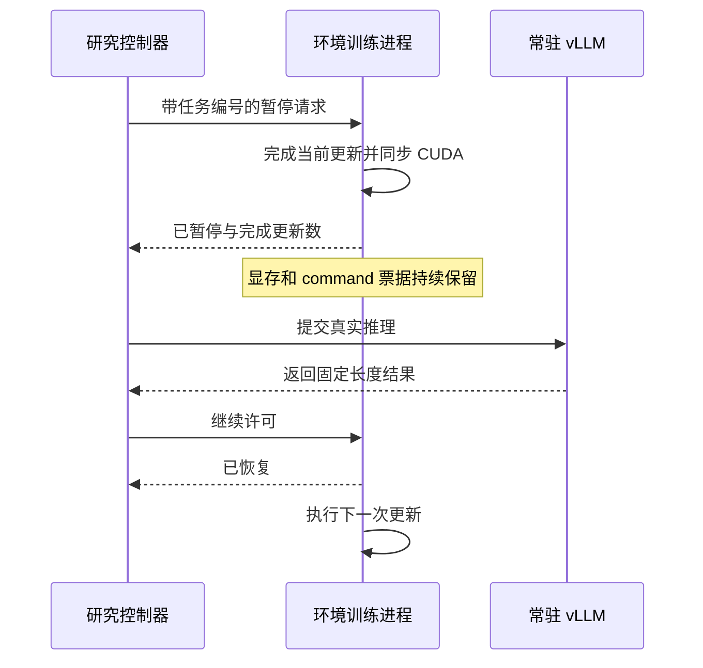

# 训推共享：常驻vLLM与环境并行实验

> **核心结论**：短图像任务的 36 个区块和长生成/4B 环境模型的 12 个区块都支持保留有益的计算重叠。当前条件下，合作式暂停能正确继续，但总完成时间没有超过现有共享：短任务连续请求增加约 14.49%，长任务两类请求分别增加约 24.78% 和 72.77%。本篇先给统一判断，再按工作量分别保存协议、实测、失败和复现证据。

两组均为同一当前实现上的三策略机制对照，固定历史 baseline `0eeead861ffafed6bf31c962d259fd847775dcf9` 未参与。生产 Router 尚未自动暂停任意命令。本次只归并报告，未重新运行实验。

## 目录

- [短图像任务协议与 36 组对照](#短图像任务协议与-36-组对照)
  - [1. 研究问题与对照](#1-研究问题与对照)
  - [2. 怎样让环境暂停而不丢进度](#2-怎样让环境暂停而不丢进度)
  - [3. 工作量、计时与验收](#3-工作量计时与验收)
  - [4. 实测结果](#4-实测结果)
  - [5. 对后续研究的影响](#5-对后续研究的影响)
  - [6. 复现与证据](#6-复现与证据)
- [长生成与 4B 环境模型的 12 组对照](#长生成与-4b-环境模型的-12-组对照)
  - [1. 相比短任务，这次加大了什么](#1-相比短任务这次加大了什么)
  - [2. 对照与计时](#2-对照与计时)
  - [3. 怎样遵守真实命令期限](#3-怎样遵守真实命令期限)
  - [4. 结果与原因](#4-结果与原因)
  - [5. 验证边界与研究判断](#5-验证边界与研究判断)
  - [6. 证据、复现与代码状态](#6-证据复现与代码状态)

## 短图像任务协议与 36 组对照

> **核心结论**：真实 vLLM、EnvRouter 与 Docker 图像任务的 36 组对照已经完成。合作式暂停后能正确继续，但本轮没有取得超出现有共享的稳定收益。256 次更新与连续请求下，现有共享总时间中位数为 2.355 秒，合作式为 2.696 秒，配对耗时增加约 14.49%。原因是现有共享已经能在推理期间推进环境，模型生成基本不受影响，暂停反而丢掉这部分重叠。
>
> 核对日期：2026-11-16。代码条件为主目录提交 `6aa328d` 加未提交内容，执行源码已保存摘要与快照。本文比较相同当前代码上的三种执行策略，固定历史 baseline `0eeead861ffafed6bf31c962d259fd847775dcf9` 没有参与本轮。合作式能力位于研究适配器中，生产 Router 尚未自动暂停任意命令。

本章先说明短任务的暂停协议和对照结果，下一章用[长生成与 4B 环境模型](#长生成与-4b-环境模型的-12-组对照)检验相同研究问题。两章分别保留模型、工作量、配置与计时条件。

### 1. 研究问题与对照

环境任务可以执行真正的 GPU 计算，例如训练图像分类器。vLLM 则生成 Agent 的下一条指令。两者放在同一张卡上，即使显存放得下，计算也可能互相拖慢。本轮只研究这部分计算干扰，模型和环境状态都保留在显存中，不做模型睡眠或状态卸载。

三组都使用真实 vLLM、EnvRouter、command 租约、受管理 Docker 与同一份图像任务代码：

| 策略 | 执行方式 | 想回答的问题 |
|---|---|---|
| A：计算串行 | 先处理本轮三个推理请求，再开始环境训练 | 不同时计算时，同一批工作需要多久 |
| B：现有共享 | 环境开始训练，普通推理照常进入 vLLM | 当前显存准入之后的自由共存，会带来多少计算干扰 |
| C：合作式暂停 | 推理到来时，环境完成当前更新并确认 CUDA 工作结束，暂停后续更新，推理结束后继续 | 增加这次交接，能否换来更短总时间或更小模型延迟 |

A 中环境已完成模型与数据准备，保留与其他组相同的显存。它提供计算串行参照。B 使用真实共享票据，普通生成不会等待环境整条长命令归还。C 的暂停协议位于研究适配器中，现有 Router 仍负责会话和 GPU 命令的容量准入与最终归还。

实验在用户私有节点执行，候选池显式限制为一张模型卡，用来研究“独立卡不可用时”的后备共享路径。节点其他卡可能空闲，本轮没有制造全节点资源紧张。正常调度继续遵守独立 GPU 优先的顺序。

### 2. 怎样让环境暂停而不丢进度

沿一个具体例子看：环境需要完成 256 次训练更新，此时已完成第 37 次，下一条模型请求到达。

1. 控制器写入带有本轮任务编号和交接编号的暂停请求。环境可能已经开始第 38 次更新，因此先让这次更新完成。
2. 环境调用 `torch.cuda.synchronize()`，等待已经提交的实际 GPU 工作结束，再写回“已暂停、完成 38 次更新”的回执。
3. 控制器收到匹配回执后才提交 vLLM 请求。环境等待期间不再提交新的训练计算，模型参数、Adam 优化器状态和输入数据仍留在原 GPU 上。
4. 推理结束，控制器写回继续许可。环境确认收到并回执，再从第 39 次更新继续。下一条暂停请求等这次恢复交接完成后再发出，防止覆盖恢复信号。
5. 最后仍需完成 256 次更新，由独立 verifier 读取最终权重评分。verifier 是单独的检查容器，只有它能挂载私有测试标签。

这里的数字用于解释机制。真实暂停位置和等待时间保存在每轮证据中。“优化器更新”指一次前向计算、反向求梯度与更新参数的完整步骤，完成后才能安全保留继续所需状态。“CUDA 同步”提供当前进程已提交 GPU 工作完成的确认。



显存与计算在这里分开管理：暂停只停止新的计算，租约和显存预算始终有效。只有整个受管理命令结束、物理归还检查通过后，Router 才回收其 GPU 预算。这避免把保留显存的暂停进程当成已经退卡。

具体接线是两个持续运行的 command，分别承载训练服务与独立评分服务，36 个试验区块是发送给它们的请求。GPU 票据在整个服务期间保留，到最终停止进程时才归还。C 由研究控制器协调自己发起的推理，普通生产生成入口尚未接入这套暂停协议。模型 sleep、wake 和权重同步仍服从原有票据门禁；需要收回显存时还需另一套释放或转存机制。

| 图中角色与交接 | 对应实现 |
|---|---|
| 控制器发暂停、等回执、发继续许可 | [Experiment.trial](../env-service-verification/scripts/resident_sharing_study/experiment.py#L289) |
| 环境在完整更新之后调用钩子 | [vision.evaluate](../../../examples/mlgym_bench/vision.py#L80) 与 [PausePoint](../env-service-verification/scripts/resident_sharing_study/protocol.py#L44) |
| 同步后回执暂停，收到许可后回执继续 | [PausePoint 的暂停与恢复](../env-service-verification/scripts/resident_sharing_study/protocol.py#L60) |
| 提交并记录真实模型生成 | [StudyServer.query](../env-service-verification/scripts/resident_sharing_study/inference.py#L16) |
| 命令结束、容器删除与物理释放核查 | [Experiment.cleanup](../env-service-verification/scripts/resident_sharing_study/experiment.py#L420) |

本轮适配的是愿意在完整更新之间响应的工具。任意 shell 程序、执行时间很长的单个 CUDA 内核、外部副作用与跨 GPU 状态搬迁需要另外的执行协议。

### 3. 工作量、计时与验收

使用本地已接入的 MLGym 图像分类有界协议：真实 CIFAR-10 图像，训练集 64 张、测试集 16 张，每批 16 张，采用本地小型卷积网络。它保留训练权重与私有标签独立评分的流程，数据量、模型和预算与官方完整 benchmark 不同，见[接入范围](../knowledge/03-任务接入/04-MLGym与SWE及Serve_任务协议与评分训练.md#mlgym-的范围与评分)。评分是独立测试准确率，执行速度不进入奖励。

| 条件 | 固定内容 |
|---|---|
| 原始短任务 | 2 轮数据遍历，共 8 次参数更新 |
| 延长机制任务 | 相同数据、模型、批次顺序，64 轮遍历，共 256 次更新，实验启动前设定 |
| 模型请求 | 每轮 3 个相同提示词，每个固定生成 64 个 token，温度 0 |
| 间隔请求 | 第一条在共同起点后 10 毫秒到达，后续间隔在预热后一次确定并固定 |
| 连续请求 | 三条具有相同到达时刻，按顺序处理，等待时间计入响应 |
| 重复方式 | 三轮轮换三种策略顺序，每种工作量与请求方式均完整配对 |
| 推理配置 | Qwen2.5-3B-Instruct，最大上下文 512、并发序列 1、eager 执行，显存利用率配置 0.15 |
| 共享边界 | 单卡、MPS 关闭、模型始终常驻，不接入 Megatron 或 PSRL PPO 训练 |

8 次更新组保留真实本地短题的长度。256 次更新组延长同一工具的固定工作量，用来观察较长命令，不把它当成原始题目的自然运行长度。三组共同调用训练钩子，在每次完整更新后同步并检查控制文件，这会改变原程序的提交粒度。默认任务入口仍执行 2 轮且不调用钩子。本轮性能结论对应这些共同测量条件。

主要时间边界是：本轮环境准备完成之后，从共同起点到环境训练、checkpoint 保存与三个推理全部完成。checkpoint 是保存模型参数的文件。环境等待、合作式交接、请求积压和规定的请求间隔都包含其中。模型加载、容器启动与每轮数据准备在公共初始化中进行，权重摘要计算、独立评分和最终清理在主要时间之外。这能回答执行策略的差异，完整 Agent 与训练流水线仍需单独验证。

模型延迟分两种看：从预设到达到结果返回的响应时间包含排队和暂停交接；vLLM 内部生成时间反映实际生成被环境拖慢多少。只看后一项会漏掉为获得无竞争计算所付出的等待。

正确性同时检查固定更新数、固定生成 token 数、最终权重张量的逐字节摘要，以及独立准确率。暂停和继续只改变执行时间，不应改变同一工作量的最终权重。

总进程设置 900 秒外部超时，主实验最多 720 秒，每轮 20 秒，三个配对轮次达到上限后停止。预先记录的筛查条件是：总耗时有改善，同时模型响应相对串行增加控制在 20% 内。它用于决定是否值得进一步研究，少量短请求不足以提供线上尾延迟保证。

### 4. 实测结果

36 个测量区块与一个工具预热区块全部完成，没有失败区块。下表每格是三个重复的中位数。配对变化先在同一重复内相除，再取中位数，因此与两个表格中位数直接相除会略有差别。完整范围和逐轮数据见[分析证据](resident-compute-sharing-evidence.json)。

#### 4.1 总完成时间

| 环境工作量与请求方式 | A：计算串行 | B：现有共享 | C：合作式暂停 | C 相对 B 的配对耗时变化 |
|---|---:|---:|---:|---:|
| 原始 8 次更新，间隔请求 | 5.331 秒 | 5.271 秒 | 5.273 秒 | −0.13% |
| 原始 8 次更新，连续请求 | 2.371 秒 | 2.357 秒 | 2.370 秒 | +0.87% |
| 延长 256 次更新，间隔请求 | 5.620 秒 | 5.267 秒 | 5.277 秒 | +0.21% |
| 延长 256 次更新，连续请求 | 2.702 秒 | 2.355 秒 | 2.696 秒 | **+14.49%** |

自然短题未显示稳定调度收益。延长任务在间隔请求下，B 和 C 相对串行分别减少约 6.17% 和 6.07%，两者接近，因为环境都能在下一次请求之前完成。连续请求下，B 相对串行减少约 12.82%，C 与串行基本持平。

[](../../_static/img/document-figures/explained-resident-compute-sharing-f533859.png)

[](../../_static/img/document-figures/explained-resident-compute-sharing-f533859.png)

[](../../_static/img/document-figures/explained-resident-compute-sharing-f533859.png)

[](../../_static/img/document-figures/explained-resident-compute-sharing-f533859.png)

<!-- explained-source:explained-resident-compute-sharing-f533859 -->
**读图结论：**在这些短任务里，主动暂停主要损失环境进度，未超过现有共享。 内部生成、到达响应和整批时间边界不同，不代表真实 PPO 训练收益。 [完整解释图（SVG）](../../_static/img/document-figures/explained-resident-compute-sharing-f533859.svg) · [原始机制图或实验图](resident-compute-sharing.png)。
<!-- /explained-source:explained-resident-compute-sharing-f533859 -->

图中虚线为计算串行，蓝色为现有共享，橙色为合作式暂停，越低越好。每根柱为三轮配对比值的中位数。原始数据波动保存在证据中；256 次更新连续请求的共享总时间范围为 2.338 至 2.374 秒，暂停为 2.687 至 2.716 秒，该差异在三次重复中方向一致。

间隔在两个预热请求之后固定为 2.237 秒，最终观测的单次生成约 0.78 秒，因此确实留下了较大的中间空窗。这有利于观察“空闲时推进”的可行性，也限制了该组的难度。连续请求组取消这部分空窗，保留请求积压，结果恰好暴露了无条件暂停的损失。

#### 4.2 推理与环境分别发生了什么

重点看 256 次更新与连续请求：

| 指标，中位数 | A：计算串行 | B：现有共享 | C：合作式暂停 |
|---|---:|---:|---:|
| 每请求 vLLM 内部生成时间 | 0.778 秒 | 0.777 秒 | 0.777 秒 |
| 每请求从到达到返回的平均响应时间 | 1.566 秒 | 1.558 秒 | 1.569 秒 |
| 环境从开始更新到训练保存完成 | 0.345 秒 | 0.462 秒 | 2.696 秒 |
| 同一批工作最后完成时间 | 2.702 秒 | 2.355 秒 | 2.696 秒 |

B 中环境自身比串行独占计算时慢约三分之一，但模型生成时间接近。更慢的环境仍然在模型三个请求完成前结束，因此没有增加最后完成时间。C 让环境在三个推理期间等待，保护模型得到的额外收益很小，却把约 0.34 秒环境工作留到了最后。

这就是本轮最值得保留的发现：**判断共享是否划算，要看受影响的是谁，以及这部分变慢是否推迟最后一个结果。** 单看环境变慢会错过 B 的重叠收益，单看模型保持原速则会错过 C 的串行代价。

本轮没有采集逐内核的 SM 占用或内存带宽轨迹。SM 是 GPU 中执行计算的多处理器。证据证明两个进程的工作时间重叠，并测到了彼此完成时间的变化；具体有多少来自内核交错、驱动时分或资源利用差异，仍需硬件级分析。MPS 关闭的这组结果也不用于推断开启 MPS 后的收益。

#### 4.3 一轮真实执行的完整例子

取第二个重复、256 次更新与连续请求，三组实际总时间分别是 A 2.706 秒、B 2.374 秒、C 2.716 秒。C 的环境事件按其实际开始更新计时：

| 时刻 | 环境进度与发生的事 |
|---|---|
| 约 0.011 秒 | 完成第 7 次更新，同步后暂停，处理第一条推理 |
| 约 0.796 秒 | 收到继续许可 |
| 约 0.800 秒 | 完成第 8 次更新，再次暂停，处理第二条推理 |
| 约 1.582 秒 | 收到继续许可 |
| 约 1.585 秒 | 完成第 9 次更新，再次暂停，处理第三条推理 |
| 约 2.381 秒 | 第三次恢复，此后完成剩下的 247 次更新 |
| 约 2.715 秒 | 256 次更新与 checkpoint 保存完成 |

同一重复的 B 没有这三个暂停，环境约 0.460 秒就完成，其余时间主要等待推理结束，总时间 2.374 秒。它相对 A 的环境计算确实变慢了约 0.115 秒，但这部分完全落在模型还在工作的区间中。C 则几乎回到了“先模型、后环境”的结果。

连续请求期间一直保持暂停，可以少做两次无意义恢复，这是合理的简单改进。但它仍然让环境等待整个推理批次，难以追回 B 已获得的约 0.34 秒重叠。因此本轮的主要问题在于是否值得暂停，而不只是暂停消息是否足够快。

#### 4.4 正确性、交接成本与清理

36 个测量区块中，每轮均完成相同的更新数及 3 × 64 个生成 token。按工作量分别比较，18 个区块的最终参数张量摘要完全相同，三个策略及重复间的生成 token 也全部一致。独立评分在 8 次更新时均为 0.125，在 256 次更新时均为 0.375。两个工作量之间的准确率差来自训练更新数变化，策略对照的结果保持一致。

实际发生了 23 次暂停，完成后都成功继续。合作式区块中“该轮最大交接等待”的中位数约 2.4 至 3.5 毫秒，所有请求中观测到的最大值为 9.11 毫秒。这里包括控制文件传递、等当前更新结束、CUDA 同步和回执等待，尚未形成任意工具的严格恢复期限保证。

vLLM 预热后实占约 15057 MiB，两个工具进程就绪后的逐轮快照为约 16060 MiB。推理 profile 报告临时峰值 248 MiB，本轮显式登记模型增长余量 2296 MiB，另保留共享准入安全余量。所有策略都保留相同模型配置和工具状态。

从实验主函数进入到完成清理约 472.9 秒，36 个测量区块的主要执行时间合计约 141.5 秒。该前者还包含公共初始化、工具准备、评分和清理，进程最初的 Python 导入另有开销。不能把各轮执行时间相加后当成完整训练时间。

因此本轮结论适用于服务已经常驻后的调度。若实际任务只运行一次，公共启动和准备可能比节省的几百毫秒更重要；若真实训练长期重复调用，需要在实际流水线中统计摊销后的效果。本轮没有为此额外启动训练。

最终两个主容器及其网络 sidecar 全部删除，两个 command 进程退出，模型进程停止。NVML 检查选定 GPU 已无计算 PID，使用量回到起始水平，所属容器标签查询为空，清理错误为空。实验已经结束，没有继续占用 GPU。

### 5. 对后续研究的影响

**当前不把“推理一到就暂停环境”设为全局默认，也不继续扩大这份小任务来追求正收益。** 现有共享已是本轮的强对照；新机制通过了正确性验收，性能上没有超过它。研究适配器保留，GPU 验证到这里停止。

值得进一步检验的角度应收窄为：**根据真实干扰与后续任务依赖，决定是否暂停，暂停哪条环境，以及允许它继续多久。** 第一层仍是独立 GPU 优先。只有进入共享后备池，且观测到模型性能边界受到影响时，才需要选择保护手段。

一个教学算例说明为什么要同时看依赖。假设环境 A 还需 0.4 秒就能给出结果，结果返回后模型才有下一条请求；环境 B 还需 4 秒，暂时不影响下一批数据。模型自己没有待处理请求时，暂停 A 会直接推迟后续推理。模型队列有其他关键请求时，是否继续 A 则要比较推进它的价值与当前推理变慢的代价。A、B 的身份和 0.4/4 秒是假设，下一阶段需要从真实 Agent 轨迹中找到并复现这种关系。

进一步实验要分两步，而不是先实现复杂算法：

1. **找真实的干扰分界。** 在不同于当前小型卷积的已有任务中，定位会明显拖慢真实推理的 GPU 命令，固定模型请求和工具工作量，确认干扰随任务或阶段确实变化。优先核查已接入的模型微调、较大图像模型或 GPU 评分任务，先测量、再选择，不用纯占位内核替代任务收益。
2. **测有依赖的固定工作量闭环。** 让“模型生成 → 工具执行 → 结果返回 → 下一轮生成”真实串起来，再比较现有共享、始终暂停、固定计算片段与干扰触发暂停。只有存在跨任务的取舍，才进一步考察依赖优先级和片段选择。

强简单策略至少包括“没有明显干扰就继续共存”和“需要保护时连续请求批次保持暂停”。新策略若连这两条规则都不能超过，就应保留为工程保护能力。一般的抢占、空闲利用和关键路径优先已有先例，论文价值需要由新决策问题、真实场景及稳定增量共同支撑，参见[提案中的文献对照](../research-proposals/06-训推借卡_可撤回执行与反馈依赖.md#7-与论文相比哪些已有先例)。

本轮还没有覆盖高强度工具竞争、长上下文或高并发模型服务、真实 Megatron 训练、显存收回与卸载成本。每项应独立选择最小实验，当前结果不作为启动完整训练的理由。

### 6. 复现与证据

- [后台启动参数与事先决策规则](../env-service-verification/results/resident-sharing-20261116-01/launch.json)。
- [后台完整日志](../env-service-verification/results/resident-sharing-20261116-01/driver.log)。
- [完整原始证据](../env-service-verification/results/resident-sharing-20261116-01/run/evidence.json)，包含 37 个区块、模型 profile、源码摘要与最终清理。
- [汇总分析证据](resident-compute-sharing-evidence.json)，包含所有配对比值、逐轮指标、权重摘要与评分。
- [执行源码快照](../env-service-verification/results/resident-sharing-20261116-01/run/executed-study)，复制前逐一与运行前摘要匹配。
- [图像下载清单](../env-service-verification/results/resident-sharing-20261116-01/run/input-assets.json)，保留 CIFAR-10 来源、样本行与原图摘要。
- [实验控制器](../env-service-verification/scripts/resident_sharing_study/experiment.py)、[暂停协议](../env-service-verification/scripts/resident_sharing_study/protocol.py)、[真实工具适配器](../env-service-verification/scripts/resident_sharing_study/worker.py)、[vLLM 请求](../env-service-verification/scripts/resident_sharing_study/inference.py)。
- [只读分析脚本](../env-service-verification/scripts/resident_sharing_study/analyze.py)，读取落盘证据，不启动 GPU。
- [CPU 交接回归](../../../tests/env_service/test_compute_pause_study.py)覆盖暂停前同步、匹配任务编号与继续确认。
- [本轮 CPU 回归输出](../env-service-verification/results/resident-sharing-20261116-01/run/cpu-regressions.log)，两项交接检查与一项私有标签挂载检查通过。
- [研究提案与文献边界](../research-proposals/06-训推借卡_可撤回执行与反馈依赖.md)。

复现前按[集群预检](../../psrl/psrl-run-guide/02-集群预检_依赖地址与GPU资源核验.md)检查所选 GPU、Docker、容器 CUDA、模型与任务数据。使用项目指定 Python 环境，将仓库及实验目录的父级加入 `PYTHONPATH`，通过控制器的 `--gpu-index`、`--node-ip`、`--model`、`--data` 和新的 `--output` 指定本次资源。不要复用已有输出，也不要停止其他实验的 Ray 或 Docker。

运行前记录的摘要覆盖图像任务与四个研究执行模块，事后复制快照时逐一匹配。driver 与实际推理 worker 的 PSRL、vLLM、veRL 和 TransferQueue 导入位置保存在原始证据中，共享依赖没有重新安装。

实验执行时的基础提交为 `6aa328d` 加当时未提交内容。收尾时，另一个会话已将图像任务纳入 `8755e20`，研究执行模块与回归纳入 `6383a8b`，文档整理纳入 `c5f2d65`。逐一读取当前已提交版本，五个执行文件与运行前摘要全部一致。本地 `main` 与 `origin/main` 跟踪引用均为 `c5f2d65`，本文的接线、适用条件和证据补充仍有未提交改动。本会话没有执行提交、推送或合并，远端服务器及部署状态未另行查询。

共享 veRL 的 `position_ids` 回归在本轮预检中仍有两个失败，当前 `.verification-deps` 不存在。本实验避开该 PPO 轨迹打包路径，仅验证真实推理、环境执行与资源生命周期。完整策略训练需要先解决并实际加载该独立依赖补丁。


## 长生成与 4B 环境模型的 12 组对照

> **核心结论**：较长任务的 12 个正式区块全部完成。单条 rollout 生成约 9.2 秒，4B 环境模型固定更新 448 次、独占计算约 21 秒。现有共享相对计算串行，在间隔请求下少用 34.81% 时间，在连续请求下少用 42.17%。合作式暂停相对现有共享反而多用 24.78% 和 72.77%，模型生成时间的改善约为 0.1% 和 1.1%。这次长任务继续支持“保留有益重叠，根据真实干扰决定是否让路”，没有支持无条件暂停。
>
> 核对日期：2026-11-16。这是 `c5f2d65` 加本地主目录修改上的机制对照，固定历史 PSRL OFF 提交 `0eeead861ffafed6bf31c962d259fd847775dcf9` 未参与。三种策略的输出 token、最终环境参数和独立评分完全一致，无 OOM，所属 GPU 进程和容器已物理释放。较短任务的结论保留在[原实验](06-训推共享_常驻vLLM与环境并行实验.md)。

### 1. 相比短任务，这次加大了什么

先前的小图像任务即使延长到 256 次更新，计算串行时也只需约 0.345 秒，很快就能躲进几个推理请求的执行区间。它适合检查暂停和继续，但不足以观察较长 GPU 命令如何与长生成相互影响。

| 内容 | 较短实验 | 本轮较长实验 |
|---|---|---|
| rollout 模型 | Qwen2.5-3B-Instruct | 相同模型 |
| 每条生成 | 固定 64 个输出 token | 固定 768 个输出 token，每区块 3 条 |
| 引擎配置 | 最大上下文 512，单序列，eager | 最大上下文 2048，单序列，eager |
| 模型显存规划比例 | 0.15 | 0.25，所有新策略使用相同配置 |
| 环境计算 | 64 张 CIFAR-10 图像的小卷积模型 | Qwen3-4B-Base，在真实 GSM8K 数学问答上进行固定更新 |
| 环境目标时长 | 原始 8 次或延长 256 次更新 | 先用 64 次更新校准，选定约 20 秒独占计算对应的固定更新数 |
| 请求方式 | 间隔与连续请求 | 相同两类方式 |
| 对照重复 | 每种条件 3 次 | 每种条件 2 次，共 12 个测量区块 |

PostTrain 在这里指任务内部调整提交模型，和外层 PSRL 对 Agent 的策略训练分开。复用现有本地 PostTrain recipe，即已接入任务的配置和执行脚本：4B 基础权重冻结，更新最后归一化层的参数。每次更新仍执行完整 4B 模型的前向和相应损失计算，反向只更新指定参数。它增加了实际模型计算量，同时把显存和训练预算保持在单卡范围内。研究适配器把原先两次更新扩成固定长工作量，保留常驻模型，接入更新边界的暂停确认；本轮验证的是这段组件计算，未运行完整 Agent 解题与外层 PPO。

训练按固定顺序循环两个公开例子，输入编码沿用现有上限：提示词最多 192 token，答案最多 64 token。评分器单独加载同一基础模型与提交参数，在四个私有例子上计算正确答案的平均负对数似然。负对数似然表示模型对参考答案的预测损失，越小越好，奖励取其指数映射。该指标不包含执行时间。这是已有本地有界评分协议，数据量与更新范围均有明确限制。

为避免按观测结果挑选工作量，更新数只根据独占校准确定一次：目标 20 秒，向上取整到 32 的倍数，最少 128 次、最多 4096 次。确定后，各策略全部使用同一个更新数，不再根据性能结果调整。校准、预热与正式对照分别保存。

### 2. 对照与计时

| 策略 | 行为 |
|---|---|
| A：计算串行 | 工具准备完成并保留同样显存，先处理三个模型请求，再运行环境更新 |
| B：现有共享 | 环境立即开始更新，普通 vLLM 生成照常执行 |
| C：合作式暂停 | 新推理到来时，环境完成当前更新并同步 CUDA，确认暂停后运行推理，随后继续 |

GPU、模型、输入、更新数、生成 token 数和评分方法保持一致，按重复轮换策略顺序。三组共同使用更新钩子，记录 CUDA 同步后的更新完成时刻。C 仍保留模型、优化器与输入显存，暂停期间也持续占用 GPU 票据。

暂停确认点放在一次完整参数更新结束后。收到暂停请求时，如果第 100 次更新正在执行，工具先完成它，等待 CUDA 确认已提交计算结束，再报告“已暂停，完成 100 次更新”。推理结束后，从第 101 次继续。这样，控制器可以验证让出了计算，最终参数也能与不暂停的固定 448 次更新比较。这里的第 100 次是机制示例，实际暂停位置由每组证据记录。

间隔请求的第一条在共同起点后 0.2 秒到达，后续间隔固定为两次引擎预热平均生成时间的 1.5 倍。连续请求三条的预设到达时刻相同，等待积压计入响应时间。控制器顺序处理请求，引擎最大并发序列为 1。

主要计时从环境准备完成后的共同起点开始，到本轮环境训练保存和三个模型请求全部结束为止。它包含环境等待、推理排队、暂停交接与规定的请求间隔。公共初始化与整轮墙钟另记，容器和模型加载、预热、校准、独立评分、最终清理不混入主指标。

同时观察四类结果：

1. 同一批工作全部完成的时间，以及环境自身耗时。
2. 模型内部生成时间，以及从预设到达到结果返回的响应时间。
3. 每次暂停的实际等待、暂停区间、推理期间完成的环境更新数。
4. 固定更新数、输出 token 数、最终参数摘要与独立评分的一致性。

环境更新发生在模型生成区间，说明两个程序在这个时间范围内都取得了进度。是否有不同进程的内核同时占用 SM，需要另一类硬件跟踪。本轮不启用 NVIDIA 多进程服务 MPS。

### 3. 怎样遵守真实命令期限

生产 Router 要求模型共享命令的期限不超过 300 秒。长实验保持这个上限，每组三种策略作为一个有界工具服务批次。训练和独立评分使用两个容器、两份租约，并行准备各自模型：

```text
vLLM 持续常驻
  → 创建训练与独立评分容器，各持有自己的 command 票据
  → 两个工具并行加载各自环境模型，再预热
  → 对同一种请求方式完成 A / B / C 配对
  → 停止两个工具进程、删除所属容器、归还租约
  → 核对只剩模型自身 GPU 进程
  → 创建下一组工具服务
```

每个服务批次从准备起最多 260 秒，GPU command 期限仍为 300 秒，主动执行命令的超时为 280 秒。正式测量区块另外限制为 150 秒。整个主实验最多 1500 秒，外层进程最多 1800 秒，超时也进入所属资源清理。

这样，长实验由多次真实借还组成，避免为了持续测量而放宽模型恢复保护。组间加载与清理成本单独保留；同一组内的三种策略复用相同已加载模型，再比较执行策略。

正式更新数固定为 448 次，沿用第二次启动中的独占校准结果，每次约 46.47 毫秒，预计环境计算 20.82 秒。正式运行重新测得约 46.84 毫秒，更新数仍保持 448。后续修正只改变两个独立工具的准备顺序，不根据测量结果增减更新数。

两次前置失败分别保存。第一次配置申请超过 300 秒的命令，在 Router 初始化阶段被拒绝，没有正式测量。第二次依次加载训练和评分模型，准备时间挤占同批三策略的预算，已完成串行和现有共享，暂停组的第三条生成被批次期限中断。这是实验编排超时。现场采样显示中断前模型仍在计算，不能将它计为暂停策略性能结果。两次均核实所属 GPU 进程和容器已释放。第三次并行准备模型，预算和正式工作量不变，达到矩阵或时限后结束，不再追加重试。

### 4. 结果与原因

#### 4.1 总时间与推理影响

每种条件完成两次配对重复。下表是总完成时间中位数，括号中保留两次实测范围，单位均为秒。百分比逐次配对后取中位数。

| 请求方式 | A：计算串行 | B：现有共享 | C：合作式暂停 | B 相对 A | C 相对 B |
|---|---|---|---|---|---|
| 间隔请求 | 59.996（59.992 至 60.000） | 39.113（39.071 至 39.154） | 48.804（48.768 至 48.840） | 少 34.81% | 多 24.78% |
| 连续请求 | 48.385（48.016 至 48.755） | 27.982（27.955 至 28.009） | 48.344（48.159 至 48.530） | 少 42.17% | 多 72.77% |

[](../../_static/img/document-figures/explained-resident-compute-sharing-long-be21a7c.png)

[](../../_static/img/document-figures/explained-resident-compute-sharing-long-be21a7c.png)

[](../../_static/img/document-figures/explained-resident-compute-sharing-long-be21a7c.png)

[](../../_static/img/document-figures/explained-resident-compute-sharing-long-be21a7c.png)

[](../../_static/img/document-figures/explained-resident-compute-sharing-long-be21a7c.png)

<!-- explained-source:explained-resident-compute-sharing-long-be21a7c -->
**读图结论：**更长命令仍可因计算重叠受益，不能仅因推理重新活跃就无条件停环境。 计时排除公共加载，批次边界含真实借还。不是新一次实机实验。 [完整解释图（SVG）](../../_static/img/document-figures/explained-resident-compute-sharing-long-be21a7c.svg) · [原始机制图或实验图](resident-compute-sharing-long.svg)。
<!-- /explained-source:explained-resident-compute-sharing-long-be21a7c -->

图中误差线是两次观测的最小值与最大值。右图环境耗时从实际开始更新算起，包含之后的暂停。A 在环境开始前等待推理的时间，计入左图的总完成时间。

推理内部时间和请求响应时间分开统计。前者从进入引擎到生成完成，后者从预设到达到返回，还包括排队与交接。表中先对每区块三个请求取平均，再对两次重复取中位数。

| 请求方式 | 策略 | 单请求引擎生成 | 请求平均响应 | 环境执行耗时，含暂停 |
|---|---|---:|---:|---:|
| 间隔 | A | 9.290 | 9.294 | 21.009 |
| 间隔 | B | 9.268 | 9.272 | 21.364 |
| 间隔 | C | 9.258 | 9.286 | 48.803 |
| 连续 | A | 9.173 | 18.355 | 20.656 |
| 连续 | B | 9.258 | 18.519 | 21.167 |
| 连续 | C | 9.159 | 18.418 | 48.343 |

连续请求下平均响应接近 18 秒，是因为三个请求同时到达，而当前引擎每次执行一条：第一条约等 9 秒，第二条约等 18 秒，第三条约等 28 秒。这是本轮配置中记录的排队。

B 相对 A 的生成平均时间，在间隔请求下变化约 -0.25%，连续请求下约 +0.93%。继续检查每个对应请求，变化范围约 -2.20% 至 +2.05%，实际有环境更新重叠的请求也在这个范围内。两次重复适合说明当前现象，没有足够样本建立尾延迟保证。原始逐请求结果保存在[整理证据](resident-compute-sharing-long-evidence.json)的 `request_metrics`。

C 相对 B 只将引擎生成时间缩短约 0.11% 和 1.07%，总时间却增加约 25% 和 73%。因此，这里主要付出的代价是暂停期间丢掉的环境进度。

#### 4.2 一组连续请求究竟发生了什么

沿第一次连续请求对照看同样的工作。三组都要生成 `3 × 768 = 2304` 个 token，并完成 448 次环境更新。下表从各组相同的共同起点计时，数字为该次实测，保留到两位小数。

| 策略 | 中间发生了什么 | 全部完成 |
|---|---|---:|
| A | 推理先连续运行到约 27.96 秒，环境随后独占计算约 20.80 秒 | 48.75 秒 |
| B | 环境立即开始，约 21.20 秒完成；推理同时推进，约 27.95 秒完成 | 27.95 秒 |
| C | 环境在约 0.23 秒完成第 5 次更新后暂停；三个推理之间只推进到第 7 次更新；约 27.92 秒才恢复最后一段计算 | 48.53 秒 |

在 B 中，448 次更新有 444 次的完成时刻落在模型生成区间。第二次重复为 443 次。C 两次均为 0 次，说明暂停确认后确实停止了新增环境更新。间隔请求下，B 两次分别有 327、324 次更新在生成期间完成，C 仍为 0 次。

C 这一次累计暂停约 27.59 秒。扣除暂停，环境自身约需 20.94 秒，与 A 接近；但完成时间已经从 B 的约 28 秒推迟到约 49 秒。交接只花几十毫秒，减少这点开销也补不回丢掉的二十多秒重叠。

这些时间戳证明两个程序在同一个长时间窗口内都取得了进度。是否有两个进程的 GPU 内核同时占用计算单元，仍需内核跟踪。本轮没有使用 MPS，也不根据 NVML 活跃率推导固定 SM 分区。

#### 4.3 正确性、暂停成本与清理

正式工作总量为 **5376 次环境更新、36 条生成请求、27648 个输出 token**，预热与校准单列。各策略的最终参数摘要完全相同，四个私有例子的独立评分均为 `0.43710736452436894`，生成 token 序列完全相同。这支持暂停、继续与共享保持了本轮固定计算的结果。

四个 C 区块共发生 12 次暂停，控制器提交暂停到收到确认的实测范围为 8.67 至 48.15 毫秒，中位数 34.89 毫秒。该范围是本轮记录，不是通用程序的最坏时延承诺。

| 检查项 | 本轮结果 |
|---|---|
| 正式矩阵 | 12/12 完成，最终 `passed=true` |
| 工作量与结果 | 更新数、token 数、最终参数、私有评分一致 |
| 显存与故障 | 区块结束时 GPU 最高快照约 41778 MiB，无 OOM |
| 工具批次归还 | 四批均确认只剩 vLLM 所属 GPU 进程 |
| 最终物理释放 | GPU 无计算进程，所属主容器和网络辅助容器均消失 |
| 清理异常 | 无 |
| CPU 回归 | 暂停协议和 PostTrain 相关 7 项通过 |

公共初始化为 303.74 秒，12 个正式区块的主计时合计 545.25 秒，整轮主函数含组间重建、预热、校准、评分和清理为 1183.50 秒，约 19 分 44 秒。上表的加速比例属于执行区块。完整 PSRL 训练及每种策略独立冷启动的总时长，均未在本轮测量。

容器现场检查覆盖两个主容器和两个网络辅助容器。主容器各有 2 CPU、32 GiB 主存限制，辅助容器没有单独硬限制，这项既有边界保留在[检查文件](../env-service-verification/results/resident-sharing-long-20261116-03/container-inspection.json)。

### 5. 验证边界与研究判断

本轮回答了“工具更重、生成更长后，直接共享与暂停各付出什么代价”。在当前单序列生成和单例环境前向下，直接共享继续取得明显的总时间收益，暂停只带来很小的模型时间变化，代价较大。生产默认策略保持原状，合作式机制作为可选研究能力保留。

**把命令变长，会扩大重叠机会；它本身不会自动增加某一时刻的计算竞争。** 这次生成 768 个 token，主要延长了解码，即逐个产生后续 token 的过程，引擎仍只处理一条序列。环境每次仍处理一个约百 token 的例子。若下一步要判断模型保护何时必要，应先从真实任务选择更大批次或更高生成并发，并用实测确认干扰确实出现，避免继续靠延长循环寻找暂停优势。

它仍是固定外部请求流，尚未让环境结果动态触发下一轮 Agent 生成。若需要研究依赖调度，后续必须保留这种实际前后关系，并超过“没有明显干扰就继续共享、超出模型性能边界才暂停”的简单策略。

正常调度仍优先使用其他有容量的 GPU。本轮显式把候选池限制为模型卡，模拟独立候选不可用时的后备共享；节点其他卡并未被人为占满。没有模型卸载、没有 Megatron 训练，也没有用显存占位替代真实工具计算。

C 让出的是计算机会，显存与共享授权仍保留。因此本轮能测普通生成的计算竞争，模型唤醒或权重同步所需的独占控制等待还需另行研究。未来若要让这些控制操作提前继续，必须接入真实资源归还及状态恢复，不能把一次暂停确认当成显存已经释放。

### 6. 证据、复现与代码状态

- [运行计划、预算与后台 PID](../env-service-verification/results/resident-sharing-long-20261116-03/launch.json)。
- [后台日志](../env-service-verification/results/resident-sharing-long-20261116-03/driver.log)。
- [原始证据](../env-service-verification/results/resident-sharing-long-20261116-03/run/evidence.json)。
- [统计、逐请求结果和摘要](resident-compute-sharing-long-evidence.json)、[结果图](../../_static/img/document-figures/explained-resident-compute-sharing-long-be21a7c.png)。
- [首次期限校验失败](../env-service-verification/results/resident-sharing-long-20261116-01/run/evidence.json)。
- [顺序准备导致批次超时](../env-service-verification/results/resident-sharing-long-20261116-02/run/evidence.json)。
- [七项 CPU 回归输出](../env-service-verification/results/resident-sharing-long-20261116-03/cpu-regressions.log)。
- [长任务控制器](../env-service-verification/scripts/resident_sharing_study/long_experiment.py)、[PostTrain 工具适配器](../env-service-verification/scripts/resident_sharing_study/posttrain_worker.py)、[只读分析](../env-service-verification/scripts/resident_sharing_study/analyze_long.py)。
- [可信模型加载、输入编码与参数评分](../../../examples/posttrain_bench/local_model.py)。

实验源码、输入 JSON 摘要、driver 和实际 worker 的依赖导入位置保存在原始证据中。运行前先读[集群预检](../../psrl/psrl-run-guide/02-集群预检_依赖地址与GPU资源核验.md)，重新核对 GPU、Docker、实际 CUDA、数据、模型与 Ray 身份，输出目录必须新建。

在仓库根目录激活项目环境后，下面的命令只读已有原始证据，重新生成统计与图，不启动 GPU 工作：

```bash
python docs/env-worker-deep-dive/env-service-verification/scripts/resident_sharing_study/analyze_long.py \
  docs/env-worker-deep-dive/env-service-verification/results/resident-sharing-long-20261116-03/run/evidence.json \
  --output docs/env-worker-deep-dive/experiments/resident-compute-sharing-long-evidence.json \
  --figure docs/env-worker-deep-dive/experiments/resident-compute-sharing-long.png
```

原始运行目录在本地共享存储，原始目录与 PNG 位图受 Git 忽略规则排除。整理后的 JSON 和 SVG 位于实验目录，JSON 保留逐组和逐请求结果，图由分析脚本生成。执行源码快照与七个关键执行文件的[摘要比对](../env-service-verification/results/resident-sharing-long-20261116-03/executed-source-check.json)一致，分析器后续增加逐请求统计，其摘要单独记录。

本轮实验脚本、公共输入编码提取和文档修改位于主目录，尚未提交、未推送，也未合并到远端。现有生产 Router 的准入和默认策略没有因本轮实验修改。已有 `position_ids` 依赖回归不在本轮执行路径中，完整 PPO 训练保持未验证状态。
