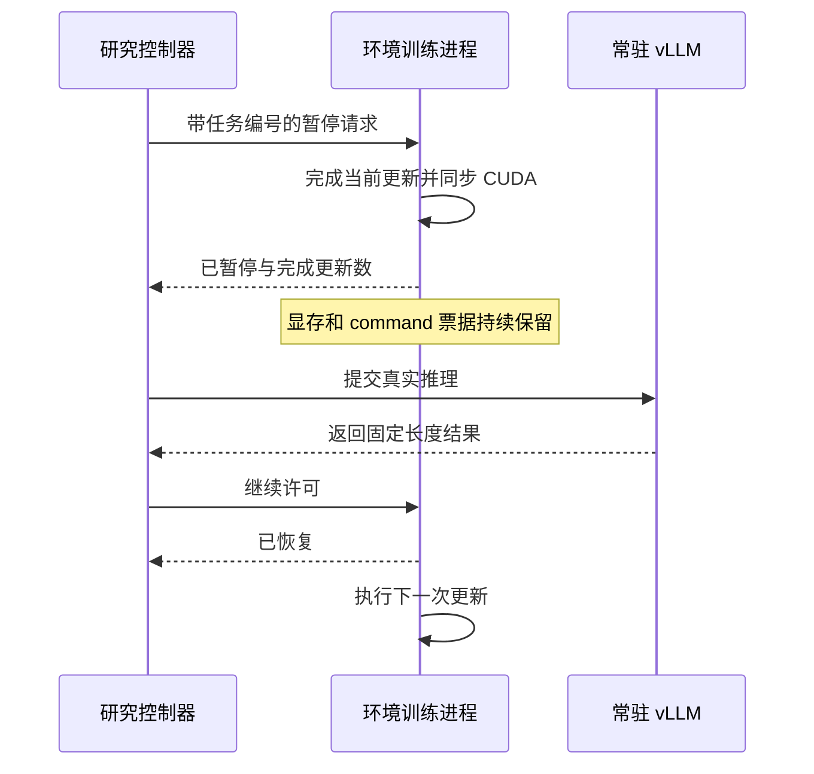

# 常驻 vLLM 与 GPU 环境：共享计算与合作式暂停实验

> **核心结论**：真实 vLLM、EnvRouter 与 Docker 图像任务的 36 组对照已经完成。合作式暂停后能正确继续，但本轮没有取得超出现有共享的稳定收益。256 次更新与连续请求下，现有共享总时间中位数为 2.355 秒，合作式为 2.696 秒，配对耗时增加约 14.49%。原因是现有共享已经能在推理期间推进环境，模型生成基本不受影响，暂停反而丢掉这部分重叠。
>
> 核对日期：2026-11-16。代码条件为主目录提交 `6aa328d` 加未提交内容，执行源码已保存摘要与快照。本文比较相同当前代码上的三种执行策略，固定历史 baseline `0eeead861ffafed6bf31c962d259fd847775dcf9` 没有参与本轮。合作式能力位于研究适配器中，生产 Router 尚未自动暂停任意命令。

## 目录

- [1. 研究问题与对照](#1-研究问题与对照)
- [2. 怎样让环境暂停而不丢进度](#2-怎样让环境暂停而不丢进度)
- [3. 工作量、计时与验收](#3-工作量计时与验收)
- [4. 实测结果](#4-实测结果)
- [4.1 总完成时间](#41-总完成时间)
- [4.2 推理与环境分别发生了什么](#42-推理与环境分别发生了什么)
- [4.3 一轮真实执行的完整例子](#43-一轮真实执行的完整例子)
- [4.4 正确性、交接成本与清理](#44-正确性交接成本与清理)
- [5. 对后续研究的影响](#5-对后续研究的影响)
- [6. 复现与证据](#6-复现与证据)

## 1. 研究问题与对照

环境任务可以执行真正的 GPU 计算，例如训练图像分类器。vLLM 则生成 Agent 的下一条指令。两者放在同一张卡上，即使显存放得下，计算也可能互相拖慢。本轮只研究这部分计算干扰，模型和环境状态都保留在显存中，不做模型睡眠或状态卸载。

三组都使用真实 vLLM、EnvRouter、command 租约、受管理 Docker 与同一份图像任务代码：

| 策略 | 执行方式 | 想回答的问题 |
|---|---|---|
| A：计算串行 | 先处理本轮三个推理请求，再开始环境训练 | 不同时计算时，同一批工作需要多久 |
| B：现有共享 | 环境开始训练，普通推理照常进入 vLLM | 当前显存准入之后的自由共存，会带来多少计算干扰 |
| C：合作式暂停 | 推理到来时，环境完成当前更新并确认 CUDA 工作结束，暂停后续更新，推理结束后继续 | 增加这次交接，能否换来更短总时间或更小模型延迟 |

A 中环境已完成模型与数据准备，保留与其他组相同的显存。它提供计算串行参照。B 使用真实共享票据，普通生成不会等待环境整条长命令归还。C 的暂停协议位于研究适配器中，现有 Router 仍负责会话和 GPU 命令的容量准入与最终归还。

实验在用户私有节点执行，候选池显式限制为一张模型卡，用来研究“独立卡不可用时”的后备共享路径。节点其他卡可能空闲，本轮没有制造全节点资源紧张。正常调度继续遵守独立 GPU 优先的顺序。

## 2. 怎样让环境暂停而不丢进度

沿一个具体例子看：环境需要完成 256 次训练更新，此时已完成第 37 次，下一条模型请求到达。

1. 控制器写入带有本轮任务编号和交接编号的暂停请求。环境可能已经开始第 38 次更新，因此先让这次更新完成。
2. 环境调用 `torch.cuda.synchronize()`，等待已经提交的实际 GPU 工作结束，再写回“已暂停、完成 38 次更新”的回执。
3. 控制器收到匹配回执后才提交 vLLM 请求。环境等待期间不再提交新的训练计算，模型参数、Adam 优化器状态和输入数据仍留在原 GPU 上。
4. 推理结束，控制器写回继续许可。环境确认收到并回执，再从第 39 次更新继续。下一条暂停请求等这次恢复交接完成后再发出，防止覆盖恢复信号。
5. 最后仍需完成 256 次更新，由独立 verifier 读取最终权重评分。verifier 是单独的检查容器，只有它能挂载私有测试标签。

这里的数字用于解释机制。真实暂停位置和等待时间保存在每轮证据中。“优化器更新”指一次前向计算、反向求梯度与更新参数的完整步骤，完成后才能安全保留继续所需状态。“CUDA 同步”提供当前进程已提交 GPU 工作完成的确认。

显存与计算在这里分开管理：暂停只停止新的计算，租约和显存预算始终有效。只有整个受管理命令结束、物理归还检查通过后，Router 才回收其 GPU 预算。这避免把保留显存的暂停进程当成已经退卡。

本轮适配的是愿意在完整更新之间响应的工具。任意 shell 程序、执行时间很长的单个 CUDA 内核、外部副作用与跨 GPU 状态搬迁需要另外的执行协议。

## 3. 工作量、计时与验收

使用本地已接入的 MLGym 图像分类任务，训练集 64 张、测试集 16 张，每批 16 张。评分是独立测试准确率，执行速度不进入奖励。

| 条件 | 固定内容 |
|---|---|
| 原始短任务 | 2 轮数据遍历，共 8 次参数更新 |
| 延长机制任务 | 相同数据、模型、批次顺序，64 轮遍历，共 256 次更新，实验启动前设定 |
| 模型请求 | 每轮 3 个相同提示词，每个固定生成 64 个 token，温度 0 |
| 间隔请求 | 第一条在共同起点后 10 毫秒到达，后续间隔在预热后一次确定并固定 |
| 连续请求 | 三条具有相同到达时刻，按顺序处理，等待时间计入响应 |
| 重复方式 | 三轮轮换三种策略顺序，每种工作量与请求方式均完整配对 |
| 推理配置 | Qwen2.5-3B-Instruct，最大上下文 512、并发序列 1、eager 执行，显存利用率配置 0.15 |
| 共享边界 | 单卡、MPS 关闭、模型始终常驻，不接入 Megatron 或 PSRL PPO 训练 |

8 次更新组保留真实本地短题的长度。256 次更新组延长同一工具的固定工作量，用来观察较长命令，不把它当成原始题目的自然运行长度。训练钩子是三组共同的测量条件，默认任务入口仍执行 2 轮且不调用钩子。

主要时间边界是：本轮环境准备完成之后，从共同起点到环境训练、checkpoint 保存与三个推理全部完成。checkpoint 是保存模型参数的文件。环境等待、合作式交接、请求积压和规定的请求间隔都包含其中。模型加载、容器启动与每轮数据准备在公共初始化中进行，权重摘要计算、独立评分和最终清理在主要时间之外。这能回答执行策略的差异，完整 Agent 与训练流水线仍需单独验证。

模型延迟分两种看：从预设到达到结果返回的响应时间包含排队和暂停交接；vLLM 内部生成时间反映实际生成被环境拖慢多少。只看后一项会漏掉为获得无竞争计算所付出的等待。

正确性同时检查固定更新数、固定生成 token 数、最终权重张量的逐字节摘要，以及独立准确率。暂停和继续只改变执行时间，不应改变同一工作量的最终权重。

总进程设置 900 秒外部超时，主实验最多 720 秒，每轮 20 秒，三个配对轮次达到上限后停止。预先记录的筛查条件是：总耗时有改善，同时模型响应相对串行增加控制在 20% 内。它用于决定是否值得进一步研究，少量短请求不足以提供线上尾延迟保证。

## 4. 实测结果

36 个测量区块与一个工具预热区块全部完成，没有失败区块。下表每格是三个重复的中位数。配对变化先在同一重复内相除，再取中位数，因此与两个表格中位数直接相除会略有差别。完整范围和逐轮数据见[分析证据](resident-compute-sharing-evidence.json)。

### 4.1 总完成时间

| 环境工作量与请求方式 | A：计算串行 | B：现有共享 | C：合作式暂停 | C 相对 B 的配对耗时变化 |
|---|---:|---:|---:|---:|
| 原始 8 次更新，间隔请求 | 5.331 秒 | 5.271 秒 | 5.273 秒 | −0.13% |
| 原始 8 次更新，连续请求 | 2.371 秒 | 2.357 秒 | 2.370 秒 | +0.87% |
| 延长 256 次更新，间隔请求 | 5.620 秒 | 5.267 秒 | 5.277 秒 | +0.21% |
| 延长 256 次更新，连续请求 | 2.702 秒 | 2.355 秒 | 2.696 秒 | **+14.49%** |

自然短题未显示稳定调度收益。延长任务在间隔请求下，B 和 C 相对串行分别减少约 6.17% 和 6.07%，两者接近，因为环境都能在下一次请求之前完成。连续请求下，B 相对串行减少约 12.82%，C 与串行基本持平。

间隔在两个预热请求之后固定为 2.237 秒，最终观测的单次生成约 0.78 秒，因此确实留下了较大的中间空窗。这有利于观察“空闲时推进”的可行性，也限制了该组的难度。连续请求组取消这部分空窗，保留请求积压，结果恰好暴露了无条件暂停的损失。

### 4.2 推理与环境分别发生了什么

重点看 256 次更新与连续请求：

| 指标，中位数 | A：计算串行 | B：现有共享 | C：合作式暂停 |
|---|---:|---:|---:|
| 每请求 vLLM 内部生成时间 | 0.778 秒 | 0.777 秒 | 0.777 秒 |
| 每请求从到达到返回的平均响应时间 | 1.566 秒 | 1.558 秒 | 1.569 秒 |
| 环境从开始更新到训练保存完成 | 0.345 秒 | 0.462 秒 | 2.696 秒 |
| 同一批工作最后完成时间 | 2.702 秒 | 2.355 秒 | 2.696 秒 |

B 中环境自身比串行独占计算时慢约三分之一，但模型生成时间接近。更慢的环境仍然在模型三个请求完成前结束，因此没有增加最后完成时间。C 让环境在三个推理期间等待，保护模型得到的额外收益很小，却把约 0.34 秒环境工作留到了最后。

这就是本轮最值得保留的发现：**判断共享是否划算，要看受影响的是谁，以及这部分变慢是否推迟最后一个结果。** 单看环境变慢会错过 B 的重叠收益，单看模型保持原速则会错过 C 的串行代价。

本轮没有采集逐内核的 SM 占用或内存带宽轨迹。SM 是 GPU 中执行计算的多处理器。证据证明两个进程的工作时间重叠，并测到了彼此完成时间的变化；具体有多少来自内核交错、驱动时分或资源利用差异，仍需硬件级分析。MPS 关闭的这组结果也不用于推断开启 MPS 后的收益。

### 4.3 一轮真实执行的完整例子

取第二个重复、256 次更新与连续请求，三组实际总时间分别是 A 2.706 秒、B 2.374 秒、C 2.716 秒。C 的环境事件按其实际开始更新计时：

| 时刻 | 环境进度与发生的事 |
|---|---|
| 约 0.011 秒 | 完成第 7 次更新，同步后暂停，处理第一条推理 |
| 约 0.796 秒 | 收到继续许可 |
| 约 0.800 秒 | 完成第 8 次更新，再次暂停，处理第二条推理 |
| 约 1.582 秒 | 收到继续许可 |
| 约 1.585 秒 | 完成第 9 次更新，再次暂停，处理第三条推理 |
| 约 2.381 秒 | 第三次恢复，此后完成剩下的 247 次更新 |
| 约 2.715 秒 | 256 次更新与 checkpoint 保存完成 |

同一重复的 B 没有这三个暂停，环境约 0.460 秒就完成，其余时间主要等待推理结束，总时间 2.374 秒。它相对 A 的环境计算确实变慢了约 0.115 秒，但这部分完全落在模型还在工作的区间中。C 则几乎回到了“先模型、后环境”的结果。

连续请求期间一直保持暂停，可以少做两次无意义恢复，这是合理的简单改进。但它仍然让环境等待整个推理批次，难以追回 B 已获得的约 0.34 秒重叠。因此本轮的主要问题在于是否值得暂停，而不只是暂停消息是否足够快。

### 4.4 正确性、交接成本与清理

36 个测量区块中，每轮均完成相同的更新数及 3 × 64 个生成 token。按工作量分别比较，18 个区块的最终参数张量摘要完全相同，三个策略及重复间的生成 token 也全部一致。独立评分在 8 次更新时均为 0.125，在 256 次更新时均为 0.375。两个工作量之间的准确率差来自训练更新数变化，策略对照的结果保持一致。

实际发生了 23 次暂停，完成后都成功继续。合作式区块中“该轮最大交接等待”的中位数约 2.4–3.5 毫秒，所有请求中观测到的最大值为 9.11 毫秒。这里包括控制文件传递、等当前更新结束、CUDA 同步和回执等待，尚未形成任意工具的严格恢复期限保证。

vLLM 预热后实占约 15057 MiB，两个工具进程就绪后的逐轮快照为约 16060 MiB。推理 profile 报告临时峰值 248 MiB，本轮显式登记模型增长余量 2296 MiB，另保留共享准入安全余量。所有策略都保留相同模型配置和工具状态。

从实验主函数进入到完成清理约 472.9 秒，36 个测量区块的主要执行时间合计约 141.5 秒。该前者还包含公共初始化、工具准备、评分和清理，进程最初的 Python 导入另有开销。不能把各轮执行时间相加后当成完整训练时间。

最终两个主容器及其网络 sidecar 全部删除，两个 command 进程退出，模型进程停止。NVML 检查选定 GPU 已无计算 PID，使用量回到起始水平，所属容器标签查询为空，清理错误为空。实验已经结束，没有继续占用 GPU。

## 5. 对后续研究的影响

**当前不把“推理一到就暂停环境”设为全局默认，也不继续扩大这份小任务来追求正收益。** 现有共享已是本轮的强对照；新机制通过了正确性验收，性能上没有超过它。研究适配器保留，GPU 验证到这里停止。

值得进一步检验的角度应收窄为：**根据真实干扰与后续任务依赖，决定是否暂停，暂停哪条环境，以及允许它继续多久。** 第一层仍是独立 GPU 优先。只有进入共享后备池，且观测到模型性能边界受到影响时，才需要选择保护手段。

一个教学算例说明为什么要同时看依赖。假设环境 A 还需 0.4 秒就能给出结果，结果返回后模型才有下一条请求；环境 B 还需 4 秒，暂时不影响下一批数据。模型自己没有待处理请求时，暂停 A 会直接推迟后续推理。模型队列有其他关键请求时，是否继续 A 则要比较推进它的价值与当前推理变慢的代价。A、B 的身份和 0.4/4 秒是假设，下一阶段需要从真实 Agent 轨迹中找到并复现这种关系。

进一步实验要分两步，而不是先实现复杂算法：

1. **找真实的干扰分界。** 在不同于当前小型卷积的已有任务中，定位会明显拖慢真实推理的 GPU 命令，固定模型请求和工具工作量，确认干扰随任务或阶段确实变化。优先核查已接入的模型微调、较大图像模型或 GPU 评分任务，先测量、再选择，不用纯占位内核替代任务收益。
2. **测有依赖的固定工作量闭环。** 让“模型生成 → 工具执行 → 结果返回 → 下一轮生成”真实串起来，再比较现有共享、始终暂停、固定计算片段与干扰触发暂停。只有存在跨任务的取舍，才进一步考察依赖优先级和片段选择。

强简单策略至少包括“没有明显干扰就继续共存”和“需要保护时连续请求批次保持暂停”。新策略若连这两条规则都不能超过，就应保留为工程保护能力。一般的抢占、空闲利用和关键路径优先已有先例，论文价值需要由新决策问题、真实场景及稳定增量共同支撑，参见[提案中的文献对照](../research-proposals/reclaim-aware-env-sharing.md#7-与论文相比哪些已有先例)。

本轮还没有覆盖高强度工具竞争、长上下文或高并发模型服务、真实 Megatron 训练、显存收回与卸载成本。每项应独立选择最小实验，当前结果不作为启动完整训练的理由。

## 6. 复现与证据

- [后台启动参数与事先决策规则](../env-service-verification/results/resident-sharing-20261116-01/launch.json)。
- [后台完整日志](../env-service-verification/results/resident-sharing-20261116-01/driver.log)。
- [完整原始证据](../env-service-verification/results/resident-sharing-20261116-01/run/evidence.json)，包含 37 个区块、模型 profile、源码摘要与最终清理。
- [汇总分析证据](resident-compute-sharing-evidence.json)，包含所有配对比值、逐轮指标、权重摘要与评分。
- [执行源码快照](../env-service-verification/results/resident-sharing-20261116-01/run/executed-study)，复制前逐一与运行前摘要匹配。
- [实验控制器](../env-service-verification/scripts/resident_sharing_study/experiment.py)、[暂停协议](../env-service-verification/scripts/resident_sharing_study/protocol.py)、[真实工具适配器](../env-service-verification/scripts/resident_sharing_study/worker.py)、[vLLM 请求](../env-service-verification/scripts/resident_sharing_study/inference.py)。
- [只读分析脚本](../env-service-verification/scripts/resident_sharing_study/analyze.py)，读取落盘证据，不启动 GPU。
- [CPU 交接回归](../../../tests/env_service/test_compute_pause_study.py)覆盖暂停前同步、匹配任务编号与继续确认。
- [研究提案与文献边界](../research-proposals/reclaim-aware-env-sharing.md)。

复现前按[集群预检](../../psrl/psrl-run-guide/cluster-preflight.md)检查所选 GPU、Docker、容器 CUDA、模型与任务数据。使用项目指定 Python 环境，将仓库及实验目录的父级加入 `PYTHONPATH`，通过控制器的 `--gpu-index`、`--node-ip`、`--model`、`--data` 和新的 `--output` 指定本次资源。不要复用已有输出，也不要停止其他实验的 Ray 或 Docker。

共享 veRL 的 `position_ids` 回归在本轮预检中仍有两个失败，当前 `.verification-deps` 不存在。本实验避开该 PPO 轨迹打包路径，仅验证真实推理、环境执行与资源生命周期。完整策略训练需要先解决并实际加载该独立依赖补丁。
