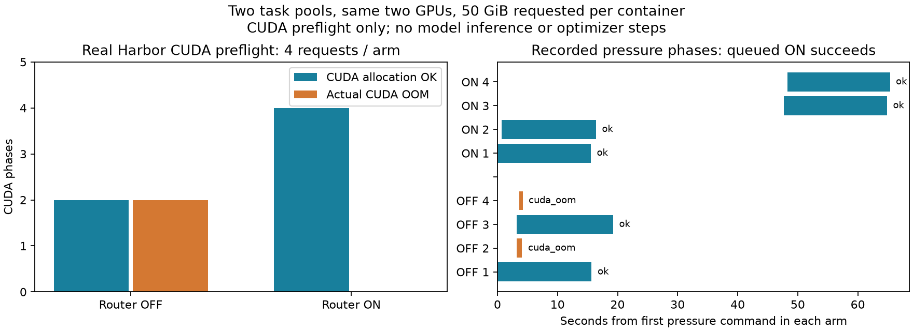
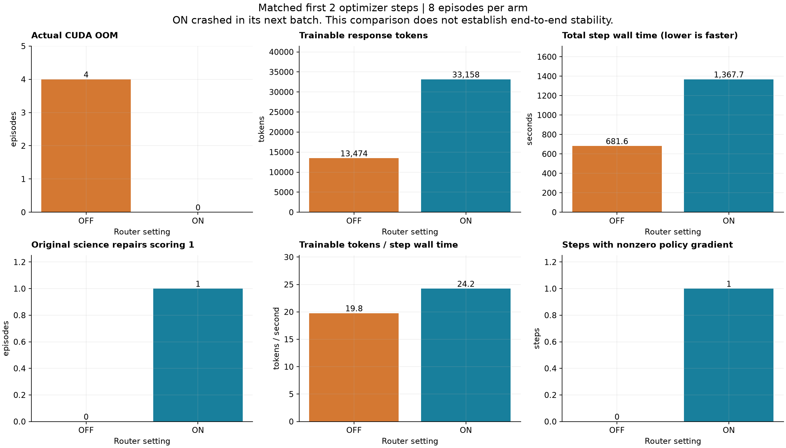
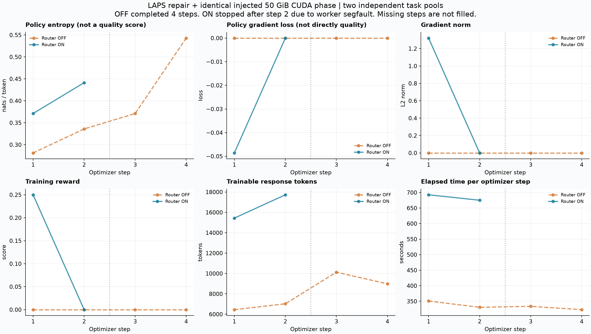
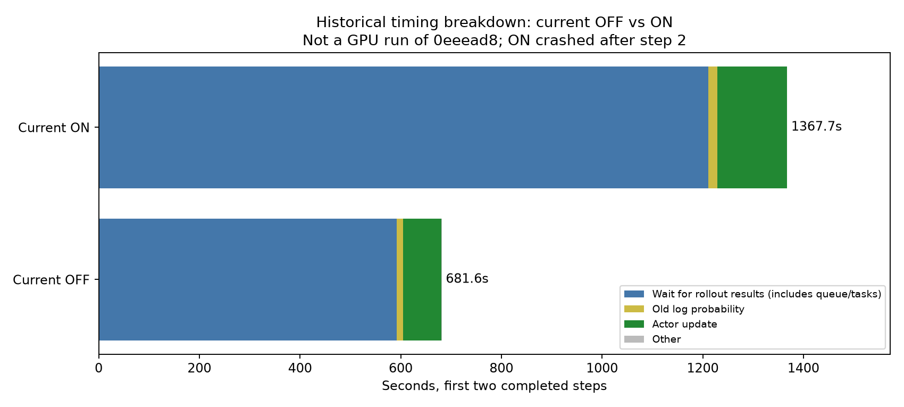
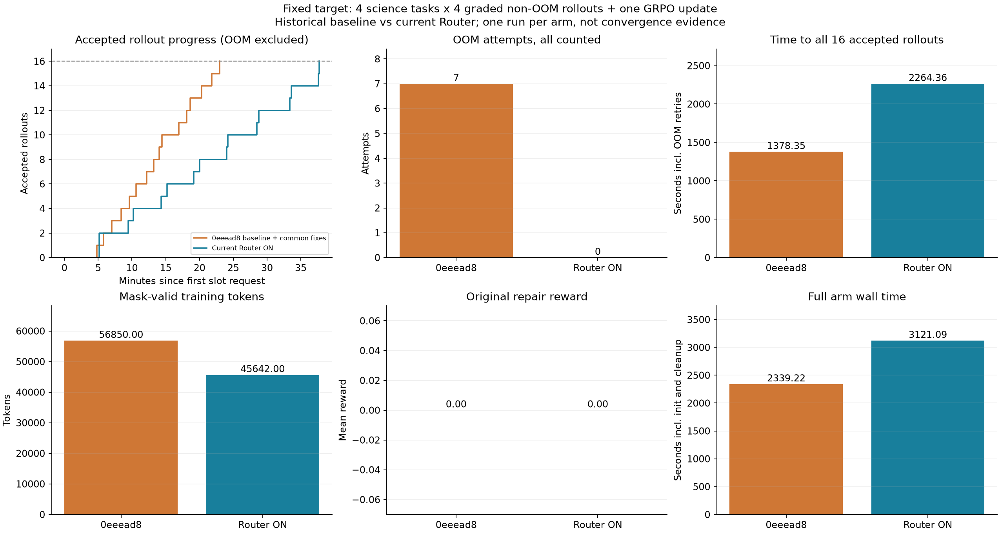
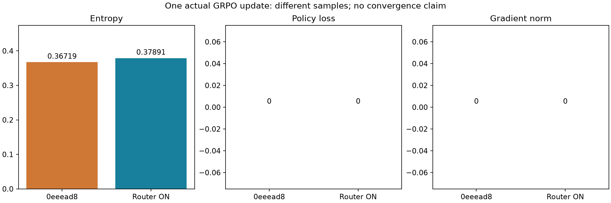
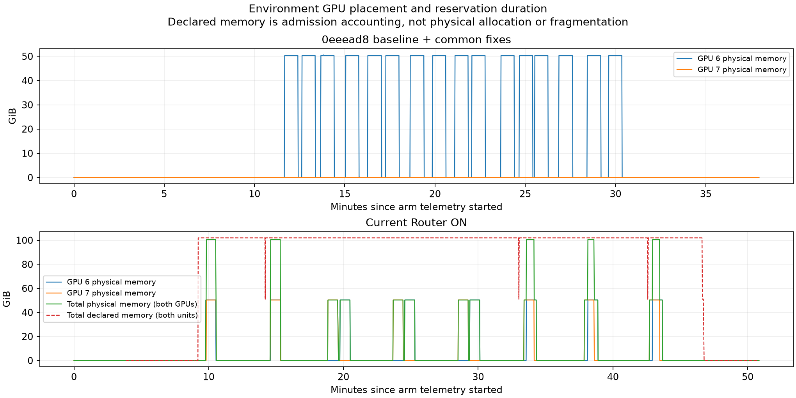

# Science 训练中的跨任务池 GPU 竞争与 Router 对照

> **最新等完成量结果（2026-10-19，第 11 节）**：实际运行指定旧提交 `0eeead8`（加已留档共同运行修复）与当前 Router；两组均收齐四题各四条非 OOM 已评分轨迹，并完成一次 GRPO 更新流程。旧版 23 次尝试、7 次 OOM，Router 16 次尝试、0 次 OOM；但补齐 16 条分别耗时 **22.97 / 37.74 分钟**，Router 慢 **64.3%**。现有整任务租约避免了超卖，也保留了大量空闲 GPU 配额。两组实际训练奖励、loss、梯度范数均为 0，不能据此宣称学习优势。两组正常退出，已独立确认资源清理。
>
> 下方 2026-10-18 结论和第 1–10 节保留为历史记录，配置、基线和完成量均不能与第 11 节混用。

> **历史核心结论（2026-10-18）**：构造的跨任务池竞争场景确实测出了显存准入优势。等量前两步、每组八条轨迹，OFF 有四次真实 CUDA OOM，ON 零次；有效训练 token 从 13474 增至 33158，按 step 时间折算提高约 22.6%。但 ON 两步耗时约为 OFF 的两倍，而且第三批启动时发生 Ray actor 的 uvloop 段错误，只完成两步，**不能宣称完整训练稳定、训练更快或已证明收敛优势**。OFF 完成四步。
>
> 本文承接 [此前的真实 LAPS 训练对照](science-training-router-ab.md)。此前任务容器只使用 CPU，且资源充足；本次给原始 LAPS 修复任务的副本增加同等 GPU 压力阶段，明确验证跨任务池准入问题。压力阶段是实验注入，**不是原始 LAPS 的原生 GPU 需求**。

> **基线更正**：用户指定的 `0eeead861ffafed6bf31c962d259fd847775dcf9` 与第 1–8 节实测 OFF 不同；第 9 节是该提交的源码审计与 CPU 准入复现，第 10 节拆分历史耗时。第 11 节才是该旧提交与当前版本的真实 GPU 等完成量对照。

## 目录

- [1. 全局流程与对照变量](#1-全局流程与对照变量)
- [2. 为什么现有 OFF 仍可能竞争](#2-为什么现有-off-仍可能竞争)
- [3. 实验配置与停止条件](#3-实验配置与停止条件)
- [4. 实测结果](#4-实测结果)
- [5. 如何理解训练指标的变化](#5-如何理解训练指标的变化)
- [6. 跟着图读源码与复现](#6-跟着图读源码与复现)
- [7. 验证边界与资源回收](#7-验证边界与资源回收)
- [8. ON 段错误调查与 HTTP 连接池修复](#8-on-段错误调查与-http-连接池修复)
- [9. 指定提交 0eeead8 与当前 Router 的收益边界](#9-指定提交-0eeead8-与当前-router-的收益边界)
- [10. 为什么 OOM 更多的 OFF 反而更快](#10-为什么-oom-更多的-off-反而更快)
- [11. 四题各四条 rollout 的等完成量对照](#11-四题各四条-rollout-的等完成量对照)
- [12. OFF 的空档复用与 ON 的整任务保留](#12-off-的空档复用与-on-的整任务保留)

## 1. 全局流程与对照变量

```text
[1] 相同的两个 LAPS 修复任务副本，同一模型、数据顺序与采样参数
                    |
[2] 每个任务采两条轨迹；A、B 使用各自独立的 jobs_dir
                    |
       +------------+-----------------+
       |                              |
[3a] OFF：各目录的整卡文件锁      [3b] ON：共享 EnvRouter → 显存账本
 A 池：GPU 6、7 各占一个          全部 A/B 请求统一累计预算
 B 池：GPU 6、7 又各占一个        每卡允许一个 51 GiB 申报，其余等待
       |                              |
       +------------+-----------------+
                    |
[4] Harbor 启动 Docker；真实模型生成第一条回复
    容器运行 CUDA 压力命令：申请 50 GiB、验证读写、持有 45 秒、释放
       | 成功                         | 真实 CUDA OOM
       v                              v
  继续模型给出的修复命令          记录异常，走原有评分/失败处理
       +------------------------------+
                    |
[5] 原始 verifier 评分 → 清理容器 → 释放锁或账本租约
                    |
[6] 有效轨迹进入训练：组内奖励比较 → loss / 梯度 / 参数更新
                    |
[7] 最多 4 step，保存原始结果、绘图、核实物理资源回收
```

图例：图里每个部分对应的源码位置。

| 节点 | 对应实现与职责 |
|---|---|
| 1、2、7 | [训练实验脚本](../env-service-verification/scripts/science_pressure_training.py)：克隆任务、固定两个配置、设置预算及遥测 |
| 2 | [AgentLoopWorker 选择 agent_name](../../../psrl/workers/agent_loop/worker.py#L302)：按数据行选择任务池配置 |
| 3a | [GpuDeviceGate.acquire](../../../psrl/utils/concurrency/gpu_device_gate.py#L117)：取得目录对应锁池的一个设备名额 |
| 3a 目录隔离 | [SlotManager.slot_lock_dir](../../../psrl/utils/concurrency/slot.py#L22)：用 jobs_dir 的绝对路径哈希区分锁池 |
| 3b | [EnvUnitLedger.try_admit](../../../psrl/workers/env_service/ledger.py#L103)：全局选择可容纳请求的 unit 并记账 |
| 3b 显存判断 | [EnvUnitLedger._fits_now](../../../psrl/workers/env_service/ledger.py#L349)：已预留显存加新需求不得超过预算 |
| 4 | [实验代理](../env-service-verification/scripts/science_pressure_agent.py)：第一次真实模型回复后执行受控 CUDA 阶段；[CUDA 程序](../env-service-verification/scripts/cuda_pressure.py)记录实际分配返回码 |
| 4、5 | [run_harbor_episode](../../../examples/sciaccel_rl/runner.py#L253)：原有 Harbor 执行、评分、异常及清理路径 |
| 5、6 | [SciAccelAgentLoop.run](../../../examples/sciaccel_rl/agent_loop.py#L224)：读取模型轨迹，区分有效评分和未评分错误 |
| 6 | compute_grpo_outcome_advantage（本地资料，未随仓库发布）：按同题奖励均值和标准差计算优势 |
| 7 | [绘图脚本](../env-service-verification/scripts/plot_science_pressure.py)：从实际日志解析曲线，不补造缺失 step |

这些代码如果有理解上的问题，可以随时追问。图中的四条轨迹是异步并发；文件锁、Router 排队和模型回复时序都会影响压力重叠，不能理解成四条严格同步的执行线。

## 2. 为什么现有 OFF 仍可能竞争

用户记忆中的“全部 Docker 挂同一张卡”确实是早期实现存在过的问题，当前源码已添加 `GpuDeviceGate`，即容器创建前先取得一张卡的排他使用名额。因此本次没有把那个早期行为冒充当前 OFF。

但排他的范围取决于大家有没有使用**同一把锁**。当前锁目录由 `jobs_dir` 哈希得到。两个任务池只要输出目录不同，就会有两组互不认识的文件锁，尽管它们最终控制的是同两张物理卡。

以本次配置举例：A 池的两条轨迹分别获得 GPU 6、7；B 池也分别获得 GPU 6、7。每个池自己看都没有重分配，整台机器上却是每张卡各有两个容器。每个容器申请 50 GiB，单卡总申请 100 GiB，超过这批 H20 的实际可用容量，后申请者会在 CUDA 分配函数中返回错误码 2，即显存不足。

也可以把 OFF 的锁作用域改成按物理 GPU 身份共享的全节点锁，从而避免这里的重复独占分配；这是另一种修复方案，本次没有实施。全局整卡锁与统一账本都能解决这种冲突，账本额外支持按显存需求共享、多资源预算和租约管理；本次不能据此宣称 Router 是唯一解。

ON 把这四个请求交给同一个 Router。每张环境卡配置一个 unit（有预算的资源集合），显存预算 80 GiB；每个请求申报 51 GiB，包含 50 GiB 工作区及余量。第一份申报后余下 29 GiB，第二份 51 GiB 放不下，所以等候。另一张卡同理。这里 `max_containers=4`，阻止第三、第四个同时启动的是**显存预算**，不是把容器数硬编码成一。

短对照中，OOM 发生时两张卡剩余显存均约 44.37 GiB，确实小于新申请的 50 GiB；错误来自真实 `cuMemAlloc_v2` 调用，不是实验脚本伪造异常，也不是 GPU 不可见或驱动加载失败。

## 3. 实验配置与停止条件

| 项目 | 两组共同配置 |
|---|---|
| 科学任务 | 原始 LAPS `coef`、`subtle` 二维 Fortran 修复任务的副本，原始提示和评分脚本不变 |
| 受控注入 | 第一次模型回复后申请 50 GiB，验证一次 CUDA 显存写入/读回，持有 45 秒后释放 |
| 训练模型 | Qwen3.5-4B |
| 模型 GPU | 两张训练卡、一张推理卡；与环境卡分开 |
| 环境 GPU | 同两张 GPU 6、7，现场核实 UUID 和设备 minor 映射 |
| 单步采样 | 两题，每题两条轨迹；A/B 独立 jobs_dir |
| 总预算 | 每组最多四个训练 step，训练子进程最多 55 分钟；每轨迹代理上限 240 秒、16 轮 |
| ON unit | 每卡 80 GiB 显存预算、16 CPU、32 GiB 主机内存、最多四容器 |
| 每轨迹申报 | 51 GiB 显存；CPU、主机内存来自任务声明 |
| 组间变量 | Env Service 开关；两组都保留各自既有准入逻辑 |
| 停止规则 | 达到四步、明确失败或时间上限后结束，不为追求好看的曲线追加训练 |

显存数字采用二进制单位：1 GiB = 1024³ 字节，1 MiB = 1024² 字节；配置中的 `gpu_memory_mb=52224` 对应 51 GiB。

容器只在命令阶段持有额外显存，命令结束即释放，随后继续正常的模型请求。这次没有借用 vLLM 所在卡，也没有验证 sleep / wake up 的借还流程。

## 4. 实测结果

**短容器对照已完成：** OFF 四次压力执行中两次成功、两次 CUDA OOM；ON 四次全部成功。短对照的 ON 遥测在 CUDA 阶段开始前就因采样超时中断，不能据此声称已捕获活动/等待租约峰值或最终账本归零；这些还需训练阶段采样。容器时间戳显示 ON 分成两批执行，而 OFF 的四次分配发生了重叠。原始证据位于 本次结果目录（本地资料，未随仓库发布），其中 [短对照审计](../env-service-verification/results/science-pressure-ab-20261018/preflight/audited-results.json)记录了结论及采样故障边界。

短对照进行中，采集器一次 `nvidia-smi` 超时使监控协程提前失败；任务完成后的收尾等待传播了该异常，导致 driver 退出 1，并阻止 ON 汇总文件落盘。四份独立 Harbor trial 结果和四份 CUDA 结果已经完整保存，实际任务没有失败。因此审计原始结果后继续训练，没有为了修正汇总再跑四个容器。采集脚本现已改为将这种超时记录为遥测错误，不能误报成任务 OOM 或训练失败。



首次训练调试运行在第一批发生真实 CUDA OOM，但实验代理的 `stderr=None` 拼接错误掩盖了外层异常名，Harbor 因而没有走正常代理退出后的评分路径。现已使用 `NonZeroAgentExitCodeError` 上报实际非零命令退出，并处理空 stderr；这会让原始 verifier 自行评分，没有合成奖励。调试运行独立保存为 `pilot-off`，中止后已核实全部 GPU 为 0 MiB、无容器。正式 OFF 剩余时间预算为 2408 秒，调试使用的约 891 秒已从原 3300 秒中扣除；ON 仍为 3300 秒。两组正式运行使用同一修正后的代理。

**真实训练已结束。** OFF 四步正常完成，16 次 CUDA 压力执行中七次 OOM；ON 完成两步、八次压力执行全部成功，随后第三批启动时 actor 发生原生段错误。已停止依赖它的训练进程，没有等待到预算耗尽，也没有补造第 3、4 步。

下面只比较双方都实际完成的前两步，各八条轨迹。它是一个已完成前缀的描述性比较，不能消除 ON 后续崩溃带来的稳定性问题。

| 指标：前两步、各八条轨迹 | Router OFF | Router ON |
|---|---:|---:|
| CUDA 压力分配成功 | 4 / 8 | 8 / 8 |
| 实际 CUDA OOM | 4 / 8 | 0 / 8 |
| 完全修复通过，reward_repair=1 | 0 / 8 | 1 / 8 |
| 平均 reward_repair | 0 | 0.125 |
| 有效训练 token | 13474 | 33158 |
| 两步总耗时，含轨迹生成、不含模型初始化 | 681.56 秒 | 1367.75 秒 |
| 有效训练 token / 秒 | 19.77 | 24.24 |
| 非零策略梯度的 step 数 | 0 / 2 | 1 / 2 |

ON 产出的有效训练 token 是 OFF 的 **2.46 倍**，两步耗时是 **2.01 倍**，两者相除后得到这里的 **22.6% 有效 token 产出率提升**。它不是 22.6% 的单步加速，也不是 22.6% 的模型质量提升。



可下载 [SVG](../env-service-verification/results/science-pressure-ab-20261018/pressure-matched.svg)、[PDF](../env-service-verification/results/science-pressure-ab-20261018/pressure-matched.pdf)，以及逐项原始数值 [matched-comparison.json](../env-service-verification/results/science-pressure-ab-20261018/matched-comparison.json)。

下图保留全部实际 step：OFF 四步、ON 两步。竖线右边只有 OFF 数据，不能当成 ON 的零 loss 或零 entropy。



| 模式 / step | Entropy | Policy loss | 梯度范数 | 平均训练奖励 | 有效 token | step 秒数 |
|---|---:|---:|---:|---:|---:|---:|
| OFF 1 | 0.28125 | 0 | 0 | 0 | 6448 | 350.85 |
| OFF 2 | 0.33594 | 0 | 0 | 0 | 7026 | 330.71 |
| OFF 3 | 0.37109 | 0 | 0 | 0 | 10127 | 333.81 |
| OFF 4 | 0.54297 | 0 | 0 | 0 | 8983 | 323.03 |
| ON 1 | 0.37109 | −0.04859 | 1.32111 | 0.25 | 15434 | 692.61 |
| ON 2 | 0.44141 | 0 | 0 | 0 | 17724 | 675.13 |

全部统计见 [pressure-comparison.json](../env-service-verification/results/science-pressure-ab-20261018/pressure-comparison.json)，[资源与账本图](../env-service-verification/results/science-pressure-ab-20261018/pressure-resources.png)保留不等长的全程遥测。三个模型 GPU 的全程时间加权平均利用率约为 OFF 7.358%、ON 7.364%，未显示有意义的利用率优势；两组完成步数不同，不能把它当成严格的等量吞吐比较。

ON 共采到 **2640 份 unit 快照**，涉及十个获准会话（八个完成，两个在第三批启动后中断）。合计峰值两个活动租约、两个等待会话，每卡最高预留 52224 MiB；CPU、主机内存、容器数、显存预算均无采样越界，记账量与活动租约需求之和一致。等待队列按节点统计，在两个 unit 快照中重复出现，不能把两个“等待 2”相加成等待 4。

OFF 全部 16 条轨迹中：七条 `NonZeroAgentExitCodeError` 对应真实 CUDA OOM，七条代理执行超时，两条无代理异常但修复评分仍为零。ON 已完成八条轨迹中：五条代理超时、三条无代理异常，其中一条修复成功。调度成功不等于任务必然成功。

## 5. 如何理解训练指标的变化

这里首先要分清“调度成功”和“模型学得更好”。避免 CUDA OOM 是调度层的直接结果；它能让更多轨迹走到任务修复和评分环节，减少训练数据因基础设施问题被截断或丢弃。但 Router 不会直接改变优化器公式，也不能保证四步训练就有更高最终准确率。

一条合理的因果链是：显存准入消除超额并发 → 容器能执行命令 → 模型获得更完整的终端反馈 → 更多有效动作和评分进入训练 → 奖励分布、token 数量、loss 和梯度随之改变。每个箭头都要查对应证据；只看到 ON 的 loss 更负，不能倒推整条链已经成立。

**奖励和组内优势。** 本实验使用 GRPO（按同一个题目的多条回答比较奖励的训练方法）。例如教学假设中，同题两条轨迹奖励都是 0，则它们减去组内均值后都为 0，几乎没有由奖励差异带来的学习方向。如果一条奖励为 0、一条为 1，均值为 0.5，本次配置关闭标准差归一化，优势为 −0.5 和 +0.5。若另一个配置启用了标准差归一化，样本标准差约为 0.707，优势才会变成约 −0.707 和 +0.707。后续更新会降低相对失败动作的概率、提高相对成功动作的概率；这是公式示例，不是本次实测奖励。

本次实际第一个 ON batch 中，`coef` 两条轨迹评分为 `[1, 0]`，`subtle` 为 `[0, 0]`，所以批次平均奖励为 0.25，前一组有正负优势，最终观测到非零策略梯度。这个成功发生在第一次参数更新之前，反映的是初始模型在当时的执行条件与采样下完成了任务，不能说是训练后模型能力已经变强。OFF 四步都没有奖励差异驱动的非零策略梯度，但熵仍变化，说明不同文本分布也会改变熵。

OOM 会影响上述过程，但有两种不同情况：如果基础设施错误使 verifier 根本没有评分，当前路径应将它标成未评分错误，不能伪装成真实 0 分；如果原始 verifier 确实对未完成修复的代码给出 0 分，训练可能接受这条短轨迹。后一种情况虽有真实评分，失败原因仍包含机器资源运气，可能污染学习信号。ON 的价值是减少这种外部随机性，不是人为给 ON 高分。

**Loss（损失）与 grad norm（梯度范数）。** 策略梯度损失表示当前概率变化和优势的组合，不同轨迹集合的 loss 并非相同试卷上的考试分数。全零优势也可能产生看起来很“好”的零 loss，却没有有效学习。需要同时读奖励差异、有效 token 数、梯度以及样本失败记录。

**有效训练 token。** `response_mask` 是逐 token 的训练掩码，1 表示这个位置参与损失，0 表示不参与。日志中的 `termination/trained_tokens` 来自 [掩码计数](../../../psrl/trainer/ppo/ray_trainer.py#L3318)及[批次求和](../../../psrl/trainer/ppo/utils.py#L64)。教学例子：一条记录有 1000 token，其中模型回复 300、终端观测 700；若观测位置掩码为 0，有效训练量是 300，不能报成 1000。“有效”在这里仅表示未被掩码排除，不保证优势非零或产生实际学习收益。本次 ON 第 2 步有 17724 个这类 token，但策略梯度仍为零。

**Entropy（策略熵）。** 它衡量模型对下一个 token 的选择有多分散，越大通常意味着选择更不确定；低熵可能来自更有把握，也可能来自输出过于单一。OFF 的 OOM 轨迹可能只留下第一条回复，ON 则包含多轮修复，两边被平均的 token 内容本来就不同。因此短程熵差异不能单独证明模型能力提高。

**租约粒度与等待。** 本次使用的是普通 unit 的整条 episode 租约：CUDA 压力命令在 45 秒后已经释放物理显存，但 51 GiB 账本预留要等后续修复、评分及容器清理结束才归还。因此 ON 的第二批可能在显存已经空闲时仍等待。这是当前保守准入粒度的代价，不能把它解释成碎片已经消除。如果以后改成阶段性 GPU 租约，需要确保命令确实结束并释放显存、后续 GPU 命令必须重新申请；仅把账本数字清零而容器继续自由访问 GPU 会破坏安全前提。该改进本次未实现，也没有冒充 vLLM 借还验证。

**速度与 GPU 利用率。** OOM 的任务会很快结束，OFF 可能因为“少干了事”而单步更短。应同时比较完成的任务工作、可用训练 token 和成功轨迹，而不是只比较墙钟时间。这次压力阶段主要占显存并等待，不是持续高算力内核，所以不能从显存占用推出 GPU 计算利用率更高。

## 6. 跟着图读源码与复现

按真实执行路径阅读，遇到并发分支分别跟踪：

1. **准备 → 图 1、2：** [训练脚本](../env-service-verification/scripts/science_pressure_training.py)将两个任务副本写成数据行，保留 `agent_name`，禁用数据洗牌，使同一步包含 A/B 两个任务池。
2. **选择配置 → 图 2：** [worker.py](../../../psrl/workers/agent_loop/worker.py#L302)从批次读取任务池名称，实例化对应 AgentLoop；四条轨迹异步执行。
3. **准入 → 图 3a/3b：** [runner.py](../../../examples/sciaccel_rl/runner.py#L338)根据是否有 EnvService 客户端选择统一账本或现有整卡锁。OFF 输出目录不同导致锁池独立；ON 各目录共享同一个 Router actor。
4. **执行 → 图 4：** [实验代理](../env-service-verification/scripts/science_pressure_agent.py)先等待一次真实模型回复，再调用容器 exec 执行 [CUDA 程序](../env-service-verification/scripts/cuda_pressure.py)。成功后释放工作区并继续原代理；真实失败则记录异常。
5. **评分和清理 → 图 5：** [runner.py](../../../examples/sciaccel_rl/runner.py#L534)清理当前任务项目后归还租约/锁；必要时按原实现从产物重新评分。
6. **数据入训 → 图 6：** [agent_loop.py](../../../examples/sciaccel_rl/agent_loop.py#L224)读取 TITO（模型交互的 token 轨迹记录），区分有效回复与未评分错误；优势估计（本地资料，未随仓库发布）按题目分组处理真实奖励。
7. **结束 → 图 7：** 实验脚本限制 step 和时间，并清理本次进程；[绘图脚本](../env-service-verification/scripts/plot_science_pressure.py)只解析已完成 step。

本次真实 GPU 实验入口是 [启动脚本](../env-service-verification/scripts/run_science_pressure.sh)，固定当前环境路径、节点、模型和结果目录。复用前必须检查现场空闲状态并换新结果目录；不能直接在已有结果目录覆盖重跑。实验运行依赖真实 Docker、GPU 和项目环境，不是 CPU 模拟。

针对图中“分目录文件锁 / 统一账本”的 CPU 演示可直接运行：

```bash
PYTHONPATH=psrl python3 docs/env-worker-deep-dive/env-service-verification/scripts/cross_pool_admission_demo.py
```

[演示脚本](../env-service-verification/scripts/cross_pool_admission_demo.py)调用真实 `GpuDeviceGate` 文件锁和生产账本，但把设备名设为不会实际访问的逻辑 GPU，完全不创建容器或分配显存。它是机制复现，不是 GPU OOM 实测。

本次实际运行观察到：两个 jobs_dir 各拿到两个名额，同一个逻辑设备各出现两个持有者；统一账本对四个 51 GiB 请求返回 `granted, granted, wait, wait`，释放后两个等待者均获准，最终租约归零。[CPU 结果](../env-service-verification/results/science-pressure-ab-20261018/cpu-mechanism.json)与真实 CUDA 结果分开保存。

原有 [unit 余量演示](../env-service-verification/scripts/unit_fragmentation_demo.py)也已在本次运行：三个 14 GiB 请求获准、第四个等待，剩余空间还能放入一个 10 GiB 请求，释放后等待请求获准。它解释预算可以细分使用，但不能用来证明本次真实训练减少了显存碎片。

## 7. 验证边界与资源回收

- 只证明同一个 Router 管理、声明需求可信且有余量的实验场景；不同 Router 各自管理同一卡仍可能冲突。
- 显存申报是准入预算，不是驱动级显存硬隔离。容器超额使用或外部未管理进程仍可能导致 OOM。
- 本轮检验的是跨任务池超额分配，不是显存碎片消除。无法用“没有 OOM”证明碎片变小。
- 本轮没有测试环境任务与 vLLM 同卡借还，也不能替代该链路的验证。
- 四步且仅两个原始题目，没有多随机种子重复和独立评测，不足以证明长期收敛或模型泛化能力更好。异步排队会改变推理批次和随机采样时序，不能假设两组逐 token 完全一致。
- OFF 先运行、ON 后运行，模型和镜像缓存温度可能不同；因此初始化总耗时也不能全部归因于 Router。优先观察 CUDA 结果和训练日志记录的 step 时间，并保留总耗时。
- 最后一次 ON 账本快照仍有第三批的两个租约，不能宣称自然释放或 TTL 回收已经在本轮验证通过。随后停止隔离 Ray 集群并清理本次进程，账本 actor 随集群销毁。
- [最终物理清理审计](../env-service-verification/results/science-pressure-ab-20261018/cleanup-final.json)：八张卡均为 0 MiB，`docker ps -a` 为空，没有本次两个 Ray 临时目录对应的存活进程。未停止共享 Ray、未全局清缓存。远端约 5 GiB 的本次 core 文件作为诊断产物保留。
- HTTP 修复在这次训练停止后才应用，不能把修复后的代码与修复前的实测曲线混为一谈。


## 8. ON 段错误调查与 HTTP 连接池修复

```text
修复前：
[8a] Ray actor 事件循环 ── 创建/读取 TITO 会话 ──┐
                                              ├─ [8c] 同一全局 aiohttp client
[8b] Harbor 专用事件循环 ── 绑定/解绑 GPU Gate B ┘       连接实际只属于其中一个循环

修复后：
[8a] Ray actor 循环 → [8c] 属于该循环的连接池
[8b] Harbor 循环   → [8c] 属于 Harbor 循环的连接池
                      关闭时只关闭调用者所属循环的池
```

图例：图里每个部分对应的源码位置。

| 编号 | 实现与职责 |
|---|---|
| 8a | [SessionAgentLoop.create_session](../../../psrl/workers/agent_loop/loops/session_agent_loop.py#L64)和[get_training_data](../../../psrl/workers/agent_loop/loops/session_agent_loop.py#L183)，从 Ray actor 循环发 HTTP 请求 |
| 8b | [_HarborLoopThread](../../../examples/sciaccel_rl/agent_loop.py#L30)创建独立线程与循环；[_bind_gate_b](../../../examples/sciaccel_rl/runner.py#L49)在该循环调用同一 HTTP 工具 |
| 8c 修复前 | [保存的 HTTP 源码](../env-service-verification/results/science-pressure-ab-20261018/on/crash/http-utils.before.py#L209)，只有一个进程级 client |
| 8c 修复后 | [_ensure_http_client](../../../psrl/utils/common/http_utils.py#L211)按运行中的事件循环取连接池；[close_http_client](../../../psrl/utils/common/http_utils.py#L221)只清理本循环 |
| 8c 回归 | 双循环与真实 HTTP 测试（外部依赖或本地资料，未随仓库发布），验证归属、复用、独立关闭与混合循环并发 |

这些代码如果有理解上的问题，可以随时追问。事件循环是接收网络就绪通知并执行回调的调度器；aiohttp client 内的 socket 连接由创建它的循环管理，不能拿到另一个循环或线程直接复用。

例如 actor 循环 A 先创建连接池 P，Harbor 循环 B 随后取全局 client，旧代码也返回 P。B 于是对 A 管理的网络对象发起操作。**本次 CPU 实际复现**显示两个循环拿到同一个 client，第二个 client 的 `_loop` 不是第二个循环；没有进行危险的跨循环 socket 操作，也没有把这次 CPU 检查称作再次复现了段错误。原始结果见 [http-loop-before.json](../env-service-verification/results/science-pressure-ab-20261018/on/crash/http-loop-before.json)。

原生崩溃证据是 fault-thread.txt（本地资料，未随仓库发布）：`SIGSEGV → 地址 0 → uv__read → uv_run → uvloop → Ray actor event loop`。这明确定位了崩溃现场，而跨循环共享连接池是源码和 CPU 实验确认的独立缺陷，二者符合可能的因果关系。**尚未通过受控原生崩溃复现和修复后的完整训练证明它是唯一根因。** 不能把 Ray 提示中的通用 “可能 OOM” 当成诊断，也不能在没有证据时说是 Router 显存预算造成。

修复在本工作区的 HTTP 工具中完成：按事件循环分别缓存 client，用线程锁保护连接池表，关闭时只移除当前循环的条目；没有修改共享依赖或卸载 uvloop。三个 CPU 回归通过，其中两个真实 HTTP 场景合计 162 次本地请求，覆盖 `asyncio/asyncio`、`uvloop/asyncio` 两线程并发和独立关闭。测试时连接池所属循环断言始终成立。见 测试输出（本地资料，未随仓库发布）和[修复补丁](../env-service-verification/results/science-pressure-ab-20261018/on/crash/http-loop-fix.patch)。

跟着图读源码：先看 8a 的 `create_session` 如何调用 `post`，再看 8b 的 `_run_harbor_in_thread` 如何把 `_bind_gate_b` 投递到另一线程，最后看 8c 如何用 `asyncio.get_running_loop()` 选池、如何在 `close_http_client()` 从当前循环移除并关闭该池。两条调用链并发发生，不能理解成同一线程里的顺序调用。

在激活项目环境并固定本工作区源码路径后，可运行不占 GPU 的回归：

```bash
cd psrl
PYTHONPATH=. python -m pytest tests/utils/test_http_loop_ownership.py -q
```

2026-10-18 的本节验证没有为该修复另启长训练。2026-10-19 第 11 节随后在修复后完成四题各四条轨迹、一个 GRPO step 并正常退出，没有再现原生段错误。这补充了本次完整短训练回归，但没有完成原计划四步，也不能证明长期稳定或该缺陷是此前段错误的唯一根因。


## 9. 指定提交 0eeead8 与当前 Router 的收益边界

本节比较用户指定的 `0eeead861ffafed6bf31c962d259fd847775dcf9` 与当前 `fc92a777466e1a751c7c7fc174deb08823ce93db` 的环境调度实现。当前工作区另有第 8 节 HTTP 修复及测试未提交。本节记录 2026-10-18 的源码审计、CPU 机制复现和已有日志分析，**当时没有启动旧提交的 GPU 训练**；后续实机结果单列在第 11 节。此前把“当前关闭 Router”作为 OFF，能回答开关的效果，但不能替代用户指定的历史基线。

```text
[9a] 旧提交的每个 worker：独立 semaphore（任务数量名额）
     → [9b] runner 原样添加同一静态 Compose 文件
     → [9c] 启用仓库 GPU override 时，都映射 /dev/nvidia0
     → Harbor 执行 / 评分 / 清理 → 归还本 worker 名额

[9d] 当前任务请求 → 共同 EnvRouter → 每个 unit 的资源账本
     → [9e] 能放下：记录租约及 GPU；暂时放不下：等待
     → 动态容器配置 → Harbor 执行 / 评分
     → [9f] 清理容器后归还租约 → 等待任务重新申请
```

图例：图里每个部分对应的源码位置。旧文件是从指定 Git 提交原样导出的快照，避免把当前源码的行号当成旧实现。

| 编号 | 职责与源码 |
|---|---|
| 9a | [旧 `_acquire_episode_slot`:64](../env-service-verification/results/science-pressure-ab-20261018/baseline-0eeead8/source/examples/sciaccel_rl/agent_loop.py#L64)：模块全局 `asyncio.Semaphore`；[旧调用及释放:342](../env-service-verification/results/science-pressure-ab-20261018/baseline-0eeead8/source/examples/sciaccel_rl/agent_loop.py#L342) |
| 9b | [旧 runner:187](../env-service-verification/results/science-pressure-ab-20261018/baseline-0eeead8/source/examples/sciaccel_rl/runner.py#L187)：满足 `needs_gpu` 且指定 override 时原样附加静态文件 |
| 9c | [旧 GPU override:4](../env-service-verification/results/science-pressure-ab-20261018/baseline-0eeead8/source/examples/sciaccel_rl/config/gpu-compose-override.yaml#L4)：固定字符设备；[默认配置:21](../env-service-verification/results/science-pressure-ab-20261018/baseline-0eeead8/source/examples/sciaccel_rl/config/sciaccel_agent_config.yaml#L21)未启用此文件 |
| 9d | [当前 runner:337](../../../examples/sciaccel_rl/runner.py#L337)：向 EnvService 申请；[当前 ledger:103](../../../psrl/workers/env_service/ledger.py#L103)：统一准入、按节点和 unit 筛选 |
| 9e | [ledger:349](../../../psrl/workers/env_service/ledger.py#L349)：同时检查容器数、CPU、主机内存、GPU 显存预算；[runner:395](../../../examples/sciaccel_rl/runner.py#L395)应用租约配置 |
| 9f | [runner:534](../../../examples/sciaccel_rl/runner.py#L534)：先清理项目，再解除绑定、释放租约 |

这些代码如果有理解上的问题，可以随时追问。

**旧提交实际能证明什么。** 你记得的固定单卡路径有源码依据，但有两个条件：一是任务确实需要 GPU，二是启用了仓库这份 override。默认 agent YAML 中 `gpu_compose_override` 为空，因此不能说该版本的所有默认任务都必定挂同一张卡。`/dev/nvidia0` 是字符设备，不能未经现场映射就认定等于 `nvidia-smi` 的 index 0。如果使用者自行替换 override，实际映射也会不同。

信号量 semaphore 是数量闸门：有 N 个名额，任务进来取一个，结束还一个。它不记录卡身份、CPU 需求或显存需求。旧模块的全局变量只属于当前 worker 进程；两进程各设上限 2，可以合计放行 4 个任务。这与“全节点总共上限 2”不同。

| 对照项 | 指定旧提交 0eeead8 | 当前 OFF | 当前 ON |
|---|---|---|---|
| GPU 选择 | 启用附带 override 时固定 `/dev/nvidia0` | 逐卡文件锁后生成设备配置 | 账本挑选 unit，租约指定 GPU |
| 并发约束 | worker 内任务数 | 任务数加整卡排他；锁按 jobs_dir 分池 | 同一 Router 内统一累计各 unit 的多资源需求 |
| 跨任务池 | 不具备统一显存统计 | 不同目录仍可能重复占用物理卡 | 共用 Router 时统一记账；不同 Router 仍需避免重叠管理 |
| 单卡小任务共享 | 能同时启动，但无累计显存预算 | 同锁池一般整卡独占 | 预算容得下即可共享 |
| 超出显存需求 | 无该项预算判断 | 依赖独占规避，仍非硬显存隔离 | 申请前等待或拒绝；申报不是硬隔离 |
| 本文证据 | 原始源码 + CPU 准入复现 | 历史真实 GPU 实验 | CPU 账本 + 历史真实 GPU 实验；训练崩溃边界保留 |

因此相对旧提交，目前 Router 提供的收益是：**从按 worker 数任务，变成明确分配哪张卡、累计多少显存以及什么时候可入场**。避免固定单卡热点、跨 worker 超卖，是实现层面的改进；小任务按预算共享是可用能力。当前的多卡分配也有一部分由后加的逐卡锁实现，不能全归因于 Router。本节审计当时不能给出“比旧提交训练快 X%”的实测结论；第 11 节的新实验实际观察到当前 Router 更慢。

**CPU 实际复现。** [审计脚本](../env-service-verification/scripts/audit_router_baseline.py)从 Git 提取旧 `_acquire_episode_slot` 的语法树原样执行，不导入整套旧 Ray/Harbor。用两个独立全局命名空间模拟两个 worker，分别设置上限 2；实际放行总数是 4。解析旧静态文件得到设备 `/dev/nvidia0`。随后对当前生产 `EnvUnitLedger` 提交四个 51 GiB 请求，两卡各配置 80 GiB，实际返回 `granted, granted, wait, wait`，分别分配逻辑 GPU 6、7；释放后两个等待者都获准，最后租约清空。

这不是四个旧容器真实启动，也没有在 CPU 上伪造 CUDA OOM。测试的是旧函数的准入范围和新账本的决策。教学例子：若四个 50 GiB 工作区在同一卡同时存活，总需求 200 GiB；若分到两卡各两个，每卡也要 100 GiB。实际能否 OOM 取决于命令重叠与卡可用容量，静态代码无法给出必然的失败次数。

跟着图读源码：9a 先取进程名额 → 9b 检查 `needs_gpu` 和文件路径 → 9c 查看设备映射 → 旧 runner 创建 Job 并在 finally 清理 → 9a 归还名额。新分支沿 9d 申请 → 9e 决策和应用租约 → Job 异步执行 → 9f 清理、归还；等待请求会在其他任务运行期间重试，并非单线程顺序流水线。

在工作区根目录、激活项目 Python 环境后运行：

```bash
python docs/env-worker-deep-dive/env-service-verification/scripts/audit_router_baseline.py \
  --output docs/env-worker-deep-dive/env-service-verification/results/science-pressure-ab-20261018/baseline-0eeead8
```

脚本只读取 Git 和已有训练结果、执行 CPU 准入、保存审计与耗时图。预期观察上述 `4` 与 `granted/granted/wait/wait`。原样快照的 SHA256、提交号及输出保存在 [audit.json](../env-service-verification/results/science-pressure-ab-20261018/baseline-0eeead8/audit.json)。两个版本共改变 97 个文件，旧/新整树训练会混入其他修改；严格度量 Router 的独立贡献需要另保留当前 OFF 这一消融对照，不能把全部版本差异归给 Router。

## 10. 为什么 OOM 更多的 OFF 反而更快

**因为这次没有要求 OOM 后补齐等量成功轨迹，失败本身就结束了任务；而 ON 执行了更多工作，并承担排队时间。** 完成同样两个 step，只表示凑齐了两批可处理的记录，不表示两组成功完成了相同数量的修复、生成了相同数量的 token，或完成了同样多的非零梯度更新。

本实验代理在模型第一条真实回复后执行 CUDA 阶段。[PressureTerminus2:18](../env-service-verification/scripts/science_pressure_agent.py#L18)拿到回复后先运行压力命令，命令失败就抛出标准 `NonZeroAgentExitCodeError`，不会返回并继续执行该回复中的修复命令。随后 Harbor 评分已有产物、清理容器。`n_attempts=1` 的 [Job 配置](../../../examples/sciaccel_rl/runner.py#L479)不会在这一层自动重跑整个失败任务；本次前两步未以补采替换这些已评分轨迹。

原始 `gpu-pressure-command.json` 显示，**全部已记录 OFF 四步**里的 7 次失败命令耗时仅 0.59–1.85 秒，9 次成功命令为 45.94–48.16 秒；ON 已完成两步的 8 次成功命令为 45.99–46.33 秒。这里时间只指压力命令，不含此前模型生成、容器启动和后续评分；也不能把这个不等量全样本统计与下方等量两步混淆。失败轨迹还省去了后续多轮修复，因此差距远不止 45 秒。

两组等量前两步的日志拆分如下。`wait_for_gen` 是训练器等待采样结果的时间，包含排队、模型交互、容器执行、评分及清理等影响，**不能全部称为 Router 排队耗时或 Router 计算开销**。

| 两步累计，秒 | 当前 OFF | 当前 ON | ON − OFF |
|---|---:|---:|---:|
| 等待采样结果 `wait_for_gen` | 591.58 | 1211.56 | +619.98 |
| 计算旧策略对数概率 `old_log_prob` | 12.88 | 17.31 | +4.43 |
| 策略训练 `update_actor` | 76.75 | 138.56 | +61.80 |
| 其他 step 时间 | 0.35 | 0.33 | −0.02 |
| 合计 | 681.56 | 1367.75 | +686.18 |



额外耗时约 90.4% 体现在等待采样阶段。ON 保留的训练 token 也更多，计算对数概率和策略更新合计增加约 66.23 秒，与处理更长数据的现象一致；未控制序列长度和负载，不能把全部差值严格归因为某一个因素。两组各步中零梯度也不代表跳过了前向、反向等计算，OFF 的 `update_actor` 时间仍明确非零。

ON 还有当前普通 unit 租约过粗的代价：CUDA 45 秒后释放真实显存，账本仍将 51 GiB 保留到该任务的修复、评分及清理结束。等待任务因此可能错过物理显存空闲窗口。这正是后续阶段性租约值得解决的问题，本次没有实现或测量其收益。

**教学时间线，不是实测时长：** 两卡、四个任务，每个完整运行 100 秒。OFF 同时起四个，其中两个 1 秒就 OOM，另两个到 100 秒结束，整批约 100 秒但只完成两个。ON 每卡跑一个，两轮约 200 秒，完成四个。OFF 墙钟更短，与 ON 避免丢任务并不矛盾。真实系统存在异步生成和超时，不能把这个例子当作上表各项精确解释。

比较速度应明确分母：固定尝试数/step 时间衡量一次批次走完多快；固定完成量、可用 token 数或固定评测目标的时间才接近有效产出。本次等量两步 ON 的掩码有效 token/s 提升约 22.6%，但未保证非零学习信号，也未覆盖后续崩溃损失。若下一次按旧提交做实机版本对比，应该保持同样物理 GPU、任务、依赖和失败/补采规则，记录达到同样完成量所需时间，并设重试及总时间上限；不能只给 OFF 加重试直到它更慢，也不能只给 ON 排除崩溃时间。现有证据不足以宣称总体训练加速。


## 11. 四题各四条 rollout 的等完成量对照

**2026-10-19 新实验已完成并清理，不能与第 4 节旧结果混用。**用户要求固定四道 science 题，每题采样四条 rollout（一次从初始任务到评分的尝试轨迹），OOM 失败必须继续补采，再比较总耗时与 GRPO 更新。GRPO 是按同一道题的多个样本奖励计算相对优势的训练方法，因此补采必须保留原题、原组和原采样名额，不能随机换题凑数。

```text
四道固定题，每题四个名额（共 16）
  → 相同初始模型，真实多轮 Harbor 修复任务
  → CUDA OOM：不评分入训该尝试的 token，清理后新会话重试原名额
  → CUDA 成功且有原始评分和轨迹：保留此名额（零分也保留）
  → 收齐四组、每组四条 → 一次 GRPO 优化器更新 → 停止并清理
```

图例：图里每个部分对应的源码位置。

| 步骤 | 实现 |
|---|---|
| 数据与配置 | [science_fixed_work_training.py](../env-service-verification/scripts/science_fixed_work_training.py)：四道固定题、每题四条、同模型参数与资源预算 |
| OOM 丢弃与补采 | [FixedWorkAgentLoop](../env-service-verification/scripts/science_fixed_work_agent.py)：在取训练数据前识别原始 CUDA 结果，OOM 返回空轨迹阻止入训；外层重试创建新会话并保持原 uid/parent_id |
| 压力阶段 | [science_pressure_agent.py](../env-service-verification/scripts/science_pressure_agent.py)：相同 50 GiB/45 秒的真实 CUDA 压力注入 |
| 固定组更新 | 两组各自提交的 science 训练入口及 GRPO 优势函数（本地资料，未随仓库发布） |
| 验收与图表 | [plot_science_fixed_work.py](../env-service-verification/scripts/plot_science_fixed_work.py)：核对唯一名额 16 个、四组各四条、一个完整 step 与退出码；不把 OOM 次数计为完成数 |

这些代码如果有理解上的问题，可以随时追问。四组异步执行，重试返回队列，不是固定单线程执行顺序。

| 对照条件 | 本次设置 |
|---|---|
| OFF | 指定提交 `0eeead861ffafed6bf31c962d259fd847775dcf9` 的隔离工作树，保留静态单设备映射及原数量闸门 |
| ON | 当前 `fc92a777466e1a751c7c7fc174deb08823ce93db` 加 HTTP 修复，启用共同 Router |
| 共同运行修复 | 旧版补入相同 HTTP 连接池修复、显式 Ray 地址/配置转换、传递 Harbor GPU override 参数；移除旧版全局镜像清理。未为旧版增加 GPU 选择或显存账本 |
| 设备适配 | 两组模型使用 GPU 0、1、2；环境设备池为 GPU 6、7。旧版静态设备映射改到 GPU 6，避免与训练卡冲突，仍保持只用一张固定卡的行为。驱动库按现场版本解析 |
| 题目 | `coef-2d-rktmod-l17k1`、`subtle-2d-rktmod-l17k1`、`coef-2d-rktmod-l18k4`、`subtle-2d-rktmod-l18k3`，同一 L1 数据集，原提示及 verifier 不变 |
| 模型与采样 | Qwen3.5-4B，同初始权重，数据不洗牌，数据种子 17，每题四条，组内四条一起训练 |
| 并发与资源 | 两组实验入口共同限制最多四个活动尝试；ON 继续按两张卡各 80 GiB 预算、每任务 51 GiB 准入 |
| 接受条件 | CUDA 阶段成功、有模型轨迹、有原始 verifier 评分。保留实际零分以及相同 240 秒/16 轮预算下的已评分截断，不要求题目修复成功 |
| 补采 | 仅实际 CUDA OOM 重试；同 uid/parent_id，新 TITO 会话，旧尝试 token 不进入奖励/训练。确定性 12–20 秒退避，两组相同 |
| 停止预算 | 每个名额最多 12 次尝试；每组训练子进程最多 3600 秒；收齐 16 条并完成一次更新即停，其他基础设施失败不无限重试 |
| 计时 | 初始化、采样含 OOM/退避/排队/清理、策略更新、最终清理分别记录，完整墙钟时间另列 |

这是**历史版本与当前版本**对照，不是纯 Router 开关消融。两版还有其他源码差异，不能把全部指标差异严格归因于 Router。当前 OFF 的旧实验仍有独立参考价值，但不能替代本节指定基线。固定种子也不保证异步模型合批与重试时序完全相同，指标属于单次运行描述。

跟着图读源码：先看 `prepare` 如何选择四题并设置相同压力，再看 `FixedWorkAgentLoop.run` 如何记录一个名额的多次尝试；其 `get_training_data` 在 CUDA OOM 时返回空列表，阻止父类评分入训，父类 finally 删除旧会话并清理任务；外层稍后用相同 request 创建新会话。成功时按原结果评分，不筛掉零奖励，交给正常 worker/GRPO 管线。审计最后核对四组各四个唯一 uid，并核对训练 step 及退出码。

前置 CPU 验证已完成：张量 position_ids 三种形状及双事件循环 HTTP 三项合计六项通过；另一个 [补采契约检查](../env-service-verification/scripts/check_fixed_work_retry.py)执行实际重试方法、用替身模拟任务结果，验证 OOM token 不被评分、保留名额、12 次上限和非 OOM 错误停止。它不是 GPU 结果。原始证据和完整补丁在 本次结果目录（本地资料，未随仓库发布），包含 `preflight-tests.log`、`retry-contract.json`、`baseline-common-fixes.patch`、`provenance.json`。

运行入口为 [run_science_fixed_work.sh](../env-service-verification/scripts/run_science_fixed_work.sh)。该入口固定本次节点和路径，复用前需重新检查现场状态并更换结果目录，不可直接覆盖已运行数据。仅检查补采规则可在工作区根目录执行 `python3 docs/env-worker-deep-dive/env-service-verification/scripts/check_fixed_work_retry.py`，不启动 GPU。

**训练指标怎样解释。** 这四行原始数据都指定 `reward_key=reward_repair`。[reward.compute_score:44](../../../examples/sciaccel_rl/reward.py#L44)按该键取训练奖励；日志里的综合 `reward` 和个别检查得分不是这次实际训练信号。GRPO 在同题四条轨迹内用“本条奖励减组内平均奖励”求相对优势，再按配置除以标准差；若一组都是 0，四条优势也都为 0。比如奖励 `[0, 0, 0, 0]` 的均值为 0，每条减均值后都是 0，这一组无法提供奖励驱动的策略梯度。不同轨迹仍可能有不同 Entropy（策略对下一个 token 的不确定程度），所以 Entropy 数值不同并不等于模型已学得更好。完整 step 表示采样、打分、反向计算和优化器调用链完成，不能把零梯度更新流程描述为有效学习已经发生。

**GPU 图的口径。** CUDA 压力程序申请 50 GiB，在其中执行小型读写校验，随后主要持有显存 45 秒；它不是持续满载的科学 GPU 计算。显存占用、GPU 计算利用率、可复用的账本配额是三个不同量。这次可以检验显存冲突、物理卡分配及配额保留时间，不能仅用占用显存更满证明算力利用更好，也没有测量 CUDA 分配器的内存碎片。分析脚本对“仍有租约与等待者、两张环境卡均不超过 16 MiB”的采样区间单独累计，跳过超过 10 秒的缺测间隔；这是观察到的闲置窗口估计，不是所有空闲时间的精确计量。

资源阶段复用与预测器的分析已追加到 [借卡专题第 15 节](../knowledge/rollout-gpu-lending.md#15-普通任务的阶段租约与预测回填)。本次对照保持现有调度实现，不加入尚未落地的预测器。


**最终实测结果。** 审计原始 39 份尝试记录、两份训练日志与物理 GPU 遥测，两组 `full_acceptance=true`。所有 32 条已接受轨迹的 CUDA 读写核验均成功；旧版 16 条使用 GPU 6，Router 在 GPU 6、7 各完成八条。

| 指标 | 旧提交 0eeead8 + 共同修复 | 当前 Router ON |
|---|---:|---:|
| 已接受轨迹 / 四题组大小 | 16 / 4、4、4、4 | 16 / 4、4、4、4 |
| 实际尝试次数 | 23 | 16 |
| 实际 CUDA OOM | 7 | 0 |
| 补齐 16 条，含失败、退避与排队（分钟） | 22.97 | 37.74 |
| 完整 step，包含等待采样（分钟） | 26.85 | 41.85 |
| 仅 actor 更新（秒） | 200.54 | 215.32 |
| 全程，含初始化与最终清理（分钟） | 38.99 | 52.02 |
| 有效训练 token | 56850 | 45642 |
| 处理 token 总量 | 210272 | 213976 |
| Entropy | 0.3671875 | 0.37890625 |
| 策略 loss / 梯度范数 | 0 / 0 | 0 / 0 |
| 实际训练奖励 reward_repair 均值 | 0 | 0 |
| 辅助综合 reward 均值（非此次训练信号） | 0.0625 | 0.003125 |
| 整条被屏蔽的样本比例 | 0 | 0 |
| 模型三卡全程平均利用率 | 9.69% | 7.60% |
| 正常完成 step / 退出码 | 1 / 0 | 1 / 0 |

“已接受”不等于完全解题成功：旧版十条、Router 九条达到相同 240 秒 agent 时限后取得真实评分，其余结束条件包含轮数上限；两组原始修复成功数都为零。没有筛掉这些零分结果，也没有临时放宽 ON 的时限。相同完成量是 16 个采样名额，并不保证随机生成的 token 数相同；这里同时公开了实际 token 量。辅助综合 reward 旧版也更高，但它不是本次训练目标，单次短实验不能据此判断版本的模型质量。

**为什么计入重试后旧版仍快。** 此场景每条任务只在前段持有 GPU 显存约 45.3 秒，随后继续 CPU 修复、模型交互和评分。旧版不安全地允许最多四个活动尝试共用静态 GPU；显存阶段重叠时确实失败了七次，但错开之后，后来的任务可以使用前一条已物理释放的 GPU，同时前一条继续 CPU/模型工作。当前 Router 每张 80 GiB 预算卡只能容纳一个 51 GiB 申报，并把这个申报保留到整条任务清理；因此两张环境卡合计最多两条整任务。它减少了失败，却也阻止了已物理释放显存后的阶段复用机会。这里的“空档”是对已发生时间线的观察，不表示旧版会识别或保证安全回填；旧版只是并发尝试，错开时成功、重叠时可能 OOM。详见第 12 节。

Router 的成功任务在 CUDA 阶段退出后，平均还持续 **212.07 秒**才结束整个尝试；物理空闲仍保留配额的具体会话见 [idle-reservation-example.json](../env-service-verification/results/science-fixed-work-20261019/idle-reservation-example.json)。在有配额占用的已观测区间 2252.68 秒里，约 **1516.46 秒（67.3%）**同时满足“两张环境卡显存均不超过 16 MiB、仍有租约、仍有等待者”。该统计按相邻采样区间估计且跳过超过 10 秒的间隔，不把无租约的初始化/训练更新时间计入分母。它是时间上的资源保留问题，不是 13 GiB 放不下 14 GiB 的空间剩余问题，更不是 CUDA allocator 碎片证据。

该机制是耗时增加的一个直接可见原因，不能解释为唯一原因：两版源码还有其他差异、轮询申请没有严格 FIFO、生成轨迹与 token 数也不同。计时中等待采样由 1384.80 秒增至 2269.17 秒，而 actor 更新只由 200.54 秒增至 215.32 秒，主要差异确实出现在采样侧。GPU 利用率列仅统计模型卡 0、1、2 的设备级平均，不能冒充环境 GPU 计算吞吐；本次也没有证明利用率提高。

**账本与清理验收。** Router 收集 4198 个 unit 快照（两卡快照合计），CPU/主机内存/容器数量预算超限为 0，GPU 申报预算超限为 0，租约数与申报显存不一致为 0；全节点同时有效租约峰值为 2，等待者峰值为 2，末次申报显存归零。等待数在每个 unit 重复显示，不相加。两组 `gpu_release.released=true`；独立复查确认 Docker 容器总数 0、本次 Ray/driver 进程 0、GPU 计算进程 0、八张卡显存均为 0。见 [cleanup-verified.json](../env-service-verification/results/science-fixed-work-20261019/cleanup-verified.json)。清理未停止共享 Ray 或重启 Docker。

**图表与原始数据。** 橙色为指定旧提交，蓝色为当前 Router；仅各一次运行，不画虚构收敛曲线。







最后一图中 Router 的红色虚线是两卡账本申报总量，绿色是两卡实际显存总量；大量“虚线高、绿色为零”的区间直观显示可研究的阶段回填窗口。旧版只在 GPU 6 有峰值，Router 两卡各承接八条；更均匀的设备选择没有自动变成更短的总时间。

机器可读汇总包含逐条尝试记录和实际训练指标：[fixed-work-comparison.json](../env-service-verification/results/science-fixed-work-20261019/fixed-work-comparison.json)。完整现场日志分别为 OFF（本地资料，未随仓库发布） 与 ON（本地资料，未随仓库发布）。图表由 [plot_science_fixed_work.py](../env-service-verification/scripts/plot_science_fixed_work.py)读取这些文件生成，没有启动额外训练。该次完整短训练在 HTTP 修复后通过，但单次运行仍不证明长期稳定性。


## 12. OFF 的空档复用与 ON 的整任务保留

> 本节中的 ON 指 `gpu_reservation: episode` 整任务保留模式。允许空档复用的 `command` 模式及独立对照见[命令阶段配额](../knowledge/command-gpu-reservations.md)，不能将这里的历史耗时当作新模式结果。

**核心结论与措辞更正：旧提交 OFF 可以在时序恰好错开时复用已经释放的显存，但没有主动发现空档、预测空档或保证安全交接的调度器。当前普通 Router ON 则把申报配额保留到整个任务结束，即使实测显存归零也不会自动解除预留。前者存在无协调的机会利用，后者缺少更细的阶段释放；两者都不等于已经实现受控的跨任务回填。** 本节直接解释第 11 节实测，未再启动训练或 GPU 实验。

先把调度到清理连起来。图中 OFF 特指指定提交 `0eeead8`，不是当前代码仅关闭 Router：

```text
OFF：
[1] 任务名额闸门：只限制同时有多少个任务
  → [2] 静态 GPU 配置：并发容器都能访问同一设备
  → [3] 每个 CUDA 进程直接申请显存
        够用 → 运行 → 显式释放显存 → 容器继续 CPU/模型交互/评分
        不够 → OOM → 实验补采逻辑清理后排队重试
        整条任务最终清理 → 归还 [1] 的任务名额

ON：
[4] 任务请求 → Router 账本：为整个任务预留 51 GiB
  → [5] 准入判断：max(已有申报, 实测显存) + 新申报 <= 80 GiB？
        是 → 创建容器 → CUDA 运行/释放 → 继续 CPU/模型交互/评分
                                ↑ 实际显存释放，不会删除账本租约
        否 → 等待，尚未创建该任务的容器
  → [6] 整条任务清理 → 解除绑定并释放租约 → 等待者重新申请
```

图例：图里每个部分对应的源码位置。

| 编号 | 对应函数及职责 |
|---|---|
| 1 | [旧 `_acquire_episode_slot`:64](../env-service-verification/results/science-pressure-ab-20261018/baseline-0eeead8/source/examples/sciaccel_rl/agent_loop.py#L64)：按任务数限流，不识别单个任务当前 GPU 阶段；本次入口另有共同的 [四尝试上限:38](../env-service-verification/scripts/science_fixed_work_agent.py#L38) |
| 2 | [旧 `run_harbor_episode`:187](../env-service-verification/results/science-pressure-ab-20261018/baseline-0eeead8/source/examples/sciaccel_rl/runner.py#L187)：直接添加静态 Compose 配置，无逐卡显存预算判断。旧源码快照未含兼容修复，相关调度语义与本次旧树一致 |
| 3 申请与释放 | [cuda_pressure.main:43](../env-service-verification/scripts/cuda_pressure.py#L43)直接调用 `cuMemAlloc_v2`；[finally:58](../env-service-verification/scripts/cuda_pressure.py#L58)释放显存并销毁 CUDA 上下文。`cuMemGetInfo_v2` 只是记录申请前读数，没有据此排队决策 |
| 3 多轮继续与失败分支 | [PressureTerminus2._query_llm:16](../env-service-verification/scripts/science_pressure_agent.py#L16)：压力阶段只插入一次，成功后继续原任务；[FixedWorkAgentLoop.run:38](../env-service-verification/scripts/science_fixed_work_agent.py#L38)：OOM 丢弃后最多重试 12 次；这套补采是两组共用的实验代码，不是旧版的原生 GPU 回填器 |
| 3 整条清理与归还名额 | [旧 runner finally:317](../env-service-verification/results/science-pressure-ab-20261018/baseline-0eeead8/source/examples/sciaccel_rl/runner.py#L317)清理项目；[旧 `_gated`:342](../env-service-verification/results/science-pressure-ab-20261018/baseline-0eeead8/source/examples/sciaccel_rl/agent_loop.py#L342)最后归还任务名额 |
| 4 | [当前 runner:337](../../../examples/sciaccel_rl/runner.py#L337)申请资源；[EnvUnitLedger.try_admit:168](../../../psrl/workers/env_service/ledger.py#L168)保存包含完整 demand 的租约 |
| 5 | [EnvUnitLedger._effective_gpu_mb:330](../../../psrl/workers/env_service/ledger.py#L330)取申报/实测较大值；[_fits_now:349](../../../psrl/workers/env_service/ledger.py#L349)检查加入新请求后是否超出预算 |
| 6 | [当前 runner finally:534](../../../examples/sciaccel_rl/runner.py#L534)清理后调用 `lease_handle.release()`；[client.acquire:159](../../../psrl/workers/env_service/client.py#L159)让等待者轮询重新申请 |

这些代码如果有理解上的问题，可以随时追问。

**先理解三个不同的“占用”。** 容器挂载 GPU 设备，只是获得访问权限；CUDA 进程调用显存分配函数后，才实际占据显存；Router 租约则是软件账本上的配额预留。三者不等价。CUDA 小程序结束不要求整个容器退出，容器可以继续修复文件或执行 CPU 命令；反过来，账本里的 51 GiB 也不会强制把物理显存一直分配出来。因此可以同时观察到“容器仍在、物理显存为零、账本仍有 51 GiB”。

**旧版真实时间线：A 未结束，B 已经用过同一卡。** 从现有原始记录选取 A=`uid=1, attempt=1` 与 B=`uid=4, attempt=1`，两条都通过 CUDA 和评分验收，GPU UUID 相同。以下以 A 首次成功申请显存为第 0 秒，全部是日志实测，不是模拟：

| 相对时间 | A 的状态 | B / 其他任务的状态 |
|---|---|---|
| 0 秒 | A 申请 50 GiB 成功 | 另三条任务在 A 持有显存期间申请，发生 OOM |
| 45.14 秒 | A 释放显存，整个任务还在继续 | 同卡出现物理可用空间 |
| 57.77 秒 | A 尚未结束 | B 申请 50 GiB 成功 |
| 102.95 秒 | A 尚未结束 | B 已释放显存，继续自身任务 |
| 259.26 秒 | A 整个尝试结束 | B 仍在执行后续工作 |
| 318.23 秒 | A 已结束 | B 整个尝试结束 |

原始证据：[A 的记录](../env-service-verification/results/science-fixed-work-20261019/off/pool-0/attempts/1-01.json)、[B 的记录](../env-service-verification/results/science-fixed-work-20261019/off/pool-1/attempts/4-01.json)。同一窗口内还成功运行了其他任务，说明这里的机会复用确实发生，不只是从总耗时猜测。但 B 并没有询问 A“你未来多久不用”，也没有取得 A 交回的阶段许可。B 的进程到达分配函数时显存恰好足够，所以申请成功。原有数量闸门仍会限制活动任务总数，并非无限放行。

**为什么 ON 知道物理空闲还要等。** 对本次普通 unit，账本使用以下规则（按 GiB 换算解释，与源码的 MiB 单位等价）：

```text
A 还活着，其租约申报 = 51
当前实际占用         = 0
B 新申请             = 51
本卡预算             = 80

当前有效占用 = max(51, 0) = 51
加入 B 之后  = 51 + 51 = 102 > 80
结果：B 等待
```

这就是 `_effective_gpu_mb` 与 `_fits_now` 的具体效果。实测为零不会自动减掉申报，因为 A 可能只是暂时在等模型，下一轮还会用 GPU；也可能刚获准、尚未来得及加载。若仅看瞬时空闲就再承诺给 B，A 和 B 后续可能同时兑现申请而超卖。当前实现通过整任务预留避免这类竞争，但未提供“保留 A 的容器、仅交回 GPU 使用权、A 下次使用必须重新申请”的普通任务协议。

ON 的等待发生在环境准入处，通常连 B 的任务容器都还没创建。因此它不仅延迟 B 的 CUDA 阶段，也延迟了 B 后续可以与 A 重叠的 CPU/模型工作。本实验有两张环境卡，A 类任务各占一个 51 GiB 租约后，两卡都无法再容纳同规格申请；并不意味着所有 ON 配置都只能跑两个任务。若需求更小、配额足够，普通账本允许同一 unit 内多条任务共享。

**OFF 到底算不算回填？** 回填（backfilling）作为受控调度策略，指主动把其他任务放进暂时不用的资源窗口，同时规定原任务返回时如何处理。按这个定义：

| 能力 | 指定旧提交 OFF | 当前普通 Router ON | 建议的 GPU 阶段租约 |
|---|---|---|---|
| 物理空档可能被其他任务使用 | 可以，时序错开时会发生 | 同规格请求若受完整租约预算阻挡，就不能使用 | 显式交回后可使用 |
| 判断 A 暂时不用多久 | 没有 | 没有 | 可先按明确阶段释放，之后增加预测 |
| 保证 A 返回时不与 B 超卖 | 没有，可能再次 OOM | 保留配额，避免该情形 | A 必须重新准入，B 未归还则等待或受控回收 |
| GPU 空闲后容器可继续保留 | 可以，但没有跨任务使用权协调 | 容器保留时配额通常也保留 | 分开记账，容器保留而 GPU 配额归还 |
| 是否已有主动安全回填机制 | 没有 | 普通任务路径没有 | 尚待实现 |

例如，仅作为**反事实教学假设**：若上述 A 在第 90 秒突然再次需要 50 GiB，而 B 正持有 50 GiB，两者就需约 100 GiB，超过本次约 95 GiB 的物理总量；旧版仍可能 OOM。ON 不肯提前放行 B，是因为它保留了 A 随时再次使用的承诺。阶段租约方案则先撤销 A 的直接使用许可，A 返回后排队，等 B 完成再获准执行；这样无需假定预测永远正确。第 90 秒的 A 返回并未在该真实轨迹发生。

**容易混淆的另一个 OFF。** 当前代码只设置 `env_service.enable=False`，在 GPU override 路径正常发现设备时会调用 [GpuDeviceGate.acquire:117](../../../psrl/utils/concurrency/gpu_device_gate.py#L117)，并在 [runner finally:552](../../../examples/sciaccel_rl/runner.py#L552)释放整卡锁。同一锁池内也会保留到整个任务清理，不能拿上述旧提交的机会复用解释它。不同 `jobs_dir` 的锁池可能互不协调而重新竞争，那同样不是安全回填。当前开关 OFF 与历史基线 OFF 必须继续分开标注。

**跟着图读源码。** 先沿 1 → 2 看旧版按任务数放行和静态设备映射，再沿 3 看独立 CUDA 进程如何先释放显存、上层多轮任务如何继续；失败时进入共同补采外循环，最终清理归还任务名额。另一条路径沿 4 → 5 看 ON 怎样把完整 demand 记入租约；CUDA 结束并不调用账本 release。只有 6 才解除这笔预留，等待者重新轮询。A、B 是并发任务，各自有完整清理链，不能将上面的箭头理解成全系统单线程串行执行。

**可运行的 CPU 证据核对。** 在工作区根目录运行：

```bash
python3 docs/env-worker-deep-dive/env-service-verification/scripts/explain_idle_window.py
```

脚本只读取已有结果，检查 A/B 的 GPU UUID 相同、A 的 GPU 阶段与 B 不重叠但整任务重叠，列出 A 显存阶段内的三次 OOM，并输出 ON 的 `max(51, 0) + 51 > 80` 算术。该算术用于讲解，没有假装调用生产账本。本次实际执行通过，输出保存为 [idle-window-explanation.json](../env-service-verification/results/science-fixed-work-20261019/idle-window-explanation.json)，没有启动新 GPU 任务。需要研究主动阶段回填时，再看[阶段租约与预测器设计](../knowledge/rollout-gpu-lending.md#15-普通任务的阶段租约与预测回填)及其中明确标注为教学模拟的脚本。
