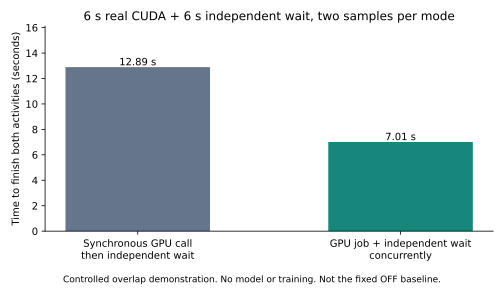

# GPU 作业入口、任务遥测与执行后端统一

> **核心结论**：GPU 作业现在有独立的提交、查询、等待、取消和遥测入口。调用方可以在作业排队、计算及归还期间执行无依赖的工作。确认物理归还之前，GPU 配额仍保留。默认 science Terminus2 已接入该工具。
>
> 遥测改用节点采集的进程数据，并按容器 cgroup 和进程出生身份过滤。普通 Docker 的整卡 NVML 视图没有被虚拟化。嵌套 PID 命名空间必须提供宿主机 procfs，否则拒绝归因。当前实验节点缺少该部署条件，正向进程归因只有 CPU 契约验证，没有实机验收通过。

## 目录

- [1. 完整执行链](#1-完整执行链)
- [2. 作业入口与重叠边界](#2-作业入口与重叠边界)
- [3. 任务遥测与评分](#3-任务遥测与评分)
- [4. 为什么统一 EnvWorker 和 Harbor](#4-为什么统一-envworker-和-harbor)
- [5. Results 与复现](#5-results-与复现)
- [6. 跟着图读源码](#6-跟着图读源码)
- [7. 尚未完成的目标](#7-尚未完成的目标)

## 1. 完整执行链

```text
[1] Science runner：申请会话租约，接入工具，检查原生 CUDA 评分条件
      ↓
[2] 模型输出 psrl-gpu JSON → Terminus2 工具适配器
      ↓
[3] GpuJobManager：返回 job_id，后台拥有作业生命周期
      ├──────── 调用方继续独立 CPU 工作或模型规划
      ↓
[4] exec_gpu → Router FIFO 与配额检查 → 节点授权设备
      ↓
[5] 容器进程组运行前台 GPU 程序
      ├──────── [6] 节点 NVML + 宿主机 procfs → 仅保留本任务进程样本
      ↓
    输出就绪：调用方可使用结果，设备归还仍在进行
      ↓
[7] 撤销新访问 → 检查 GPU 描述符、映射与计算进程 → 配额释放
      ↓
[8] 汇合剩余作业 → verifier 正确性评分 → 主机活动归因门槛
      ↓
[9] 回收容器集合，释放会话租约
```

图例：图里每个部分对应的源码位置。

| 编号 | 职责、函数及源码 |
|---|---|
| 1 | [runner 的 command 接线](../../examples/sciaccel_rl/runner.py#L390)及原生 CUDA 遥测预检 |
| 2 | [TruncatingTerminus2._execute_commands](../../examples/sciaccel_rl/agent.py#L104)，只拦截明确的作业工具请求 |
| 3 | [GpuJobManager.start](../../psrl/workers/env_service/gpu_jobs.py#L58)，后台任务拥有执行与清理 |
| 4 | [ManagedDockerEnvironment.exec_gpu](../../psrl/workers/env_service/docker.py#L78)，沿用资源账本和设备授权协议 |
| 5 | [_run_gpu_process](../../psrl/workers/env_service/docker.py#L192)及 [进程组助手](../../psrl/workers/env_service/gpu_job_process.py) |
| 6 | [TaskGpuTelemetry.sample](../../psrl/workers/env_service/task_telemetry.py#L56)，核对 PID 视图、cgroup 和进程出生身份 |
| 7 | [revoke_gpu_command](../../psrl/workers/env_service/command_gpu_node.py#L153)，物理确认后才解除 GPU 预算 |
| 8 | [apply_gpu_activity_gate](../../examples/sciaccel_rl/gpu_grading.py)，结合每个检查的宿主机报告调整训练奖励 |
| 9 | [ManagedDockerEnvironment.stop](../../psrl/workers/env_service/docker.py)，作业汇合后进入 Harbor 容器清理，runner 再归还租约 |

## 2. 作业入口与重叠边界

普通终端工具的“返回”只说明当前观察结束。例如，一个 30 秒的仿真被送进 tmux，工具观察 1 秒后返回，GPU 还可能计算 29 秒。将这次终端调用直接当作 GPU 完成边界会过早归还资源。

新入口将“提交工作”和“工作结束”分开。调用者得到一个作业编号 `job_id`，随后可以查询或等待它。

| 操作 | 行为 |
|---|---|
| `start` | 验证参数，立即返回编号。后台等待配额和执行，不阻塞调用者 |
| `status` | 返回排队、运行、归还中、完成、取消或失败状态，以及已有输出 |
| `wait` | 等待输出就绪，或设置 `released=true` 等待资源归还。观察超时不会取消作业 |
| `cancel` | 取消队列项或终止所属进程组，等待设备归还确认。不能确认时按原协议隔离相关 unit |
| `telemetry` | 返回本作业的节点侧归因报告。不可测时报告缺失原因 |

Science 的模型仍使用 Harbor 的命令字段，但可以提交以下独立一行。它由代理适配器解析，不在宿主机 shell 中执行：

```text
psrl-gpu {"op":"start","command":"./solver","cwd":"/workspace","tag":"aw-2d-256","timeout_sec":300}
psrl-gpu {"op":"status","job_id":"替换为返回的编号"}
psrl-gpu {"op":"wait","job_id":"替换为返回的编号","timeout_sec":1,"released":false}
psrl-gpu {"op":"telemetry","job_id":"替换为返回的编号"}
psrl-gpu {"op":"cancel","job_id":"替换为返回的编号"}
```

第一条提交一个前台求解程序。`cwd` 是程序目录，`tag` 将它关联到具体评分检查。GPU 作业在独立 bash shell 中执行，共享容器文件，但不隐式继承 tmux 的目录和变量，需显式传入 `cwd`、`env`。普通 CPU 命令仍走原终端。

作业管理器在 `psrl/workers/env_service/gpu_jobs.py`，不导入 Harbor 或 Ray。它接受一个异步执行器。当前生产适配器是 ManagedDockerEnvironment，负责真实 GPU 授权、进程控制和资源归还。其他后端必须提供同样的物理完成契约，不能只把普通 shell 调用接上就宣称安全。

默认 science 代理在 command 租约下自动切到带工具的本地 Terminus2 子类。它会向模型说明工具协议。自定义代理需要主动使用这些入口，不能假定任意 shell 字符串中的 CUDA 工作都会被识别。

**可以重叠的工作有依赖约束。** 教学例子：A 的 GPU 求解需要 6 秒，同时有 6 秒不依赖其结果的规划工作。串行约为 `6 + 6` 秒，并行约为 `max(6, 6)` 秒，另外加调度和工具开销。如果下一步必须读取求解结果，就必须等待 `output_ready`，不能靠异步消除数据依赖。正在使用的输入文件也不能被并行 CPU 操作覆盖。

同一容器的 GPU 作业串行，因为设备权限以容器为边界。不同容器仍可以在账本允许时并发。作业排队不占 GPU 活动配额，但会话的 CPU、主存和容器配额继续保留。当前 GPU 申报仍来自会话需求，不是每个作业自动预测实际显存。

每个 episode 最多提交 128 个作业。执行与排队超时默认各 300 秒，单项最多 3600 秒。状态输出尾部各最多 16000 字符。取消使用进程出生时间检查防止 PID 复用误杀。后台 CUDA 子进程遗留仍会阻止归还，没有实现任意进程暂停与恢复。

## 3. 任务遥测与评分

NVML 是 NVIDIA 提供的设备管理接口。整卡利用率回答的是“这张卡是否忙”，不回答“是谁让它忙”。Docker 的 PID 命名空间隔离，也不会自动把整卡显存和利用率变成任务专属数据。

当前设计提供的是**受管理的任务资源视图**：

1. 节点从 NVML 读取进程显存及带时间戳的进程利用率样本。
2. 在宿主机 procfs 中核对进程所属的设备 cgroup。cgroup 是 Linux 归组进程、实施资源控制的机制，此处用于匹配容器及其后代。
3. 检查进程出生时间，拒绝作业开始前或 PID 复用前的旧样本。
4. 只将匹配本任务的显存和利用率写入报告，记录样本数量、峰值和缺失原因。
5. GPU 作业返回后保留报告，runner 清理租约前写入作业目录中的 `gpu-job-reports.json`。

显存是匹配进程的 NVML 报告值之和。利用率报告使用观测到的进程样本峰值，不声称多个进程的百分比可以线性相加成精确的整卡占比。没有利用率样本时保留 `null`，不替换成整卡数据或零。瞬时、短命进程可能采不到样本，不能据此断言没有运行 GPU。

**宿主机 PID 与节点 PID 必须一致或可以可靠映射。** 本次实机中，节点 cgroup 看到的进程编号与 NVML 返回的编号不同。它们分别来自容器命名空间与物理宿主机，不能按相同数字直接关联。[NVIDIA 的问题记录](https://github.com/NVIDIA/nvidia-docker/issues/1483)也说明了这种差异。

部署时选择以下方式之一：

- 将节点遥测服务运行在物理宿主机 PID 视图中。
- 给节点服务只读挂载真正的宿主机 `/proc`，将 `PSRL_GPU_HOST_PROC` 设为挂载路径。此变量须传入实际 EnvNodeService 进程，不能只设在训练 driver 中。

实现检查 procfs 中 PID 1 对应的 Linux 初始 PID 命名空间身份，避免把嵌套 Docker 的“host”误当作物理宿主机。该身份常量来自 [Linux 的命名空间定义](https://github.com/torvalds/linux/blob/master/include/linux/proc_ns.h)。当前实现依赖 Linux cgroup v1 的设备控制协议。

不能在当前容器中把它自己的 `/proc` 再挂一次就解决问题，也不应通过容器内替换 `nvidia-smi` 可执行文件来宣称实现了资源隔离。任务还可以通过 NVML 或 CUDA API 读取物理设备信息。

如果要在硬件层让任务拥有独立的计算和显存分区，应另行考虑 [MIG](https://docs.nvidia.com/datacenter/tesla/mig-user-guide/latest/index.html)，即将支持的 GPU 切成硬件实例。它会引入分区配置和粒度限制，且部分进程利用率接口在 MIG 下不支持。本次没有启用 MIG，也没有改变物理 GPU 配置。[NVML 接口说明](https://docs.nvidia.com/deploy/nvml-api/latest/api/group__nvmlDeviceQueries.html)列出了逐进程利用率的支持边界。

**原生 `laps-accel-cuda` 的评分适配。** 它的 verifier 做数值正确性检查，同时依据任务保存的整卡 CSV 给出 GPU 活动判断。command 路径保留数值正确性奖励，改用节点报告判断三个检查 `aw-2d-256`、`aw-2d-512`、`aw-128` 是否各自有已完成、带匹配 tag 的 GPU 作业。每个检查至少需要三个有效观测及不低于 10% 的峰值利用率。

原始 verifier 文件不会被改写，最终训练奖励与主机报告另存。缺少主机进程视图或设备不支持利用率时，在启动原生 CUDA episode 前拒绝执行。运行中遥测失败也拒绝按成功样本评分，不能将基础设施缺失伪装成任务零分。

这一适配解决邻居活动误归因，不是恶意解题策略的完整验证器。任务仍能在自己的作业里运行无关 GPU 程序，也能给作业命名。证明“指定求解算法本身使用了 GPU”还需要更严格的执行或检查协议。

## 4. 为什么统一 EnvWorker 和 Harbor

原设计的核心理由是重复维护。旧 EnvWorker 同时承担任务放置与容量管理、容器创建和持续 shell 执行。Science 则另走 Harbor，形成另一套容器生命周期和清理路径。原稿的方向是保留并通用化调度层，统一容器执行层，Harbor 仍作为执行器。

这不是 Harbor 无法管理 Docker GPU。当前 ManagedDockerEnvironment 已经证明可以在 Harbor 生命周期中接入设备映射、命令授权、进程控制和资源归还。真正的问题是资源协议应该有一个明确的拥有者，并覆盖所有调用者。

建议的目标结构如下，**这是下一阶段提案，尚未完成迁移**：

```text
Science / MLGym / AIRS-Bench 的任务适配器
                  ↓
统一的环境会话接口
open / exec_cpu / start_gpu_job / wait / cancel / close
                  ↓
执行 Worker：持有会话、工具状态、作业与异常清理
                  ↓
Harbor Docker 环境 + 持久终端
                  ↔
EnvRouter / EnvNodeService：准入、GPU 授权、遥测、归还
```

图例：目标中的执行 Worker 与统一会话接口尚无完整实现。当前可复用部分是图 1 的 [作业管理器](../../psrl/workers/env_service/gpu_jobs.py)、[Harbor 适配器](../../psrl/workers/env_service/docker.py)和 [节点服务](../../psrl/workers/env_service/node.py)。旧执行器仍为 [ContainerShell / EnvWorker](../../psrl/workers/env_worker/worker.py)，Science 仍在 [agent_loop](../../examples/sciaccel_rl/agent_loop.py) 中调用 Harbor。

实施顺序应为：先固定会话协议与等价测试，再将 MLGym 接到 Harbor 环境和持久终端，随后把 science 的 Harbor 调用移到专门执行 Worker，最后删除重复的 shell 与线程执行路径。MLGym 不必被强行改成 Harbor 内置代理循环，它可以通过同一会话接口逐轮调用；共享的是容器执行后端。

执行 Worker 与轻量控制服务应保持职责分离。不要把耗时的构建、模型调用和整条任务塞到负责 GPU 授权的关键控制路径里。统一不应重新把“整条 episode 持有 GPU”作为默认行为。

收益包括统一取消和回收、统一资源协议、统一观测，以及让调用者与容器初始放置解耦。它不自动提供活容器跨节点迁移。已经创建的 GPU 作业仍在会话所在节点运行。

## 5. Results 与复现

本节记录限定规模的小实验，不代表完整 science 训练或固定 OFF 提交对照。原始日志保存在运行输出目录，便于分享的结果摘要在 [summary.json](gpu-job-validation/summary.json)。

| 检查 | 实际观察 | 结论边界 |
|---|---|---|
| 6 秒真实 CUDA + 6 秒独立等待，串行、并行、并行、串行各两次 | 串行均值 12.89 秒，作业重叠均值 7.01 秒，总时长减少 45.64% | 独立工作用等待模拟，没有运行 vLLM，也没有训练。对照是当前同步 `exec_gpu`，不是固定 OFF baseline |
| 未获授权的普通 CUDA 调用 | 被拒绝 | 明确工具入口不能被普通终端 GPU 调用绕过 |
| CPU 任务与邻居真实 CUDA 同卡 | CPU 任务看到整卡利用率 99% | 复现了整卡遥测污染 |
| 正向进程归因 | NVML 宿主机 PID 与节点 `/proc` 不匹配 | 私有节点与一个历史节点都缺宿主机视图。已实现拒绝和预检，正向真实归因仍未验收 |
| 作业取消与再次申请 | 取消状态完成，配额归零，后续真实 CUDA 内核返回 42 | 覆盖前台进程组及物理归还，不覆盖任意脱离会话的 GPU 守护进程恢复 |
| Harbor 与旧 EnvWorker shell | 两次调用保留目录、环境变量、shell 函数 | 使用缓存 science 镜像的 CPU 实验，不等于完整 MLGym 等价验收 |
| 回归 | 61 项针对性检查通过 | 覆盖作业生命周期、归还协议、归因过滤、原生任务预检及 science 工具接线 |
| 物理收尾 | GPU 计算进程为 0，显存回到约 0.19 MiB 的启动基线 | 所属容器及 sidecar 已清理，未停止共享 Ray 或重启 Docker |



时长来自首轮作业原型，当时逐进程归因未正确匹配，不能用这组数值估计完整、有效遥测部署后的开销。后续只补验故障修复和未完成项目，没有为追求更漂亮的时长重跑对照。

首轮实机还发现进程出生身份比较不能直接比较两次换算后的墙钟时间。换算会有微小漂移，稳定身份应使用内核出生 ticks，墙钟只用于筛除旧样本。对应回归已覆盖。

最初 GPU 探针镜像没有 tmux，不能完成 shell 检查。随后只补跑缓存 science 镜像的 CPU shell 对照，没有重复已完成的 GPU 延迟实验。

本次修改文件的 Ruff、格式及注释风格检查通过，新增文档的路径、源码行号和目录锚点检查通过。全仓 `pre-commit run --all-files` 在隔离副本执行，仍有其他文件的既有格式及注释问题，不能报告为全仓通过。自动修改没有写回工作区。

在仓库根目录使用项目 Python 环境运行 CPU 验证：

```bash
python -m pytest tests/env_service/test_gpu_jobs.py tests/env_service/test_task_telemetry.py tests/env_service/test_runner_env_service.py -q
python docs/env-worker-deep-dive/env-service-verification/scripts/plot_gpu_job_results.py
```

第一条验证排队与取消、输出与归还分离、拒绝邻居样本、进程身份变化及 science 接线。归因用例含教学输入，不会分配 GPU。第二条从已提交的摘要再生成图，不重跑实验。

真实 GPU 脚本需要先按集群运行指南检查设备空闲、镜像、Docker 和容器 CUDA 能力。设置 `GPU_JOB_IMAGE` 为已缓存的探针镜像，`GPU_JOB_INDEX` 为现场核验的设备序号，`GPU_JOB_OUTPUT` 为新建的独立结果目录：

```bash
python docs/env-worker-deep-dive/env-service-verification/scripts/gpu_job_probe.py \
  --image "${GPU_JOB_IMAGE:?Set a cached image with Python and bash}" \
  --gpu "${GPU_JOB_INDEX:?Select a verified idle GPU}" \
  --output "${GPU_JOB_OUTPUT:?Set a new output directory}"
```

脚本最多运行 300 秒，使用两只小容器和一张 GPU。默认要求正向归因通过。只诊断缺少宿主机视图的失败路径时，显式加 `--allow-unavailable-attribution`，结果不能称为正向归因成功。`--skip-latency` 用于已有时长证据、只补验后续项目的情况。

CPU 后端契约脚本是 [harbor_shell_contract.py](env-service-verification/scripts/harbor_shell_contract.py)，用 `--image` 指定包含 tmux 的缓存 science 镜像，`--output` 指定独立目录。它比较真实 ContainerShell 和 Harbor TmuxSession，不加载模型。

## 6. 跟着图读源码

| 步骤 | 图中编号与函数 | 输入、输出及并发关系 |
|---|---|---|
| 接入任务 | 1，runner command 分支 | 租约转成环境配置，默认代理开启 `gpu_jobs`。原生 CUDA 先检查遥测条件 |
| 提交工具 | 2，`_execute_commands` | JSON 转成结构化参数，普通 CPU 命令仍交给 Harbor |
| 后台作业 | 3，`start` / `_run` | 立即返回编号，后台获得容器作业锁及 GPU 配额。这里与模型工作并行 |
| 设备授权 | 4，`exec_gpu` / `acquire` | unit 预算通过后授权设备，普通命令在授权前不能使用 GPU |
| 执行与采样 | 5、6，`_run_gpu_process` / `sample` | 前台进程组和节点采样并行，不把终端观察窗口当作程序结束 |
| 输出与归还 | 7，`revoke_gpu_command` | 输出可读之后仍可能处于 returning，归还确认才释放容量 |
| 评分与退出 | 8、9，`apply_gpu_activity_gate` / `stop` | 等待必要作业、核对检查 tag、保存报告、清理整个会话 |

具体源码路径见第 1 节图例。这些代码或并发关系有不清楚的地方，可以随时追问。

## 7. 尚未完成的目标

本次没有删除旧 EnvWorker，也没有把所有 Harbor episode 搬到新的执行 actor。下一步应完成 MLGym 的超时、中断、后台输出、截断与最终奖励等价测试，再迁移并删除重复实现。

正向任务遥测还需要在具备宿主机进程视图的节点运行真实 CUDA 对照，并验证三项原生 LAPS 检查的训练奖励。当前只完成接口、过滤规则、错误拒绝和评分接线，不能写成原生 CUDA 训练已经通过。

任务标签的可信性、短命 GPU 进程的采样覆盖、MIG 设备支持、cgroup v2、服务重启恢复和跨节点重派发仍需独立设计和验收。GPU 作业接口没有引入任意 CUDA 进程抢占、自动显存预测或跨节点容器迁移。
