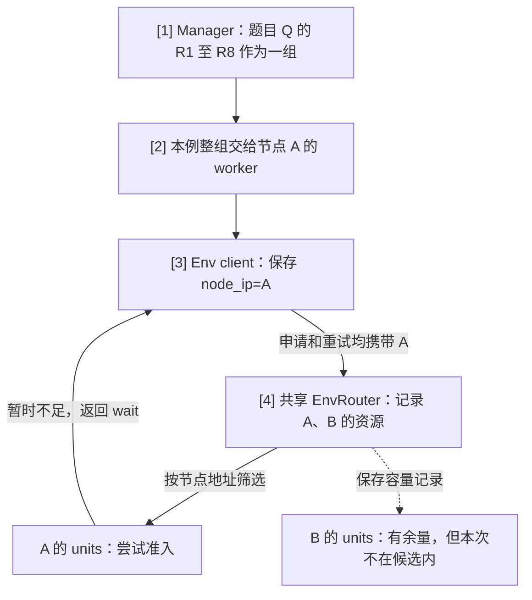

# Env架构：现状与完整执行流程

> **核心结论**：EnvRouter 仍是环境资源准入入口。容器和文件可以随会话保留，GPU 则按 episode 全程持有或按 command 逐命令申请归还。显式配置后，下一条命令还可改用同机兼容卡、共享 vLLM 余量，或在低推理负载下借出一个休眠副本的整卡。这些是可用动作，是否缩短完整训练需由对应实验判断。

例如，一个任务先用 GPU 训练 20 秒，再等 Agent 思考 10 秒，最后继续训练。采用逐命令借还时，20 秒训练结束并确认资源释放后，其他任务可以使用这张 GPU；原任务的文件仍留在容器里。Agent 发出下一条 GPU 命令时，再重新申请资源。这里的数字是教学假设，具体任务能否归还取决于后台进程是否仍持有 GPU。

本文是 Env 设计现状的主文档。先看下方能力与主基线对照，再沿调用流程理解配置、记账和归还。性能证据集中在[实验总览](../../experiments/01-实验总览_调度收益与证据范围.md)，接下来做什么看[研究优先级](../../milestones/05-调度研究_研究全景与证据详解.md#接下来可以做什么优先级与验收边界)，本篇不重复维护完整实验表。版本和源码核对范围见第 6 节。


## 目录

- [先看结论：现有能力与主基线](#先看结论现有能力与主基线)
- [1. 现在的完整结构](#1-现在的完整结构)
- [2. 四个容易混淆的选择](#2-四个容易混淆的选择)
  - [2.1 先声明环境资源范围，再分派和申请](#21-先声明环境资源范围再分派和申请)
  - [2.2 同一道题八条 rollout 的 episode 调度](#22-同一道题八条-rollout-的-episode-调度)
  - [2.3 command 在共同机制上增加什么](#23-command-在共同机制上增加什么)
  - [2.4 为什么会在本节点排队，其他节点仍有空闲](#24-为什么会在本节点排队其他节点仍有空闲)
- [3. 资源如何计算与归还](#3-资源如何计算与归还)
- [4. 已实现与尚未完成的边界](#4-已实现与尚未完成的边界)
  - [任务接入：哪些可以开始使用](#任务接入哪些可以开始使用)
  - [固定工作量服务：等待热卡，还是在冷卡重建模型](#固定工作量服务等待热卡还是在冷卡重建模型)
- [5. 跟着图读源码](#5-跟着图读源码)
- [6. 可运行例子与验证边界](#6-可运行例子与验证边界)
  - [核对记录](#核对记录)
- [7. 接下来按问题阅读](#7-接下来按问题阅读)

## 先看结论：现有能力与主基线

统一主基线是**静态独立环境卡池、episode 持卡、容量不足排队**。它可以使用同一 EnvRouter、同一显存安全检查，和改进组使用共同冻结的代码。比较的是策略提供的动作，不是“旧框架没有任何资源管理”。

| 要决定什么 | 统一主基线 | 当前实现可以增加的动作 | 使用边界 |
|---|---|---|---|
| GPU 预算留多久 | 获准后保留至会话清理 | Command 在一条命令物理归还后释放，下一条重新申请 | 独立受管命令不能遗留未管理的 GPU 进程 |
| 下一条命令放哪里 | 会话已获准的环境卡 | 显式同机命令池内重新选卡 | CPU、主存、容器、文件不迁移，不搬运行中 CUDA 进程 |
| 独立环境池满了 | 等待 | 再检查已绑定 vLLM 卡的安全余量 | 先独立卡，后推理余量，模型仍常驻 |
| 推理长期低负载 | 卡的角色不变 | 可选控制器排空一个副本、休眠后把卡交给环境 | 完整训练已观察借出，恢复尚未实机触发，不借训练卡 |
| 是否按任务选择持卡方式 | 固定 episode | Auto 根据可信执行能力声明和可选成本预测，准入时选一次 | 不自动理解任意 shell，不在活动会话中反复切换 |
| 发布新权重时是否等待 | 独立池不占推理卡 | 共享默认等归还，特定 NIXL 配置可显式允许同步越过准备期 | 不是任意计算期间都可无损同步，策略权重内容核验仍缺证据 |

这些能力都不是“全局自动打开”。基础配置的 Env Service、整卡调整、共享同步重叠默认关闭，候选设备要声明并核对实际归属。**AIRS 等任务的接入路径不同，底层有能力不表示每个 benchmark 的所有命令都已接通。**

主目录的 Compose 提供者在受管 GPU 命令执行前，通过本机 Docker API 按项目、服务和租约查当前容器，声明 actor 时也核验其归属；不再启动 Compose 子进程查询 ID。只读查询有最多两次重试，受准入剩余预算约束。公共执行层记录查询、准入、执行与归还阶段，Agent 公共包装层区分整轨迹与操作超时。CPU 和真实容器验证已通过，尚未用于新的正式训练对照；流程中的资源归属和清理顺序不变。细节见[查询修复与证据边界](06-工程审查_待修复问题与优先级.md#容器查询修复与-trace-能回答的问题)。

Episode 主基线、Command 静态池和重叠交接补跑均完成相同两步。相对主基线，Command 静态池的训练与完整作业分别少用 33.07% 和 14.77%，重叠交接补跑分别少用 47.04% 和 38.39%。各组分次运行，放置协议、启动阶段与实验时限存在差异。 [当前两步对照](../../experiments/01-实验总览_调度收益与证据范围.md#完整两步主基线对照)

## 1. 现在的完整结构

[](../../experiments/env-current-layout.svg)

先从上面的两条路径读：SMG 负责模型请求，EnvRouter 负责环境资源。中间看资源布局，CPU 和主存跟随会话，GPU 位置跟随命令。最后看轨迹进入训练批次及权重返回推理。该图说明显式单卡 direct 池的结构，下面补充 Harbor、AIRS 和 MPS 的具体分支。

先看800像素宽的屏幕版，点击图片可查看完整分面板图。回顾持有方式时看[episode与command对照](../../../_static/img/document-figures/command-episode-residency-screen.png)，回顾推理卡使用时看[选卡顺序](../../../_static/img/document-figures/chapter-gpu-priority-screen.png)与[共享控制](../../../_static/img/document-figures/chapter-sharing-control-screen.png)。

下面是已启用 Env Service 时的结构示意。容器提供任务的文件和进程视图，命令进程在其中按需启动、退出。容器可以跨命令保留；后台模型进程仍存活时，命令返回后显存也可能继续被占用。箭头表示调用或数据传递，不表示所有环节都在同一个进程里顺序执行。

<!-- figure:host-and-gpu-ledgers -->
这张图沿同一个场景解释：同机换卡时，容器、CPU、主存、GPU预算和模型状态各自怎样处理？

[](../../../_static/img/document-figures/host-and-gpu-ledgers.png)

教学同机布局：首条GPU命令运行20秒，思考10秒，再执行10秒。容器、CPU和主存仍留节点N；GPU预算按命令申请，下一条候选设备来自配置池。完整图的换卡算例只适用于支持这一执行协议的路径，跨节点与活模型迁移另需实现。 [查看矢量图](../../../_static/img/document-figures/host-and-gpu-ledgers.svg)。
<!-- /figure:host-and-gpu-ledgers -->

```text
[1] Science runner：读取任务资源需求
       │ acquire：申请一次环境会话
       ▼
[2] EnvRouter / Ledger：选择 unit，检查预算，发放 lease
       │ unit = 节点上的资源单元，lease = 获准资源及身份凭据
       ▼
[3] Harbor 编排任务 → 容器提供者创建环境
       ├─ native EnvWorker：单容器生命周期
       └─ Harbor Compose：Compose 创建方式
       │ 两者都提供容器身份和命令执行通道
       ▼
[4] ManagedGpuExecution / GpuJobManager：提交、状态、等待、取消
       ├─ direct → GpuExecutionBackend → 同环境串行
       │             ├─ episode：使用会话持有的 GPU 预算
       │             └─ command：逐命令申请，确认归还后释放
       └─ mps → Router → 节点 MpsDomain：按作业准入与并发
                     │ 实际执行、遥测、定向取消及物理清理
                     ▼
[5] 作业结果返回 Harbor，继续下一轮任务或评分
       │ command 释放 GPU 预算不等于销毁容器
       ▼
[6] 环境结束：汇合作业清理 → 销毁所属容器 → 释放会话租约
```

图例：图里每个部分对应的源码位置。

| 节点或箭头 | 职责与实际函数 | 源码 |
|---|---|---|
| 1 → 2 | `run_harbor_episode` 在创建环境前申请租约 | [runner.py](../../../../examples/sciaccel_rl/runner.py#L369) |
| 2 | `EnvUnitLedger.try_admit` 返回获准、等待或拒绝，重复会话请求复用租约 | [ledger.py](../../../../psrl/workers/env_service/ledger.py#L113) |
| 2 → 3、4 | runner 将租约身份、持有模式、执行后端注入环境 | [runner.py](../../../../examples/sciaccel_rl/runner.py#L412) |
| 3 | 两种容器提供者都继承公共执行层 | [EnvWorkerEnvironment](../../../../psrl/workers/env_worker/harbor.py#L19)、[ManagedDockerEnvironment](../../../../psrl/workers/env_service/docker.py#L25) |
| 4 | `_init_gpu_execution` 建立执行器与作业管理器，`start_gpu_job` 提交作业 | [managed_execution.py](../../../../psrl/workers/env_service/managed_execution.py#L17)、[作业入口](../../../../psrl/workers/env_service/managed_execution.py#L137) |
| 4 direct | `GpuExecutionBackend.execute` 串联排队、执行、返回和异常清理 | [gpu_execution.py](../../../../psrl/workers/env_service/gpu_execution.py#L109) |
| 4 mps | `_execute_mps_job` 经 Router 把作业送到租约所属节点 | [managed_execution.py](../../../../psrl/workers/env_service/managed_execution.py#L194)、[router.py](../../../../psrl/workers/env_service/router.py#L349) |
| 4 → 5 | direct 路径先设置输出可读，再完成持有策略收尾 | [gpu_execution.py](../../../../psrl/workers/env_service/gpu_execution.py#L151) |
| 6 | 原生后端 `stop` 清理作业和容器，runner 的 `finally` 完成外层资源释放 | [harbor.py](../../../../psrl/workers/env_worker/harbor.py#L182)、[runner.py](../../../../examples/sciaccel_rl/runner.py#L610) |

Harbor 是任务编排框架，负责执行任务、调用评分器并收集产物。EnvWorker 是容器执行实现。EnvRouter 是资源调度入口，Ledger 是它维护的资源账本。两个容器提供者保留各自的构建和网络管理，共用提交、查询、等待、取消 GPU 作业的协议。

AIRS 目前走另一条路径：`MLGymAgentLoop → EnvWorkerCoordinator → GPU sandbox → 独立 verifier`。其中 sandbox 是任务执行容器，verifier 是独立评分程序。GPU recipe（接入配置与运行脚本）申请一个由 Ray 分配的独立 GPU 槽位，CPU recipe 申请零 GPU；逐命令借还尚待接入。调用图与 19 题验证情况见 [AIRS GPU recipe](../03-任务接入/03-AIRSBench_接入流程与有界验收.md#任务怎样进入-psrl)和[接入审计](../../airs-bench-audit/01-AIRS审计_修复状态与验证范围.md)。

## 2. 四个容易混淆的选择

| 选择 | 回答的问题 | 当前含义 |
|---|---|---|
| 是否启用 Env Service | 这次任务是否进入 Router 管理 | [默认 `enable: False`](../../../../psrl/trainer/config/psrl/env_service.yaml#L6)，实现存在不等于所有任务自动启用 |
| native / Compose | 谁创建容器 | 原生路径复用 EnvWorker，Compose 路径保留 Harbor 创建方式，两者共用 GPU 作业执行层 |
| episode / command / auto | GPU 预算持有多久 | episode 贯穿环境会话，command 在每条 GPU 命令获准后持有、确认物理归还再释放；auto 根据可信能力与可选成本建议在准入时选择其中一种 |
| direct / mps | 作业怎样执行 | direct 在同环境串行，mps 支持受管的同容器和跨容器作业并发 |

MPS 是 NVIDIA 的多进程服务，让多个程序共享 GPU 执行。这里在 MPS 外加了逐作业预算、身份和清理管理。当前接入要求环境专用单卡、cgroup v1（Linux 的进程资源管理机制）和同一可信实验域；vLLM 与环境共卡走单独的共享协议。具体条件见 [MPS 专题](../02-资源与调度/04-GPU并行_MPS执行后端.md)。

`episode` 指一次完整环境会话：例如 Agent 从接题、修改代码到最终评分的全过程。它可以经过 EnvRouter 准入，并在整个会话持有预算。后续调度实验统一以“静态独立环境卡池＋episode 持卡＋满池排队”为主基线，与改进组使用同次冻结实现，不共享推理余量或主动调整分卡。Command 静态池单列为消融，历史提交 `0eeead861ffafed6bf31c962d259fd847775dcf9` 仅保留为历史参照。完整定义、历史对照实际模式与尚缺的速度证据见[实验口径](../../experiments/09-资源分区_静态卡池与推理余量共享.md#统一基线与读表方法)。

**默认 direct 执行后端，不等于默认把环境放到推理卡。** 基础配置仍关闭 Env Service，模型共享需显式声明 unit 并绑定 rollout 副本。绑定完成后，新会话可以优先选择独立卡、容量不足再选择共享卡，默认 `cpu_only` 也保留显式共享 unit 的后备优先级。显式同机命令池也可包含已经绑定的共享推理卡，逐命令先尝试独立卡，具体例子与任务入口限制见[默认共享边界](../02-资源与调度/05-训推共享_vLLM余量与容量调度.md#默认配置与自动后备的边界)。

### 2.1 先声明环境资源范围，再分派和申请

通常先在 `psrl.env_service.units` 声明哪些节点和 GPU 可以给环境使用，以及各自的 CPU 配额、主存、显存预算和并发会话名额。`unit` 是一组受管理的资源配额，可以包含一张 GPU、多张 GPU，或只有 CPU。启动时 [Trainer._init_env_service](../../../../psrl/trainer/ppo/ray_trainer.py#L549) 把配置交给共享 EnvRouter。运行时再结合实际占用、训推设备归属、节点健康和清理状态检查，显卡短暂空闲不会自动让未配置的设备加入。

这里有两种容易都被叫作“卡池”的配置，作用不同：

| 配置 | 实际作用 | episode 是否使用 |
|---|---|---|
| `units` 及节点、设备使用规则 | 声明 Router 能管理和选择的环境资源范围 | 使用，初次会话分配就在这些候选中进行 |
| unit 的 `command_gpu_pool` | 允许已存在会话的下一条 GPU 命令在同机兼容卡之间重新选卡，独立卡优先，推理卡需显式共享绑定 | 仅实际解析为 direct command 的租约使用，包括 auto 选出的 command；episode 租约不获得命令候选池 |

基础配置仍为 `enable: False`、`units: []`，需要先启用并声明资源，见[配置文件](../../../../psrl/trainer/config/psrl/env_service.yaml#L6)。这里的“声明”是给调度器提供预算和范围，硬件上的实际显存分配仍由执行中的程序完成。

以同一道题采样 8 次为例，当前调用顺序是：

```text
训练配置声明环境 units → 启动一个共享 EnvRouter
        ↓
Manager 为同题的 8 条 rollout 选择 agent loop worker
        ↓
worker 并发推进这些 rollout，各自的 runner 代表环境申请资源
        ↓
EnvRouter 检查本次需求，选择符合条件的本节点 unit
        ├─ 可以容纳：发放 lease → 容器后端创建环境 → 执行与评分
        ├─ 暂时不足：client 等待后重试，尚未创建这次环境的容器
        └─ 空 unit 也无法容纳，或没有合法候选：拒绝申请
        ↓
各 episode 完成清理并归还资源 → 等待方重试时可继续获准
```

lease 即租约，是“哪些资源已经答应给哪次会话”的账本记录。8 条 rollout 有各自的会话身份和工作文件，共享 Router 与资源范围，不会为每条 rollout 各建一套独立资源账本。一个会话还可能包含独立评分器等多个容器。

**初次派发和正式准入分两步。** Manager 先结合节点容量，为同题采样组选择一个 agent loop worker。随后该 worker 代表每条 rollout 申请本节点的 unit。共享 Router 可以记录多节点资源，正式申请仍受所带节点地址限制。上游并发限制也可能让部分 rollout 稍后才走到申请阶段，双机算例、调用关系与容器约束见[第 2.4 节](#24-为什么会在本节点排队其他节点仍有空闲)。

Science 的 [agent loop 入口](../../../../examples/sciaccel_rl/agent_loop.py#L391) 在启用 Env Service 后直接申请 Router，由共享资源账本控制环境准入。旧路径的进程内 episode 信号量位于另一分支，不能用它的并发上限代替 Router 的资源容量。

### 2.2 同一道题八条 rollout 的 episode 调度

<!-- chapter-figure:chapter-episode-admission -->
沿同一道题的R1至R8，看环境满了如何等待、释放后如何接续。

[](../../../_static/img/document-figures/chapter-episode-admission.png)

每卡的CPU、显存和会话名额都只允许2条，本例两卡共准入4条。R1完成清理后，假设R5在重试中获准；接续顺序不构成严格FIFO保证。具体预算见下表。 [放大查看 SVG](../../../_static/img/document-figures/chapter-episode-admission.svg)。
<!-- /chapter-figure:chapter-episode-admission -->


**episode 已经支持“资源满时等待，释放后接着调度”。** 下面是教学假设，8 条 rollout 记为 R1 至 R8，均已到达同一节点并发起申请。该节点配置两个独立 GPU unit：

| 配置或需求 | GPU0 对应 unit | GPU1 对应 unit | 每条 rollout 申请 |
|---|---|---|---|
| CPU 配额 | 8 | 8 | 4 |
| 系统主存 | 32 GiB | 32 GiB | 8 GiB |
| 可供环境使用的 GPU 显存预算 | 40 GiB | 40 GiB | 20 GiB，使用一张卡 |
| 并发会话名额 `max_containers` | 2 | 2 | 1 |
| GPU 持有方式 | `episode` | `episode` | 随获准 unit 确定 |

本例使用 direct 后端，假设没有外部干扰，已有 GPU 占用能可信归属，所有实际显存检查均通过，资源需求也已涵盖会话中需要同时活动的容器。每个 unit 的 CPU、显存和会话名额都允许 2 个会话，因此总共可以准入 4 个。`max_containers` 在当前账本里按活动会话租约数检查，一个租约对应的实际容器集合可能不止一个容器。

上图中的接续只发生在R1完成执行、评分与所属容器清理以后：GPU0留下R3，R5在下次重试时占用释放的容量；GPU1仍是R2、R4。其余请求继续等，各会话完成后独立归还，直到八条全部结束。

前四条获准后才创建自己的环境。后四条等待时仍有 rollout 的执行流程和请求状态，但这次环境的受管理容器尚未创建。8 并发表示可以同时推进 8 条求解流程，实际同时持有环境资源的数量仍受容量约束。

每条 rollout 独立完成清理和资源归还，无须等同题的 8 条全部结束。上层何时收齐这一组样本，与单个环境何时释放租约，是两个不同的时机。

episode 会一直保留获准的 GPU 预算。R1 完成一条 GPU 命令、开始等模型回复时，即使实际显存暂时减少，这份 20 GiB 的承诺仍在账本中。其他会话只有在剩余资源足够时才能进入。R1 整段会话结束后，runner 清理其所属容器集合，再释放租约；Router 对待清理资源保留检查，确认后才允许复用。

“释放后自动接续”由等待 client 持续重试实现。[acquire](../../../../psrl/workers/env_service/client.py#L159) 默认从 1 秒基础间隔开始，按 1.5 倍退避至 5 秒基础上限，每次加入随机抖动。Router 在下一次申请时重新选择符合条件的本节点 unit，并检查 CPU、主存、名额和 GPU 容量。本例 R5 先获准只是示意顺序，这层申请目前不保证严格先到先服务。

直接支持这一过程的代码是 [Ledger.try_admit](../../../../psrl/workers/env_service/ledger.py#L113)、[_fits_now](../../../../psrl/workers/env_service/ledger.py#L542)、[runner 收尾](../../../../examples/sciaccel_rl/runner.py#L610)、[Router.release](../../../../psrl/workers/env_service/router.py#L331)，以及真实节点的[清理与健康核对](../../../../psrl/workers/env_service/router.py#L653)和[正式准入](../../../../psrl/workers/env_service/router.py#L793)。

### 2.3 command 在共同机制上增加什么

<!-- chapter-figure:chapter-gpu-pool-host -->
逐命令换卡只改变本条命令的GPU授权，主机上的会话资源仍在。

[](../../../_static/img/document-figures/chapter-gpu-pool-host.png)

图表示已配置同机兼容命令池的路径。没有命令池时仍申请原卡；活模型状态和跨节点容器不会随这条授权自动搬走。 [放大查看 SVG](../../../_static/img/document-figures/chapter-gpu-pool-host.svg)。
<!-- /chapter-figure:chapter-gpu-pool-host -->


command 复用上一节的会话准入与收尾流程，把 GPU 预算的占用期缩短到每次显式 GPU 程序执行。CPU、主存、工作文件和会话名额仍保留到 episode 结束。

| 资源生命周期 | episode | command |
|---|---|---|
| 创建环境前 | 检查并预约主机资源与 GPU 预算 | 检查并预约主机资源，确认 GPU 需求形状可满足，暂不占活动 GPU 预算 |
| 会话发起 GPU 命令 | 使用已持有的 GPU 预算 | 再申请本次 GPU 预算和设备权限，暂时不足则等待 |
| GPU 命令结束，开始 CPU 工作或模型交互 | 继续持有 GPU 预算 | 确认物理归还后释放 GPU 预算，保留主机资源 |
| 整段会话结束 | 清理所属资源，释放整份会话预算 | 清理所属资源，释放剩余会话预算 |

因此，上一节的配置若只把 `episode` 改为 `command`，**仍然最多准入 4 个会话**，因为 CPU 配额和会话名额没有增加。若希望 8 个会话同时保留环境、轮流使用 GPU，主机资源和名额也必须允许 8 个会话。单条 GPU 命令归还资源后，其他已经准入的会话可以申请该 GPU。

再次需要 GPU 时，没有配置 `command_gpu_pool` 就申请原卡，显式配置同机命令池才可以在兼容卡中重新选卡。共享推理卡必须加入同名池并通过模型余量校验，独立卡先尝试。池内命令队列采用先到先尝试的 FIFO 顺序，与前一节会话准入的随机退避重试是两层不同机制，见 [GpuCommandScheduler.acquire](../../../../psrl/workers/env_service/command_gpu.py#L82)。episode 的首次会话选卡和释放后接纳新会话，都由共同的会话准入层完成，不需要这个命令池。

显存预算允许多个会话同卡，只说明可以准入。各程序仍会竞争实际计算资源，unit 配额没有给它们划出独立计算单元。逐命令设备归还原理与开销见[命令阶段配额](../02-资源与调度/02-命令调度_GPU申请归还与状态保留.md#2-为什么整任务模式保留配额)，独立卡换卡配置见[同机命令池](../../research-proposals/03-动态放置_会话与GPU执行分离.md#11-已实现的同机命令池与资源账本)。

### 2.4 为什么会在本节点排队，其他节点仍有空闲

<!-- chapter-figure:chapter-grouped-placement -->
跨节点选择发生在前面，排队时的重试并不会再做一遍全局派发。

[](../../../_static/img/document-figures/chapter-grouped-placement.png)

本例A可同时容纳4条，整组8条已派到A，余下4条在A等待。B的空闲不意味着本次申请有权转过去；下面再给出节点地址怎样传入申请的源码。 [放大查看 SVG](../../../_static/img/document-figures/chapter-grouped-placement.svg)。
<!-- /chapter-figure:chapter-grouped-placement -->


当前 Science/Harbor 路径的跨节点选择发生在请求进入 worker 之前，正式环境申请则限定在 worker 所在节点。这里要区分机器、控制进程与资源配额：节点 A 是一台执行机器，agent loop worker A 是运行在这台机器上的一个进程，A 的 unit 则是配置给环境使用的 CPU、主存、GPU 与名额。一个节点可以有多个 worker，一个 worker 可以交错推进多条 rollout。模型生成通过独立的推理服务完成，选择 worker A 不等于把 vLLM 模型放到 A。

**第一步决定谁负责推进这一组求解，第二步决定本地哪些资源可以给每次环境使用。** Manager 使用题目身份 `parent_id` 把同题采样归为一组，每组只选择一个 worker，再把组内各条请求放进该 worker 的批次。例如题目 Q 有 R1 至 R8，当前结果可以是 `Q → worker A`，随后八条请求都进入 A，组内各自保留会话与环境。这条分组规则没有把八条 rollout 合并成一个容器。

派发器会比较不同节点的容量快照。快照是稍早采到的剩余资源记录，派发器在本批计划内扣减预计需求，正式的 lease 仍由后续逐条申请产生。有节点能容纳整组时，优先从能放下整组的节点中选择；所有候选都放不下整组时，可以选择当前能容纳更多条的节点，让剩余条目在当地等待。因此“比较了全局容量”与“允许拆开同题组”是两项不同能力。

正式申请时，worker 的 Env client 从 Ray 读取本进程所在节点地址，保存为 `self.node_ip`。每次申请或重试都把这个地址传给 Router。Ledger 遍历配置的 units 时，先排除其他节点的 unit，再检查资源是否足够。重试只重新检查原节点的资源，未返回 Manager 再选一次 worker。

这个限制来自申请携带的节点地址，与 EnvRouter 服务进程部署在哪台机器无关。等待时只是当前 rollout 的申请流程暂时挂起，worker 仍可以推进其他 rollout；挂起等待本身不会把它交给另一台机器上的 worker。



图例与直接源码定位：

| 步骤 | 调用与状态变化 | 源码 |
|---|---|---|
| 1 | `parent_id` 分组，每题组得到一个 worker 索引，组内行复用同一个选择 | [Manager.get_dispatch_plan](../../../../psrl/workers/agent_loop/manager.py#L984) |
| 1 → 2 | 比较整组能否容纳，选择节点上的 worker，维护本批预计容量 | [EnvAwareDispatcher._assign_resources](../../../../psrl/workers/env_service/placement.py#L188) |
| 2 → 3 | 从本进程所在 Ray 节点取得地址，传给 Env client 构造函数 | [EnvServiceClient.from_config](../../../../psrl/workers/env_service/client.py#L149) |
| 3 → 4 | 每轮 `try_admit` 都传 `self.node_ip`，等待后仍走同一循环 | [EnvServiceClient.acquire](../../../../psrl/workers/env_service/client.py#L186) |
| 4 → A | 先排除与请求节点地址不同的 unit，再做容量检查 | [Ledger.try_admit](../../../../psrl/workers/env_service/ledger.py#L156) |

**用两台机器看影响。** 以下是教学场景：A、B 都有合法环境 units 和可接单的 worker，各自能同时容纳 4 条此类环境会话，其他需求均满足。同一道题采样 8 次，两个节点都放不下完整的 8 条。假设派发时其他条件相同，本次选择 A：

| 时刻或动作 | 节点 A | 节点 B |
|---|---|---|
| 派发前 | 4 个可用名额 | 4 个可用名额 |
| 同题 8 条全部交给 worker A | 4 条获准，4 条等待 | 仍有 4 个可用名额 |
| R5 在等待循环里重试，申请仍带 A | 继续等待 A 的容量 | 空余名额仍未被这个申请使用 |
| A 的一条会话完成清理，R5 再次申请获准 | R5 在 A 创建环境 | 仍保留其空余名额 |
| 后续另一个题目组到来，刷新容量后再派发 | 可以暂时没有空余 | 新组可以选择 worker B |

这个例子中，集群合计能容纳 8 条，单题的 8 条却可能只进入 4 条。若同时有多个不同题目组，派发器可以把其他组送到 B，因此是否造成明显损失取决于题目组数量、组大小、各节点容量与后续资源变化。容器创建前已有请求在 A 等待，B 后来空闲时，现有等待循环也会继续申请 A。这是从当前调用链得到的容量利用边界。

**节点地址与容器执行位置需要一致。** 目前受支持的 Science/Harbor 部署由 worker 一侧的 runner 调用容器后端，在该节点的 Docker 与设备视图中创建环境。原生 Harbor 适配器也会构造本地 EnvWorker 并调用 `create_sandbox`，最终执行 `docker run`，见 [EnvWorkerEnvironment.start](../../../../psrl/workers/env_worker/harbor.py#L146)、[EnvWorker.create_sandbox](../../../../psrl/workers/env_worker/worker.py#L224)和[Docker 参数构造](../../../../psrl/workers/env_worker/sandbox.py#L143)。Compose 路径由[ManagedDockerEnvironment](../../../../psrl/workers/env_service/docker.py#L25)继承 Harbor 的容器生命周期。

例如 A 的容器使用设备编号 0，访问的是 A 的 GPU0；B 的 GPU0 物理上连接在 B。当前普通 Docker/CUDA 执行路径无法仅靠改一个设备号把 A 的程序放到 B 的 GPU 上。如果 Router 只返回 B 的资源额度，而后端仍在 A 创建容器，就会造成账本位置与实际资源使用位置不一致。

可以设计成 A 保留控制流程、B 创建容器和运行命令，但那需要明确的远端创建、执行、文件传递、取消与清理协议。当前共享 Router 的远程调用首先提供资源控制，未自动把 Science/Harbor 变成这种远程环境执行方式。

该约束同时影响 episode 和 command。episode 在 A 结束后，原来等待于 A 的后续请求仍在 A 准入；command 的同机池可以换到 A 的其他兼容卡，[候选筛选](../../../../psrl/workers/env_service/ledger.py#L410)仍要求相同节点。

**如果后续扩展，先区分三个时机。** 首次派发前，允许同题不同 rollout 选择不同 worker，可以利用 A、B 的合计容量，需要保留题目身份并核对结果汇总、取消与重试。已经到 A、但尚未创建环境的等待请求，还需要明确谁接管执行流程，避免在途申请导致两边重复执行。已有容器或 GPU 进程的跨节点转移，则还涉及代码、文件、进程和显存状态。这些是不同范围的改造，当前均未由这个等待循环自动完成。

2026-11-18 本次以 `c5f2d65` 加主目录内容运行一次 CPU 演示，直接调用生产派发器与账本，给 A、B 各配置 4 个会话容量。实际输出为：8 条组成一组选择 A，4 条获准、4 条等待，B 剩余 4 个名额；R5 原节点重试继续等待；模拟 A 已完成物理清理并释放一份账本预约后，R5 获准；刷新容量后，新题组选择 B。演示没有启动 Ray actor、Docker、GPU 或训练，源码版本与结果见 [evidence.json](../../env-service-verification/results/rollout-node-boundary-20261118/evidence.json)，自包含输入与运行代码保存在同目录 [probe.py](../../env-service-verification/results/rollout-node-boundary-20261118/probe.py)。

## 3. 资源如何计算与归还

容器占用的 CPU、主存和容器名额，与 GPU 活动预算有不同生命周期。command 命令结束后，文件和 CPU 状态可以继续保留，GPU 预算则必须在节点确认任务不再占用后才可复用。启用同机命令池时，CPU/主存按会话的主机 unit 计费，GPU 按本次命令实际选中的 unit 计费。两个位置由同一个 Router 的 Ledger 维护，均在同一节点，不会把主机资源搬到目标 GPU unit。若后台服务还持有 GPU 状态，只是发送请求的客户端结束，不能据此宣布 GPU 已归还。

显存准入还要同时考虑实际使用和尚未兑现的承诺。当前 [accounted_gpu_memory_mb](../../../../psrl/workers/env_service/gpu_memory.py#L9) 的计算为：

```text
计入占用 = 设备实测占用 + 每个任务 max(0, 预约量 - 可信归属于该任务的实测量) 之和
```

以下是教学假设，不是实测：三个任务各预约 20 GiB，当前各实际使用 14 GiB，总实测 42 GiB。若能够可信地确认归属，计入量为 `42 + 3 × (20 - 14) = 60 GiB`。三个任务后续尚可增长的 18 GiB 仍被保护。若没有可信归属，不能猜测哪些预约已经兑现，保守计入量为 `42 + 3 × 20 = 102 GiB`。因此，“还有空闲显存”与“账本允许再进一个任务”不是同一问题。

GiB 是显存容量单位，1 GiB 等于 1024 MiB。unit 配额是调度容量，并非给容器划出的显存硬分区。当前工作区 episode 归属与记账细节见[显存准入](../02-资源与调度/01-显存准入_实测占用与预约预算.md)。

## 4. 已实现与尚未完成的边界

**启动生命周期（11月26日主目录修改）。** 模型进程已就绪但尚未传完初始权重时，训练driver向Router提交控制句柄准备。Router完成接收与依赖加载，保存对推理服务的引用；共享GPU仍保持禁止准入。初始权重就绪以后，driver等待准备结果，Router验证显存余量，然后才开放对应单元并启动动态分区控制器。设备归属在准备之前核对。Router协议版本升为2，同名旧服务无法被新driver误复用，需待其所属任务清理后重新创建。这把独立的CPU导入与模型权重准备重叠，不提前运行环境命令，也不提前触发借卡。

[](../../experiments/gpu-control-startup-overlap.svg)

图中40秒、30秒和2秒为教学假设，用于解释72秒怎样缩至42秒，不是PSRL提速实测。[准备入口](../../../../psrl/trainer/ppo/ray_trainer.py#L608)与[Router准备及激活](../../../../psrl/workers/env_service/router.py#L165)已在主目录实现，47项相关CPU回归通过，真实Ray的CPU复现确认提前连接能隐藏部分导入等待，准备阶段始终禁止准入。修改未提交、未推送、未合并，也未装入正在执行的冻结十步任务；详细计时和真实Ray的CPU验证边界见[初始化报告](../../experiments/13-扩展对照_八卡单批次与多负载回放.md#初始化为什么更久与怎样缩短)。

先按使用场景看能力。表中的“已实现”说明本地代码具备相应机制；是否适合某次实验，还要满足链接里的配置和验证条件。

| 你想做什么 | 当前能做到哪里 | 深入阅读 |
|---|---|---|
| episode 满载等待，结束后接纳下一条 rollout | 会话准入检查本节点 unit 的 CPU、主存、名额和 GPU 预算，完成清理与归还后，等待 client 重试即可继续获准 | [八条 rollout 完整例子](#22-同一道题八条-rollout-的-episode-调度)、[节点边界](#24-为什么会在本节点排队其他节点仍有空闲) |
| 在两种容器后端运行 GPU 命令 | native EnvWorker 与 Compose 共用作业提交、等待、取消及执行层 | [统一执行层](02-统一执行_EnvRouter与容器及预算策略.md#10-当前结构与前两阶段的对照) |
| 命令之间让出 GPU | direct command 支持借还，物理归还可与 Agent 思考重叠；常驻后台模型需要显式结束或管理 | [命令阶段配额](../02-资源与调度/02-命令调度_GPU申请归还与状态保留.md#8-异步归还与模型规划并行) |
| 同一容器同时跑多条 GPU 作业 | direct 串行；显式 MPS 后端支持受管并发与单独取消 | [MPS 后端](../02-资源与调度/04-GPU并行_MPS执行后端.md) |
| 下一条命令换到同机空闲卡 | 显式 `command_gpu_pool` 支持单卡 direct command 在独立卡和已绑定共享推理卡间重新选卡。`max_gpu_commands` 可单独限制活动命令数，保留原容器、主机资源和文件。公共任务仍需接通命令与评分器，计算繁忙程度尚未用于完成时间判断 | [启用条件与拥堵区别](../../research-proposals/03-动态放置_会话与GPU执行分离.md#21-什么时候会自动考虑其他卡) |
| 使用训练或推理所在的 GPU | vLLM 共享需显式配置，启用后新会话优先独立 GPU、容量不足再选共享候选。基础配置不自动开启，Megatron 峰值协调和主动退卡仍待实现 | [默认与后备边界](../02-资源与调度/05-训推共享_vLLM余量与容量调度.md#默认配置与自动后备的边界)、[退卡提案](../../research-proposals/06-训推借卡_可撤回执行与反馈依赖.md) |
| 已绑定会话从独立环境卡转向推理卡余量 | 显式同机command池可纳入已绑定共享副本，独立卡优先。真实PSRL已完成共享和episode主基线补测，耗时有条件改善，也有共享更慢的结果。在线性能与批次依赖选择仍未接入 | [当前对照与结果](../../experiments/01-实验总览_调度收益与证据范围.md#当前训练实验有哪些结果) |
| 权重同步与环境命令并行 | 默认等共享命令归还。显式sync_overlap支持有效常驻权重的nixl_cpu同步，已观察环境准备期的真实重叠。主要计算重叠和策略权重内容仍缺核验，尚无可归因的训练提速 | [同步、等待与抢占](../02-资源与调度/05-训推共享_vLLM余量与容量调度.md#模型同步带来的额外依赖) |
| 环境池满后主动减少推理副本占卡 | 可选控制器接入 Trainer、协调器和 EnvRouter。主动查询获得空闲推理的有效反馈。可选重叠允许模型排空时按常驻预算准入、休眠时保留已准入命令、物理验收后扩容。实机交接 98.11→5.19 秒，首次重叠训练因环境命令超时退出，补跑在 3.62 秒完成交接并跑完两步，恢复未触发 | [整卡机制](../02-资源与调度/05-训推共享_vLLM余量与容量调度.md#15-固定分区与推理副本收缩) · [最新配对](../../experiments/09-资源分区_静态卡池与推理余量共享.md#交接重叠配对验证) |
| 长命令中途让出计算后继续 | 图像与 4B PostTrain 研究适配器可在完整更新后暂停，保留显存与票据。长任务对照仍显示无条件暂停丢失有益重叠；通用自动策略未接入生产 | [短任务对照](../../experiments/06-训推共享_常驻vLLM与环境并行实验.md)、[长任务对照](../../experiments/06-训推共享_常驻vLLM与环境并行实验.md#长生成与-4b-环境模型的-12-组对照) |
| 复用跨命令的模型和准备状态 | 文件、应用自己保留的进程可以延续；生产尚无通用的代码版本检查、模型卸载恢复与 GPU 缓存管理 | [状态生命周期](../02-资源与调度/07-状态复用_基线状态寿命与版本正确性.md)、[真实任务核查](../../research-proposals/04-状态复用_真实任务中的收益空间核查.md) |
| 自动选择 command / episode 与驻留时长 | 工作区已加入专用 direct GPU 的 `auto`：按任务协议逐租约选择，独立受管理命令默认选 command，也接受成本建议保留 GPU；要求成本证据时，缺少画像也保留。常驻或未知状态选 episode，同池统一计账。借卡等待预测器在独立实验控制器中验证，尚未默认接管生产共享卡或动态改变活动租约 | [自动持有粒度与决策原理](../02-资源与调度/05-训推共享_vLLM余量与容量调度.md#自动模式第一版怎样工作)、[实机实验](../../experiments/08-模式选择_Command与Episode及等待预测.md) |
| 服务配置变更或节点故障后继续工作 | 已实现同名 Router 配置核对、节点诊断和受控重新探测；隔离 Ray/Docker 链路已有验证 | [配置与恢复](05-EnvRouter_配置恢复与Worker重试.md#8-运行教学实验与回归) |
| 任务失败后继续采样 | 已有重试、补采与执行监督；原请求自动跨 worker 转移仍需单独协议 | [重试与重派发](05-EnvRouter_配置恢复与Worker重试.md#worker-失败重试与整组补采) |

**同机换卡保留的是容器和文件。** 正在运行的 CUDA 进程所持有的显存、上下文和模型状态，仍留在原 GPU。跨节点执行、MPS 池改派和活 GPU 状态迁移属于后续能力。

### 任务接入：哪些可以开始使用

当前基础范围包含 Harbor 六类 476 题、AIRS 原生 sandbox 19 题，以及独立 MLGym 9 个 GPU 任务。基础库已有逐题快检和代表题策略闭环，MLGym 的 9 题均有策略闭环。任务执行与独立评分构成环境链路，策略闭环还要求优化器更新、版本发布与新版本后续评分。

扩展库按各自完成范围使用：PostTrain 的 15/24 个组合、FastKernels 的 77/458 个目标已有独立 GPU 快检；SWE 导入 41 题，原测试与本地快速协议去重后 21 题全过，其中 17 题观察到 GPU 工作。策略闭环的逐组合与代表题覆盖、隔离情况和剩余工作统一维护在[接入状态与路线图](../../milestones/02-Science现状_任务覆盖与接入路线.md)，避免在架构入口重复全套验收表。

RE-Bench 已有任务、独立 verifier 和本地 Qwen 裁判桥接，小样本真实反馈验证通过，完整 512 条本地评分待验证。训练命令内部等待裁判时，当前仍由应用负责 GPU 生命周期，见 [RE-Bench recipe](../03-任务接入/05-REBench_聊天模型训练接入.md)。

### 固定工作量服务：等待热卡，还是在冷卡重建模型

已有[类型化放置控制器](../02-资源与调度/09-动态放置_热卡等待与冷卡重建代码.md)比较三种策略：等待有模型的热卡、始终在另一张卡重建、按预计完成时间选择。新增[命令可预测性模块](../02-资源与调度/08-命令预测_适用条件与时长估计.md)和受管理队列执行器，把“何时允许使用时间预测”变成显式条件。调用者登记固定工作量、模型与代码版本、输入和可重建性，服务报告进度。系统先检查分块稳定性、报告新鲜度和近期独立完成命令的预测误差，再核对加载与执行画像及排队成本。

默认 `off` 沿用普通容量放置。`observe` 额外计算影子预测并积累完成校准，实际仍走普通策略。`auto` 逐命令通过检查后，才允许预计完成时间改变设备选择。普通放置优先复用可行的热副本，没有副本时仍允许按容量首次加载。容量检查同时计入模型和本次计算的临时显存，时间未知保留为未知。

[系统对照矩阵](../../experiments/gpu-benchmarks/04-动态放置_热卡等待与冷卡加载对照.md)完成 48 个核心区块和 5 个故障区块，总计 53/57。主要结果是：热卡长时间繁忙时，冷卡重建可以缩短等待；热卡很快空闲时，保留模型更合算；接近分界点时，预测策略尚无稳定优势。该 GPU 实验采用 2026-11-13 冻结的研究策略。本次新增门控、受管理队列及固定步数 GPU 服务适配器，提供默认 off 的[专用入口](../02-资源与调度/08-命令预测_适用条件与时长估计.md#92-固定步数-gpu-服务接入)，已做 CPU 协议验证，尚未实机重跑。生产 Router 的通用 shell 路径未默认启用预测。

受管理服务通过 episode 会话租约登记常驻显存，结束时依次汇合请求、停止容器、释放租约并核对物理资源。普通 `command_gpu` 逐命令归还协议仍要求 GPU 状态真实退出，不在后台留下未记账模型。当前模块覆盖愿意提供可核验进度的结构化程序，任意 shell 时长预测、活 CUDA 状态迁移和全局最优调度仍是后续问题。

调用关系和取消路径见[代码指南](../02-资源与调度/09-动态放置_热卡等待与冷卡重建代码.md)，门控原理、完整数字例子和 CPU 演示见[命令可预测性](../02-资源与调度/08-命令预测_适用条件与时长估计.md)，适用任务与历史收益的区别见[逐 benchmark 判断](../02-资源与调度/08-命令预测_适用条件与时长估计.md#11-当前-benchmark-中哪些值得使用这套机制)。

其他研究结果与工程缺口分别查[研究索引](../../research-proposals/README.md)和[工程审查](06-工程审查_待修复问题与优先级.md)，性能结果查[实验结论入口](../../experiments/01-实验总览_调度收益与证据范围.md)。

## 5. 跟着图读源码

按下列顺序可以从入口读到清理，函数链接与图例对应。

1. **1 → 2**：读 `run_harbor_episode` 的资源申请，输入任务需求，输出租约或准入失败。再读 `EnvUnitLedger.try_admit`，看 unit 和预算怎样影响获准结果。
2. **2 → 3**：读 runner 的 `gpu_execution` 绑定及两种提供者。租约的模式和身份传入环境，容器创建后才能提供实际容器标识。
3. **3 → 4**：读 `ManagedGpuExecution._init_gpu_execution`、`start_gpu_job`，每次提交生成独立作业记录，调用方可以继续交互或等待。
4. **4 的分支**：direct 读 `GpuExecutionBackend.execute` 与 `EpisodeGpuReservation` / `CommandGpuReservation`。MPS 读 `_execute_mps_job`、`EnvRouter.submit_mps_job`，再到 [MpsDomain.admit](../../../../psrl/workers/env_service/parallel_gpu.py#L208)。MPS 是远程调用与轮询状态链，不经过 direct 的串行执行锁。
5. **4 → 5 的并发点**：direct 输出就绪与物理归还不是一个瞬间。后台归还可以与调用方规划重叠，下一次执行仍等待旧归还完成。MPS 每个作业独立跟踪和回收，详情见 [MpsDomain.cleanup](../../../../psrl/workers/env_service/parallel_gpu.py#L342)。
6. **6**：读原生 `stop` 及 runner 的 `finally`，会话结束要处理全部所属作业、容器和租约。单条命令完成不能代替这一步，清理失败也不能伪装成物理资源已经空闲。

## 6. 可运行例子与验证边界

复用已有的 [explain_unit_capacity.py](../../env-service-verification/scripts/explain_unit_capacity.py)，从仓库根目录运行：

```bash
PYTHONPATH=. python docs/env-worker-deep-dive/env-service-verification/scripts/explain_unit_capacity.py
```

这是图中 **2 的准入与 6 的账本释放**的 CPU 教学例子：它调用真实账本与显存计算函数，以模拟遥测代替 GPU。运行前激活项目环境。脚本直接提供“资源已释放”的教学前提，适合观察记账逻辑；真实容器和物理回收需查看对应实验。

预期观察：24 GiB 配额只接纳第一项任务，96 GiB 配额在没有可信归属时接纳前三项，提供可信归属后四项均获准。三项任务的保守占用为 102 GiB，可信归属下为 60 GiB。释放后新的申请可以获准，重复声明同一设备的两个 unit 会被拒绝。这些观察用于理解准入，不能作为本次 GPU 性能结果。

### 核对记录

2026-11-24 本轮核对主目录 `c5f2d65` 加未提交实现中的 Env Service 默认配置、Trainer 建立 Router 与绑定副本、command 物理归还、auto 选择、整卡借出／恢复及同步门禁。接入和性能沿用各报告冻结证据，没有新 GPU 实验。架构增加能力对照和整体结构图，实验与下一步分别由主入口维护。源码已核对不等于这些可选能力已部署到远端或对所有任务默认启用。

- 会话调度与八条 rollout 算例：2026-11-18 按主目录 `c5f2d65` 加工作区内容核对启动配置、同题组分派、客户端等待、episode/command 准入和清理。4 项既有账本 CPU 回归通过，覆盖同卡多会话、会话名额、释放后重新准入和节点范围，耗时 0.10 秒，见[回归日志](../../env-service-verification/results/env-session-admission-20261118/cpu-regressions.log)。算例数字为教学假设，本次未运行 GPU 或训练实验，既有实机结果保持原有条件。
- 结构与默认开关：2026-11-05 对照 `0326d46` 核对 runner、容器提供者及执行后端；本轮文档整理复读相关入口，默认仍为 `enable: False`。
- 任务接入：2026-11-16 补充真实 GPU 快检、PSRL 优化器更新、版本发布与后续评分。接入代码与分组修复已在共享目录提交 `8755e20`、`30997ea`，后续修改仍含未提交内容；历史任务保留各自证据，范围见[路线图](../../milestones/02-Science现状_任务覆盖与接入路线.md)。RE 候选源码三个直接入口的旧字节码修复另有 10 项 CPU 回归，新生成任务资产才携带该修复，详见[真实任务核查](../../research-proposals/04-状态复用_真实任务中的收益空间核查.md#results真实入口的旧字节码问题与修复)。
- 容量教学脚本：2026-11-02 实际运行，断言通过，本轮未重跑该脚本，历史训练和性能结果保持各自条件。
- 合作式计算让出：2026-11-16 在 `6aa328d` 加未提交内容上完成真实 vLLM、command 租约与 Docker 图像任务的 36 个对照区块，3 项针对性 CPU 回归通过。同日基于 `c5f2d65` 加主目录修改，完成 768 token 生成与 4B PostTrain 固定 448 次更新的 12 个对照区块，7 项相关 CPU 回归通过，输出一致、资源已清理。两类任务均未观察到无条件暂停超过现有共享，生产调用图与默认策略未改变，详见[短任务报告](../../experiments/06-训推共享_常驻vLLM与环境并行实验.md)和[长任务报告](../../experiments/06-训推共享_常驻vLLM与环境并行实验.md#长生成与-4b-环境模型的-12-组对照)。
- 命令可预测性：2026-11-16 在 `6aa328d` 加主目录未提交内容上核对固定工作量门控、匹配成本画像、受管理队列及专用 GPU 服务接线。两批 CPU 回归共 325 项通过，实际范围维护在[对应教程](../02-资源与调度/08-命令预测_适用条件与时长估计.md#10-已验证范围与后续研究)，新入口未实机运行，历史 GPU 矩阵未重跑。

以上记录描述本地主目录与各报告的证据范围。运行中服务的版本、远端合并和部署状态需在部署时另行核实。

## 7. 接下来按问题阅读

- **还分不清训练、rollout 和环境申请**：读 [Router 入门第 1.1 节](05-EnvRouter_配置恢复与Worker重试.md#11-启动方题目rollout-与环境申请)，从训练初始化追到 worker 协程、租约和清理，并运行四条 rollout 的 CPU 教学模拟。
- **要决定下一步修复**：读 [工程 review](06-工程审查_待修复问题与优先级.md)，R1 至 R6 与同机命令池边界于 2026-11-10 局部复核，区分本地已实现的配置核对与人工重新探测、队列限制和后续研究。已实现不等于已部署验收。
- **要看 R1/R2 之后还剩什么**：读[剩余工程工作](06-工程审查_待修复问题与优先级.md#9-从训练执行链理解剩余工作)，2026-11-11 对四项边界局部复核，按受控实验与长期共享部署分别排序，附 CPU 算例。
- **只想知道现状**：读到这里即可，不要求先读各阶段长文。
- **要改执行接口**：读[统一执行后端第 10 节](02-统一执行_EnvRouter与容器及预算策略.md#10-当前结构与前两阶段的对照)，再按图查源码。
- **要查排队和显存**：读[显存准入](../02-资源与调度/01-显存准入_实测占用与预约预算.md)，再查[命令配额](../02-资源与调度/02-命令调度_GPU申请归还与状态保留.md)或 [MPS](../02-资源与调度/04-GPU并行_MPS执行后端.md)。
- **要接入真实任务**：读[benchmark recipe](../03-任务接入/01-任务接入_公共GPU任务与PSRL配方.md)，用对应[实验报告](../../experiments/gpu-benchmarks/README.md)核对输入、结果及适用条件。
- **要追溯设计理由或旧阶段**：从[分类索引](../README.md)进入提案、背景知识或历史实现。旧总览里的阶段性限制不能覆盖本文明确区分的当前分支。

维护约定：已实现能力变化时先更新本文的结构和边界，再更新专题细节。实验数据留在对应报告，提案保留明确标签，避免在本文连续追加互相覆盖的进度通知。

调度研究的整体取舍、容量建模与训练依赖主线见 [Big Map](../../milestones/05-调度研究_研究全景与证据详解.md)。其中在线联合控制器属于研究提案，本文能力表继续作为实现边界。
