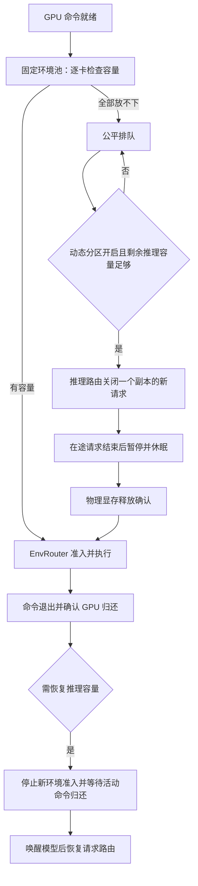

# 训推共享：vLLM余量与容量调度

> **核心结论**：环境任务优先使用独立 GPU。资源紧张时，再检查 vLLM 常驻情况下的安全余量；如果仍放不下，才考虑在足够长的空闲窗口让模型睡眠、借出 GPU。每一步都要同时保护显存和模型响应，目标是整批任务更早完成。

先分清三个问题：显存是否放得下、一起运行是否更划算、借走后能否及时归还。它们先后限制可选动作，最后都回到同一个目标：同样工作量，尽量更早全部完成。

**按问题选一条阅读路线：**

- 想知道现在怎样用卡：看[显式共享与默认边界](#10-常驻共享kv-上限与已睡眠窗口)，再看[固定分区与副本收缩](#15-固定分区与推理副本收缩)。
- 想先理解为什么这样设计：从[完成时间](#2-先确定要缩短谁的时间)、[显存预算](#3-第一层模型保持服务环境使用安全余量)、[借卡窗口](#4-第二层在长空闲窗口内释放模型显存)的三张局部图开始。
- 想研究并发和自动决策：读[第16节](#16-从计算上限到整批完成时间)和[第17节](#17-从并发收益到自动选择-gpu-持有粒度)。历史实机条件与源码表留作需要时核验。

当前共享分支已经保护推理余量与控制操作，训练峰值协调与通用主动撤回仍待实现，空档等待预测器已进入第 17 节的受控实机验证。2026-11-16 的图像任务和较长 4B PostTrain 对照均已完成，合作式暂停可正确继续，但无条件暂停丢掉了有益重叠，见[短任务实验](../../experiments/06-训推共享_常驻vLLM与环境并行实验.md)与[长任务实验](../../experiments/06-训推共享_常驻vLLM与环境并行实验.md#长生成与-4b-环境模型的-12-组对照)。其余机制核对基于 2026-11-13 的 `6aa328d` 加工作区内容，历史 GPU 数据保持原条件；进一步研究见[可撤回执行提案](../../research-proposals/06-训推借卡_可撤回执行与反馈依赖.md)。


## 目录

- [1. 全局关系与已有源码](#1-全局关系与已有源码)
- [2. 先确定要缩短谁的时间](#2-先确定要缩短谁的时间)
- [3. 第一层：模型保持服务，环境使用安全余量](#3-第一层模型保持服务环境使用安全余量)
- [4. 第二层：在长空闲窗口内释放模型显存](#4-第二层在长空闲窗口内释放模型显存)
- [5. 预测失败、提前唤醒与大任务等待](#5-预测失败提前唤醒与大任务等待)
- [6. 当前实现与建议推进顺序](#6-当前实现与建议推进顺序)
- [7. 跟着图读源码](#7-跟着图读源码)
- [8. 可运行教学模拟与验证边界](#8-可运行教学模拟与验证边界)
- [9. 独立 GPU 优先的实现与实机验证](#9-独立-gpu-优先的实现与实机验证)
- [10. 常驻共享、KV 上限与已睡眠窗口](#10-常驻共享kv-上限与已睡眠窗口)
  - [默认配置与自动后备的边界](#默认配置与自动后备的边界)
  - [已启用共享后的执行流程](#已启用共享后的执行流程)
- [11. 计算竞争与控制等待：已经验证到哪里](#11-计算竞争与控制等待已经验证到哪里)
- [12. MPS、SM 与时分复用：怎样理解多进程共享](#12-mpssm-与时分复用怎样理解多进程共享)
- [13. Docker MPS 接入探索与框架落点](#13-docker-mps-接入探索与框架落点)
- [14. MPS 控制组件与统一执行器取消验证](#14-mps-控制组件与统一执行器取消验证)
- [15. 固定分区与推理副本收缩](#15-固定分区与推理副本收缩)
  - [完整训练中的整卡调整与余量共享](#完整训练中的整卡调整与余量共享)
  - [从四张卡看完整流程](#从四张卡看完整流程)
  - [Roofline 为什么不能直接变成请求数阈值](#roofline-为什么不能直接变成请求数阈值)
  - [现有实现与新增入口的边界](#现有实现与新增入口的边界)

- [16. 从计算上限到整批完成时间](#16-从计算上限到整批完成时间)
  - [能否给每个模型计算请求上限](#能否给每个模型计算请求上限)
  - [怎样把单卡曲线用于准入](#怎样把单卡曲线用于准入)
  - [PD 分离对环境调度有什么价值](#pd-分离对环境调度有什么价值)
  - [环境放得下十条命令时应该放几条](#环境放得下十条命令时应该放几条)
  - [借出的卡什么时候能收回来](#借出的卡什么时候能收回来)
  - [把 PSRL 训练批次纳入决策](#把-psrl-训练批次纳入决策)
  - [怎样证明策略有收益](#怎样证明策略有收益)
- [17. 从并发收益到自动选择 GPU 持有粒度](#17-从并发收益到自动选择-gpu-持有粒度)
  - [已经尝试了哪一部分](#已经尝试了哪一部分)
  - [Unit 应该调整哪一种粒度](#unit-应该调整哪一种粒度)
  - [环境并发的拐点怎样建模](#环境并发的拐点怎样建模)
  - [十并发与十二并发该怎样比较](#十并发与十二并发该怎样比较)
  - [从 Roofline 到环境命令与 vLLM 实例容量](#从-roofline-到环境命令与-vllm-实例容量)
  - [学习型容量模型与相关工作](#学习型容量模型与相关工作)
  - [怎样把预测器做成可靠的调度依据](#怎样把预测器做成可靠的调度依据)
  - [容量预测与 PSRL 依赖联合设计](#容量预测与-psrl-依赖联合设计)
    - [当前显存准入与命令并发上限的关系](#当前显存准入与命令并发上限的关系)
    - [默认放满并用完成时间反馈收紧准入](#默认放满并用完成时间反馈收紧准入)
    - [具体公式与实测修正](#把候选区间算出来再用数据修正)
    - [同步时等待、抢占还是并行](#模型同步带来的额外依赖)
    - [在线控制的接口位置](#在线控制将接在哪些现有位置)
    - [利用确定的前后关系减少归还风险](#利用确定的前后关系减少未知结束时间风险)
    - [相关论文与研究边界](#研究价值应落在哪里)
  - [整体目标与迁移成本怎样放在一起](#整体目标与迁移成本怎样放在一起)
  - [先判定能力再选择粒度](#先判定能力再选择粒度)
  - [用完整时间线比较保留与归还](#用完整时间线比较保留与归还)
  - [不知道空档多长时怎样决策](#不知道空档多长时怎样决策)
  - [中央调度器与 Agent 的分工](#中央调度器与-agent-的分工)
  - [建议落地顺序与教学验证](#建议落地顺序与教学验证)
  - [自动模式第一版怎样工作](#自动模式第一版怎样工作)
  - [把额外等待公式变成可用预测器](#把额外等待公式变成可用预测器)
  - [相关工作已经做到哪里](#相关工作已经做到哪里)
  - [值得继续研究的具体问题](#值得继续研究的具体问题)

## 1. 全局关系与已有源码

先把模型、环境和调度器串起来。下图是**建议结构**，不是当前已经存在的完整调用链。推理副本是一套能完成模型生成的实例，可能使用多张 GPU。GPU 命令是环境明确提交的一段计算，不等于整个容器生命周期。

```text
[1] 模型请求队列、环境命令队列、任务前后依赖
                  ↓
[2] 共享决策层（待实现）
    读取逐卡显存预约、计算干扰、下一次需要模型的时间
    目标：同一批任务更早全部完成，限制模型额外等待
       │
       ├─ 其他独立 GPU 可以接纳任务 → 优先放到独立 GPU
       │
       ├─ 余量足够且干扰可接受
       │    → [3] command 准入 → 环境执行 → 物理归还
       │         vLLM 始终保持服务，不触发 sleep
       │
       └─ 余量不足且有长空窗
            → [4] 协调器确认可借，关闭新生成准入，必要时 sleep
            → [5] 环境命令执行，持有本轮授权
            → [6] 停新准入、确认 GPU 归还、恢复模型和路由
                  ↓
             回到 [1]，根据真实延迟修正下一次决策

若两条路径都不合适：继续等待或选择其他有容量的 GPU。
失败清理期间保留使用权，不把超时当作物理释放。
```

图例：图里每个部分对应的源码位置。

| 编号 | 可复用实现 | 当前缺口 |
|---|---|---|
| 1 | [EngineStats](../../../../psrl/workers/gen/stats_collector.py#L21)、[ModelTurnRecord](../../../../psrl/utils/profiling/records.py#L140) | 有引擎统计和轮次记录，不等于已有跨模型与 Docker 的完整依赖图及未来空窗预测 |
| 2 | [accounted_gpu_memory_mb](../../../../psrl/workers/env_service/gpu_memory.py#L9)、[共享准入](../../../../psrl/workers/env_service/command_gpu.py#L143) | 显式 vLLM 共享已有 profile 校验和逐卡增长余量，尚无统一训练峰值协议或总完成时间优化器 |
| 3 | [GpuCommandScheduler.acquire](../../../../psrl/workers/env_service/command_gpu.py#L82)、[命令归还](../../../../psrl/workers/env_service/command_gpu_node.py#L233) | 有独立卡和显式模型共享 command，未提供计算性能隔离或按恢复请求主动撤回 |
| 4 | [协调器借卡入口](../../../../psrl/workers/gen/rollout_coordination/coordinator.py#L272)、[prepare_env_gpu](../../../../psrl/workers/gen/gpu_handoff.py#L105) | 已有生成准入关闭、等待在途请求、一级睡眠。尚无“空窗足够且值得借”的前置决策 |
| 5 | [GpuLendingBinding._enter_env](../../../../psrl/workers/env_service/lending.py#L63) | 睡眠后检查逐卡容量并恢复容器，当前仅一个借卡会话 |
| 6 | [物理归还检查](../../../../psrl/workers/env_service/lending_node.py#L87)、[模型恢复](../../../../psrl/workers/gen/gpu_handoff.py#L133)、[最终清理](../../../../psrl/workers/env_service/lending.py#L98) | 旧互斥执行机制，预测性提前归还仍待实现。新共享路径见第 10 节 |

以上源码如果有理解上的问题，可以按编号继续追问。

## 2. 先确定要缩短谁的时间

先固定目标：**同样一批任务，从开始到最后一项完成，尽量少花时间。** 这个指标叫整批完成时间（makespan）。某条环境命令抢先开始，却挡住能解锁后续工作的模型请求，最后可能更慢。


<!-- chapter-figure:chapter-critical-path -->
先看同样三项工作：把模型请求放前面，为什么整批反而更早结束？

[](../../../_static/img/document-figures/chapter-critical-path.png)

[](../../../_static/img/document-figures/chapter-critical-path.png)

两种策略都做完 M、A、B。模型优先让 CPU 上的 A 与 GPU 上的 B 重叠，最后从第22秒提前到第12秒。数字是教学假设。 [放大查看 SVG](../../../_static/img/document-figures/chapter-critical-path.svg)。
<!-- /chapter-figure:chapter-critical-path -->

如果 M、B 共运行，假设竞争期间各半速，则 M 到第4秒才结束，A 到第14秒结束；B 到第12秒结束。整批14秒，仍慢于模型优先的12秒。共享是否值得，要把被推迟的后续工作一起算进去。

“关键路径”指决定最后完成时间的依赖链。调度不能只看模型队列长度或 Docker 等待时长，也应考虑某个模型回答能解锁哪些后续任务。无需一开始实现全局最优求解器，可以先用可观测的模型响应时间、环境队列年龄和阶段时长作保守近似。

## 3. 第一层：模型保持服务，环境使用安全余量

把 vLLM 看成外部显存压力，在**容量记账**上是合理的。现有账本已经将物理总占用与尚未真正分配的环境预约相加。但是活跃 vLLM 还有未来内存变化与计算竞争，不能完全等同于“分配一块张量后不再计算”的压力注入器。

先区分两种余量：物理卡上真正未分配的显存，和 vLLM 已经分配的缓存池中尚未装入有效内容的空间。后者仍属于 vLLM，Docker 不能直接再分配使用。KV cache 是模型为避免重复计算保存的注意力中间结果，减少其容量可能降低可同时服务的请求数或增加重算。vLLM 的内存比例和缓存大小设置用于规划本实例内存，并不是跨进程共享仲裁器，见[官方引擎参数](https://docs.vllm.ai/en/stable/configuration/engine_args/#cacheconfig)。本地会传递 `gpu_memory_utilization`，见 [vllm_async_server.py:366](../../../../psrl/workers/gen/vllm_async_server.py#L366)。不能把调低该比例后释放的容量当作对推理完全无代价。


<!-- chapter-figure:chapter-memory-headroom -->
显存要同时容纳“已经用了多少”和“已经答应、之后还会用多少”。

[](../../../_static/img/document-figures/chapter-memory-headroom.png)

先读上面的物理占用，再看下面16 GiB空闲怎样分配。模型和环境都可能继续增长，真正留给新命令的只有4 GiB。这是统一模型预约的设计算例，当前显式共享实现见第10节。 [放大查看 SVG](../../../_static/img/document-figures/chapter-memory-headroom.svg)。
<!-- /chapter-figure:chapter-memory-headroom -->

对应关系是 `当前实占 U + 环境未兑现预约 + 模型未兑现预约 + 新需求 D + 安全余量 S ≤ 卡预算 C`，各项单位均为GiB。某任务预约B、已用A，则未兑现部分是 `max(0,B−A)`：已用部分已经计入U，只补还没用的部分，避免算两次。归属不明或关键遥测过期时停止新准入。预约约束参与者的申报与授权，不是CUDA显存硬限额。

峰值预算必须覆盖选定的模型服务阶段，包括缓存配置、临时工作区及相关状态切换。已经预约进缓存池的空间不能因为逻辑请求较少就再次当作增长空间累加，具体分项必须与本地版本的分配方式一致。模型重新配置、加载或权重同步需要扩大预算时，应先经过同一仲裁层，不能事后才用遥测发现冲突。训练、验证和其他使用同卡的角色也必须登记，不能只考虑 vLLM 与环境两方。

容量允许后还要检查**计算干扰**。多个进程会争用 GPU 计算、显存带宽及传输资源，可能时间片轮转，不能把“同时存在”理解为 GPU 内核必然并行。NVIDIA 对普通 CUDA 上下文与 MPS 多进程服务的调度差异有[官方说明](https://docs.nvidia.com/deploy/mps/latest/architecture.html)。当前设备权限控制只能决定能否访问 GPU，不能保证模型拿到某个计算份额。本方案不以部署 MPS 为前提。

起步策略可以是限制共享命令数量和持续时间，按真实模型延迟判断是否继续批准新命令。已经在运行的普通 CUDA 命令不能假定可瞬间撤回。对持续长、计算密集的任务，即使显存足够，也可能应当等模型较空闲时再进入。

## 4. 第二层：在长空闲窗口内释放模型显存

“空闲”需要拆开看：

| 当前状态 | 能否直接把释放后的容量交给环境 |
|---|---|
| 模型仍在生成，只是某个环境在等待它 | 不是空闲，环境等待恰好说明模型是前置条件 |
| 目标副本暂时无请求，但权重和缓存仍在卡上 | 可以评估剩余空窗，不能只看队列此刻为零就睡眠 |
| vLLM 已经睡眠，卡也没有其他 owner 使用 | 可以评估回填，已经发生的 sleep 成本不重复计入本次增量成本 |
| vLLM 因训练阶段而睡眠，卡随后交给训练 | 卡并不空闲，必须把训练预约计入，不能从 vLLM 状态单独推断 |

预测应针对目标副本的**剩余空闲时间**，包含其他会话何时会发模型请求，而不是当前 Docker 会话自身的等待时间。任务未来依赖也是输入。如果模型请求正在等待本次大环境命令的结果，两者的时间不能视为相互独立的外部到达。

offload 在这里指把模型 GPU 状态转移到主机内存以释放设备容量。本地借卡调用 `nixl_sleep(level=1)`。vLLM 一级睡眠会备份模型权重到 CPU 并丢弃 KV cache，恢复时要搬回模型状态。二级睡眠不保留相同的权重备份，需要另外恢复权重。详见[vLLM 睡眠文档](https://docs.vllm.ai/en/stable/features/sleep_mode/)。这与推理过程中按层持续搬运权重的 CPU offload 配置是不同使用方式，不能把后一种当作无代价空窗借卡。

本地还执行 NIXL 内存注册的注销与恢复。NIXL 是这里用于跨进程传输模型数据的通信组件，注册状态要与当前 GPU 内存一致，见 [nixl_sleep / nixl_wake_up](../../../../psrl/workers/gen/vllm_async_server.py#L1284)。实际成本应包括等待在途请求、sleep、主机备份容量、传输带宽、环境清理、wake、传输注册及必要的缓存重算，而不仅是某个 API 返回耗时。


<!-- chapter-figure:chapter-idle-window -->
长空档能不能借出去，要看从卸载到恢复的整段时间能否放进去。

[](../../../_static/img/document-figures/chapter-idle-window.png)

B的30秒计算只是其中一段。按图中假设，交接40秒，再加5秒安全余量，小于60秒空档；但若模型第8秒就回来，它仍会多等32秒。 [放大查看 SVG](../../../_static/img/document-figures/chapter-idle-window.svg)。
<!-- /chapter-figure:chapter-idle-window -->

保守筛选应比较“等待在途请求、卸载、环境运行、物理归还、模型恢复及安全余量”的总上界，与模型剩余空档的下界。预测若来自历史分位数，仍可能失准；通过这个筛选只说明值得继续评估，还不能证明整批更快。其他空闲GPU和继续排队也应纳入比较。

若模型本来就已睡眠，应从当前状态算剩余释放与恢复成本，不能为了套用统一流程先 wake 再 sleep。现有 `prepare_env_gpu` 在引擎已经睡眠时会先唤醒、必要时恢复权重，再做一级睡眠。这是当前为获得可恢复备份的流程，说明“利用既有睡眠窗口”需要状态感知改造，不能把它直接当成零 offload 成本路径。二级睡眠或权重更新后的恢复代价尤其需要单独计算。

## 5. 预测失败、提前唤醒与大任务等待

沿用上述例子，如果请求在第 8 秒就到来，Docker 命令还要到第 33 秒完成，清理与恢复后模型第 40 秒才能服务，额外等了 32 秒。当前普通命令没有通用的无损抢占能力，不能先唤醒模型，再希望环境自行让出容量。

需要明确两类承诺：

- **尽量不拖慢模型**：允许预测误差，监控额外等待，停止新准入并在已有命令的安全边界回收。收益需要实测。
- **严格限制模型最多多等几秒**：环境命令必须有可信的最大剩余时间，或支持有界取消/检查点及物理释放。只有预测值而没有这些执行条件，无法保证硬上限。

检查点是程序主动保存可恢复状态的机制。杀掉 GPU 进程能释放资源，但可能丢失已完成的计算，不能叫作无损抢占。取消到物理释放的耗时也要计算。恢复前禁止新 GPU 命令进入，旧授权必须失效，防止一边回收、一边批准新任务。

“大型任务”至少有两个维度：占显存大、运行时间长。一个需要 60 GiB 但仅运行 5 秒的任务，可能适合借空窗。一个占 10 GiB 却运行数十分钟且不能提前结束的任务，反而难以承诺及时还卡。长时间没有合适窗口时，需要其他卡、任务拆分或有计划的资源时段，不能无限等待，也不能为避免等待就默认打断繁忙模型。

对支持合作执行的工具，可以改为约束“到下一安全点的时间加实际退卡成本”，而不是要求预测整条命令结束。常驻余量共享可能只需停止新增计算，睡眠窗口则可能还需释放显存，两者不能统一按 shell 结束判断。研究适配器支持更新边界的计算暂停，生产通用主动撤回及显存转存协议仍待实现，具体例子、不可撤回命令的限制与新颖性核查见[研究提案](../../research-proposals/06-训推借卡_可撤回执行与反馈依赖.md#4-未知结束时间怎样变成可管理的风险)。

## 6. 当前实现与建议推进顺序

当前 `GpuLendingBinding` 是环境请求驱动的 ENV / MODEL 切换，没有先证明模型有长空窗。`prepare_env_gpu` 等待在途生成而不是强制杀掉它，但关闭准入后仍可能推迟新的模型请求。已有互斥交接保障可以保留为第二层的执行机制，不宜成为所有同卡任务的默认策略。

普通 command unit 仍不能冒充受协调的模型共享。显式 `shared_rollout_replica_rank` 路径已经接入推理增长余量和生命周期门禁，详见第 10 节，固定工作量的计算共享对照见第 11 节。旧的互斥借卡配置 `rollout_replica_rank + command` 仍被拒绝，见 [EnvUnit 校验](../../../../psrl/workers/env_service/types.py#L67)。

| 顺序 | 当前状态与剩余工作 | 最小验收问题 |
|---|---|---|
| 1 | 独立卡优先和显式 vLLM 常驻 command 余量共享已实现，已有图像及较长 4B PostTrain 的固定工作量计算对照。更大瞬时竞争及 Megatron 峰值未验收 | 模型响应与整批完成时间是否可接受，适用范围随工作负载核实 |
| 2 | 已支持观察并锁定现有睡眠状态。研究适配器已有更新边界暂停，通用恢复请求驱动的撤回与显存转存接口尚缺 | 是否避免重复 offload，能否在恢复预算内完成所需资源归还 |
| 3 | 持续低推理负载下的排空休眠控制已接入并观察到整卡借出。长空窗预测和净收益在线决策仍是提案 | 交接重叠已完成两步实机补跑。负载回升后恢复副本和严格配对收益仍待验证，见第 15 节 |

第一阶段的重点不是实现预测模型，而是完成容量、实际归还和性能观测。后续再决定是否需要复杂的代价估计器。不要为验证共存直接改弱模型缓存配置或替换固定 baseline 后宣称提速，模型配置变化本身需要单独对照。

真实验证固定模型请求和环境工作量，分别记录模型响应、环境完成时间、总时间及物理释放。第 10 节保留真实共存功能证据，第 11 节与[计算共享报告](../../experiments/06-训推共享_常驻vLLM与环境并行实验.md)覆盖当前小任务性能对照。长空窗与卸载唤醒另测，不默认启动完整训练。历史 science ON/OFF 的 `0eeead861ffafed6bf31c962d259fd847775dcf9` 结果保留原版本含义。后续默认使用同次冻结实现的 episode 静态环境池主基线，定义见[分区实验口径](../../experiments/09-资源分区_静态卡池与推理余量共享.md#统一基线与读表方法)。

## 7. 跟着图读源码

以下按建议的数据流阅读，明确区分已有函数与缺失的连接。图中异步队列、命令归还和模型请求不是一条全局串行线程。

| 步骤 | 编号与函数 | 输入、输出或状态变化 |
|---|---|---|
| 获取信号 | 1，[EngineStats](../../../../psrl/workers/gen/stats_collector.py#L21) | 已有引擎队列等状态，仍需加入环境依赖和空闲窗口信号 |
| 计算容量 | 2，[accounted_gpu_memory_mb](../../../../psrl/workers/env_service/gpu_memory.py#L9) | 实测总量加每个预约未兑现部分，显式共享路径另外加入模型增长余量，全阶段统一 owner 预算仍未完成 |
| 授权命令 | 3，[acquire](../../../../psrl/workers/env_service/command_gpu.py#L58) | 队列、容量及遥测合格后授权，现有代码不会检查本方案的模型干扰目标 |
| 归还命令 | 3，[revoke_gpu_command](../../../../psrl/workers/env_service/command_gpu_node.py#L207) | 禁新设备打开，检查旧句柄与 GPU 工作，确认后才释放预算 |
| 判断长空窗 | 2 → 4，无生产函数 | 本方案新增决策点，不把已有吞吐估计器冒充空窗预测器 |
| 借出整副本 | 4 → 5，[prepare_env_gpu](../../../../psrl/workers/gen/gpu_handoff.py#L105)、[_enter_env](../../../../psrl/workers/env_service/lending.py#L63) | 关闭生成准入、睡眠、采集基线与核对容量，随后恢复容器 |
| 恢复模型 | 6，[_freeze_gpu_lease](../../../../psrl/workers/env_service/lending_node.py#L87)、[return_env_gpu](../../../../psrl/workers/gen/gpu_handoff.py#L133) | 旧互斥路径检查本租约归还后唤醒，共享路径另用命令票据聚合控制 |
| 会话结束 | 6，[_finish](../../../../psrl/workers/env_service/lending.py#L98) | 清理容器、确认归还、释放预约，失败时保持隔离 |

## 8. 可运行教学模拟与验证边界

脚本：[vllm_env_sharing_demo.py](../../env-service-verification/scripts/vllm_env_sharing_demo.py)。只使用 Python 标准库，无 GPU、Docker、Ray、网络或真实等待。它模拟上述容量计算和时间线，不调用生产调度器，不是性能预测器。

从仓库根目录运行：

```bash
python docs/env-worker-deep-dive/env-service-verification/scripts/vllm_env_sharing_demo.py
```

`memory_admission` 对应图中 2，`dependency_orders` 展示图中 1 的前后依赖，`idle_window` 对应图中 4 至 6。输出 JSON 记录准入、模型额外等待和全部完成时间。真实实现还需要多会话、多卡、遥测异常、任务取消和通信故障控制，教学脚本没有模拟这些机制。

**Results：2026-10-27 CPU 教学运行。** 原始输出保存在 [vllm-env-sharing-demo.json](../../env-service-verification/results/vllm-env-sharing-demo.json)。这些数值只用于检验示例推导，不是 GPU 实测。

| 场景 | 预期观察 |
|---|---|
| 80 GiB 预算与增长预约 | 新申请 4 GiB 获准，8 GiB 被拒绝 |
| 模型是后续 CPU 工作前置条件 | 模型优先 12 秒，Docker 优先 22 秒，假设共享期间各半速则 14 秒 |
| 60 秒空窗，交接预算 45 秒 | 固定工作量参考顺序总计 102 秒，空窗回填 72 秒，模拟节省 30 秒 |
| 原预测 60 秒，模型实际第 8 秒回来 | 模型多等 32 秒，总时间从参考顺序的 50 秒变为 52 秒，反而增加 2 秒 |
| 只有 15 秒窗口，或交接预算增至 72 秒 | 拒绝借出 |

空窗场景的参考顺序明确为：保持模型常驻直到下一次请求完成，再 offload、执行同一个 30 秒 Docker 命令、清理并恢复。两种策略都包含模型请求后的 10 秒 CPU 工作以及最终模型恢复。参考顺序只是本教学模型中的一种可行策略，不代表生产系统的最优 baseline。复现脚本中有这些时间关系的断言。

已有真实借卡与独立环境卡训练结果仍按[状态总览](../../milestones/06-历史阶段_2026年10月28日实现与规划.md)各自的验收范围理解，不能视为本方案已经验证。旧 episode 互斥借卡与 command 的历史组合限制见[当时的边界](../../milestones/06-历史阶段_2026年10月28日实现与规划.md#当时的同卡借还与-command-组合限制)，当前常驻共享能力见本文第 10 节。

## 9. 独立 GPU 优先的实现与实机验证

**本轮先落地设备选择顺序。** `prefer_other` 按已核实的物理 GPU 归属区分优先与后备资源，不再把一台机器上的所有 GPU 都视作正在被训推占用。它仍是放置偏好，不是模型共享许可或性能隔离。默认 `cpu_only` 不自动放行普通训推占用卡，已核实独立的同机 GPU 可以使用。`avoid` 仍排除整台训推节点，`any` 仍表示不施加这项偏好。

下面是本轮已接入的路径，与上文尚未实现的共享决策层分开阅读。

```text
[A] Trainer 查询已初始化 worker 的节点和全部 GPU ID
      ↓ 把设备归属发布给 Router
[B] NodeRules：同机独立卡也属于优先资源，未知归属保持保守
      ↓ 带优先级的逐 unit 容量快照
[C] Manager 的 EnvAwareDispatcher 先选有容量的独立资源
      ↓ 任务交给固定节点上的 worker
[D] Router 根据新鲜节点状态和账本再次选择 unit
      ↓ 独立卡放得下则优先，放不下才考虑已允许的后备 unit
[E] command 申请设备权限 → Docker 执行 → 确认归还
      ↓ 容量恢复后，新会话重新优先使用独立卡
[F] 会话结束：清理容器和租约
```

图例：图里每个部分对应的源码位置。

| 编号 | 函数与源码 | 状态变化 |
|---|---|---|
| A | [gpu_placements_from_worker_groups](../../../../psrl/workers/env_service/node_policy.py#L278)、[Trainer 发布入口](../../../../psrl/trainer/ppo/ray_trainer.py#L608) | 核对实际节点与所有已分配 GPU，不能只记录一个 worker 的首张卡 |
| B | [overlaps_train_rollout / tier](../../../../psrl/workers/env_service/node_policy.py#L89)、[发布归属](../../../../psrl/workers/env_service/router.py#L134) | 精确归属优先，缺失时按训推节点保守判断。有活动租约时拒绝替换归属表 |
| C | [节点容量](../../../../psrl/workers/env_service/ledger.py#L304)、[_assign_resources](../../../../psrl/workers/env_service/placement.py#L188) | 优先级先于 CPU 负载和轮询顺序。同题轨迹仍按组放置，临时扣除本批已派出的容量 |
| D | [Ray Router.try_admit](../../../../psrl/workers/env_service/router.py#L537)、[账本选择](../../../../psrl/workers/env_service/ledger.py#L106) | 所有健康候选共同参与选择，不按节点遍历顺序抢先批准。遥测 URL 与实际选择节点一致 |
| E | [command 准入](../../../../psrl/workers/env_service/command_gpu.py#L58)、[归还检查](../../../../psrl/workers/env_service/command_gpu_node.py#L207) | 仍经真实命令预约和设备授权。容器获准排队不等于 GPU 已授权 |
| F | [Router.release](../../../../psrl/workers/env_service/router.py#L220) | 按原有物理归还协议收尾，再释放租约 |

跟着图读源码：先从 A 的运行时 GPU 清单进入 B，得到每个 unit 的优先级，再看 C 如何把实际需求和整组轨迹数量用于放置。D 是最终准入，必须再次看当前容量，不能把 C 的快照当作已保留资源。随后沿 E 进入实际命令授权与归还，最后走 F。不同 worker 和环境命令可以并发，C 与 D 之间容量可能变化，因此该偏好不是跨所有会话的原子最优调度。以上源码可以继续按编号追问。

还修正了两个会使优先级落空的条件：`prefer_other` 创建 worker 时保留后备节点，不再在初始化阶段永久过滤掉它们。该策略要求每个候选环境节点至少有一个 worker，数量不足时明确报错。Env Service 启用时 worker 使用固定节点放置，保证实际启动 Docker 的节点与调度记录一致。

command 会话允许在 GPU 满时先保留主机资源并排队，但“能排队”不能压过另一张卡“现在就有容量”。本轮让派发和 unit 选择都查看 GPU 当前余量，避免把有空容器槽位误认为有可执行 GPU 容量。如果所有候选都暂时满了，仍可在优先资源上排队，实际 GPU 授权继续等待准入。

**可用范围。** 在显式配置的 unit、允许的节点和实际存在的 worker 范围内选择。没有实现扫描整个平台并自动申请未分配给本作业的 GPU，也没有把已运行的 Docker 容器迁移到其他节点。同题轨迹仍保持整组派发，所以可容纳单条但不能容纳整组的节点，不保证排在能容纳整组的节点前。

**训推占满所有设备时。** 这只表示所有设备都有训推归属，还要另看物理余量、未来峰值与计算负载。本轮不会自动建立模型的显存峰值承诺，也没有检测计算干扰后授权活跃训推共享。`prefer_other` 的既有后备路径不能被当作这个安全协议，不能仅靠切换该配置就宣称“训推不紧张时自动共存”已经完成。实际模型 GPU 仍须通过明确的共享预算或已接通的借卡协议使用。本轮没有新增 sleep / offload 调用。

**Results：2026-10-27 有界真实验证。** 使用首选实验节点、两张 H20、真实 Ray Router、Harbor/Docker 与 CUDA。每个 unit 申报预算 4096 MiB，每条命令申报 2048 MiB，容器实际执行 64 MiB 小型 CUDA 内核。后备实验卡常驻注入 1 GiB 压力。该卡仅被标为受保护的实验资源，**没有加载 vLLM 或训练模型**。压力是容量条件，不是假装运行模型。

| 阶段 | 条件 | 实际选择与执行 |
|---|---|---|
| 独立卡优先 | 独立卡空闲，后备卡有 1 GiB 常驻压力 | 选择独立卡，GPU UUID 与预期一致，CUDA 返回 42 |
| 容量不足回退 | 独立卡另注入 3 GiB 压力，不能再容纳 2 GiB 命令预约 | 选择后备卡，CUDA 返回 42 |
| 恢复后返回 | 释放独立卡压力，后备卡仍保留原占用 | 再次选择独立卡，CUDA 返回 42 |

成功轮总计 84.42 秒，三条命令退出码均为 0，租约归零，两张卡回到约 0.19 MiB 应用显存基线，GPU 计算进程和所属容器清空。外层运行预算 360 秒，工作阶段预算 210 秒，压力进程自带 240 秒寿命并由父进程按归属回收。达到三项选择结论后结束，没有追加训练或吞吐实验。

首次尝试已选对独立卡、CUDA 也返回 42，但探针写入不存在的 `/logs/artifacts` 目录而退出 1。先确认 GPU 与容器清理，再补建产物目录，在一次有界重试中完成三阶段。原始失败没有删除，也没有计作完整成功。

脚本为 [real_gpu_preference.py](../../env-service-verification/scripts/real_gpu_preference.py)。复现前先按运行指南核对节点和镜像，在已激活的项目环境中设置 `NODE_IP`、`CUDA_IMAGE`、`PROTECTED_GPU`、`DEDICATED_GPU` 和全新的 `OUTPUT_DIR`，分别表示执行节点、已有 Python/CUDA 探针镜像、两张现场空闲卡的遥测 index 及结果目录。然后执行：

```bash
timeout -s INT -k 30s 360s python \
  docs/env-worker-deep-dive/env-service-verification/scripts/real_gpu_preference.py \
  --node-ip "$NODE_IP" --image "$CUDA_IMAGE" \
  --protected-gpu "$PROTECTED_GPU" --dedicated-gpu "$DEDICATED_GPU" \
  --output "$OUTPUT_DIR"
```

原始[成功证据](../../env-service-verification/results/gpu-preference-20261027-r2/run/evidence.json)、[首轮失败](../../env-service-verification/results/gpu-preference-20261027/run/evidence.json)保留了代码哈希、依赖来源、设备身份、选择结果与清理数据。[独立收尾复查](../../env-service-verification/results/gpu-preference-20261027-r2/physical-release.json)确认所属容器、网络、隔离 Ray 进程及 GPU 计算进程均已清空，Env Service 源码哈希与执行时一致。CPU 回归为 Env Service 全目录 309 项通过，之后新增全局 Router 选择与 URL 对应检查，定向 10 项通过，两次统计有重叠。跨两台真实机器的回退、完整 Trainer 启动、活跃 vLLM/训练共存和吞吐收益不在本次实机覆盖范围。


## 10. 常驻共享、KV 上限与已睡眠窗口

本节描述显式 `shared_rollout_replica_rank` 路径。前文第 1 节的预测决策层仍是提案，下面是已接入的执行链。共享不是让环境获得模型的缓存，而是在同一物理 GPU 上另外分配自己的显存。

### 默认配置与自动后备的边界

**仓库默认配置不会自动把环境任务放到推理卡。显式配置共享资源后，新会话可以在独立候选容量不足时选择共享推理卡。** 要分清三个决定：是否启用 Router、哪些 GPU 允许参与、选中共享卡后怎样执行。

| 决定 | 当前默认或实际行为 | 源码 |
|---|---|---|
| 是否启用 EnvRouter | 基础配置为 `enable: False`，`units: []`，需要启动配置覆盖 | [env_service.yaml](../../../../psrl/trainer/config/psrl/env_service.yaml#L6) |
| 开启 Router 后能否随意使用模型卡 | Trainer 要求重叠模型设备具有显式绑定，并核对完整 rollout 副本及其他模型角色的设备归属 | [Trainer._init_gpu_lending](../../../../psrl/trainer/ppo/ray_trainer.py#L608) |
| 如何声明常驻共享卡 | unit 需设置 `shared_rollout_replica_rank`、`gpu_reservation: command` 与正的 `model_headroom_mb`，启动时校验模型临时空间测量 | [EnvUnit 校验](../../../../psrl/workers/env_service/types.py#L104)、[共享绑定](../../../../psrl/workers/env_service/router.py#L164) |
| 独立卡和共享卡谁先用 | 默认 `cpu_only` 下，独立 GPU 优先级为 0，显式常驻共享 unit 为 1。共享 unit 已声明并通过绑定后，也能作为后备，无需仅为此改成 `prefer_other` | [NodeRules.tier](../../../../psrl/workers/env_service/node_policy.py#L104) |
| 选中共享卡后会不会自动暂停环境 | 普通生成与环境直接共存，准入检查模型状态、控制等待和显存余量。生产尚无按新推理自动暂停环境的策略 | [acquire_env_command](../../../../psrl/workers/gen/gpu_handoff.py#L99)、[命令准入](../../../../psrl/workers/env_service/command_gpu.py#L126) |

`direct` 是 GPU 命令执行后端，默认值见 [EnvUnit](../../../../psrl/workers/env_service/types.py#L57)。它决定命令走哪条执行路径，目标卡还需由资源声明与放置决定。因而“默认 direct”与“默认借用 vLLM 卡”是两个不同的配置问题。显式常驻共享获准后，普通推理继续执行，环境也不会自动触发模型睡眠或 MPS。


<!-- chapter-figure:chapter-gpu-priority -->
把设备选择拆成三个同条件情形：先独立卡，再显式共享卡，都不够就等。

[](../../../_static/img/document-figures/chapter-gpu-priority.png)

新命令始终需要8 GiB。共享卡即使余量更大，也排在能满足需求的独立卡后面；未声明共享绑定的卡不会自动成为候选。最终授权仍要重新检查模型状态和新鲜遥测。 [放大查看 SVG](../../../_static/img/document-figures/chapter-gpu-priority.svg)。
<!-- /chapter-figure:chapter-gpu-priority -->


这里的容量均是假设值。实际放置还受任务组大小、节点健康、worker 所在节点和已申报 CPU、主存、容器配额约束，具体选择见 [Ledger.try_admit](../../../../psrl/workers/env_service/ledger.py#L113) 和 [Dispatcher._assign_resources](../../../../psrl/workers/env_service/placement.py#L188)。

**已有会话也可显式启用逐命令后备放置。** 没有命令池时，后续命令仍在原 unit 申请 GPU。配置同名 `command_gpu_pool` 后，同机 direct 单卡命令先尝试独立环境卡，再尝试已完成模型绑定的共享推理卡。主机 CPU、主存和容器保持原归属，实际 GPU 位置记录在命令授权中。共享命令的超时清理与归还检查针对实际执行卡。`max_gpu_commands` 可独立于显存设置计算并发上限，`command_placement_policy: first_fit` 按稳定卡序装入，默认仍为独立卡优先的 `least_pressure`。见 [命令候选](../../../../psrl/workers/env_service/command_gpu.py#L64) 和 [命令池限制](../../../../psrl/workers/env_service/types.py#L71)。

任务入口也要支持相应模式。[公共 benchmark 启动器](../../../../examples/gpu_benchmarks/train.sh#L29)会开启 Router，但多数 [GPU benchmark 入口](../../../../examples/gpu_benchmarks/agent_loop.py#L25)仍要求 episode unit，即会话持有 GPU，不能直接换成要求 command 的常驻共享 unit。较长 PostTrain 对照使用研究适配器显式接线，不是修改普通 benchmark 的默认入口。默认共享命令期限为 [30 秒](../../../../psrl/trainer/config/psrl/env_service.yaml#L105)，该实验显式设置为 300 秒，实际配置和范围见[长任务报告](../../experiments/06-训推共享_常驻vLLM与环境并行实验.md#长生成与-4b-环境模型的-12-组对照)。

本小节于 2026-11-18 基于主目录 `c5f2d65` 与未提交修改核对基础配置、Trainer 绑定、逐命令共享候选和 benchmark 入口。当前实现与真实训练验收分别记录，完整对照进度见[训练接入实验](../../experiments/09-资源分区_静态卡池与推理余量共享.md#实验三把余量共享接入六步真实训练)。

### 已启用共享后的执行流程


<!-- chapter-figure:chapter-sharing-control -->
同卡共享时，普通推理和“唤醒、权重更新”走不同的等待规则。

[](../../../_static/img/document-figures/chapter-sharing-control.png)

图重点解释下表第3至6步。共享票据相当于“还有环境命令没归还”的记录：普通生成可继续，控制操作先排队，已有命令确认物理归还后才放行。配置绑定与容量测量仍见下表第1、2步。 [放大查看 SVG](../../../_static/img/document-figures/chapter-sharing-control.svg)。
<!-- /chapter-figure:chapter-sharing-control -->


图例：图里每个部分对应的源码位置。

| 图中编号 | 职责与函数 | 源码 |
|---|---|---|
| 1 | `_init_gpu_lending` 核对设备及角色 | [ray_trainer.py](../../../../psrl/trainer/ppo/ray_trainer.py#L608) |
| 2 | `env_sharing_profile` 导出瞬时容量测量，`validate_env_sharing` 校验下限 | [vllm_extension.py](../../../../psrl/workers/gen/vllm_extension.py#L29)、[gpu_handoff.py](../../../../psrl/workers/gen/gpu_handoff.py#L66) |
| 3 | `acquire_env_command` 原子检查模型状态和控制队列 | [gpu_handoff.py](../../../../psrl/workers/gen/gpu_handoff.py#L99) |
| 4 | `_grant` 使用遥测、预约及逐卡余量 | [command_gpu.py](../../../../psrl/workers/env_service/command_gpu.py#L143) |
| 5 | 设备授权和环境命令执行 | [command_gpu_node.py](../../../../psrl/workers/env_service/command_gpu_node.py#L206)、[真实实验脚本](../../env-service-verification/scripts/real_gpu_sharing.py) |
| 6 | `_return` 先物理归还，`release_env_command` 再放开控制 | [command_gpu.py](../../../../psrl/workers/env_service/command_gpu.py#L259)、[gpu_handoff.py](../../../../psrl/workers/gen/gpu_handoff.py#L94) |
| 超时分支 | `_expire_shared` 删除所属容器，保留未确认的隔离状态 | [command_gpu.py](../../../../psrl/workers/env_service/command_gpu.py#L215) |

这些代码如果有理解上的问题，可以随时追问。

**常驻占用为什么不等于峰值。** GPU 中同时存在几类东西：模型权重、KV 缓存池、运算临时张量、CUDA 图和第三方算子工作区。KV 是注意力机制保存的键和值，用来避免每生成一个 token 都重新计算完整前文。临时张量则是本次推理运算产生、之后可以释放的中间结果。启动后空闲时测到的占用，未必包含下一次长输入计算所需的全部临时空间。

本环境核对的版本为 `0.22.1.dev0+g0b3ba88f1.d20260729.cu128`。安装来源是外置 editable 依赖，不在本仓库中。下面给出该版本的文件、函数及核对位置，不能把网上最新版本的新功能直接当成本机能力：

| 依赖源码位置 | 实际行为 |
|---|---|
| `vllm/v1/worker/gpu_worker.py:433`，`determine_available_memory` | 自动模式用 dummy forward 测量非 KV 占用，从计划内存中扣除权重、激活峰值等，决定 KV 池容量 |
| 同文件 `:445` | 显式设置 `kv_cache_memory_bytes` 时跳过该内存测量，不遵循 `gpu_memory_utilization` 的自动 KV 规划 |
| 同文件 `:506` | 保存 `non_torch_memory`、`peak_activation_memory` 和图内存估计，作为本次共享校验输入 |
| `vllm/v1/worker/gpu_model_runner.py:6926`，`_allocate_kv_cache_tensors` | 根据已经确定的大小创建 GPU tensor，物理缓存池在初始化时分配 |
| `vllm/v1/core/sched/scheduler.py:933`，`_preempt_request` | 释放被抢占请求的 KV 块，将已计算 token 计数清零并放回等待队列，后续重新计算 |

用已激活的运行环境执行 `python -c "import importlib.util; print(importlib.util.find_spec('vllm').origin)"` 可以定位实际依赖，再核对上述文件。这里的依赖行号对应本轮读取版本，不承诺升级后不变。一般机制也可对照[官方优化说明](https://docs.vllm.ai/en/stable/configuration/optimization/#preemption)与[官方缓存参数](https://docs.vllm.ai/en/stable/configuration/engine_args/#cacheconfig)。

**KV 增长究竟会发生什么。** 教学假设：物理 KV 池预先分配了 20 GiB，初始有效 token 只占相当于 2 GiB 的块。生成变长后，逻辑使用量从 2 增到 15 GiB，通常仍在这 20 GiB 物理池内，没有再向 GPU 申请 13 GiB。剩余块不够时，当前 V1 的普通路径优先等待或抢占重算。`recompute` 就是释放某个请求的缓存，把它暂时退回队列，以后重新算前缀来恢复缓存，代价是额外计算和延迟。它不是默认自动扩大池，也不是默认自动换出到 CPU。

`offload` 表示把数据搬到 CPU 等其他存储，需要显式的相关配置或缓存连接器支持。模型 sleep 的权重卸载与 KV 压力下的请求重算也是两个不同机制。更重要的是：如果 Docker 把推理临时张量所需的物理显存占掉，后续 PyTorch/CUDA 分配仍可能直接 OOM。重算机制管理的是缓存块，不能把跨进程显存不足自动变成可恢复排队。

**本次实际采用的准入公式。** 对每张卡分别计算，单位使用 MiB：

```text
已承诺占用 = 实测总占用
           + Σ max(0, 已有环境承诺 - 已核验归属的环境实占)

醒着时：已承诺占用 + 新环境需求 + model_headroom_mb ≤ 可用预算
睡眠时：已承诺占用 + 新环境需求 + safety_margin_mb ≤ 可用预算
可用预算 = min(unit 配置容量, 设备物理容量)
```

多卡情况下，现有实现不能精确归属的部分继续保守全额计入预约，不把多张卡平均后的一张富余用于掩盖另一张不足。模型余量每张卡只留一份，多个环境命令不会重复扣掉多份完整模型余量。

`model_headroom_mb` 是在**当前物理占用之外**保留的增长空间，不是把模型常驻显存扣掉后得到的环境容量，也不是模型总显存硬上限。绑定时要求它至少覆盖全部 worker 中最大的 `激活峰值 + 非 PyTorch 增长 + CUDA 图估计 + 安全余量`。使用最大值是为了不依赖 worker 返回顺序和物理 GPU 顺序的偶然一致。已经存在于遥测中的工作区可能再次被保守计入，这会少放一些任务，但不会借用别人尚未兑现的预算。

教学假设：卡总容量 80 GiB，当前占用 58 GiB，已有环境承诺中尚未分配的部分 4 GiB，为模型再留 8 GiB。那么最多再放 10 GiB 的新需求。申请 12 GiB 必须等待，不能因为 `80−58=22` 就放行。若遥测时恰好处于推理峰值，仍再留 8 GiB，属于有意保守。

这不是对任意模型输入的数学峰值证明。自动 profile 是指定模型配置下的测量，额外安全余量应结合真实最大批次、长度、算子和图配置验证。修改这些配置、启用额外 GPU 缓存组件或更换模型时，需要重新测量和配置。缺少 profile 时明确拒绝共享，尤其不把显式 KV 大小路径的缺失字段默认为零。环境申报显存也不是 CUDA 硬隔离，越预算的任意 CUDA 程序仍可能破坏容量假设。

**两类共享如何与模型控制协调。** `GpuControlGate` 是一个异步门禁，使用条件变量把“模型状态检查”和“命令取得票据”连成不可交错的操作。正常生成不经过这个控制门禁，因此可以继续服务。睡眠、唤醒和权重更新等操作必须等票据全部归还。一个控制操作开始等待后，后来的共享命令不能插队，避免环境源源不断地延迟模型。

已睡眠模式直接利用观察到并在门禁内锁定的状态，既不先唤醒再睡眠，也不在命令结束时自行决定恢复生成。原本负责模型状态的协调器继续拥有唤醒决策。若协调器提前要唤醒，等待当前命令物理归还，新的共享命令等待。这种方案没有预测未来空窗，也没有为环境主动 offload 模型。

默认命令服务期限为 30 秒，配置上限 300 秒，不适合把无法中断的长任务直接塞进共享池。到期会终止**本租约所属环境容器**，确认 GPU 归还后才释放门禁。正常归还同样先关闭设备权限并检查残留句柄、进程。控制等待除了命令剩余期限，还可能包括清理耗时。如果物理释放无法确认，宁可保留隔离状态，也不能声称“到时间一定可以安全唤醒”。

**配置示意，数字是教学值。** 在现有 `env_service.units` 中为完整推理副本声明共享 unit，具体设备和预算由部署决定：

```yaml
node_policy: prefer_other
units:
  - unit_id: shared-rollout-0
    node_ip: ${oc.env:ENV_NODE_IP}
    cpu_quota: 4
    memory_mb: 8192
    gpu_indices: [0]
    gpu_memory_mb: 81920
    max_containers: 2
    gpu_reservation: command
    shared_rollout_replica_rank: 0
    model_headroom_mb: 8192
gpu_sharing:
  safety_margin_mb: 1024
  max_command_s: 30
  reuse_sleeping: true
```

这里不能同时填写旧的 `rollout_replica_rank`。旧字段表示 episode 级互斥借卡，新字段表示 command 级共享。独立 GPU 仍需单独声明 unit，并由既有优先级优先选择。已经启动的 Docker 不会因为后来出现空闲卡而自动迁移。Trainer 拒绝没有显式绑定却与模型设备重叠的 unit，拒绝共享副本与训练、验证或其他模型角色占同一设备。共享训练设备所需的完整训练峰值协议仍未实现。

**跟着图读源码。** 按真实执行路径阅读：

1. 图 1：[ray_trainer.py:608，`_init_gpu_lending`](../../../../psrl/trainer/ppo/ray_trainer.py#L608) 输入所有 worker 的设备位置，检查完整副本及其他角色重叠，然后选择共享绑定。
2. 图 2：[router.py:158，`bind_shared_rollout_gpu`](../../../../psrl/workers/env_service/router.py#L158) 调用模型 `validate_env_sharing`，后者通过集体远程调用收集每个模型 worker 的 profile。校验通过才解除共享 unit 的初始阻塞。
3. 图 3：[command_gpu.py:58，`acquire`](../../../../psrl/workers/env_service/command_gpu.py#L58) 在 unit 锁内调用 `acquire_env_command`。这不是推理的全局串行锁，其他生成请求仍在引擎内并行推进。
4. 图 4：[command_gpu.py:106，`_grant`](../../../../psrl/workers/env_service/command_gpu.py#L106) 拉取新鲜设备遥测，根据票据对应的 resident 或 sleeping 状态计算余量，预算满足才授权 cgroup 设备访问。
5. 图 5：调用方执行 Docker 命令，服务端同时保留期限任务。命令和模型生成是并发分支，不能读成先后顺序。
6. 图 6：[command_gpu.py:215，`_return`](../../../../psrl/workers/env_service/command_gpu.py#L215) 等待节点撤销设备权限和确认旧进程退出，再调用 `release_env_command` 通知模型控制门禁。失败分支由 `_expire_shared` / [command_gpu.py:315，`finish`](../../../../psrl/workers/env_service/command_gpu.py#L315) 执行所属资源清理并保留必要隔离。

**可运行 CPU 协议实验。** 在项目已配置的 Python 环境中执行：

```bash
python -m pytest tests/env_service/test_gpu_sharing.py -q
```

该脚本调用真实模型门禁和命令调度器，但用测试替身模拟设备遥测与物理清理，所以只验证协议。例子中的容量 80、模型余量 35、命令需求 51，会在醒着时等待，睡眠后保留安全余量 4 则可放行。另一个用例故意让物理归还确认等待，观察模型唤醒仍不能完成。真实容器与模型验证使用 [real_gpu_sharing.py](../../env-service-verification/scripts/real_gpu_sharing.py)，执行命令参数包括模型目录、节点地址、输出目录，模型只生成少量 token，不运行训练。

**Results 与验证边界。** 后台实机脚本 `real_gpu_sharing.py` 使用 Qwen2.5-3B-Instruct、单张 H20、eager 模式、最多 512 token 上下文和每次最多 16 个输出 token。自动 profile 给出的临时空间为 248 MiB，本轮配置额外预留 2296 MiB，睡眠状态仍保留 1024 MiB。整个功能实验含初始化和清理约 248.76 秒，退出码 0。

| 验收问题 | 本次观察 |
|---|---|
| 超预算命令是否被拒绝授权 | 返回 `wait`，未打开设备权限 |
| 模型常驻时能否执行环境 GPU 命令 | `resident` 准入成功，真实 CUDA 分配 64 MiB、内核读回 42、设备 UUID 匹配 |
| 命令活动期间模型是否能生成 | 观测到模型与环境 CUDA 进程同时存在，生成完成，引擎保持醒着 |
| 已睡眠路径是否可用 | 第二条命令记录为 `sleeping`，CUDA 内核读回 42，没有为取得票据先唤醒 |
| 提前唤醒是否越过归还 | 命令活动时唤醒仍等待，命令归还后完成 |
| 模型恢复是否有效 | 恢复后的 16 个确定性输出 token 与初始请求相同 |
| 是否清理干净 | 脚本无清理错误、无所属容器，应用显存回到初始 3.5 MiB 且无 GPU 进程。独立后检 `nvidia-smi` 显示 0 MiB、无计算进程及本轮网络/Ray 进程 |

原始证据位于本地 `env-service-verification/results/gpu-sharing-20261027/`，包含执行脚本快照、源码校验和、配置、输出、退出码、失败过的初轮 CPU 回归日志及独立清理记录，结果目录默认不随仓库发布。该目录名用于定位证据，不是新的 baseline。

任务遥测报告包含缺少 host procfs 的归属错误，所以没有以其缺失数值计算模型/环境各自的显存峰值或利用率。命令准入没有因此获得额外归属抵扣，最终物理释放由独立整卡检查补充确认。这轮证明命令协议和真实模型/容器共存，不证明长时间同时运行计算内核时无性能干扰，不证明完整 PSRL 训练、NIXL 权重同步或全链路 SMG 路由已通过，也没有触发 KV 耗尽来实测重算。没有比较 Science 训练吞吐，没有重新定义固定历史 baseline。

新增的 7 项共享协议 CPU 回归全部通过。初轮唯一失败是测试误读了准入返回的租约副本，改为检查服务端实时租约后通过，未为此修改调度逻辑。实机结束后另补充了“归还回调不能把已经隔离的超时命令改成成功”的竞态保护，仅通过针对性 CPU 回归验证，不为这项失败分支重复加载模型。实验脚本另外修正了初始显存快照与 resident 命令结果的同名字段，原始已执行脚本单独保留。


补充检查：涉及的 12 个 Python 文件通过 Ruff 检查与格式检查，本文和两个知识索引共 156 个本地链接通过路径、章节锚点或行号范围校验。额外全量 `tests/env_service` 在依赖导入阶段长期等待文件系统请求，约 10 分钟后中断，结果为 `no tests ran`，不能写成全量通过。隔离副本中已执行 `pre-commit run --all-files`，仍有既有绘图脚本长行和配置注释长度等错误，没有把这些无关自动修复复制回主目录。

## 11. 计算竞争与控制等待：已经验证到哪里

> **本节要点**：显存共存之外，还要看计算争用和最后完成时间。真实图像任务完成 36 个区块，长生成与 4B PostTrain 完成 12 个区块。后者每条生成约 9.2 秒、环境独占计算约 21 秒，无条件暂停仍丢失有益重叠。环境专用 MPS 的现状见[MPS 专题](04-GPU并行_MPS执行后端.md)，常驻模型的 direct 共享与该后端分别验证。
**显存放得下，只回答“能否同时留在卡上”，没有回答“同时运行会不会变慢”。** 当前共享协议没有给环境划分固定比例的计算单元，也没有部署 MPS。MPS 是 NVIDIA 的多进程服务，用于协调多个 CUDA 进程的执行，不是显存准入公式的一部分。

先把两种影响放在同一张图里。下图上半部分是当前调用关系，下半部分标为外部机制的部分由 CUDA 驱动实现。

```text
[A] vLLM generate ───────────────→ 模型 CUDA 上下文 ─┐
                                                   ├→ [D] 驱动调度 GPU
[B] 环境 command 准入 → Docker → 环境 CUDA 上下文 ─┘      SM / 显存带宽 / 缓存
          │                                            （外部机制，计算竞争）
          └→ 命令结束 → [C] 撤销设备权限、确认物理归还
                                     │
                                     ↓ 释放共享票据、通知等待者
[E] wake_up / pause_for_sync → GpuControlGate → 进入模型控制操作
                                     ↑
                     共享票据未归还时在这里等待
                     已有控制操作等待时，拒绝新共享命令
```

图例：图里每个部分对应的源码位置。

| 图中部分 | 职责与真实入口 |
|---|---|
| A | [vllm_async_server.py:945，`generate`](../../../../psrl/workers/gen/vllm_async_server.py#L945)，不使用控制门禁装饰器，因此常驻共享期间可以继续生成 |
| B | [gpu_handoff.py:76，`acquire_env_command`](../../../../psrl/workers/gen/gpu_handoff.py#L99) 发共享票据，实际命令准入见 [command_gpu.py:58](../../../../psrl/workers/env_service/command_gpu.py#L58) |
| C | [command_gpu.py:215，`_return`](../../../../psrl/workers/env_service/command_gpu.py#L215) 确认归还，再通过 [gpu_handoff.py:94，`release_env_command`](../../../../psrl/workers/gen/gpu_handoff.py#L94) 释放票据 |
| D | CUDA 驱动的外部执行机制，PSRL 没有 SM 分区实现，不能给这个节点配一个伪造的本地调度函数 |
| E | [wake_up:735](../../../../psrl/workers/gen/vllm_async_server.py#L735)、[pause_for_sync:770](../../../../psrl/workers/gen/vllm_async_server.py#L770) 经 [GpuControlGate.operation:21](../../../../psrl/workers/gen/gpu_handoff.py#L21) 等待独占控制条件 |

这些代码如果有理解上的问题，可以随时追问。

**计算竞争究竟竞争什么。** SM（Streaming Multiprocessor，流式多处理器）是 GPU 中执行大量并行线程的计算单元。CUDA 上下文可以理解为一个进程提交 GPU 工作时使用的执行状态和资源集合。模型进程与 Docker 内的计算进程通常拥有不同上下文。

在常规、未启用 MPS 的多进程执行中，不同上下文通常在 GPU 上轮流获得执行时间。因而不应理解成“系统预先切出 20% 的 SM 永久给环境，剩下 80% 给 vLLM”。启用 MPS 后可以出现跨进程同时调度，但本项目本轮并未部署它。[NVIDIA MPS 架构说明](https://docs.nvidia.com/deploy/mps/latest/architecture.html)区分了同上下文并发、不同上下文的时间片执行以及 MPS 的作用。

环境运行期间，模型可能少拿到执行时间，也可能受显存带宽、缓存及调度开销影响。显存**容量**表示能放多少数据，显存**带宽**表示单位时间能搬多少数据。即使容量还剩很多，频繁读写也可能使带宽繁忙。MPS 也不自动提供完整带宽隔离或模型延迟保证。

结果可能是首个 token 更晚返回、后续 token 间隔变大、每秒生成 token 数下降。若后续环境步骤必须先拿到模型输出，整个任务链也跟着推迟。只看单卡显存余量或者 GPU 利用率不能推导这个损失是多少。

**控制等待在等什么。** 它是 PSRL 主动设置的安全门禁，不要求环境正在大量使用 SM 才发生。模型唤醒会重新建立显存占用，权重同步会改变模型状态。如果环境仍持有共享授权，先等它归还，避免两个控制动作破坏容量假设。已有控制请求排队时，不再发新的共享票据，防止后来环境命令不停延长等待。

例如，环境在第 0 秒开始，第 6 秒结束，第 6.3 秒完成物理清理。模型在第 2 秒要求唤醒，则门禁增加的等待为 `6.3 - 2 = 4.3` 秒，之后才开始模型自身的唤醒。**这是教学假设，不是实测延迟。** 环境这几秒即使只拿着 CUDA 上下文睡觉，等待也存在。默认 30 秒命令期限约束命令服务时间，不能把它宣传成故障下保证 30 秒恢复：清理仍需时间，无法确认释放时仍会保留隔离。

**跟着图读源码。** 先读 B 的共享准入，获得票据后有两条并发分支：A 继续向 vLLM 提交生成，B 执行环境命令。D 在二者提交 GPU 工作时决定实际执行次序。E 若收到唤醒或同步请求，等待 C 释放票据。C 正常归还后通知门禁；超时走 [command_gpu.py:171，`_expire_shared`](../../../../psrl/workers/env_service/command_gpu.py#L171) 清理分支。不能把这张图读成先生成完、再执行环境、最后才检查控制请求的串行调用。

**一个可以手算、可以运行的任务依赖例子。** 假设模型工作需要独占 GPU 2 秒，它的输出会启动一个 CPU 任务，后者耗时 10 秒。同时有一个独立环境 GPU 作业，需要独占 GPU 10 秒。

| 教学策略 | 中间过程 | 全部完成 |
|---|---|---|
| 模型先执行 | 模型 0–2 秒，后续 CPU 与环境 GPU 都在 2–12 秒运行 | 12 秒 |
| 环境先执行 | 环境 0–10 秒，模型 10–12 秒，后续 CPU 12–22 秒 | 22 秒 |
| 同时共享，假设重叠期间双方各半速 | 模型 0–4 秒，环境剩余工作独占运行到 12 秒，后续 CPU 4–14 秒 | 14 秒 |

共享比“环境先执行”好，但比“让模型尽早解锁后续 CPU”差。这里的半速是计算方便的假设，不是 CUDA 的固定时间片比例，也不是实测减速。现有 [vllm_env_sharing_demo.py:19](../../env-service-verification/scripts/vllm_env_sharing_demo.py#L19) 实现这个教学模型，仅需 Python 标准库：

```bash
python docs/env-worker-deep-dive/env-service-verification/scripts/vllm_env_sharing_demo.py
```

本次实际运行输出 `model_first_makespan_s=12`、`docker_first_makespan_s=22`、`shared_makespan_s=14`，解释的是依赖关系如何改变总时长。它没有调用 CUDA，不预测某个真实任务会慢几倍。真实门禁的 CPU 回归命令见第 10 节。

**Results：已有实测能证明什么。** 第 10 节的历史功能实验中，[probe:49](../../env-service-verification/scripts/cuda_driver_probe.py#L49) 只启动一次很小的内核并读回 42，随后 [probe:65](../../env-service-verification/scripts/cuda_driver_probe.py#L65) 在 CPU 上 `time.sleep`。2026-11-16 的[计算共享实验](../../experiments/06-训推共享_常驻vLLM与环境并行实验.md)则实际执行图像训练，分原始 8 次和延长 256 次更新、间隔与连续请求、三策略与三重复。

| 问题 | 已有证据 | 结论边界 |
|---|---|---|
| 两个进程能否持有 GPU 资源，模型能否继续生成 | resident 命令成功，模型返回少量 token | 已验证功能共存 |
| 小图像任务持续计算时，模型慢多少 | 256 次更新连续请求下，串行/共享的每请求生成中位数约0.778/0.777秒，环境自身约0.345/0.462秒 | 该任务生成速度持平，环境与推理的重叠有益 |
| 新推理到来就暂停环境是否更好 | 更新边界暂停可正确继续，但相对现有共享总时间配对增加约14.49% | 合作式机制可用，该场景暂停策略无增量，详见[逐轮解释](../../experiments/06-训推共享_常驻vLLM与环境并行实验.md#43-一轮真实执行的完整例子) |
| 生成更长、环境换成 4B 模型后如何 | 768 token、448 次更新的 12 个区块全部完成，现有共享相对串行少34.81%和42.17%，暂停相对共享多24.78%和72.77% | [长任务报告](../../experiments/06-训推共享_常驻vLLM与环境并行实验.md#长生成与-4b-环境模型的-12-组对照)：单序列生成约9.2秒，环境约21秒，结果一致。更大并发的瞬时竞争仍待测 |
| 未归还时唤醒是否被阻挡 | [实验脚本:147](../../env-service-verification/scripts/real_gpu_sharing.py#L147) 等 0.2 秒后检查唤醒尚未完成，归还后成功 | 已验证等待顺序，**没有完整等待耗时统计** |
| 含初始化和清理约 249 秒能否表示共享开销 | 只有整个功能实验的总时长 | 不能，据此不能声称模型无减速或训练加速 |

两类对照分别固定模型配置、提示词、输出长度与 GPU，测量包含请求积压及暂停交接的响应时间，核对最终权重与独立评分。长任务记录了生成期间的更新完成时刻，直接共享能推进环境，暂停组相应计数为零；SM、带宽和驱动时分的具体贡献尚未分离。加长命令扩大重叠机会，未必增加同一时刻的竞争。下一步应从真实任务的批次或生成并发中确认实际干扰，再判断按需暂停是否有价值。控制操作等待、MPS 共存及长空窗显存归还分别保留独立验收。

## 12. MPS、SM 与时分复用：怎样理解多进程共享

<!-- chapter-figure:chapter-compute-sharing -->
先区分“填补计算空闲”和“让两个满负载任务竞争”，再看MPS。

[](../../../_static/img/document-figures/chapter-compute-sharing.png)

蓝色格表示A的计算机会，绿色表示B有机会填入。格子是教学抽象，实际MPS不是这种固定分区，也不保证双方互不减速。下面再分别解释上下文、时间片和执行后端。 [放大查看 SVG](../../../_static/img/document-figures/chapter-compute-sharing.svg)。
<!-- /chapter-figure:chapter-compute-sharing -->


**核心结论**：显存共存、不同进程的 GPU 内核重叠、整个任务并发是三件事。普通 CUDA 上下文在同一 GPU 计算引擎上采用时间片调度，MPS 可使不同进程的工作具备并发执行机会。但时间片调度不等于一个任务跑到结束才轮到下一个，MPS 也不保证所有负载加速。

**先从一条真实命令理解，2026-10-29 补充。** 用户在容器 A 运行 Python，Python 仍是 CPU 上的进程。当它调用矩阵乘法时，CUDA 库向 GPU 提交计算内核，GPU 执行后把完成状态返回。容器 B 也可以做同样的事。Router 决定是否允许这两份工作进入，驱动决定它们提交的内核何时执行。容器进程存活、命令已提交、数据还在显存中，都不意味着这个进程此刻正在 SM 上计算。

```text
EnvRouter 容量准入 → 容器 A/B 获准执行
                         ↓
任务 A 进程 → CUDA 上下文 A ─┐
                            ├→ 驱动 / GPU 计算调度 → SM 执行内核
任务 B 进程 → CUDA 上下文 B ─┘
      │
      └→ A、B 的数据可以同时常驻显存，不必随每次计算切换搬走

普通上下文：计算时间片 A → B → A → B
启用 MPS ：满足资源条件时，A 与 B 的内核可在同一时间推进
EnvRouter：在上述执行之前检查容量、决定允许或等待，结束后核验归还
```

图中上下文与 MPS 属于 NVIDIA 驱动机制，不是 PSRL 自己实现的 SM 调度器。图例与源码对应如下：

| 图中部分 | 对应实现或资料 |
|---|---|
| 容量检查与授权 | [GpuCommandScheduler.acquire](../../../../psrl/workers/env_service/command_gpu.py#L58)、[显存记账](../../../../psrl/workers/env_service/gpu_memory.py#L9) |
| 模型进程提交生成 | [vLLM generate](../../../../psrl/workers/gen/vllm_async_server.py#L945) |
| 模型控制与归还 | [共享票据](../../../../psrl/workers/gen/gpu_handoff.py#L99)、[命令归还](../../../../psrl/workers/env_service/command_gpu.py#L215) |
| 上下文时间片与 MPS | [NVIDIA 架构说明](https://docs.nvidia.com/deploy/mps/595/architecture.html)，属于外部机制，PSRL 无对应 SM 调度源码 |

跟着图读源码：先沿容量检查取得命令授权，随后环境与模型分别提交工作，由驱动决定计算的实际交叠。命令结束后沿归还路径释放票据，唤醒或权重更新才可继续。模型生成与环境执行是并发分支，不是同一个 Python 顺序调用。具体函数可继续追问，第 11 节给出了更完整的控制等待关系。

**显存和 SM 分别是什么。** 显存保存模型权重、输入、输出和中间张量。SM 是 Streaming Multiprocessor，中文常称流式多处理器，是执行大量 GPU 线程的计算单元。kernel 即内核，是提交到 GPU 上执行的一段程序，其线程块被调度到 SM。两个进程各占 20 GiB 显存，只说明数据同时存得下，不说明计算各拿到一半 SM。显存带宽还决定每秒能搬多少数据，它与容量、SM 数量也不同。

**“一个时刻只有一个进程跑”应怎样限定。** NVIDIA 对普通 CUDA 上下文的说明是：不同上下文提交到同一计算引擎的内核不能并发，采用时间片调度。同一上下文内的不同 stream 则可能并发。stream 是按顺序提交 GPU 操作的队列。不同进程通常各有自己的上下文，所以 Docker 隔离不会消除这层差异。以上不是说整个机器只运行一个进程，也不是说其他进程无法进行 CPU 工作、I/O 或保留显存，更不表示等待一个完整 episode 结束才切换。[官方依据](https://docs.nvidia.com/deploy/mps/595/architecture.html)

**MPS 改变的是跨进程提交与调度条件。** MPS 是 Multi-Process Service，即 NVIDIA 多进程服务。客户端仍是独立进程，现代 MPS 客户端有各自 GPU 地址空间，并可直接提交工作，由服务协调共享资源，不应理解成所有运算都经过一个 Python 中转队列。资源条件合适时，不同客户端的内核可以重叠。若每个内核单独已经吃满计算或带宽，重叠不代表凭空多出吞吐。[架构说明](https://docs.nvidia.com/deploy/mps/595/architecture.html)

**MPS 到底是一个什么东西？** 它是一套 NVIDIA 提供的软件运行服务，不是一块额外 GPU，也不是 PyTorch 的 batch 参数。控制程序 `nvidia-cuda-mps-control` 负责服务启动和连接协调，`nvidia-cuda-mps-server` 协调客户端共享 GPU 调度资源，应用通过 CUDA 驱动库 `libcuda.so` 接入。适用的程序通常不需要重写计算内核，但须在 CUDA 初始化时正确接入服务。服务运行在哪里与最终算在哪张物理 GPU 上，是两件事。[官方组件说明](https://docs.nvidia.com/deploy/mps/latest/index.html)

把“时间片”理解为轮流获得计算机会即可，不要假定固定几毫秒切一次，也不要假定轮到 A 就能用满 GPU。教学假设 GPU 有 100 个 SM，A 的内核只有足以用 20 个 SM 的并行工作，B 也只有 20 个，显存与带宽均足够：

```text
普通独立上下文，示意而非固定时间片长度：
时间段一：A 用 20 个 SM，另 80 个没有被这两个任务利用
时间段二：B 用 20 个 SM，另 80 个没有被这两个任务利用

MPS 允许有效重叠时的一种可能：
同一时间：A 用 20 个 + B 用 20 个，仍剩 60 个
```

MPS 的价值是在有合适工作时填补余量，而不是给每个程序复制整张卡。若 A、B 各自已经需要全部 100 个 SM，并且始终算满，总计算能力没有增加。两者同时推进可能各自更慢，总完成时间未必缩短。普通时间片切换也不等于把 A 的全部显存卸载到 CPU，因此不能把它与 episode 的 offload/reload 混为一谈。

**“分 SM”需要区分两种机制。**

| 方式 | 实际含义 | 不应推导成什么 |
|---|---|---|
| MPS 动态执行额度，如 active thread percentage | 限制某个客户端可使用的执行资源上限，减少其影响范围 | 50% 不等于永久独占固定的一半 SM，也不保证半速或一半显存带宽 |
| MPS 静态 SM 分区 | 支持的版本和硬件上，显式为客户端指定 SM 分区 | 不是旧版百分比开关的同义词，也不等于显存、带宽等全部资源都隔离 |

官方文档明确动态额度不预留专属资源，不同客户端的工作仍可能落到同一个 SM。CUDA 编程指南记载从 CUDA 13.1 开始支持显式 MPS 静态分区。是否能用要核对实际驱动、工具及 GPU 支持，不能把新文档能力直接当成本机已安装能力。[MPS 资源配置](https://docs.nvidia.com/deploy/mps/when-to-use-mps.html)、[CUDA 分区机制对比](https://docs.nvidia.com/cuda/cuda-programming-guide/04-special-topics/green-contexts.html)

**为什么不能直接说“与 Router 串行排队一样快”。** 下面全部是教学假设，忽略切换和启动成本：

| 负载 | 整任务串行 | 允许任务共存 | 原因 |
|---|---|---|---|
| A、B 各持续占满 GPU 计算 5 秒 | 总计 10 秒 | 公平时间片下总计仍约 10 秒，可能额外有切换成本 | 没有空闲计算能力可挖掘，单个任务延迟也可能变大 |
| A、B 各做 GPU 2 秒、CPU 6 秒、GPU 2 秒 | 总计 20 秒 | 不需要内核重叠，也可排成 12 秒 | A 做 CPU 时 GPU 可交给 B，等待阶段能重叠 |
| A、B 各有一个只用部分 SM 的 5 秒内核，且其他资源够用 | 10 秒 | MPS 若使二者有效重叠，理想情况下接近 5 秒 | 填补单个上下文不能利用的计算余量，真实收益必须测量 |

第二个例子的合法时间线是：A 的 GPU 阶段 0到2秒、CPU 阶段2到8秒、GPU 阶段8到10秒。B 的 GPU 阶段2到4秒、CPU 阶段4到10秒、GPU 阶段10到12秒。任何时刻都没有两个 GPU 阶段同时执行，但两条任务比整任务串行更早完成。

这里还取决于 Router 排队粒度。如果 Router 已经在每次 GPU 阶段完成后让位，它也可以得到上述 12 秒调度，不应把这个收益误算成 MPS 独有。若一个 GPU 命令进程内部包含长时间 CPU 工作，Router 持有整条命令的额度，与驱动只在有实际 GPU 工作时执行的时间片调度又不同。比较前必须说明排队保护的是会话、命令还是内核。

**这对当前 Env 结果意味着什么。** 高压力训练的主要结果是 OOM 从 18 次降到 0 次，减少失败补采。它不要求两个环境内核同时运行，因此没有 MPS 不会推翻这项结论。低压力共享能否进一步提吞吐、模型会慢多少，则没有得到充分证明。已有共享 probe 只启动小内核，随后持有显存并在 CPU 上 sleep，不能据此声称持续计算时内核重叠或双方无减速。

对 Router 可以把问题分为三个层次：第一层是容量准入，保证不重复承诺同一份显存。第二层是进入后的计算共享，普通驱动时间片或 MPS 决定内核怎样推进。第三层是结束后的归属与清理，确认本任务退出后其他工作仍能继续。只开启 MPS 不会自动完成第一和第三层。当前 command 预算不够只放行一条时，MPS 也没有第二个已获准任务可重叠。

**接入 MPS 对当前代码还有实际适配工作。** 本地 [task_telemetry](../../../../psrl/workers/env_service/task_telemetry.py#L25) 使用 GPU 进程身份做任务归属，[归还检查](../../../../psrl/workers/env_service/command_gpu_node.py#L207) 检查所属进程、设备句柄与 GPU 活动。不能将共享 server 的全部占用算到某个容器，也不能因容器 PID 不在 GPU 列表中就判定已释放。第 13 节实测中 NVML 同时报告 server 和客户端，不能笼统地说开启 MPS 后就丢失所有客户端显存。当前节点的实际障碍是监控和控制使用的 PID 视图不同。还需对照 MPS 客户端终止协议适配框架超时取消，不能将直接杀容器天然视为对其他客户端无影响。官方提供定向终止客户端上下文的机制，跨容器时需使用服务所见的进程编号。[监控与客户端终止要求](https://docs.nvidia.com/deploy/mps/when-to-use-mps.html)

**Docker 内可以使用 MPS，也可以运行 MPS 服务。** NVIDIA 提供了服务和客户端分别运行在容器里的示例。因此答案不是“容器一定不能开”，而是要把 GPU 设备、用户身份和进程间通信配置完整。IPC 是进程间通信，IPC namespace 是这类资源的隔离视图。服务与客户端需要能找到并使用彼此的通信资源。

```text
同一节点、同一物理 GPU
  ├─ MPS 服务：可以在宿主机，也可以在专用服务容器
  ├─ 任务容器 A ─┐
  └─ 任务容器 B ─┴→ 连接同一个 MPS 服务
                    共享所需通信目录与 IPC 视图
```

两种容器用法分别是：

- **容器接入已有服务**：把服务通信目录挂入任务容器，正确设置 `CUDA_MPS_PIPE_DIRECTORY`，匹配用户身份及 GPU 可见性，并按部署方式配置 IPC。不是在每个任务容器内各开一个服务就会自动合并。
- **在专用容器里开服务**：服务容器运行 MPS 工具，任务容器连接它。NVIDIA 的 Compose 示例使用共享通信卷和 `ipc: container:mps-daemon`。该示例较旧，仅用于证明确有这种拓扑，不能原样当作当前集群配置。

官方示例还将“修改 GPU 计算模式”放在单独具备额外权限的容器中，这说明管理 GPU 模式的权限与运行 MPS 服务不是同一件事。单用户 MPS 有普通用户启动路径，容器内 root 则不等于宿主管理权限。第 13 节已经在目标环境启动独立服务容器，验证无需修改整机计算模式即可接入。其他节点仍需检查实际驱动、工具、设备和平台权限。[NVIDIA 容器示例](https://gitlab.com/nvidia/container-images/samples/-/raw/master/mps/docker-compose.yml)、[单用户部署](https://docs.nvidia.com/deploy/mps/common-tasks.html)、[通信目录](https://docs.nvidia.com/deploy/topics/topic_5_2_2.html)

MPS 不是“装了 CUDA 就必定已开启”。需要服务已启动且客户端真正接入。平台可能预配置服务，也可能没有，所以需现场核对版本、服务进程、客户端连接、容器目录挂载与用户身份。容器内看不到宿主服务进程也不能单独证明没开。只设置一个额度环境变量或看到两条 nvidia-smi 进程记录，都不是接入或内核并行的证据。[官方启动与接入检查](https://docs.nvidia.com/deploy/mps/quick-start.html)

**可运行的 CPU 教学计算。** 以下只检验上面的时间线算术，不模拟 CUDA 时间片长度、不检测 MPS、更不是性能实测：

```bash
python3 - <<'PY'
# 图中的 A/B：内存可以共存，GPU 计算阶段仍不重叠。
gpu, cpu = 2, 6
whole_task_serial = 2 * (gpu + cpu + gpu)
a_first_end = gpu
b_first_end = a_first_end + gpu
a_second_start = max(a_first_end + cpu, b_first_end)
a_end = a_second_start + gpu
b_second_start = max(b_first_end + cpu, a_end)
b_end = b_second_start + gpu
print("whole_task_serial_s:", whole_task_serial)
print("interleaved_without_kernel_overlap_s:", b_end)
assert (whole_task_serial, b_end) == (20, 12)
# 满负载的理想下界，与未占满时 MPS 的理想重叠假设分开。
print("two_saturated_jobs_total_work_s:", 5 + 5)
print("ideal_small_kernel_overlap_s:", max(5, 5))
PY
```

输出为 20、12、10、5。最后的 5 依赖两个小内核确实能有效重叠，不是启用 MPS 后必然达到的结果。后续若做实机对照，应分别测单任务、Router 串行、无 MPS 多进程、MPS 多进程，固定成功工作量并记录总时间、单任务响应和内核时间线。小内核与持续满载应分开，模型与环境的依赖也要保留，不能只看整卡利用率或显存占用。

## 13. Docker MPS 接入探索与框架落点

**接入方向：保留现有显存准入，把 MPS 作为可选的计算执行方式，并配套任务身份和取消适配。** `command/episode` 决定预算持有多久，MPS 决定已经获准的进程如何共享 GPU，两者是独立维度。可以组合成 command + MPS，也可以是 episode + MPS。MPS 不会替 episode 自动释放模型显存，也不会解除现有同容器执行锁。

先串起已有实现、这次探针与建议扩展。图中“待实现”没有接入正式训练链路。

```text
[1] science / 其他任务 → 统一 GPU 执行后端
           │                 command 或 episode 预约策略
           ↓
[2] EnvRouter：检查容量并持有任务预算
           ↓
[3] 节点 MPS 管理器（待实现）
    按节点、物理 GPU、用户与隔离域管理服务
    绑定 lease / job / epoch 与 CUDA 客户端身份
           │
           ├── [4] 容器 A：独立 PID 空间 → CUDA 客户端 A ─┐
           └── [4] 容器 B：独立 PID 空间 → CUDA 客户端 B ─┤
                                                       ↓
                                    [5] 同一个 MPS 服务 → 同一 GPU
                                        ↑             │
                       [6] 身份映射 ← MPS 客户端表 + NVML 显存观测
                                        │
             完成或取消 → [7] 撤销新接入，终止目标上下文，核实退出
                                        ↓
                              [2] 释放这条任务的预算

本次探针实际验证 [4] → [5] → [6] 的观测与 [7] 的定向终止。
没有运行 science、EnvRouter actor 或完整 PSRL 训练。
```

图例：图里每个部分对应的源码位置。

| 编号 | 当前源码与职责 | MPS 接入边界 |
|---|---|---|
| 1 | [GpuExecutionBackend.execute](../../../../psrl/workers/env_service/gpu_execution.py#L102)，执行和异常清理 | 可以保留预约策略，执行控制需要增加 MPS 客户端协议 |
| 2 | [GpuCommandScheduler._grant](../../../../psrl/workers/env_service/command_gpu.py#L106)，读取测量并检查预约 | 显存准入仍必须存在，MPS 不代替它 |
| 3 | 尚无 MPS 管理器，节点侧现有 [GpuCommandNodeMixin](../../../../psrl/workers/env_service/command_gpu_node.py#L105) | 待增加服务健康、客户端登记和隔离域生命周期 |
| 4 | [探针 client](../../env-service-verification/scripts/mps_docker_probe.py#L128) | 独立容器共享通信目录及服务 IPC，仍保留各自 PID 空间 |
| 5 | [探针服务启动](../../env-service-verification/scripts/mps_docker_probe.py#L155) | 使用匹配驱动的 MPS 工具，服务具有祖先 PID 视图 |
| 6 | [NvmlProbe.read_gpu_snapshot](../../../../psrl/workers/env_service/probe.py#L85)、[read_command_memory](../../../../psrl/workers/env_service/task_telemetry.py#L10) | 设备观测已复用，正式跨 PID 视图绑定仍待实现 |
| 7 | [探针定向取消](../../env-service-verification/scripts/mps_docker_probe.py#L178)、[正式物理归还](../../../../psrl/workers/env_service/command_gpu_node.py#L207) | 探针验证 MPS 协议，正式回收路径尚未采用 |

这些源码如果有理解上的问题，可以按图中编号继续追问。

**Results：2026-10-29 的真实 Docker CUDA 验证。** 代码基于工作树 `e8ab9bf`，另加本节两份探针。现有工作树的其他未提交修改不是本实验的 MPS 后端实现。硬件为一张 H20，驱动 `535.247.01`，Docker `26.1.3`。使用缓存的 science 环境镜像，但只运行自包含 CUDA 程序，不执行题目、模型、rollout 或优化器。每个客户端申请 256 MiB，反复执行一个小内核并检查输出 42，单客户端上限 40 秒，单轮外层预算 240 秒。

| 验证项 | 观察 | 能得出的结论 |
|---|---|---|
| 普通 Docker CUDA | 内核输出 42，正常释放 | 先排除镜像和驱动挂载不兼容 |
| MPS 双客户端连接 | 服务存在，两个客户端成功计算 | Docker 内 MPS 确实可用，不能只靠环境变量推断接入 |
| 计算额度 | A 可见 78 个 SM，B 设置 50% 后可见 38 个 SM | 额度生效且有硬件取整，不代表 B 的速度固定为 A 一半 |
| 服务使用独立 PID 空间 | MPS 显示 PID 0，命名空间未知 | 服务无法可靠区分客户端，第一轮主动停止且完整清理 |
| 服务改用 `--pid=host` | MPS 能列出 A、B 的不同 PID 和 PID namespace | 服务可定位目标，客户端仍维持独立 PID 空间 |
| 定向取消 A | `terminate_client` 返回 0，A 收到 CUDA 错误 810 | A 的 CUDA 上下文被按预期终止，A 退出码 1 是取消结果 |
| B 不受本次取消影响 | 取消后仍继续提交，最终完成 2046 次内核并返回 42 | 本次定向取消没有破坏 B，不能外推所有故障均隔离 |
| 资源回收 | 无实验容器，无 GPU 计算进程，显存回到约 0.19 MiB | 与第二轮起点一致，MPS 服务已关闭 |

**为什么第一轮会看到 PID 0。** PID namespace 是进程编号的隔离视图，两个容器内部都可以有 PID 1。服务如果也在独立的同级空间，不能用自己的编号定位另一个空间的进程。本次只扩大可信服务的 PID 视图，任务容器没有改成共享宿主 PID。这里的 `host` 是 Docker 所在节点的视图，不能理解成一定拿到了物理宿主机最外层视图。

修复之后仍存在三层编号：任务容器里的 A 是 PID 1，MPS 中是另一个编号，NVML 又报告更外层编号。本次实际观察到 MPS 的 A 为 `2744797`，NVML 中随 A 退出而消失的记录为 `3527537`。这个对应关系由受控实验的单独退出推断，**不能用“显存数刚好相同”或消失顺序作为生产身份认证**。应将容器身份、进程出生标识、MPS 服务代次与控制视图 PID 绑定，再连接已有 eBPF 身份信息。仅有裸 PID 或 namespace 编号不足以防复用。

**显存记账并没有必然失效，但需要准确映射。** 两个客户端运行时，NVML 给出三条记录：约 58 MiB 的服务占用、570 MiB 的 A 和 420 MiB 的 B，整卡约 1058 MiB。A 被取消后只留下服务和 B，整卡约 487 MiB。用户申请的 256 MiB 不包括全部 CUDA 上下文开销，所以不能按申请数组大小直接写任务预算。这里的任务对应来自受控退出观察，尚未验证现有 procfs/eBPF 到 MPS 的完整归属链。

正式记账应继续采用“设备当前占用 + 各任务尚未兑现的预约”。例如，**教学假设** A 预约 1024 MiB，可信观测到它已用 570 MiB，就只再保留 454 MiB 的未兑现部分。MPS 服务自己的内存仍包含在设备占用中，不能抵扣给 A。如果暂时无法确认 A 的归属，继续保留完整 1024 MiB 预约会偏保守，但比误把 B 的占用抵扣给 A 更可靠。实现见 [accounted_gpu_memory_mb](../../../../psrl/workers/env_service/gpu_memory.py#L9)。

**跟着图读源码。** 下面是探针的真实执行路径。A 与 B 运行期间是并发的，表格列的是控制器观察顺序。

1. 步骤 [4] 前置检查 → [main](../../env-service-verification/scripts/mps_docker_probe.py#L70)：检查 Docker、镜像、UUID、minor 与实时占用，卡不空闲则退出。
2. 步骤 [4] 普通 CUDA → [direct 探针](../../env-service-verification/scripts/mps_docker_probe.py#L152)：先运行不接 MPS 的小内核，确认真实容器 CUDA 可执行。
3. 步骤 [5] 启动服务 → [服务参数](../../env-service-verification/scripts/mps_docker_probe.py#L155)：挂载设备、匹配版本的驱动库和工具，共享 IPC，服务使用祖先 PID 视图。
4. 步骤 [4] 并发客户端 → [启动 A/B](../../env-service-verification/scripts/mps_docker_probe.py#L170)：两个独立容器持续计算，B 在创建上下文之前设置计算额度。
5. 步骤 [6] 观察和定位 → [客户端表与 NVML](../../env-service-verification/scripts/mps_docker_probe.py#L174)：通过本实验可信客户端提供的 namespace 匹配 MPS 行，不直接拿 NVML PID 发取消指令。
6. 步骤 [7] 定向终止 → [terminate_client](../../env-service-verification/scripts/mps_docker_probe.py#L186)：收到成功确认后检查 A 的 810 错误，确认 B 的已完成内核数继续增加。
7. 步骤 [7] 正常退出与最终清理 → [finally](../../env-service-verification/scripts/mps_docker_probe.py#L228)：协作停止剩余任务，等待退出，关闭本次 MPS，删除带本次标签的容器，复查物理资源。

**复现入口。** 在已有项目 Python 环境和可访问 Docker 的执行节点，先按运行指南预检。`MPS_PROBE_IMAGE` 填本地已有、含 Python 3 的受信任镜像，`MPS_PROBE_GPU` 填现场确认的空闲 GPU index，`MPS_PROBE_OUTPUT` 填尚不存在的结果目录。脚本要求节点有与驱动匹配的 MPS 工具。它使用显式设备与驱动库挂载，不依赖 Docker NVIDIA runtime。

```bash
: "${MPS_PROBE_IMAGE:?Set a cached Python image}"
: "${MPS_PROBE_GPU:?Set an idle GPU index}"
: "${MPS_PROBE_OUTPUT:?Set a new output directory}"
timeout 240 python docs/env-worker-deep-dive/env-service-verification/scripts/mps_docker_probe.py \
  --image "$MPS_PROBE_IMAGE" --gpu "$MPS_PROBE_GPU" --output "$MPS_PROBE_OUTPUT"
```

预期 `result.json` 中 `status=passed`、`terminate_response="0"`、`a_after_cancel.cuda_error=810`、`b_completed.answer=42`、`containers_remaining=""`，且没有 `cleanup_errors`。每次运行保留实际命令、客户端输出和 MPS 日志。`--server-pid-mode private` 可以复现本次 PID 可见性障碍，该组预期失败而不是性能对照。两轮原始结果保存在本地 `env-service-verification/results/mps-integration-20261029/`，不作为可移植的仓库依赖。

**2026-10-29 探索阶段的实现顺序。** 下表保留当时设计与验收目标。节点服务、逐作业预算与取消已在环境专用 MPS 后端接入，更广泛故障恢复和隔离仍需独立验收，不再将整张表视为当前未完成清单。

| 优先级 | 实现内容 | 验收条件 |
|---|---|---|
| P0 | 节点管理一个有明确设备、用户和服务代次的 MPS 隔离域，服务生命周期独立于单个任务 | 服务重启使旧绑定失效，某任务退出不停止其他任务的服务 |
| P0 | 给统一执行后端增加可选 MPS 控制，保留 command/episode 预约策略 | 两种策略都经过同一套绑定、取消和归还，不通过脚本绕过 Router |
| P0 | 绑定 job、lease、epoch、进程出生身份及不同 PID 视图 | 取消、显存抵扣都只作用于确证属于本次任务的客户端 |
| P0 | 取消先停止新客户端接入，再执行 MPS 定向终止，最后回收 OS 进程并验证显存 | 不能沿用直接 SIGKILL 的顺序，失败保留预约并隔离待清理资源 |
| P0 | 验证 MPS 下设备权限撤销和通信入口控制，处理任务派生子进程与重新连接 | 禁止已归还任务借仍可访问的 MPS 入口重新开始 CUDA 工作 |
| P1 | 计算额度与客户端显存上限配置，先使用固定配置 | 每进程额度不冒充整个任务的总预算，多进程任务仍需总账本 |
| P1 | 真实 science 工作负载做固定成功工作量对照 | 比较 Router 串行、普通多进程、MPS 多进程，分别测总时长和单任务延迟 |

当前 [gpu_job_process.cancel](../../../../psrl/workers/env_service/gpu_job_process.py#L20) 直接给任务进程组发送 SIGKILL，[统一后端异常路径](../../../../psrl/workers/env_service/gpu_execution.py#L151) 先调用进程取消再调用预约取消。MPS 接入不能只添加容器环境变量。第 14 节已增加前置清理扩展点，默认 direct 任务不会自动绑定 MPS，显式 mps 配置已通过节点专用路径调用 [MpsDomain.cleanup](../../../../psrl/workers/env_service/parallel_gpu.py#L342)。探针客户端是可信的，且共享 MPS 通信目录，因此也没有证明任意不可信任务之间具备管理权限隔离。正式接入需限定信任域并保护控制接口，目录只读不能自动阻止 Unix socket 管理请求。

初期优先限定在环境专用 GPU，多容器任务共享一个 MPS 服务。不先把 vLLM 纳入同一故障域，也不实现自动切换 command/episode 或预测 offload。MPS 服务参与多个任务后，单任务是否可取消、可记账、可归还，比先追求吞吐数字更优先。本次已经满足 Docker 接入探索的必要证据，因此停止 GPU 验证。**没有 science 加速结论，没有内核重叠时间线，没有训推同卡性能隔离结论。**

## 14. MPS 控制组件与统一执行器取消验证

<!-- chapter-figure:chapter-gpu-return-states -->
取消结束时，要核对的是物理资源，而不仅是作业状态。

[](../../../_static/img/document-figures/chapter-gpu-return-states.png)

图解释输出、撤权和资源可复用三个事件。MPS的具体取消与故障验证仍以本节链接的原始实验为准；本次配图没有重跑实验。 [放大查看 SVG](../../../_static/img/document-figures/chapter-gpu-return-states.svg)。
<!-- /chapter-figure:chapter-gpu-return-states -->


**实现范围：** 新增 [MpsClientController](../../../../psrl/workers/env_service/mps.py#L93)，以控制服务所在视图的真实 PID、进程出生信息、namespace、MPS 客户端 ID 和服务出生信息绑定 job/epoch。探针从 Docker inspect 获取本次自建容器 PID，而不是把任务 stdout 当作可信身份来源。PID 分层的设计原因和三层编号例子见 [PID 分层讲解](03-进程归属_PID身份与显存记账.md#pid-为什么分层及-mps-应该用哪个编号)。

[统一执行器](../../../../psrl/workers/env_service/gpu_execution.py#L102) 增加 `before_cancel` 扩展点，清理顺序为：MPS 定向终止确认 → 任务进程回收 → 预约取消。任何前置清理失败都会阻止后续预约取消。这里的“保留预算”不是自动完成了隔离和重试，失败资源仍需要节点后续受控回收。

**Results：2026-10-30。** 23 项 CPU 回归通过，覆盖不可用 PID、旧 epoch、客户端出生变化、服务重启、连接变化、MPS 拒绝及清理失败。真实双 Docker CUDA 探针通过新增控制组件和统一执行器的超时路径：A 收到预期 810，进程退出码 1，B 继续执行并最终完成 3059 次小内核、返回 42。实验容器和服务全部删除，GPU 无计算进程，NVML 显存约 0.19 MiB。后台有界执行的原始证据保存在本地 `env-service-verification/results/mps-controller-20261030/`。

本次使用真实 `GpuExecutionBackend` 和 episode 预约策略，但**没有运行 Router actor，未验证真实租约记账链路**。进程取消回调在 CUDA 终止后等待客户端正常退出，没有额外向正在计算的客户端发送 SIGKILL。脚本源码和复现命令仍使用第 13 节入口。

**当前接入另见 [MPS 并行后端](04-GPU并行_MPS执行后端.md)**：节点服务、显式配置、作业设备组、eBPF 显存关联和正常取消回收已接入，两种容器 provider 与两种预算模式完成真实 CUDA 验收。以下仅描述本节独立控制组件的调用边界。真实 science 性能对照和不可信任务隔离仍未完成。`before_cancel` 目前由探针显式接入，默认路径仍不启用 MPS，配置 mps 后走节点的专用执行路径。

控制表校验和终止指令不是原子操作，因此组件仅用于受控、可信且由调用方串行管理生命周期的客户端，不能宣称已解决所有 PID 复用竞态。本节的历史成果限于控制组件和清理顺序。当前环境专用 MPS 调度实现另见上述专题，实际集群是否已部署须现场核对。

## 15. 固定分区与推理副本收缩

<!-- chapter-figure:chapter-gpu-priority -->
固定分区先规定哪些卡可用，动态策略再决定何时借用已声明的共享卡。

[](../../../_static/img/document-figures/chapter-gpu-priority.png)

这张局部图表示已配置候选之间的优先级。推理副本收缩还会改变服务能力，具体四卡例子和实验控制器的边界见下文。 [放大查看 SVG](../../../_static/img/document-figures/chapter-gpu-priority.svg)。
<!-- /chapter-figure:chapter-gpu-priority -->


统一主基线采用“静态环境卡池＋Episode 持卡＋满池排队”。预先划定环境和训推卡，固定组只在独立环境卡内按卡序检查容量，会话获准后保留预算至清理。改进组以同次冻结代码为共同基础，逐层加入 Command 归还、常驻共享或整卡调整。Episode 以 1200 秒单轨迹期限完成两步。等工作量的重叠交接补跑相对它训练少用 47.04%、完整作业少用 38.39%。各组分次运行，时限、放置协议和启动成本的差异都进入实测耗时。 [统一基线与读表方法](../../experiments/09-资源分区_静态卡池与推理余量共享.md#统一基线与读表方法) · [当前两步对照](../../experiments/01-实验总览_调度收益与证据范围.md#完整两步主基线对照)

**先辨认本节讲的是哪一种“动态”。** 用户提出的 2+2 运行中变成 3+1，需要减少服务副本数并释放一张卡。完整 PSRL 训练中已经测过的常驻余量共享则保留原来的推理副本：EnvRouter 只在已绑定推理卡上检查剩余容量，没有因为环境积压自动收缩副本。两者共享准入底座，但控制动作不同。

[](../../experiments/partition-strategy-distinction.svg)

图中四张卡供环境与推理使用，系统另有两张固定训练卡。第一行环境使用模型旁边的余量，第二行先排空和休眠，再得到接近第三行的布局。早期 `ElasticPartition` 组件实验实现第二行，历史六步和四步共享实验采用第一行。完整训练的等待交接组和重叠补跑组都观察到整卡借出与环境使用，未触发恢复。 [交接实测](../../experiments/09-资源分区_静态卡池与推理余量共享.md#交接重叠配对验证)

**不必把两个相同模型实例都搬到一张卡。** 同模型、同版本时，最直接的动作是让剩下的已有实例承接未来请求，待另一个实例完成在途请求后休眠。这样可减少重复常驻状态，也不需要搬迁正在生成的 KV。代价是剩余实例要承担合并后的请求负载，并且借出的卡不能在环境长命令未归还时随意恢复。

**显存平稳不等于推理需求平稳。** 常驻权重和预留缓存可以长时间维持相似占用，请求数、输入长度与生成阶段却会变化。因此“峰值显存不高”只能说明空间可能容纳，是否适合合并还应看单副本在合并流量下的响应时间、吞吐和突发排队。已有单引擎画像可以帮助筛选，不能把当前显存比例直接当作合并阈值。

若从开头到结束都知道一个推理副本够用，3+1 静态可省去排空、休眠和归还切换。运行中转换的价值在于初始未知或负载阶段改变，而不是必然胜过事先选对的固定布局。相同两步工作量下“2+2 自动变 3+1”与“从头 3+1”尚无直接配对。现有两步已验证运行中借出，并和2+2 command静态组比较，不能拿另一轮四步静态耗时替代这项配对。

### 完整训练中的整卡调整与余量共享

**当前实现是低频调整资源比例，之后保留该比例，同一张仍承接推理的卡还可以提供常驻余量。** 2026-11-23 已接入 Trainer、RolloutCoordinator 和 EnvRouter，默认关闭。整卡控制器及同步重叠各有独立配置。两步完整训练中，等待交接组和重叠补跑从决定借卡到开放环境容量分别用 98.11 秒和 3.62 秒。补跑的端到端耗时还包含初始化差异。 [完整对照](../../experiments/12-研究报告_PSRL环境GPU调度的设计与评估.md#56-重叠交接怎样减少等待)

[](../../experiments/live-partition-lifecycle.svg)

沿图固定角色：A、B 是两个同模型、同版本的单卡推理副本，另有两张独立环境卡和两张固定训练卡。系统发现独立卡一直拥堵，而 B 可以承接请求时，停止向 A 派新请求；A 完成在途请求、已有共享环境命令归还后，才休眠并核验物理显存。A 的卡成为第三张环境卡，B 继续推理。环境命令依次尝试独立卡、已借出的整卡、仍常驻模型的卡上余量。第三层仍保留推理增长与同步所需空间。

#### 为什么稳定负载下也值得在线调整

PSRL 每条轨迹交替生成和执行工具，完整批次满足条件后才开始策略训练。固定任务、固定采样数量和受控预取，会让长期工作比例相对可预测，但命令完成后仍会集中产生下一轮请求。因此可以把“长期需求相对稳定”作为初版适用场景，用在线观察修正初始 x+y，而不用假设每秒的请求数恒定。

实现对各运行副本的请求数与网关积压做持续观察。配置的单副本容量必须来自目标模型和输入长度的画像；它不等于 H20 的固定 SM 饱和点。默认请求容量为 16，收缩门槛为剩余容量的 65%。从两个副本缩到一个时，持续观察到总运行及引擎等待请求数不超过 `16×0.65=10.4`，即整数计数最多十条，且 SMG 没有积压、环境仍需要更多容量，满 30 秒才尝试借出一张卡。请求数每两秒检查。当前改为主动读取存活推理引擎已接收但未完成的请求数，避免迭代统计在空闲期间停止更新；查询失败、同步屏障和版本不一致均记录原因并重置观察窗口，缺失观测仍不会计为空闲。

这组数字是初版显式策略参数，须按部署画像校准。它采用持续低负载证据，并没有预测任意未来请求，也没有拟合 SM 争用曲线。环境队列短暂清空不会立即恢复 A；一次改变后至少 60 秒才允许再次收缩。这样长期稳定的工作负载可以收敛到更合理比例，而不用不停切换。

推理持续积压六秒，或运行需求持续超过保留副本容量的 90%，会请求恢复一张借出的卡。恢复优先于收缩冷却期，但不能强行抢占任意环境程序：先停该卡的新环境准入，再等已有命令物理归还。控制器至少保留一个推理副本，当前只支持完整单卡副本，不自动拆张量并行组。

#### 采样空档怎样中断借卡窗口

借卡要用两类时间。**30 秒**是要求持续观察到低负载的时长。**6 秒**是相邻有效观测允许的最大间隔，对应约 2 秒检查周期的三倍。两张推理卡中，任一张的负载数据失效，当前这轮便不能算进 30 秒。在旧实现里还有一个 **10 秒**期限，限制可使用的引擎统计有多旧。6 秒看两轮决策之间的间隔，10 秒看这一轮取到的引擎统计年龄。

[](../../experiments/handover-window-reset.svg)

图从首条轨迹开始后第 315.47 秒起算。连续观察到 24.02 秒后，下一个有效样本在 46.02 秒。两次间隔为 46.02 减去 24.02，得到 22.00 秒，超过 6 秒。即使新样本仍显示低负载，控制器也从 46.02 秒重新计时，不能拿前后两个低负载样本填上中间失去证据的 22 秒。历史 9 段空档里，8 段至少有一个副本的零请求统计重复超过 10 秒。最长的一段有 128 次独立网关记录，排队、运行请求均为 0，两个引擎的零请求统计却约 126 秒没有更新。 [历史时间对齐](../../env-service-verification/results/handover-rerun-20261125/historical-window-reconstruction.json)

原来用 vLLM 推理迭代顺带上报的队列统计。引擎空闲时可能没有下一次迭代，统计就会停在最后一次的 0。现在协调器每轮主动询问各活跃引擎当前接收但未完成的请求数，再结合 SMG 的等待队列与 EnvRouter 的压力。活着的空闲副本可以每轮回答 0，查询失败则重置窗口。路由暂停、权重同步、版本不一致和引擎查询失败会有独立记录。借卡所需的低负载时长、间隔限制和剩余副本容量检查继续生效。 [决策代码](../../../../psrl/workers/gen/rollout_coordination/env_partition.py#L201) · [引擎查询](../../../../psrl/workers/gen/vllm_async_server.py#L796)

#### 借卡时能否一边排空模型请求一边运行环境命令

**工作区已实现这个可选过渡，开关为 `elastic_partition.handover_overlap`，默认关闭；28 项针对性 CPU 回归通过，真实 PSRL 已观察到交接 98.11→5.19 秒，旧命令在休眠时仍持卡。** 排空的是模型服务请求，环境在已有安全余量内继续运行；只有模型确认释放显存，环境才能获得扩大后的容量。源码实现与实机收益是两层证据，不能互相替代。

沿实测固定角色：GPU2 上的推理副本准备退出服务，环境评分命令 B 已在 GPU2 运行，GPU3 上另一个推理副本继续接收模型请求。旧路径同时等待模型请求和 B 结束，历史一轮因此等待 B 约 67.69 秒。新路径仍等模型请求完成，但不再要求 B 先退出。另一张卡上的环境命令和 GPU2 没有交换，也没有迁移 B 的 CUDA 状态。

| 交接阶段 | 模型侧动作 | 环境侧动作与容量 |
|---|---|---|
| 关闭该副本的新模型请求，等待已接收请求完成 | SMG 停止给 GPU2 派新请求，GPU3 继续服务 | `draining_shared` 状态仍允许 B 执行、C 申请；按模型常驻预算和原共享并发上限检查 |
| 模型请求已完成，开始休眠 | 串行执行暂停生成、关闭入口、备份并释放该模型的分配 | 短暂关闭新命令准入；`retiring` 状态只放宽指定的暂停和休眠操作，B、C 原有所有权继续保留 |
| 休眠返回，物理验收通过 | GPU2 不再承担推理，剩余副本保持服务 | 扣除可核验的环境实际占用后检查残留，角色改为 `borrowed`，再使用更大的命令预算 |
| 后续需要恢复推理 | 重新装入并更新模型权重 | 停新准入并等待所有旧环境命令物理归还；本次没有放宽唤醒规则 |

源码对应[转换顺序](../../../../psrl/workers/gen/rollout_coordination/env_partition.py#L119)、[命令状态过滤](../../../../psrl/workers/env_service/command_gpu.py#L161)、[模型门禁](../../../../psrl/workers/gen/gpu_handoff.py#L25)与[休眠验收](../../../../psrl/workers/env_service/router.py#L206)。本机 vLLM 的 `CuMemAllocator.sleep` 只备份和释放本分配器登记的内存，不释放环境进程的张量；PSRL 的 `nixl_sleep` 还会注销模型传输登记。具体版本见[休眠实现核对记录](../../env-service-verification/results/elastic-startup-20261124/sleep-source-audit.json)。这解释了为何可以做单向重叠，仍需实测 CUDA、NIXL、主存和带宽上的影响。

下面沿同一张 GPU2 展开预算变化。所有数字都是教学假设：GPU 可调度预算 90 GiB，vLLM 当前占 40 GiB，额外留 16 GiB 给模型峰值和转换，B 已预约 16 GiB，新命令 C 也需要 16 GiB。

[](../../experiments/partition-overlap-proposal.svg)

第一阶段还有 `90 - 40 - 16 - 16 = 18 GiB`，所以 C 的 16 GiB 可以进入。B 与 C 同时存在后只剩 2 GiB，D、E、F 继续等待。**此时即使已经决定借卡，也不能提前花掉模型尚未释放的 40 GiB。** 同时，共享并发上限、实际显存观测和独立卡优先仍然有效。

模型请求真正结束后，可在实际休眠及确认的短窗口暂停新的环境准入，让 B、C 继续执行；待模型释放确认，再把角色切为 borrowed 并扩大容量。假设睡眠阶段只需保留 4 GiB安全余量，则五条 16 GiB 环境命令加上预留共 `5×16+4=84 GiB`，可以让 D、E、F 进入，还有 6 GiB 余量。4 GiB 只是教学值，实际应由目标模型与恢复协议校准。这个动作扩大 GPU 命令预算，B、C 的旧预约必须保留，容器、CPU 和主存仍归各自会话，不迁移运行中的 CUDA 进程。

当前实现先在同一命令池锁下关闭新准入，再采集仍存活的命令代次，防止“模型预算先去掉、实际显存还没释放”或“旧环境预约被清零”的竞态。物理核验也不能简单用整卡用量减去环境**申报**预算来推算模型残留，因为预约量不等于实际占用。验收使用节点核对后的环境实际占用：整卡实测用量减去这些实际占用，残留必须不超过配置的 1024 MiB。归属有错误、代次已过期或残留不满足时进入隔离，不能扩大容量。这个版本限定单卡完整推理副本。

这比要求整卡先空下来减少了一类人为等待，但速度收益仍有条件。B、C 可能与模型最后几个请求竞争计算或显存带宽，也可能与模型备份到主存的拷贝竞争传输带宽，使模型退出更慢。验收要同时比较借卡完成时刻、模型尾部请求延迟、环境整批完成时刻与完整训练时间。反方向恢复推理会增加模型显存，仍需先留出足够恢复空间，不能把单向退出的放宽直接照搬到唤醒。

权重同步重叠和本次休眠交接是两个独立开关。历史启动修复组没有新交接逻辑，且实际未借卡；新配对把两组的实时负载查询、任务和启动实现固定，只切换交接重叠开关。实际借出时旧命令继续持卡，睡眠确认后新增四条环境命令。首次重叠组在批次尾部有两条环境命令触及 240 秒上限。提高限时后的补跑完成两步，交接用 3.62 秒，训练段用 450.92 秒，比等待组实测少 59.66 秒。两组仍有启动与运行时段差异。结果与预算见[交接重叠配对验证](../../experiments/09-资源分区_静态卡池与推理余量共享.md#交接重叠配对验证)。

#### 提前准备借卡具体改变哪一步

**这个设想只把“暂缓候选卡的新环境命令”往前挪，不提前暂停 vLLM，也不取消已经运行的命令。当前源码尚未实现这层准备阶段。** 现有控制器先连续观察 30 秒，确认推理足够闲、环境又确实缺卡，然后才把候选卡切换为 draining。draining 的意思是关闭新的准入、等已经接下来的工作自然结束。在前面的观察期，普通余量共享仍可能把一条新长命令放上候选卡，导致第 30 秒真正决定借卡时，要等它很久。

上一轮真实整卡组就提供了这种时间关系：从首条轨迹开始约第 283.78 秒起，日志连续记录低推理负载与环境压力；GPU2 上的一条 verify 命令在约第 295.72 秒获准进入；约第 313.81 秒控制器决定借卡时，该命令才运行了约 18 秒，还要约 67.69 秒才归还。GPU3 上另一条 verify 几乎同时结束，所以事到临头改选另一张卡也没省下多少等待。这些数字是既有日志，不是提前准备策略的新实验。

拟议的过程分成两次决定：

1. **开始观察时，选一个可以撤销的候选。** 例如选择 GPU2。两个 vLLM 副本继续接收推理请求，模型显存和版本同步规则保持原有语义。EnvRouter 暂时不把新的环境命令放上 GPU2，先看独立环境卡或另一张允许共享的卡，有位置就过去，否则排队。GPU2 上已经运行的环境命令自然结束。
2. **观察满 30 秒，再决定是否真的借卡。** 如果环境仍积压、剩下的推理副本仍能承接请求，进入现有排空、休眠和物理显存核验流程。由于观察期没有新长命令进入，候选卡可能已经能更快释放。这里“可能”很重要：如果原先就有一条剩余三分钟的命令，提前准备也不会让它凭空结束。
3. **条件变差就撤销候选。** 如果推理变忙、独立环境卡已经空出来、观测过期，或模型控制流程要求退出准备，就恢复普通共享准入。准备要有明确最长时间和冷却期，不能因不断重新计时而长期挡住环境任务。

下面另设一个可手算的教学例子。V 是 GPU2 上的推理副本，B、C、D 都是环境命令，三条命令均在第 12 秒就绪。独立环境卡在整个比较期间都忙。模型常驻时 GPU2 余量只能放一条命令，模型休眠后能同时放三条。假定第 30 秒没有尚未完成的模型请求，B 运行 86 秒，C、D 各运行 30 秒，两种策略下运行时长相同。实际共卡竞争可能改变这些时长，这里暂时固定它们，只解释排队与转换的关系。

[](../../experiments/borrow-preparation-example.svg)

上图现有流程中，B 在第 12 秒进入共享余量，到第 98 秒结束。虽然第 30 秒就确认可以借卡，也得先等 B。再假定休眠与物理核验共用 3 秒，第 101 秒整卡可用，C、D 同时开始并在第 131 秒完成。因此整批完成时间是 131 秒。

下图提前准备在第 0～30 秒暂缓候选卡的新环境准入。B、C、D 从第 12 秒开始排队，第 30 秒确认借卡，第 33 秒完成转换，三条命令同时进入。B 在第 119 秒结束，C、D 在第 63 秒结束。**B 自己晚了 21 秒，C、D 各早了 68 秒，整批却早了 12 秒。** 这说明不能拿“借卡快了 68 秒”直接当作整批收益，还要把被暂缓命令变晚的代价算进去。

同样，如果这个例子只有 B、没有 C 和 D，提前准备就会把最后完成时间从 98 秒推迟到 119 秒，反而慢 21 秒。或者第 20 秒推理变忙、决定不借卡，B 因之前暂缓而多等了 8 秒，即使马上撤销准备，这段等待也不会消失。因此不应一见推理稍闲就封住共享入口，应同时看到独立卡确实拥堵、后续环境工作足够多，而且借卡有较大机会成立。

若写成决策，比较的是同一批必需工作全部完成的时刻：上图 `max(98,131,131)=131` 秒，下图 `max(119,63,63)=119` 秒。这里取最大值，是因为三条命令都完成才算整批结束。真实 PSRL 中还需把后续模型请求、同题轨迹配对、权重版本资格和训练批次依赖接上，不能只用这三个工具命令的结束时间替代完整训练耗时。第一版设计可以先使用短且可撤销的准备窗口，把“暂缓了哪些命令”和“借卡时少等多久”分别记账；本次用户只要求解释，这层策略尚未加入运行路径。

#### 训练继续更新时，休眠副本怎样恢复正确版本

A 被借出期间，常规权重同步跳过它，B 继续更新。举例，A 在版本 0 时休眠，B 随训练更新到版本 2。A 归还后先唤醒、重新注册 NIXL 内存，再拉取策略参数，完成缓存版本处理；向 SMG 公布实际取得的版本后才开放请求。如果拉取期间参数服务已经推进到版本 3，就公布 3，不能仍标成 2。

这里“拉取”是在线参数传输，不是重新读取磁盘 checkpoint。休眠与同步选择共享同一把短期控制锁，确保一个副本不会同时被选去同步和借出；等待环境归还时不持有这把锁，其他副本仍可更新。SMG 全局派发屏障只覆盖路由状态交接，长期排空和等待都在屏障之外完成。超时或物理释放检查失败时，该卡保持隔离，不能把未知状态视作归还成功。

主机资源没有跟着模型转移。原容器、CPU 和主存预算仍属于会话的原 unit，GPU 命令账本记录本次实际选择的卡。这里是同机的设备角色切换，没有跨节点搬运容器或主存。

#### 权重同步与环境命令重叠实现到哪里

`gpu_sharing.sync_overlap` 已从冻结实验整理为正式路径的显式开关，默认关闭。只对参数有效、模型常驻、采用 `nixl_cpu` 的同步操作放宽互斥；准入仍要求推理画像与显式同步余量满足配置。同步期间暂停 vLLM 自身生成并拒绝新共享命令，但已有独立环境进程可继续执行。休眠借出的卡、整卡归还、无效权重和其他传输方式不会套用这个放宽规则。

历史实机证据确认过“同步发生时环境命令尚未结束”，但重叠都在环境准备阶段。它尚未证明权重传输与环境主要计算重叠时的速度与峰值。新开关接入也不会自动扩大这个证据范围；已完成对照共同保留16 GiB模型余量，重叠阶段和资源占用由原始审计记录保留。

#### 配置、源码与验证入口

先启用 Env Service，显式声明独立卡与全部 rollout 卡的同机 command 池，绑定准确的 `shared_rollout_replica_rank`；共享卡必须覆盖整个单卡副本。随后开启 `elastic_partition.enable`，按画像设置 `request_capacity` 和 `borrowed_max_gpu_commands`。同步重叠另设 `gpu_sharing.sync_overlap=true` 与显式 `sync_headroom_mb`。主路径目前拒绝与另一套 elastic RM、固定会话路由或活动请求迁移同时控制同一批副本。

主要实现为[整卡策略与转换](../../../../psrl/workers/gen/rollout_coordination/env_partition.py)、[共享与同步门禁](../../../../psrl/workers/gen/gpu_handoff.py)、[命令放置](../../../../psrl/workers/env_service/command_gpu.py)和[配置](../../../../psrl/trainer/config/psrl/env_service.yaml)。Trainer 完成 GPU 归属核对后绑定控制器，仍由 EnvRouter 完成实际命令准入和物理回收。实验设计与实际进度统一放在[新三组短对照](../../experiments/09-资源分区_静态卡池与推理余量共享.md#实验八训练途中把推理卡改给环境)。

### 从四张卡看完整流程

教学假设有 GPU0、GPU1 两张环境卡，GPU2、GPU3 各放一个同版本、可独立完成推理的模型副本。训练组保持原设备归属。如果一个副本使用多张卡共同计算，需要以整个副本为资源组，当前新增入口先限定单卡副本。

假设每张环境卡允许同时运行两条 GPU 命令，并且两条的显存请求能容纳。六条命令到来，固定组在 GPU0 接纳前两条、GPU1 接纳接下来的两条，最后两条排队。一张卡满了会尝试下一张，既不会无限堆到 GPU0，也不会为了等最早提交的卡而忽略 GPU1。这个并发上限是实验明确配置的计算容量，不是 H20 的物理最大并发数。显存检查仍由 EnvRouter 在真正开放设备前完成。

动态组开始时行为相同。只有已有独立卡均无法接纳队首命令时，才执行以下流程：

1. 检查剩余推理副本能否接住当前请求负载。初版按显式并发上限判断，保留至少一个运行副本。
2. 从新请求的候选集合移除待借 GPU3。已有 GPU3 请求继续生成，新请求交给 GPU2，或在推理容量不足时排队。
3. 等 GPU3 已接纳的请求全部结束。调用模型暂停和一级休眠，确认权重和 KV 显存已释放，才将 GPU3 标为环境可用。
4. 原先排队的环境命令可在 GPU3 申请真实 command 租约。节点检查显存、设备身份和进程归属，执行后确认物理归还。
5. 环境积压消失或推理出现等待时，关闭 GPU3 的新环境准入，等当前环境命令结束，再恢复模型。唤醒成功才把 GPU3 加回推理候选。

容器命令在第二步开始之前无法提前使用 GPU3，模型也不能在环境任务尚未归还时恢复显存。超时或无法确认资源释放时，控制器将该设备隔离，避免把未知状态宣告为可用。

这里把未来推理请求集中到仍运行的副本，待旧副本排空后休眠。KV 缓存是注意力中间状态，随一级休眠丢弃，模型权重保存在 CPU 主存。已完成请求不需要迁移正在生成中的 KV，后续请求在另一个同版本副本重新处理输入。真正迁移未完成生成还要传递请求进度、随机数与 KV 状态，并处理失败恢复，属于另一层能力。[vLLM 一级休眠说明](https://docs.vllm.ai/en/latest/features/sleep_mode/)



图中的队列和状态转换由 [ElasticPartition](../../../../psrl/workers/env_service/elastic_partition.py) 管理。真实调用连接见[实验入口](../../env-service-verification/scripts/elastic_partition_study.py)，其中每个候选卡的 EnvRouter 负责命令准入和物理归还，模型暂停、休眠、唤醒复用 [PSRL vLLM 控制接口](../../../../psrl/workers/gen/vllm_async_server.py#L722)。试验入口独占请求路由，常规 SMG 入口尚未接入这个控制器。

**完整训练的接入状态。** 下面新增的控制器已经协调 SMG 请求入口、推理副本状态、EnvRouter 租约和权重版本。它复用上述排空方式，恢复时拉取允许服务的最新参数并公布实际版本。CPU 回归覆盖资源归还和版本顺序，新实机训练仍需验证。早期组件报告保存原始验证范围，不追改成完整训练成功。

### Roofline 为什么不能直接变成请求数阈值

Roofline 把一次计算的性能上限写成 `min(计算峰值, 显存带宽 × 算术强度)`。算术强度表示从显存读取或写回每字节数据，完成多少次浮点运算。两条上界的交点满足 `算术强度 = 计算峰值 / 显存带宽`。它描述的是运算与数据搬运的比例，横轴并不是请求数量。[NVIDIA Roofline 说明](https://docs.nvidia.com/nsight-compute/pdf/ProfilingGuide.pdf)

对解码阶段，多个请求一起使用同一批模型权重，扩大批次可能提高权重复用，使每次读取权重带来更多计算。于是低并发时，把两张卡各自的小批次合在一张卡上，可能只损失很少总吞吐，同时释放一张卡。这是本方案值得测试的原因。

但“20–30 条请求”只有在给定模型、精度、上下文长度、内核与批处理配置下才可能成立。随着请求增多，注意力还要读取各自的 KV，长上下文会增加这些访存。Prefill、decode 和二者混合也有不同计算特征。某一算子的拐点无法直接给出整个服务的合并阈值，更不能把 GPU utilization 的单一百分比当作所有 SM 都已满载的证据。

第一版采用简单、有界的 if-else：环境队列积压、独立卡都不可准入、保留副本的请求容量足够，才尝试收缩。请求上限为实验显式参数，不把 20–30 写成硬编码结论。后续应对实际模型测量并发数、输入与输出长度组成的服务曲线，记录吞吐、首 token 延迟和生成延迟，再据实决定阈值。

目标先用相同任务集的整体完成时间，包含排空、休眠、环境执行、归还与唤醒。环境完成量与推理 token 数的单位不同，直接相加会让权重任意决定结论。若采用加权吞吐，应先分别除以各自基准吞吐，再规定权重，同时保留推理延迟和任务正确性约束。

例如，教学假设借卡减少环境等待 20 秒，模型排空与借还共花 5 秒，合并推理额外延迟 3 秒。是否更快仍应看最后一个必须完成的任务，不能简单把所有重叠分支耗时相加。如果推理恰好是下一阶段前置条件，增加的 3 秒可能进入关键路径。实验因此同时报告环境等待、推理延迟及整批完成时间。

### 现有实现与新增入口的边界

| 能力 | 当前范围 |
|---|---|
| 预先划定环境卡与模型卡 | 已有显式 unit 与模型设备归属，新增控制器读取固定分区 |
| 环境卡内逐卡准入、满则排队 | 新固定组提供稳定 first-fit 策略，按并发槽位和显存请求限制 |
| 环境按 command 归还 | 复用生产命令执行层，任务仍需显式提供 GPU 命令边界 |
| 低推理负载时释放一个副本给环境 | 显式控制器已通过四卡真实对照，排空后休眠，恢复后重开请求入口 |
| 已绑定容器从独立卡直接转到模型卡 | 通用同机池仍不覆盖共享模型卡。当前实验按命令创建目标卡执行容器，用文件传递训练产物 |
| 常驻余量共享后再决定整卡收缩 | 常驻共享协议已有，新增分区实验为隔离机制只测整卡收缩，没有自动组合两条策略 |
| 自动识别 command 与 episode | 尚未实现，当前由任务适配器明确声明 |
| 正在生成请求的活 KV 迁移、Megatron 训练组腾挪 | 未在此入口实现与验证 |
| 全局生产启用 | 新控制器尚未接到常规 SMG/Trainer 主循环，不改变原有默认配置 |

该机制要求所有被调度副本承接相同模型版本、推理请求全部经过控制器、环境回调在物理归还后才退出。控制器关闭新环境准入后仍允许已运行命令完成，未知长命令会延迟恢复，当前通过命令期限和转换超时约束，尚无任意程序无损抢占。实验与结果统一见[固定分区与动态借卡对照](../../experiments/09-资源分区_静态卡池与推理余量共享.md)。

2026-11-18 的一对四卡实机对照已完成：在每环境卡两条命令上限、低推理负载的条件下，整批耗时由 344.3 秒降到 271.0 秒，缩短 21.3%，包含容器清理与模型恢复。推理平均延迟约 6.42 对 6.34 秒，训练产物、评分和生成 token 一致。共同初始化单列，动态组存在更慢的模型准备和两次借还。更高固定池并发与模型常驻共享尚待对照，详见上述实验报告的计时边界和适用条件。

## 16. 从计算上限到整批完成时间

本节区分三个层次：Roofline 给出的计算与访存边界，测量得到的并发服务曲线，以及考虑任务依赖的调度决策。2026-11-18 核对了 PSRL 批次等待、细粒度训练与 PD 配置源码，并完成[单卡并发扫描](../../experiments/07-vLLM并发_吞吐与请求延迟曲线.md)。下列机制算例使用教学假设，动态借卡实测另见[动态分区实验](../../experiments/09-资源分区_静态卡池与推理余量共享.md)。

### 能否给每个模型计算请求上限

可以给定模型与请求类型，建立一个随负载变化的建议上限。真正用于准入的对象应是“当前请求集合增加一个工作后的预计耗时”，单一请求数只是同类请求条件下的简化。

SM 是 GPU 执行计算的硬件单元，其中包含不同运算管线。任务可能先耗尽矩阵计算能力，也可能先耗尽显存带宽，还可能受小内核启动和依赖链限制。低算术利用率不自动意味着加入另一项工作没有代价。例如 vLLM 解码已经大量读取模型权重，环境程序也需要读取大张量，即使矩阵计算单元仍有空余，两者仍会争用显存带宽。Roofline 的基本边界是 `性能 ≤ min(有效计算峰值, 有效带宽 × 算术强度)`，官方定义见 [NVIDIA Profiling Guide](https://docs.nvidia.com/nsight-compute/pdf/ProfilingGuide.pdf)。

对稠密模型的一次解码迭代，可以先作粗估：

```text
计算量 F(B,L) ≈ 2 × P × B + 注意力计算量(B,L)
数据搬运 D(B,L) ≈ s × P + KV读取量(B,L) + 激活与其他开销
时间下界 t(B,L) ≥ max(F / C, D / W)
```

这里 `P` 是参与计算的参数量，`B` 是本轮实际合批的序列数，`L` 是上下文长度，`s` 是每参数字节数，`C` 与 `W` 分别是适合该精度、内核与配置的有效计算率和有效显存带宽。时间下界还没有包括不能重叠的内核、通信、调度与启动成本。

如果暂时忽略 KV 和注意力，令两项时间相等，可以得到 `B ≈ sC/(2W)`。这个公式说明扩大批次能让一次读取权重服务更多序列，但在该极简近似中参数量甚至会约掉。因此，直接把参数量代进去得到一个“精确请求上限”并不可靠。加入长上下文、注意力、多卡通信、量化和内核形状后，拐点会变化，某些长度下带宽始终是主瓶颈。

请求队列长度也不等于 `B`。vLLM 还有每轮 token 预算、最大活动序列数、KV 容量限制及输入处理阶段的切分。同样 16 个请求，16 个短上下文解码与 16 个长输入同时处理，服务曲线可能完全不同。模型配置、精度、并行度、上下文长度分桶、输入与输出长度和缓存状态，都应进入测量条件。

实用办法是先用上述估算选择测量范围，再在同一模型下测并发 1、2、4、8、16 等点，记录整批完成时间、每请求延迟、首 token 延迟和总 token 吞吐。吞吐开始变平的区间是候选拐点，但最终上限还受可接受延迟限制。本轮研究入口只测一个模型和固定长度，在孤立推理延迟不超过单请求参考值 25% 的测量点中选吞吐最大的点。这是可复现的初始规则，25% 是人为设定的实验容忍度，尚未测量 SM 饱和度或建立通用预测器。

### 怎样把单卡曲线用于准入

Roofline 的横轴是每字节数据支持的计算量，用来分析计算或访存瓶颈；我们真正需要给调度器的是“当前这批工作再加一个请求，完成时间预计怎样变化”。基础原理、权重读取的手算、同一模型怎样合批多个 D 请求，集中见 [vLLM 推理机制](../../../psrl/推理与训练/01-vLLM推理_计算瓶颈与KV缓存.md#11-prefill-与-decode-的根本差异)。

测量时至少分开三种时间。首 token 延迟 TTFT 包括引擎排队与输入处理；每输出 token 时间 TPOT 取首 token 后的生成时长除以剩余输出数量；完整请求延迟同时包含这两部分。输出吞吐按整波实际完成的输出 token 数除以波次墙钟时间计算。吞吐更高表示单位时间完成更多工作，单请求更快则意味着依赖它的后续步骤能更早启动，两者可能朝不同方向变化。

本次[单卡并发实验](../../experiments/07-vLLM并发_吞吐与请求延迟曲线.md)把引擎序列上限提高到 256，短输入扫描 1 至 256，长输入扫描 1、8、32、64，固定每请求 512 个输出 token，记录实际运行序列数、排队与 KV 抢占。它给出一台 H20、一种模型和一种引擎配置下的曲线。服务曲线可以作为准入模型的一个输入；它还没有测量加入 Env 后的混合干扰。

一个可落地的候选规则是：先按模型、实际 P/D 状态、上下文长度和引擎配置查表，估算接纳后的 TTFT、TPOT 与请求完成时间；然后与延迟预算和等待方案比较。若业务要求相对单请求的完整延迟增加不超过 25%，应选实测满足要求的候选，而不是拿吞吐最大的批量作为上限。25% 只是可解释的研究门槛，不是硬件常数，也不保证下一次测量仍满足，正式策略还要保留误差余量。

正式服务中的完整延迟必须包含准入前排队。短输入实测从 128 到 256 并发，单请求平均服务时间由 7.48 增至 10.34 秒，但吞吐仍由约 8,693 增至 12,500 token/s。若一次到达 256 条请求，只允许 128 条进入会让后半等待。用实测独立波次估算，两波约需 15.08 秒，一波 256 条约需 10.49 秒。因此在没有其他 GPU 且优先整批完成时，较大批量仍可能更好。这个两波比较是估算，完整例子与测量边界见[实验报告](../../experiments/07-vLLM并发_吞吐与请求延迟曲线.md#怎样理解上限与等待)。

同模型请求合批能够复用权重读取，新增 Env 进程通常做不到这一点。环境可能带来独立权重、不同内核和显存带宽竞争，因此不能把“一条 8 GiB 的环境命令”等价成“若干条 vLLM 请求”。接下来要测的应是条件曲线 `vLLM延迟(B,上下文,环境类型,环境并发)` 与 `环境完成时间(环境并发,B,上下文)`。只有结合它们，才能比较现在共享执行与排队后执行的总成本。

这与第 17 节的借卡等待预测是两个相连但不同的问题：借卡预测问“如果 A 先让出、B 独占执行，A 多久能取回”；并发曲线问“A 与 B 同时运行，各自会慢多少”。第一种需要估计归还时刻，第二种需要估计互相干扰后的运行速度。模式选择器确定资源可以怎样持有，调度器以后再在这些合法选项中比较保留、串行借用和并发共享的完成时间。

当前已有[固定活动命令上限](../../../../psrl/workers/env_service/command_gpu.py#L128)，尚未用上述混合曲线自动调整这个上限。2026-11-18 的高并发扫描测的是单个 vLLM 引擎，未完成“环境并发 × 推理并发”的系统扫描，也没有采集足以确定 SM 计算饱和的硬件计数。后续建模首先应固定输入和环境类型、测量少量实际可选并发档位，再检查选择出的档位能否胜过调优后的固定策略。

### PD 分离对环境调度有什么价值

当前 PSRL 的生成网关关闭 PD 分离，每个普通推理副本都能处理 P 与 D。已有缓存迁移不等于已有 P/D 专用池，源码位置及一个 72 MiB KV 传输例子见[推理机制第 1.6 节](../../../psrl/推理与训练/01-vLLM推理_计算瓶颈与KV缓存.md#16-prefilldecode-分离disaggregation)。

阶段分离可能带来两个机会。其一，长工具返回引发的 P 突发不再直接插入另一张卡的 D 迭代，有机会降低正在生成请求的延迟抖动。其二，P 与 D 分别形成负载曲线和队列，可以分别扩缩容，环境准入就有更清楚的条件。然而 D 的矩阵算力可能没满、显存带宽却已经繁忙，P 卡当下空闲也可能很快收到工具反馈，阶段标签本身无法保证环境共享安全。

先看固定两张推理卡的教学例子。两个普通副本都可承担 D；若改成一张专门 P、一张专门 D，在短输入、长输出的任务里，D 可能成为瓶颈，另一张 P 卡却空闲。对于长输入频繁到达并明显干扰 D 的场景，专门 P 卡才更可能发挥价值。比较时应保持总 GPU 数相同、允许普通副本调优 chunked prefill，并计入 KV 传输和两池不均衡，不能拿“新增一张 P 卡”与原来的单卡服务直接声称调度收益。

在 PSRL 中还多一个约束：P 生成的 KV 与 D 使用的权重应对应兼容的模型版本。训练更新后，不应把旧版本 P 的缓存无条件交给新版本 D。需要同时维护请求归属、版本、缓存传输、取消、失败重试和 GPU 借还状态。这比改变网关的一个开关更完整，也增加了初版研究成本。

因此建议先做**能识别 P/D 状态的共享准入**：保留现有合并实例，分别观察待处理输入 token、活动解码序列及其上下文、环境在途命令与预计归还时间，再决定是否把环境放进去。只有真实任务持续出现“长 P 显著阻塞 D”，且调优 chunked prefill 仍无法满足目标时，再加入专用 P/D 池做等资源对照。这里提出的是研究顺序，当前 EnvRouter 尚未自动按这些曲线决策。

对“环境会不会拖住下一轮推理”的担忧，PD 分离仍需配合归还约束。例如工具计算还需 60 秒，而 P 请求 5 秒后就到达，把 P 卡借出去仍可能制造约 55 秒额外等待。能够在安全点暂停的命令、可信的短剩余时间，或持续保留足够 P/D 容量，才是解决这个问题的具体条件。

### 环境放得下十条命令时应该放几条

必须同时检查显存容量和并发耗时。以下教学例子假设十个独立、同类命令，每个显存需要 8 GB，卡上可分配 90 GB。这个容量条件说明十个命令可能放得下，但并发数由计算曲线决定：

| 同时运行命令数 | 一波命令耗时，假设实测 | 十条命令全部完成 |
|---|---:|---:|
| 1 | 20 秒 | 10 波，共 200 秒 |
| 2 | 28 秒 | 5 波，共 140 秒 |
| 5 | 80 秒 | 2 波，共 160 秒 |
| 10 | 190 秒 | 1 波，共 190 秒 |

两条同时运行时，每条从 20 秒变成 28 秒，但整批更快。十条同时运行时没有队列等待，整批却比并发两条慢。对于这组假设，最合适的选择是两条计算、其余排队，而不是尽量消灭排队。这也解释了为什么“并发存在干扰”本身不能决定是否应拒绝并发。

对已经在运行的异构命令，需要比较两种未来：保持当前并发，让新命令等待后执行，或现在接纳新命令，同时重估它和已有命令的剩余时间。应把仍未完成的工作量纳入估计，而非拿完整运行时间替代剩余时间。已运行十分钟的程序可能很快结束，也可能还要运行一小时，运行时长本身不是可靠的剩余时长预测。

对于可信、可拆分训练程序，可以在优化步骤边界记录进度和每步时间。对于任意 shell 命令，初期应按程序、输入规模和执行阶段分组学习分布，使用保守的高分位剩余时间，对陌生长任务优先使用独立卡。原有显存账本继续做容量安全检查，新计算准入层负责判断共享是否值得，二者不能互相替代。

### 借出的卡什么时候能收回来

<!-- paper-figure:paper-weave-fig01 -->
先用Weave原图理解“利用空档”的理想安排，再检查环境命令能否遵守同样的交接边界。

[](../../../_static/img/literature-reviews/paper-weave-fig01.png)

**原图来源：**Tianyuan Wu et al.，[原文](https://www.usenix.org/conference/osdi26/presentation/wu-tianyuan)，图1，PDF第2页，OSDI 2026 published edition。版权归原作者，作为本文讨论对象节选。仅截取图形区域与等比例显示，中文说明置于图外，访问于2026-11-23。

**怎样读这张图。** 上半部作业A在rollout与train之间留下空泡，下半部插入B，利用互补的阶段。Sync仍把每项作业内的参数与计算顺序连接起来；插入的工作需要与后续阶段的可执行时间兼容。

**与本节的联系。** Env命令可能不可暂停、结束时间也不确定。因此，能容纳B与能按时取回卡必须分别评估。本节的取回等待、同步门禁和超时边界，用来补齐原图未替任意工具程序解决的条件。
<!-- /paper-figure:paper-weave-fig01 -->


当前控制器没有把多个 vLLM 实例装到同一 GPU。初始 GPU2、GPU3 各有一个相同模型副本，借 GPU2 时关闭它的新请求入口，等在途请求结束后将权重卸到主存，后续请求交给 GPU3 的已有副本。这要求两个副本提供相同模型与权重版本，不能把不同模型的请求直接合并成一个实例处理。一级休眠丢弃 KV 缓存、权重保存在主存，恢复需要重新取得 GPU 资源。[vLLM Sleep Mode](https://docs.vllm.ai/en/latest/features/sleep_mode/)

因此问题是推理服务从两份容量减少到一份容量。推理流量再次增大时，可以立即停止给 GPU2 分配新环境命令，但已经执行的命令仍需完成。假设它还剩 80 秒，归还检查与唤醒共需 2 秒，则取回延迟约为 82 秒，不能只用模型唤醒的 2 秒估算。GPU3 同期仍能处理请求，新请求延迟取决于队列长度、剩余副本的服务率以及 GPU2 何时恢复，并不等于每个请求都会等待整整 82 秒。


<!-- chapter-figure:chapter-replica-backlog -->
副本收缩后，要看请求积压和恢复后的消化时间。

[](../../../_static/img/document-figures/chapter-replica-backlog.png)

在这个固定服务率的教学模型中，第80秒取回第二副本时已积压160个请求。恢复后新增请求仍在到来，所以还需80秒清空。真实延迟另受输入长度、合批与队列次序影响。 [放大查看 SVG](../../../_static/img/document-figures/chapter-replica-backlog.svg)。
<!-- /chapter-figure:chapter-replica-backlog -->


在命令归还之前，不能让模型强行恢复并争抢已经承诺给环境的显存。单纯暂停环境进程通常也不会释放其显存。需要安全边界、保存状态和清理 GPU，才能实现真正可撤回的借卡，普通进程信号或租约期限没有这些含义。命令超时可以触发失败清理，但被终止的计算可能丢失，轨迹也可能失败，因此超时上限不能当作免费、无损的取回能力。相关实现范围见[可撤回执行](../../research-proposals/06-训推借卡_可撤回执行与反馈依赖.md)。

还有一种等待发生在模型控制操作。当前 [GpuControlGate.operation](../../../../psrl/workers/gen/gpu_handoff.py#L21) 要求所有共享环境命令归还后，才允许受保护的模型控制操作进入。普通常驻推理可以与环境运行，但休眠、唤醒和受门禁保护的权重切换会等待。这意味着完整 PSRL 中即使常驻共享没有明显拖慢单个推理请求，环境长命令也可能推迟新版本装载，进一步影响版本窗口和后续采样。

2026-11-18 的真实 PSRL 六步对照已经测到这种等待：同步先暂停 SMG 分派，再等模型控制门禁，单副本最长等 125.43 秒，请求 P95 从静态池的 11.97 秒增到 127.90 秒。与此同时，六步合计缩短 25.08%，说明整体进度与单次请求延迟需要一起评价，详见[真实控制等待](../../experiments/09-资源分区_静态卡池与推理余量共享.md#为什么一次权重同步会等约五十秒)。

初版建议分两道判断。第一道要求显存与执行权限安全。第二道要求共享后的整批时间预计改善，而且推理恢复等待处于预算内。这个预算可以用“剩余命令时间的保守分位数 + 物理归还与恢复时间”估计。对于没有运行时间信息、也没有安全暂停点的长命令，保留推理副本或继续等待独立卡，比仅根据当前请求数为零就借出设备更稳妥。这个策略是建议，当前新增控制器仍采用队列和并发阈值，没有上述预测机制。

### 把 PSRL 训练批次纳入决策

PSRL 默认以完整训练批次作为更新边界。一个 episode 完成后，还要经过结果、有效 token、组内处理和版本检查，才能占据可消费的缓冲位置。多次采样的同题组通常需要凑齐配置要求的有效轨迹。`fine_grain_overlap.granularity=none` 时，训练器等待对应批次就绪，再计算概率、优势并更新模型。完整路径、配置分支和源码见[训练什么时候开始](../../../psrl/推理与训练/03-训推协作_异步流水线与版本协调.md#一个-episode-完成后训练什么时候开始)。

教学例子：一批需要 4 个题目组，每组 2 条有效轨迹，总共 8 条。已有 3 个组完整结束，最后一组只有一条结束，另一条在等待环境 GPU。即使已经收集 7 条轨迹，默认训练器仍需等待最后一组满足要求。若调度器优先完成这条环境命令，就可能提前启动训练。若它把 GPU 分配给下一批的无关任务，虽然环境设备更忙，当前训练 GPU 仍可能空等。

另一个情况是训练正在处理前一批，还需要 30 秒，而下一批预计 20 秒后就能准备好。把环境完成提前到 15 秒，可能对下一次训练启动没有影响。这时应更谨慎地牺牲推理能力。可以把“训练预计什么时候要下一批”和“这一批还缺哪些组”作为共享决策的附加信息，而不仅看设备空闲度。

这种优先级不能简单变成“总是先短任务”。若一直优先快任务，慢样本会长期等待，甚至通过过滤改变训练样本分布。应保留组完整性、版本限制、最长等待保护，并把完成同样有效工作量作为比较前提。可以研究以训练可消费批次更早就绪为目标的调度，同时约束推理延迟和慢任务等待，而非最大化一个混合单位的 GPU 利用率指标。

可先实现一个小范围决策器，每次比较等待、常驻共享、排空借卡三种候选。对每个候选估计同一组未完成任务的完成时间，把命令的剩余计算、准备、推理依赖和模型恢复放在同一条时间线上。只有预计完成时间改善超过误差余量，且推理延迟与取回等待不超过预算，才改变当前放置。保持最短借用窗口或设置切换收益门槛，可以避免上一轮已经观察到的短暂队列空隙引起反复借还。这属于待实现的策略，不是当前简单控制器已经具有的保证。

显存安全条件仍单独执行，例如模型常驻、KV 与临时增长余量、环境尚未兑现的预约之和要能容纳。即使计算模型预计共享能加速，也不能跳过这个条件。相反，显存有空余只允许进入性能评估，不能直接得出接纳结论。

### 怎样证明策略有收益

最小可信比较包括固定独立池、模型常驻共享、排空后借卡三组。固定组应允许在共同安全边界内调整环境并发，避免用偏低的固定并发制造动态策略收益。动态策略还应接受推理突然增多、长命令、预测误差和环境模型准备争用这些不利情况。

指标应分别记录：命令排队、准备和 GPU 计算时间，推理首 token 与完整请求延迟，停止接纳环境到模型恢复的时间，组与批次就绪时间，真实训练器的 `wait_for_gen` 和优化步骤时间，最后才是同样任务和训练步数的总体耗时。若实验只执行任务闭环，批次就绪时间只能描述样本准备，不能冒充已经测得训练加速。

当前研究入口增加了真实任务执行后的推理反馈、一个较长训练命令以及执行中途的请求突发。命令集合与更新次数受控固定，推理生成的是解释而非任意代码执行，尚未连接自由行动的 Agent、常规 SMG 或策略优化器。本轮三组已完成：固定分区 343.8 秒、常驻共享 292.8 秒、主动休眠 291.8 秒，主动休眠的突发请求平均延迟约为常驻组的两倍。两次取回等待分别约 131 和 107 秒。时间线也确认推理卡上的主要环境计算段未与推理服务重叠，该历史组没有覆盖强计算竞争与完整训练，详见[反馈与突发对照](../../experiments/09-资源分区_静态卡池与推理余量共享.md#实验二借卡期间突然来了推理请求)。

研究新意需要与已有工作区分。[Llumnix](https://www.usenix.org/conference/osdi24/presentation/sun-biao) 已研究跨模型实例的动态请求重调度与请求状态迁移，[Parrot](https://www.usenix.org/conference/osdi24/presentation/lin-chaofan) 已利用应用请求依赖优化端到端体验，[LLMStation](https://www.usenix.org/conference/atc25/presentation/he-yongjun) 已研究微调与推理的时空资源复用。因此“请求动态迁移”“看依赖”或“训推共卡”单独都不是足够的新意。这里更具体的候选是：在带组完整性和版本约束的在线 RL 流水线中，联合考虑未知时长 GPU 工具命令的计算干扰与可归还性，让可消费训练批次更早形成。其研究价值取决于真实闭环数据中这种瓶颈是否常见，以及比调优静态池、常驻共享和已有借卡策略是否持续更好，当前尚无论文新颖性结论。

本轮还核对了三篇更直接相关的 2026 年工作，包含摘要与相关机制章节，未复现其系统：

| 工作 | 与本问题直接重叠的内容 | 对研究范围的约束 |
|---|---|---|
| [ARL-Tangram](https://arxiv.org/html/2603.13019v1) | 动作级外部资源管理、弹性调度，包含 GPU 资源管理 | 单独把 episode 粒度改成 command 粒度不足以构成研究贡献 |
| [Libra v3](https://arxiv.org/html/2606.03077v3) | 按工具反馈相关信号调度长尾请求，动态调整 rollout 与训练资源 | 预测后续请求或跨阶段动态分卡都需要更具体的差异与对照 |
| [EBRL](https://arxiv.org/html/2609.27547v1) | 环境模拟、生成、训练异步流水线，按阶段性能表选择 CPU、SM 配额和批次 | “用性能测量调 GPU 计算份额”已有高度相关工作，应重点比较其配额假设与任意工具命令的取回约束 |

因此当前最需要证明的是一个可观察的缺口：不透明或难以暂停的长 GPU 工具命令，在未来推理或权重更新需要取回设备时，会造成多少额外阻塞，而训练批次需求与保守取回预算能否减少这部分代价。若实测显示固定池调优或常驻共享已经足够好，就应缩小或放弃主动借卡方向，而不是只给已有动态调度换一个名称。

## 17. 从并发收益到自动选择 GPU 持有粒度

**结论：可以先用明确的执行协议自动选择持有粒度，再用测量模型决定是否借出空档，不需要先引入大模型 Agent。** 2026-11-18 的工作区已经加入逐租约 `auto` 选择，以及带历史过期和拒绝预测条件的借卡等待预测器。前者接入正式准入路径，后者在独立实验控制器中决定保留或借出，尚未默认接管生产推理卡。实机对照、原始条件与结果统一记录在[自动持有与借卡预测实验](../../experiments/08-模式选择_Command与Episode及等待预测.md)。Roofline 为什么取 `min` 的逐步推导在[推理机制主文档](../../../psrl/推理与训练/01-vLLM推理_计算瓶颈与KV缓存.md#11-prefill-与-decode-的根本差异)。

### 已经尝试了哪一部分

现有研究控制器的 [`reconcile`](../../../../psrl/workers/env_service/elastic_partition.py#L166)已经实现简单判断：独立环境容量不足、环境有等待者、剩余推理副本的配置容量能够承接当前请求时，关闭一个副本的新请求，排空后让它睡眠，把卡交给环境。它集中的是后续请求，原实验没有把正在解码的请求连同 KV 无缝迁移，也没有把多份 vLLM 权重搬到一个实例中融合。

已完成的[动态分区对照](../../experiments/09-资源分区_静态卡池与推理余量共享.md)中，低推理负载时整批由约 344 秒降至 271 秒。随后含反馈与突发请求的实验，常驻共享与主动休眠分别约 293 和 292 秒，主动休眠的突发请求平均延迟却由约 9.97 秒增至 19.86 秒，取回等待达到约 131 和 107 秒。两轮条件不同，不能合并为固定收益率。第二轮仍使用 16 个请求的软件上限，具体工作量和计算重叠边界见原报告。

后来完成的[单卡曲线](../../experiments/07-vLLM并发_吞吐与请求延迟曲线.md)扩大到 256 并发，但尚未接入上述控制器的精细成本决策。完整 SMG/Trainer 联调现已完成[每组六步对照](../../experiments/09-资源分区_静态卡池与推理余量共享.md#实验三把余量共享接入六步真实训练)：常驻共享训练计时缩短 25.08%，包含各组初始化和清理缩短 16.72%，同时出现显著同步等待与请求尾延迟。

该历史结果使用每卡两条命令的共同配置，当时未做静态容量校准。当前新增的硬件参考、推理模型留出检验与环境容量试验见[容量校准报告](../../experiments/09-资源分区_静态卡池与推理余量共享.md#实验四每卡从两条增至四条后再比较)。联合在线控制仍需独立验证，不能把历史共享收益当作新控制器的结果。

### Unit 应该调整哪一种粒度

**2026-11-19 核对：值得研究的是会话驻留、准备任务和 GPU 命令的联合准入。Unit 是资源记账与放置单元，调整它的上限不会自动把一张物理 GPU 切成独立计算分区。** 历史真实训练对照中的“每卡两条”指 GPU 命令并发上限。当前[实验配置](../../env-service-verification/scripts/integrated_partition_training.py#L244)另外声明每 unit 最多 16 个会话、32 个 CPU 配额、256 GiB 主存和 90 GiB GPU 预算。这些是该实验的声明值，不能当成所有部署的默认值或物理独占保证。

| 控制对象 | 当前机制 | 为什么需要分别考虑 |
|---|---|---|
| 驻留会话数 | `max_containers`，另检查 CPU 和主存需求之和 | 会话可能在等模型回答，仍保留容器和主存，但暂时不执行 GPU 命令 |
| CPU 与主存预算 | `cpu_quota`、`memory_mb`，随会话租约记账 | CPU 配额限制可用处理能力，主存决定进程、数据与缓存能否容纳，两者性能影响不同 |
| 活动 GPU 命令数 | `max_gpu_commands`，另检查显存及模型余量 | 限制已获准的命令，命令持卡期间可能包含初始化和加载，并非全程都在执行 GPU 内核 |
| 同时准备任务数 | 建议单独控制，尚无本节提出的自适应联合控制器 | 多个进程同时导入 PyTorch、读权重、预处理，可能先耗尽 CPU、主存带宽或存储带宽 |

[会话准入](../../../../psrl/workers/env_service/ledger.py#L556)先检查会话数、CPU 和主存。command 模式允许容器先进入，之后 GPU 命令可以排队。[命令准入](../../../../psrl/workers/env_service/command_gpu.py#L83)再检查候选卡上的活动命令上限和显存。现有 `_load` 按资源占用比例选择较轻的 unit，没有预测放进去后需要多少秒。


<!-- chapter-figure:chapter-three-limits -->
把“有多少会话留着”和“现在有多少工作在准备、在用GPU”分开看。

[](../../../_static/img/document-figures/chapter-three-limits.png)

16个会话可同时保留文件；只有4项在CPU准备，2条在GPU执行，其他会话等模型或排队。数字是分阶段设计示意，当前普通命令未自动拆成三段。 [放大查看 SVG](../../../_static/img/document-figures/chapter-three-limits.svg)。
<!-- /chapter-figure:chapter-three-limits -->

这样才保得住有用的重叠：不必为了只让两条命令计算，就把其他14个会话的工作文件和主存状态也清掉。真正独立调节三个上限，仍需要执行协议安全地划分阶段。

再看一个只计算容量的教学例子：unit 有 24 个 CPU 预算、96 GiB 主存、90 GiB 显存，每会话申报两个 CPU 与 8 GiB 主存，每条 GPU 命令申报 8 GiB 显存。暂忽略其他开销，会话容量最多为 `min(24/2,96/8)=12`，GPU 命令的显存容量最多为 `floor(90/8)=11`。性能上适合同时运行几条，还需测量。command 模式下，一个会话归还 GPU 后仍保留 CPU 和主存预算，因此会话容量也可能先于 GPU 性能成为限制。

CPU、主存和显存都需要建模，但 Roofline 主要解释计算与数据搬运速度。它不能独自算出进程需要多少主存，也不能从“90 GiB 显存”推出最佳会话数。主存容量影响是否能留下权重和数据缓存，主存带宽影响同时读取这些数据有多快，这是两种资源。多张卡上的 unit 还可能共用同一节点的 CPU、主存和存储，因此性能模型需要节点视角，配置资源总额也需要与节点实际预算核对，不能给每张卡重复许诺整台机器的容量。

建议先分别调整现有 unit 的会话上限与命令上限，不急于把 GPU 切成更多固定 unit。更多固定资源包可能增加碎片：一个包主存不足，另一个包却还有余量。若后续改成节点级 CPU/主存池与逐卡 GPU 池，应保留节点总账和每卡总账，避免重复承诺资源。当前同机 command 池支持重新选择 GPU，容器和主机预算仍保持原归属；这与迁移整套会话到另一台机器是不同能力。

### 环境并发的拐点怎样建模

显存容纳 30 条命令只定义容量可行范围。先固定相同代码、输入、工作量和设备条件，记 `T(n)` 为 n 条同类命令一起运行时整波完成时间，则该波有效完成率为 `q(n)=n/T(n)`。同样 N 条工作按等长波次执行，可以估算 `总时间≈ceil(N/n)×T(n)`；异构命令、连续补位或不同到达时间需要逐任务时间线，不能直接套这条简式。


<!-- chapter-figure:chapter-finite-concurrency -->
同样30条命令，用整批完成时间判断并发，而不是只看单条延迟。

[](../../../_static/img/document-figures/chapter-finite-concurrency.png)

每行完成相同工作量。5并发时每条25秒，虽慢于单条10秒，却让整批从300秒降到150秒；继续加到10并发，额外争用让整批升至240秒。这组数是教学假设。 [放大查看 SVG](../../../_static/img/document-figures/chapter-finite-concurrency.svg)。
<!-- /chapter-figure:chapter-finite-concurrency -->


这里每条命令变慢，不妨碍并发从 1 提到 5 仍改善整体时间；到 10 后，额外争用已经抵消合并收益。SM 饱和本身通常意味着新增并发的收益趋小。若整体吞吐进一步下降，还需要考察缓存失效、额外访存、进程切换、CPU 准备争用等成本，不能仅凭显存足够和请求数推导出下降幅度。

一个用于理解曲线的经验形式是 `T(n)=a+b×n+c×n²`，其中 a 表示固定成本或可重叠部分，b 表示随工作量增长的成本，c 表示额外争用。若 a、c 为正，则连续近似下 `q(n)` 的最大值位于 `n≈sqrt(a/c)`；若 c 为零，吞吐可能只是趋于平台。这是可检验的拟合假设，不是 GPU 物理定律。真实曲线可能有多个内核切换点，不必强行拟合成一条光滑二次曲线。

更适合初版的方法是少量档位查表：在可比较任务上测 1、2、4、8 等候选，计算相同待办工作在各档的完成时间，只在改善超过测量误差时调整。负载变化后重新校准；降低并发时停止新的准入，等待正在运行的命令自然结束，不假定能立即抢占任意 CUDA 程序。只看到短命令先完成可能误判吞吐，需要记录未完成工作与长尾，并将画像成本计入总成本。

任务描述至少包含模型及代码版本、输入形状、设备、缓存状态与运行模式。计算密集/访存密集可以帮助决定先测哪种搭配，但同一程序可能交替处于加载、CPU 准备、矩阵计算和 KV 读取阶段，不能给整个 benchmark 永久贴一个标签。环境命令通常没有同模型请求合批的权重共享条件，应单独测量环境曲线与混合曲线。

### 十并发与十二并发该怎样比较


<!-- chapter-figure:chapter-tail-batch -->
固定12条待办时，还要计入“最后只剩两条”的尾批。

[](../../../_static/img/document-figures/chapter-tail-batch.png)

先10后2固定为130秒。12条一起若125秒，即使持续吞吐略差，当前批次仍更早完成；若一起需要150秒，就应分两波。这里改变的只有12并发的争用耗时。 [放大查看 SVG](../../../_static/img/document-figures/chapter-tail-batch.svg)。
<!-- /chapter-figure:chapter-tail-batch -->


若问题确实是持续同类满负载，可以用 `q(n)=n/T(n)` 比较。12 比 10 的完成率高，当且仅当 `T(12)/T(10)<12/10=1.2`。从 10 加到 12 时，单任务慢 10% 仍可能值得，慢 25% 则已降低该条件下的完成率。这里的 20% 来自新增并发的比例，并非某个硬件固定阈值。换成 10 到 11，条件就变成 10%。

真实环境命令长短不同，通常不必等前十条全部结束才启动后两条。有一个名额释放就可以补入下一条，同时已有命令的运行速度可能随并发变化。因此更一般的方法是按完成事件推进时间线，并在并发变化时更新剩余工作速度。当前离线原型按配置上限使用平均服务时间，是这个方法的简化版，尚未实现精确的逐阶段剩余工作模型。

预测不足时，优先比较相同工作量的总时间及测量波动。只有业务额外要求限制单请求延迟，才把“单任务最多慢 x%”作为约束。没有硬延迟要求时，可以选择预计总时间接近最佳、资源占用较小的配置，避免为微小且不确定的收益频繁调整。固定阈值适合表达工程容忍度，无法替代任务规模、依赖和争用曲线。

例如候选总时间分别为 100、98、99 秒，观测波动足以覆盖两秒差异，就没有必要认定 98 秒对应的并发数是精确拐点。可以预先规定选择“预计总时间距最佳不超过 5% 的最小并发”，减少无效占用。这是工程容差，需结合误差和目标设定，不能将 5% 解释成统计置信度。持续满负载时也可看相同有效工作的完成率比最好档位下降多少；这比固定单命令减速阈值更符合当前训练总时间目标。

### 从 Roofline 到环境命令与 vLLM 实例容量

**2026-11-19 调研结论：可以用数学模型和学习模型估计并发配置，建议采用“容量约束 + Roofline 起点 + 少量实测校准 + PSRL 时间线评价”。** 输出应是针对当前模型、输入和运行阶段的可行配置及预测误差，而非一张 H20 永久对应一个命令数。离线容量选择原型与本轮 GPU 验证按[联合设计](#容量预测与-psrl-依赖联合设计)推进，线上自适应控制器仍属后续设计。

先区分三个问题：显存最多放得下多少；同一批任务并发多少完成最快；在推理响应和权重更新要求下允许多少。后两个答案可能小于第一个，也可能随任务阶段变化。SM 是 GPU 执行计算的单元；SM 活跃、显存占用和显存带宽占用是三种观测，单个利用率百分比不能替代这三个判断。

Roofline 用两个上界约束计算吞吐：`可达 FLOP/s ≤ min(C, B × I)`。C 是对应精度与算子路径的计算能力，B 是显存带宽，I 是每读取一字节数据完成多少浮点运算，称为算术强度。对应计算阶段的理想时间下界为 `max(F/C, D/B)`，F 是运算量，D 是该阶段实际访存量。边界依赖缓存和算子实现，实际建模应使用测量校准后的硬件能力。参考 [NERSC Roofline 文档](https://docs.nersc.gov/tools/performance/roofline/)。

教学假设：GPU 对目标算子可提供 100 TFLOP/s 和 4 TB/s，拐点是 `100/4=25 FLOP/byte`。一个小批次 decoder 的权重主导近似为 `F≈2Pb`、`D≈Ps`，P 为参数量、b 为本轮共同计算的请求数、s 为每个权重的字节数。于是 `I≈2b/s`；BF16 的 s=2 时约为 b，模型给出 b≈25 的候选拐点。这只是这个简化例子的候选点。真实请求还读写 KV、处理注意力、激活及调度，长上下文下 D 会变，prefill 与 decode 也需要分开建模。因此不能直接把该算式变成所有 H20 的 25 请求上限。

批处理的收益在于多条同模型请求可在同一轮计算中摊薄权重读取。独立环境进程通常各读自己的模型和输入，增加 n 个进程会同时增加运算与访存，整体算术强度未必增加 n 倍；它的额外收益可能来自填补空闲、重叠准备或不同阶段互补。即使 SM 已很忙，仍应比较吞吐和等待：饱和可能意味着吞吐趋于平台，只有额外争用、缓存或调度成本上升才会使吞吐下降。

**显存给出候选范围。** 同类环境的教学容量式为 `n ≤ floor((卡预算−其他常驻−安全余量)/单命令峰值)`。假设预算 90 GiB、其他常驻 10 GiB、余量 8 GiB、每条峰值 8 GiB，容量最多给出九条候选。接下来测并发 1/2/4/8，必要时细化附近点；不能直接把九条设成性能最优。生产仍应沿用已有的可归属占用与预约账本，避免把同一份显存重复计算，且应保留峰值估计误差。


<!-- chapter-figure:chapter-instances-requests -->
“一个实例接许多请求”与“同卡放许多实例”，占用和收益都不同。

[](../../../_static/img/document-figures/chapter-instances-requests.png)

一个实例有一套权重、KV池与工作区，可在内部合批；两个实例通常复制这些常驻状态，实例之间不自动合批。图中26 GiB是教学预算，不是本地实测。 [放大查看 SVG](../../../_static/img/document-figures/chapter-instances-requests.svg)。
<!-- /chapter-figure:chapter-instances-requests -->

同模型同版本时，先优化一个实例内的合批，再测复制实例是否有益。不同模型、版本或隔离要求可能必须用多个实例。容量筛选为 `各实例的权重、KV池、工作区之和 + 环境预算 + 安全余量 ≤ 卡预算`，分项不要重复计费。教学中每实例26 GiB，90 GiB卡再留8 GiB，仅按容量最多放 `floor(82/26)=3` 个；三个是否更快仍要测。[vLLM配置说明](https://docs.vllm.ai/en/v0.10.2/cli/bench/throughput.html)中的显存比例属于每实例设置，不提供计算隔离。

本地已有[单引擎 H20 曲线](../../experiments/07-vLLM并发_吞吐与请求延迟曲线.md)：同一个 Qwen2.5-3B，短输入下 64 并发平均延迟增加约 12%，长输入下 32 并发增加约 52%。该结果支持按输入形状建立曲线，但没有测同卡多个 vLLM 实例。若延迟要求允许不同，所选择的并发数也会不同。

### 学习型容量模型与相关工作

先预测各候选配置的延迟、吞吐、显存峰值和归还时间，再在约束下选配置，比直接让网络输出“最佳命令数”更容易验证。最佳数量依赖目标：吞吐优先与响应时间优先会选择不同的点，修改目标时不应重训整个物理性能预测器。

| 模型方法 | 解决什么 | 当前建议 |
|---|---|---|
| 数学式与 Roofline | 排除显存不可行配置，定位计算/带宽瓶颈和候选区间 | 作为起点，不覆盖 Python 初始化和同步等待 |
| 实测查表、分段插值 | 已知模型与形状，少量并发档位的行为 | 首先建立可复查的强基线 |
| 树模型或高斯过程 | 用较少样本拟合非线性开销，部分方法可给不确定性 | 随数据积累比较，特别关注低估风险 |
| 小型神经网络 | 多模型、多输入和混合任务的复杂干扰 | 数据覆盖足够时使用，与简单模型比较实际决策质量 |

输入应包含 GPU 类型、模型/代码版本、精度、输入长度与形状、执行阶段、命令并发、实例数量、每实例请求数、KV 与工作区预算，以及 CPU/文件准备状态。direct、MPS、CUDA Graph 等运行模式分别建档。预测一个未执行的候选时只能使用决策前可获得的特征；不能把候选执行后的 GPU 利用率当作预先知道的输入。

GPU 计算阶段可用 `预测时间 = Roofline 下界 × 学到的修正系数` 这一待验证结构，再另估准备、排队、释放与同步成本。模型应预测保守范围，遇到未见过的代码或输入先退回已有安全配置。对任意 shell 的总时长尤其需要处理超时和未完成样本，否则只用短任务成功记录会低估长尾。

已核对的相关工作说明，这条技术路线已经有明显先例：

| 原始资料 | 已涉及的内容 | 对本项目的启发与边界 |
|---|---|---|
| [Synergy，OSDI 2022](https://www.usenix.org/conference/osdi22/presentation/mohan) | 测量训练对 CPU 和主存分配的敏感度，再联合分配资源 | 直接支持不把 CPU/主存固定绑成每 GPU 一个比例。其低成本主存估算依赖可预测的应用缓存，任意环境程序需重新验证 |
| [Gavel，OSDI 2020](https://www.usenix.org/conference/osdi20/presentation/narayanan-deepak) | 用有效吞吐表达不同调度目标，结合少量测量、矩阵补全和相似任务估计共运行吞吐 | 可以复用相似任务的测量，预测性能与选择目标分别处理 |
| [ATC 2022 GPU 时空共享](https://www.usenix.org/conference/atc22/presentation/choi-seungbeom) | 用两任务单独运行时的 L2 缓存与显存带宽使用特征做线性回归，预测干扰并选择批大小及共享资源 | 简单学习模型已有先例，特征质量比先选复杂网络更重要。论文的推理共享条件需另行匹配本项目 |
| [AlpaServe](https://arxiv.org/abs/2302.11665) | 多模型部署、模型并行与流量统计复用 | 实例布局要结合到达分布与通信代价 |
| [DistServe](https://arxiv.org/abs/2401.09670) | 区分 prefill/decode 干扰，在延迟约束下优化有效吞吐 | 请求长度和阶段必须进入画像 |
| [MeanField，2026](https://arxiv.org/html/2609.02109v1) | 小型多层感知机用本模型配置与聚合 GPU 状态预测共运行性能，再搜索配置 | 已实际使用学习型代理模型；其评估是特定 GPU、LLM/视觉任务，不等于 H20/PSRL 泛化结论 |
| [PairSight，2026 预印本](https://arxiv.org/html/2610.23086v1) | 用 XGBoost 树模型读取两侧算子的独立耗时、访存及等待特征，预测 SM 分区下的相互干扰 | 只分计算密集/访存密集不够。未见模型与输入需要额外适配，逐算子采集成本也要计入 |

本节已核对 Synergy 第 3.1 节、Gavel 的吞吐估计、ATC 2022 第 4.4 节，以及两篇 2026 预印本的公开正文，AlpaServe 和 DistServe 此处沿用已有摘要级对照。尚未复现作者系统，也未完成排他性检索。当前判断是：**“用深度学习算 GPU 最佳并发数”本身不足以构成我们的新颖性。** 更值得验证的是把环境命令的准备/归还、轨迹依赖和模型版本同步联合建模，减少“局部吞吐增加、训练批次反而晚到”的决策。

对 PSRL 的一个教学反例：A 是当前批次最后一条缺失轨迹的评分，B 是下一批次的长适配。两条都可放入显存，单卡吞吐模型可能偏好一起接纳；若 B 占住共享卡跨过权重同步窗口，它会阻塞后续推理。调度器需要知道 A 和 B 属于哪个批次、距同步还有多少余量，再比较整体完成时间。我们已经测到最长约 125 秒的同步门禁等待，见[真实训练对照](../../experiments/09-资源分区_静态卡池与推理余量共享.md#为什么一次权重同步会等约五十秒)，这为研究问题提供了场景依据。

本轮先复用已有单实例曲线做配置留出验证，再按下面的联合设计进行环境并发校准。环境每条预约 16 GiB、卡预算 90 GiB，因此只测可行的 1 至 5 条候选。相同总 KV 预算下的同卡多实例比较属于后续独立实验。模型固定、工作量和到达过程固定，分别记录准备、计算、排队与控制等待。预测器先接受按任务/模型/运行批次留出的验证，不能随机拆同一批近重复记录；评价选错配置造成的完成时间损失、尾延迟和约束违反，而不只看拟合平均误差。

静态池的配置只用校准集确定，再冻结用于独立的 PSRL 对照，避免用测试集挑最优点。只有这一步证明动态策略超越调优静态池，再比较加入批次和同步信息的增量收益。

### 怎样把预测器做成可靠的调度依据

**预测器的用途是低成本比较尚未执行的选择。** 假设当前正在运行两条命令，它应回答“现在放入第三条，三条分别何时结束，模型请求会延后多少”，并与“等其中一条结束再放入”比较。只估计新命令自己的时间会漏掉它给现有命令造成的损失。最终选择由下节的 PSRL 依赖时间线决定，继续以相同训练工作量的完成时间为主目标。

建议按以下顺序推进，前两步复用现有离线原型，后续联合预测与在线调节属于设计：

1. **先保证比较对象相同。** 记录任务代码和模型版本、输入规模、冷启动或已有缓存、运行模式、CPU 配额，以及正在准备和执行的任务。不能只用“science”这个 benchmark 名字匹配历史。命令运行到一半时还需记录已完成进度或当前阶段，已运行了 50 秒并不意味着只剩平均时间减 50 秒。
2. **用少量实测建立查表基线。** 在显存安全范围内选择分散档位，保留未参与选择的档位做检验，穿插重复点检查缓存和机器状态漂移。当前脚本使用 1、2、4、5 建表，3 留出，另重复 4。它按上限条件下的平均时间插值并回放单批依赖，没有训练跨任务通用模型。
3. **再学习各阶段耗时。** 分别估计 CPU/文件准备、GPU 计算、归还所需时间。可以从回归树开始，学习“输入规模 × CPU 配额 × 准备并发 × GPU 并发”的非线性关系。对 GPU 段用 Roofline 下界加经验修正，避免模型凭空外推不可能的速度。同卡推理另加入 prefill token 工作量、decode 活动序列和上下文长度，独立卡画像不能直接搬过去。
4. **只为可能改变选择的不确定性补测。** 如果两个候选预计总时间接近、误差范围又重叠，可保持已验证配置，或在预算内补测其中信息最少的一点。若一个候选明显更差，就不必把每种 CPU、主存与命令组合都测一遍。这种按决策价值选择测量的方式，适合控制采样成本。
5. **运行中校准，改变时有节制。** 记录预测与真实完成时间的差异，连续偏差增大时让旧画像失效。小样本误差范围只是经验参考，不能包装成可靠的 99% 保证。下调并发时停止新准入，等待已有命令归还。设置最小调整间隔，避免测量噪声造成频繁升降。

神经网络适合已有大量模型、输入和共运行样本的阶段。当前每个档位仅少量观测，查表或小型树模型更容易发现错误。MeanField 的聚合状态思路可降低输入组合复杂度，PairSight 的算子特征思路可改善干扰解释，但两者需要的数据与工程成本不同。任何方案都只能使用决策前可获得的信息，候选运行后的利用率不能作为预测时已知的特征。

**预测接口应返回阶段耗时和依据，而不是一个孤立的“最佳并发数”。** 一个可落地的设计是：输入任务版本、输入规模、当前阶段、已完成进度、节点 CPU/主存状态、候选 GPU 及其共运行任务，输出准备、计算、归还的预计时长和经验误差范围。对于已在运行的任务，输出从现在起的剩余时间。容量峰值单独预测并由现有预约与安全余量约束，不能因为时间模型乐观就突破预算。候选进入后既可能改变新命令的时间，也可能改变已运行命令与 vLLM 的剩余时间，需要一起更新。

**剩余时间尤其不能总用“平均总时长减已运行时间”。** 教学例子：同类历史命令一半用 10 秒、一半用 100 秒，平均为 55 秒。一条命令已经运行 20 秒仍未结束，直接相减得到还剩 35 秒。但在这个简化分布里，10 秒的类型早已结束，当前必然是 100 秒的类型，实际还剩 80 秒。没有进度接口时，也应根据“已运行到现在仍未结束”更新对类型的判断；有内部更新次数、已处理样本数或阶段事件时，可进一步估计剩余工作量。这有助于回答旧命令多久归还，以及新命令是否会跨过模型同步窗口。

**候选的排队时间由调度器结合时间线计算。** 将历史排队总时长直接当成任务固有耗时，会把旧调度策略的拥堵学进去。先预测服务阶段与剩余工作，再根据真实就绪队列、可用卡和 PSRL 依赖估计何时开始、何时结束，更便于比较不同策略。普通命令中途并发会改变时，单个固定并发的总时长表只提供起点，需要阶段速度或受控实测来检验误差。

公开工作也提示应关注泛化条件。[PairSight 的设计消融与留出测试](https://arxiv.org/html/2610.23086v1#S4.SS3)中，相同特征的树模型与小型神经网络有接近的误差，但未见模型上的误差明显更大，补充新样本后才能下降。对我们而言，先把代码版本、输入、执行阶段和共同运行的工作表示清楚，再比较学习器，优先级高于直接增加网络规模。MeanField 的聚合特征可以减少共运行组合数量，但聚合会丢失某些任务相遇时刻与依赖，需要由独立测试检查其影响。

验收首先看**选错配置造成多少时间损失**。教学例子中，已测最佳配置是 100 秒，预测器选了实际 105 秒的配置，选择损失就是 5%。还要报告采样和在线决策开销、失败与资源约束，以及固定训练 step 的实际完成时间。平均时间预测误差小，并不保证候选排序正确。对相近候选，几秒的误差就可能选反，因此目标应是稳定地选到足够好的配置，而不是强求一个精确到整数的永久拐点。

如果一次校准花 20 分钟，随后每次运行节省 2 分钟，在串行计时且任务条件可复用的教学假设下，需要超过十次运行才有净时间收益。代码频繁变化时，画像是否还能复用本身也是研究问题。超时样本至少表明时长超过已观察窗口，不能丢掉后只用成功短任务训练。验证应按代码版本、任务或完整运行批次留出，避免同一次运行的相似记录同时进入训练集和测试集。

还要防止历史数据只覆盖旧策略偏爱的配置。例如始终只开放两条命令，就没有直接证据判断第四条的影响；不同档位若恰好对应不同难度任务，也会混入工作量差异。初版需要预算受控、任务可比的档位采样，保留整轮记录和未完成样本。使用模型集合或重复采样得到的误差范围也应在留出运行上检查覆盖情况，不能因为模型能输出一个区间，就自动认为这个区间可靠。

### 容量预测与 PSRL 依赖联合设计

<!-- chapter-figure:chapter-rollout-pipeline -->
容量模型最后要服务训练批次：更早完成一条命令，还要看能否更早收齐所需轨迹。

[](../../../_static/img/document-figures/chapter-rollout-pipeline.png)

这是2道题、每题2条尝试的独立教学配置，不是本项目所有实验的固定比例。每条尝试还可包含多次模型请求和GPU命令。真正训练启动条件以下文源码与配置为准。 [放大查看 SVG](../../../_static/img/document-figures/chapter-rollout-pipeline.svg)。
<!-- /chapter-figure:chapter-rollout-pipeline -->


**这次要解决的具体问题是：给定两张独立环境卡、两张常驻推理卡和一批有前后依赖的任务，怎样选环境并发，以及何时允许使用推理余量，才能更早完成相同数量的策略训练 step。** 研究分成三个可单独验收的部分：预测一条命令在某个配置下需要多久，推算这些命令组成的完整任务何时结束，将选出的配置接入真实 PSRL 检验。下面区分本轮已经写出的离线原型、正在进行的实机验证和下一阶段在线设计。

#### 当前显存准入与命令并发上限的关系

**当前运行时同时检查显存和命令数量。实验从 cap4 改到 cap5，改变的是每卡 GPU 命令预约上限，没有改变会话数量或显存预算。** 本节于 2026-11-23 核对主工作区源码与实验配置，未为讲解新增 GPU 实验。

先分清三个层次：

| 层次 | 本轮配置 | 实际限制什么 |
|---|---|---|
| 容器／会话 | 每个 unit 的 `max_containers=16`，还须满足 CPU 和主存预算 | 多少环境可以保持容器、文件和主机资源，不保证它们立即获得 GPU |
| GPU 显存 | 独立卡账本预算 90 GiB，每条 GPU 命令预约 16 GiB | 当前观测占用加尚未兑现的预约是否放得下，并检查逐卡容量 |
| GPU 命令数量 | `max_gpu_commands=4` 或 `5` | 同卡有多少命令可以持有 GPU 预约，避免仅因显存充足就无限增加竞争 |

沿同一张独立环境卡看：A、B、C、D 已各获准预约 16 GiB，E 的下一条 GPU 命令到达。忽略其他进程和额外开销的理想账本中，四条共 64 GiB，加 E 后 80 GiB，仍小于 90 GiB。cap4 会让 E 尝试其他候选卡或排队，cap5 则允许继续做物理显存检查，通过才执行。再来第六条需要 96 GiB，超过预算，即使把数量上限设成六也不应放行。

这里的命令从获准访问 GPU 到确认物理归还期间都占预约，可能包含进程初始化、权重加载和清理。五条获准命令不等于同一时刻有五个 CUDA 内核正在运行。CPU 和主存随会话保留，GPU 命令结束后可先释放，下一条命令再申请。

显存检查也不只看 `nvidia-smi` 的当前空闲值。例如 A 到 D 各预约 16 GiB、各实际只加载 4 GiB，则当前可归属使用为 16 GiB，还有 48 GiB 已经承诺但尚未使用，按 64 GiB 记账。若另有进程占 12 GiB，则新命令 E 加入后需计 `16+48+12+16=92 GiB`，超过 90 GiB，因此 cap5 也会拒绝。此处为教学算例，假定占用可准确归属。实现把实测显存加上各命令尚未使用的预约，不能用无归属的外部占用冲抵已有预约。预约是准入预算，不是 CUDA 分配硬隔离，申报低于真实峰值仍可能出问题。

实际路径是：先准入容器和主机资源，命令到达后进入同机候选池的先进先出队列，优先独立环境卡，再考虑已借出的整卡，最后考虑常驻推理卡余量。每张候选卡都须同时通过命令数量、预约容量、实际显存与模型控制状态检查。运行时默认按显存压力排序，本轮冻结实验明确使用 `first_fit`，按卡顺序尝试，当前卡不能准入才看下一张。候选资源都不满足就等待。`max_gpu_commands=0` 表示不额外限制命令数量，显存和其他安全检查仍执行，并非关闭准入。

**容量优化已经有离线实验原型，在线自动调节尚未接入。** 离线原型测量若干并发档位下的准备、计算和归还耗时，再回放任务依赖，选出预计批次完成时间接近最佳的较小档位。历史校准预测 cap4 为 312.32 秒、cap5 为 315.50 秒，故选了四条。它采用“落在最佳预测时间的 5% 内，取最小并发”的工程规则，5% 不是统计置信区间。

随后完整 PSRL 的三环境卡对照却是 cap5 更快。这表明离线校准的单批次近似、样本数量和运行条件还不足以可靠选择完整流水线的最优点，不能说已有完善的并发自适应。具体性能与限制统一见[实验报告](../../experiments/09-资源分区_静态卡池与推理余量共享.md#同窗口四步共享略胜原静态增加静态并发更快)。新整卡控制器调整的是推理副本数和可借卡数，尚未根据实时任务耗时自动把命令上限从四调到五。最近两步三组协议均已固定独立卡上限五，避免只给某组较低的上限。

后续应保持显存预算作为必要条件，在容量允许的档位内预测“多放一条后，已有命令、新命令和训练批次分别何时结束”。短时准备密集的命令可能值得增加并发，计算密集的命令可能适合减少并发。下调时停止新的准入，等待已有命令自然归还。该在线闭环仍是待实现项，不把固定数量上限或卡数调整称为完成了此优化。

源码核验入口：[会话准入](../../../../psrl/workers/env_service/ledger.py#L556)、[命令数量与候选选择](../../../../psrl/workers/env_service/command_gpu.py#L110)、[物理显存准入](../../../../psrl/workers/env_service/command_gpu.py#L190)、[预约与实测合账](../../../../psrl/workers/env_service/gpu_memory.py#L9)、[实验参数](../../env-service-verification/scripts/integrated_partition_training.py#L255)、[离线选档](../../env-service-verification/scripts/analyze_environment_capacity.py#L94)、[原始校准预测](../../env-service-verification/results/capacity-design-20261119/capacity-selection.json)。

#### 默认放满并用完成时间反馈收紧准入

**设计结论：把“显存允许就尽量准入”作为默认动作和必须超过的基线，只在可靠证据支持时临时降低并发。** 不预设较低并发一定更优，也不从一并发开始逐级试探，避免把学习成本放在整批任务的关键路径上。本节为 2026-11-23 的策略设计，尚未接入运行时。新增图为教学算例，本次未启动 GPU 实验，也未修改正在运行的冻结对照。

为什么默认放满值得保留：当前命令持卡时间包含加载和准备，在一条命令准备时，另一条可能正在计算。多准入一条既可能重叠准备，也可能减少排队。历史三环境卡 cap5 快于 cap4 与这个方向一致，但不能据此断言所有任务都单调受益。单卡校准中 cap4 第一次为 262.01 秒、cap5 为 271.33 秒，看似四条更好，但 cap4 重复为 242.75 秒，前后相差约 7.35%，超过第一次四／五条之间约 3.56% 的差异。顺序单次证据不能可靠识别性能拐点。

[](../../experiments/adaptive-admission-design.svg)

图中 A～D 始终是已有四条命令，E 始终是新命令。计时从 E 到达开始，目标是这五条命令全部完成。显存均能容纳五条，两个面板仅改变第五条加入造成的竞争程度。若立即加入使各条剩余时间变成 12 秒，就比先等 A～D 十秒、再执行 E 十秒更快。若严重竞争让五条各需 25 秒，等待反而以 20 秒更早结束。实际命令会先后完成，预测器需要在每个结束事件后重新计算剩余任务速度，不能假设整段一直保持峰值并发。图中各条同步完成仅为可手算的简化。

**决策单位是“下一条命令是否现在进入”，并发上限只是连续决策形成的结果。** 对每个显存检查通过的候选卡，比较立即准入与暂缓到下一次归还或阶段变化。初版维持已有池内先进先出顺序，先尝试其他合适的独立卡，再决定是否在当前卡等待。一次暂缓不驱逐已有命令、不取消其预约、不让会话丢失 CPU 或文件。异构命令每条预约不同，不能把所有任务都折算成固定的五个槽位。

##### 控制器观察什么，怎样避免误判

| 观察 | 用途 | 使用边界 |
|---|---|---|
| 排队、获准、准备结束、计算进度、归还时间 | 分开等待、准备、计算、清理，估计还剩多久 | 当前已有部分命令遥测，需补齐统一时间戳和缺失标记 |
| 同卡实际活动命令及其类型、阶段的时间线 | 学习“加入这类命令会怎样改变已有任务” | 使用真实重叠时间，不再只按配置写着 cap4 就把整条标为四并发 |
| 任务代码、模型与输入版本、设备和运行方式 | 仅复用匹配的历史画像 | 版本或运行模式不匹配时降低信任，不能跨 MPS 配置直接复用 |
| CPU、存储准备耗时与显存占用 | 区分加载拥堵和 GPU 计算竞争 | 只在有证据时归因，GPU 利用率 100% 不直接触发降并发 |
| episode、题目组、待消费训练批次与版本资格 | 判断命令提前结束能否更早收齐训练数据 | 这些关系需要从 PSRL 上层传入，当前通用命令调度器未拥有完整依赖图 |

已有 [CommandSpec 与进度预测接口](../../../../psrl/workers/env_service/command_prediction.py#L22)可复用任务版本及固定工作量身份，不能因此认为它已经具备共运行干扰预测。未知工作量的命令使用匹配历史的条件剩余时间，既没有进度也没有历史时，不凭空给出准确结束时间。运行中尚未完成的长任务也要保留在样本中，否则只统计先结束的命令会把当前档位错误地判断得很快。

主目标是完成同一组已知任务和策略训练批次的时间。命令数每秒仅作辅助，因为短评分命令和长适配命令的工作量不同。第一个实现阶段可只预测当前就绪命令集合的完成时间，用于独立环境卡的受控试验。没有批次与版本信息时明确标为局部近似，不能宣称已优化 PSRL 的完整训练时间。正式比较仍以相同训练工作量的墙钟和步骤累计耗时验收。

##### 一条命令到达后的可执行规则

1. **先过已有安全检查。** 主机预算、实际显存与预约、模型控制状态、资源归还必须有效。性能预测不覆盖这些约束。
2. **没有待准入请求时不主动调节。** 只有新命令的进入确实可能增加同卡竞争，才需要做额外比较。空卡上的首条命令可正常准入。用户显式指定的硬上限仍是边界，不能由学习器偷偷放宽。
3. **数据不足时默认尽量放满。** 若匹配画像不足、样本过旧或预测误差过大，回到容量允许的准入。此默认只针对独立环境卡的性能软限制，不绕过推理卡保护。第一版只控制独立卡，整卡角色变化和共享卡策略固定，防止同时调整多个因素。
4. **有证据时比较两个后续时间线。** 立即放 E，可能减小它的等待但拖慢 A～D。暂缓 E，则 A～D 较早完成，E 较晚开始。两种时间线使用相同任务集合、当前已完成进度和计时起点，也计入后续模型请求及可观测的批次依赖。未来未知命令不能按事后结果补进去，使用相同预测并注明限制。
5. **只有收益超过误差和控制成本才暂缓。** 设从现在开始的预计完成时间为 `T现在` 与 `T等待`，暂缓的预计收益为 `Δ=T现在−T等待`。仅当 Δ 大于已校准误差裕量与额外控制成本时，才暂停该卡的新准入。轻竞争算例为 `12−20=−8` 秒，因此放 E。强竞争为 `25−20=5` 秒，若教学假设误差及开销合计 2 秒，则支持等待。误差裕量不是未经校准的统计保证。
6. **归还或阶段变化时重算，并有界恢复。** 下调只拦新命令，已有工作自然结束。软等待采用到期复查与累计等待上限，初版可配置每请求累计 30 秒作为实验护栏，到期解除性能软限制，仍须过显存检查。这是限制误判损失的工程参数，不是最优值。命令变短、排队增长或画像失效时重新评估，不能长期锁在低并发。相邻档位证据需跨匹配观测重复出现才延长收紧，不能因一次长命令或一个利用率尖峰来回切换。

该规则并不保证全局最优。局部批次近似、未来命令未知和预测失误都会影响选择。到期恢复还可能牺牲一个本来正确的等待决定，换取更有限的误判代价。这里没有依赖强杀、抢占或硬件资源隔离来补救预测。

##### 怎样学习，又不为了学习拖慢短作业

“从放满开始”会带来一个问题：长期只运行五条，如何知道四条是否更好？自然到达和退出会产生较低并发样本，但这些往往同时伴随任务类型变化，不能当成可靠的相邻档位对照。已有匹配画像可先用于只记录建议的旁路模式，检验剩余时间预测是否准确。这种旁路模式没有执行另一动作，不能验证反事实收益。

需要辨别四／五条时，使用预先限定预算的相邻档位试验，保持同一任务集合、设备与初始模型状态，平衡两种顺序，只调整一个并发因素。开始降低后，原有五条不会立即变成四条，应单列自然排空的过渡时间，完整计入成本。按实际阶段和共运行暴露分组，不能把过渡期的数据硬归为四并发。共享存储或其他 GPU 进程干扰不一致时标记该轮混杂。

短任务不应强制先完成整套探索。默认不开主动探测，没有足够历史证据就保持放满。长期重复工作负载可复用经版本核验的画像，也可在独立校准预算内探索。初版暂定每卡最多两次相邻档位探测，未得到一致证据就停止学习并保持放满，禁止无限试到出现收益。持续学习是否划算必须扣除测量、等待和控制开销。

##### 与现有代码的结合和验证边界

现有 [acquire](../../../../psrl/workers/env_service/command_gpu.py#L108)负责候选选择和准入，[return](../../../../psrl/workers/env_service/command_gpu.py#L310)负责物理归还后释放预约。建议另设独立的准入建议组件，输入已通过安全检查的候选和观测快照，返回立即准入或有期限的暂缓及依据。安全账本与模型门禁保留权威性，建议计算不在池锁内执行长时间拟合或远程等待。提交决定时核对观测版本，候选状态已变化就重算或放弃性能暂缓。

第一版需要新增实际开始及阶段时间、共运行暴露、任务类型身份、等待累计和建议原因记录。请求结束、取消、超时及 GPU 角色改变时清掉对应软限制。没有这些记录，事后无法区分“调度判断正确”与“恰好执行了不同的工作”。本节没有修改正式调度器，当前仍执行固定 `max_gpu_commands` 加显存准入。

验证分为两个问题，使用同一套基线：

| 对照 | 独立卡行为 | 回答什么 |
|---|---|---|
| 显存允许即准入 | 不额外设较低性能上限，保留全部安全预算 | 是否真的比尽量放满更好，是主要基线 |
| 独立校准后冻结的最佳候选档位 | 在测试工作量开始前选好并发，运行中不变 | 是否只是修正一个选差的固定上限 |
| 动态准入建议 | 同一安全预算，仅控制下一条命令的进入时间 | 运行中使用状态是否带来额外收益 |

先使用目前准备开销较重的真实任务，验证策略是否会无谓降低并发。动态组始终放满也可以是正确行为，但不是获得动态优化收益。再从已接入任务的真实适配、评分及输入规模变化中寻找可重复的竞争差异，不把图中的强竞争数字当作 benchmark 证据。如果始终没有自然场景超过放满基线，就保留简单策略，不为显示优势额外构造弱基线。

后续实机验证建议每组固定四个 PSRL step，每步六个题目组、每组两条完整轨迹，因此各组 48 条轨迹，每条两条 GPU 命令、三次模型请求，共 96 命令和 144 请求。固定卡数、准备方式、模型版本、数据及允许的安全显存预算，隔离整卡伸缩对本次结论的影响。建议每组最多 3000 秒、初始化最多 1200 秒、每组一次，失败即清理停止，证据不足不自动扩步。该协议目前只是设计，未提交执行。若三组全跑，总计划为 12 step、144 轨迹、288 GPU 命令、432 模型请求。

主指标为相同工作量的完成时间，并列启动至清理、命令排队与持卡时间、有效轨迹、请求延迟及物理释放。解释时核对动作和 token 差异，训练中步骤长短交替不能当作局部准入收益。单次三组只足以发现机制与候选收益，稳定提速仍需要另行限定重复预算。现有在跑的整卡对照继续使用原冻结配置，不能半途换成该设计。

绘图源：[plot_adaptive_admission_design.py](../../env-service-verification/scripts/plot_adaptive_admission_design.py)。生成过程只做 CPU 绘图，不包含真实调度实验。

#### 三层模型分别负责什么

```text
任务代码、模型、输入长度、设备及运行模式
                ↓
第一层：容量和硬件约束 → 删除显存放不下的配置，确定值得测的区间
                ↓
第二层：实测性能表 → 预测准备、计算、归还需要多久，并保留误差
                ↓
第三层：任务依赖时间线 → 比较整批轨迹与训练 step 的完成时间
                ↓
冻结静态池配置 → 在相同预算下比较静态池与动态后备共享
```

第一层中，显存容量可以构成硬限制，Roofline 的理想计算时间只能构成性能下界。例如本轮独立卡的账本预算为 90 GiB，每条命令预约 16 GiB，所以最多五条命令可以同时获准。不能因为某次实际峰值较低就临时改成十条。Roofline 用来判断哪些计算区间值得画像，也提示需要区分加载、prefill、decode 和环境计算。由于这次没有采集每个算子的实际访存字节与硬件性能计数器，不把理论 FLOP 估算冒充实测 SM 饱和点。

第二层把每条命令拆成 `准备 + 计算 + 归还`。准备包括启动 Python、加载依赖、读取权重和建立 CUDA 上下文。上下文是进程向 GPU 驱动登记的一套执行状态，它也有启动和显存成本。归还是清掉所属 GPU 进程、确认设备可再次准入。环境命令的 GPU 租约可能覆盖全部三个阶段，所以只预测矩阵计算时间会严重低估它阻塞其他工作的时间。当前离线原型使用少量实测档位及线性插值，分别画像短适配、长适配和独立评分，暂不训练神经网络。

第三层把轨迹视为一串必须按顺序发生的事件。先完成模型请求，才能提交适配命令。适配完成并生成下一次回答后，才提交评分命令。评分和总结结束，轨迹才可以进入训练批次。这里的“依赖”就是后一个动作必须等前一个动作结束，不是额外的一套抽象资源。

#### 静态最优包含哪些配置维度

“最好的静态池”至少有两层含义。第一层固定环境、推理、训练各占几张卡，只选每卡命令并发。本轮实际校准和对照属于这一层。第二层连各池卡数一起选，再比较动态变化是否有额外收益。论文中的强静态对照最终应包含第二层。

以本轮六卡预算为例，训练固定两卡后，剩余四卡至少可以比较“一环境、三推理”“两环境、两推理”“三环境、一推理”。每个划分还要选环境并发、单引擎请求预算和 KV 空间。低推理负载时，三环境、一推理可能已经解决大部分环境排队，且没有环境占用推理卡造成的同步等待。历史容量对照的两组都固定两环境、两推理；后续 3+1 静态已验证更快，数值和最新同窗口配对见下文。

完整离线规划可把配置写成 `c=(各池卡数，每卡环境上限，推理并行方式，请求与KV预算)`。先固定训练所需资源和版本兼容要求，再用容量检查排除放不下的配置，用各阶段实测曲线和任务时间线比较余下少量候选。多个同模型实例往一张卡上堆不应作为默认扩容方式，单引擎合批与跨实例重复权重的成本不同。

验证动态方案的更强方法是：在一段独立校准负载上选出静态配置并冻结，再在未参与选择的负载上比较。负载应确实包含“推理多、环境少”和“推理少、环境多”的阶段变化。另提供事后知道整段负载时最好的一个固定配置作为参考，说明动态策略是否只是弥补初始分卡不合理。不能针对每个测试阶段重新调静态配置，却仍把它叫作运行期间不变化的静态基线。

不同分卡比例已有部分完整 PSRL 证据：历史 3+1 静态四步用时 991.06 秒，优于当时 2+2 常驻共享的 1107.20 秒。2026-11-23 同一冻结协议下，3+1 静态 cap4 与常驻共享已分别完成四步，为 1036.81 和 965.42 秒，训练计时减少 6.89%，启动至清理仅减少 0.25%；共享仍未收缩副本。cap5 强静态已完成 898.98 秒，比本组 cap4 共享更快；1+3 因轨迹超时停止，已物理释放，未证明共享胜过最佳静态配置。详细协议由[实验报告](../../experiments/09-资源分区_静态卡池与推理余量共享.md#启动前预测选配比验证到了哪一步)维护。同卡多个 vLLM 实例尚不在本轮比较范围。

#### 启动前选配比，运行中处理偏差

**建议把问题分成两个速度不同的决定。** 开始运行前决定模型常驻在哪些卡、环境常驻池多大；运行中只在这份布局上判断下一条命令是否值得共享。常驻布局涉及模型加载、KV 空间和副本注册，调整成本高。命令共享不搬模型，成本较低，适合应对短时排队。先做好静态配比，动态共享才是在处理实际偏差，而不是一直弥补明显不合理的初始分卡。

[](../../experiments/partition-prelaunch-design.svg)

沿图使用固定场景：总共六张卡，两张始终训练策略模型，其余四张分给环境和推理。先选 3+1，独立环境卡各有四个名额，共十二个。一批 PSRL 训练消费六题×两轨迹，每条轨迹要先问模型、执行适配、再问模型、执行评分、最后问模型。后一批可能已经开始，导致第十三条环境命令到达。静态方案让它等待，动态方案再检查那张 vLLM 卡，而不是搬走 vLLM 或立即取消已有命令。

**启动前要知道什么。** 任务的模型输入／输出长度、每条轨迹需要哪些工具、长短命令比例、同时在途批次数，会影响哪一池缺资源。这些可来自已有任务清单、前一作业的画像，或者预算很小的校准。新任务如果连工具类型都未知，就只能先选保守配置并学习，不能承诺零信息下算出最优配比。“分配之前”指正式长期分配之前，校准本身仍需要短时借用设备；复用历史画像时则不必每个作业重新校准。

分成三步计算：

1. **筛掉装不下的组合。** 固定训练、模型参数、KV 及同步临时空间，再检查环境命令的同时峰值。空间预算是准入条件，不能代替速度预测。当前一张推理卡一个副本；多个实例同卡需要额外测量，不能把单实例曲线乘个系数就当已知。
2. **估计各个阶段需要多久。** 推理的 Roofline 参考时间经实测修正，环境采用准备、计算、归还的画像。运行次数要足以分辨候选，不需要训练到收敛。模型输入不同、工具不同或 MPS 模式改变时，应检查画像是否仍适用。
3. **按前后依赖回放整批工作。** 一条轨迹只有前一个模型请求完成才会提交工具，工具产物就绪后才发下一个模型请求；凑够本轮合法轨迹组之后才训练。将这些开始条件放进事件模拟，比较完成固定训练步数的时间，而不是把每张卡的局部吞吐相加。

先用一个可手算的粗筛理解本轮为什么偏向多分环境卡。校准中 cap4 的短适配、长适配、评分持卡时间约为 98.62、131.99、63.71 秒。四步的 48 条轨迹中，40 条用短适配，8 条用长适配，全部要评分。把每条命令占用一个名额的时长相加：

`环境名额工作量 ≈ 40×98.62 + 8×131.99 + 48×63.71 = 8058.80 名额·秒。`

若三张环境卡各四个名额一直有工作，容量分摊时间约为 `8058.80÷(3×4)=671.57 秒`；只有一张则约为 `8058.80÷4=2014.70 秒`。这是使用平均画像的理想分摊量，不是严格的真实运行下界，因为实际并发会改变准备和计算速度。它暂时忽略轨迹依赖、空档和训练。

同样按每请求 6 秒估算，144 次模型请求的工作量为 864 请求·秒。若一个副本可同时服务十六条且服务时间不变，分摊时间仅 `864÷16=54 秒`。这个假设不描述真实连续合批，只用于说明为什么本任务更值得优先增加环境卡。若输入更长、输出更多或请求更密，推理服务时间会变，最佳配比也可能改变。当前预筛模型正保留了这些近似和灵敏度场景，不把 16 当作 Roofline 算出的 SM 饱和点。

加入两批在途及依赖后，筛选器对 1+3、2+2、3+1 的 cap4 预测分别约 2036、1080、756 秒。历史 3+1 实际约 991 秒，低估约 24%，所以当前模型适合找候选，不能直接接管线上决策。更值得检查的是：它还推荐 3+1 cap5 约 634 秒，是否真的优于 cap4？这就是新增加强静态组的原因。四组结果、运行时间预算和预测冻结文件见[报告](../../experiments/09-资源分区_静态卡池与推理余量共享.md#启动前预测选配比验证到了哪一步)。

**怎样避免预测器把答案偷看进去。** 校准集合负责估计阶段耗时，独立验证集合负责计算误差；再用未参与拟合的完整作业检查配比排序。当前脚本未用完整训练结果拟合，但作者已经看过历史 3+1，所以历史排序只能称为回顾分析。新的 cap5 和 1+3 是本轮预先登记的验证候选。每次验证不仅报告选中配置的时间，还报告它比实测最好的静态候选多花多少时间。没有穷举全部配置时，只称“已测候选中最好”。

例如，预测选择 A，验证时 A 为 1000 秒、B 为 950 秒，则选错的代价是 `1000−950=50 秒`，相对 B 多用 `50÷950≈5.26%`。这组是教学数字。即使逐项耗时预测误差比较大，只要能稳定选对配置，仍可能有实际价值；反过来，平均预测误差很小却总把第一、第二名排反，也可能不好用。

**在线共享补什么。** 固定分区无法提前知道哪条命令特别慢、下一批何时到齐、某轮生成会不会突然变长。运行中先问独立卡是否可用，再比较“在独立卡等一下”和“现在到推理卡上运行”对下一次合法训练开始时刻的影响。现有实现完成了独立卡优先、容量保护和借还；下面的性能与依赖比较仍是设计，不能归入已实现收益。

以同一条等待命令 A 为例，假设在独立卡等 20 秒，再运行 50 秒，总共 70 秒；共享卡立刻运行但需 65 秒。只看 A，共享省 5 秒。再假设 A 进入会使补齐当前训练批次所需的模型请求 B 晚 15 秒，而 A 属于下一批，当前批次才是训练器正在等的批次，那么优先 A 反而可能推迟下一次训练。调度器需要知道 A、B 服务哪批数据，以及模型请求能用哪些权重版本；“当前卡空闲多少”不足以决定动作。这些数字为教学假设，真实选择要回放同一批工作，不能简单把 5 与 15 当作所有情况通用的加减法。

建议在线控制只看短窗口内的一至两批任务，枚举少量动作：继续等待、借用已校准的常驻余量、暂缓新的共享。将预测不确定性也算进去，例如只有保守估计下能省至少 10 秒而预测波动约 2 秒时才试探；“10、2 秒”是示意阈值，需要校准。两种动作差异落在误差范围内时保留当前布局，避免频繁改变策略。这比先上深度学习模型更容易验证，后续数据量与任务多样性足够时，再比较学习模型是否减少选错配置的代价。

**权重同步请求到来后怎么处理已有命令。** 本次证据支持先取消不必要的整条命令互斥，尤其是环境还在准备时；但不能因此无条件放行所有组合。长期设计应有如下清晰条件：

| 发生同步时的状态 | 可以优先研究的动作 | 当前证据或缺口 |
|---|---|---|
| 模型常驻，环境在准备阶段 | 保留命令与租约，暂停模型生成，完成同步再恢复 | 冻结实验已观察三次，现已接入默认关闭的显式开关 |
| 环境已在主要 GPU 计算 | 只有同步峰值空间和共运行减速已测时才并行，否则等待 | 目前缺少真实 NIXL 计算重叠的对照 |
| 环境借用了模型睡眠后释放的空间 | 等待物理归还后再恢复模型 | 当前互斥继续保留 |
| 同步失败或权重状态不完整 | 隔离模型副本，保持生成入口关闭，继续正确回收环境 | 生产同步有失败隔离，但重叠故障还需专门验证 |

实现阶段识别不能只按“命令已运行了几十秒”猜。对可协作的 Python 工具，可显式报告“CPU 准备完成、下一步将使用 GPU”，由控制器决定何时放行计算；任意 shell 命令没有这种能力时，按未知阶段处理。已获得租约、已分配显存和正在执行 GPU 内核是三种不同状态，准备阶段也可能已有显存分配，不能把准备期需求写成零。

同步容量预算必须在命令进入前就保留。模型生成与覆盖自身权重不能重叠，因此模型这两种互斥阶段可采用各自测得峰值中较大的一个；与它们同时存在的环境显存及其他进程占用仍要计入。注册缓冲区、临时连续分片和传输合并是否已经包含在峰值内，要以源码与采样核对，不能重复计入，也不能忽略。本轮共同留 16 GiB 是实验参数，没有证明它适用于所有模型。

**真正值得深入的研究问题**是：在存在准备开销、两批预取和权重新鲜度约束时，怎样用少量校准选出可靠的初始分区，再只为会提前训练的工作打开共享余量。单纯增加动态池、用 Roofline 选一个请求数，或取消无必要的锁，本身都不足以证明研究新颖性。需要超过“调优静态池＋安全同步重叠”这个强参考，并在自然的工具／生成负载变化上展示选错成本低、校准开销可摊销。现阶段这是待验证的研究切口，尚不能断言学术界没有做过。

校准成本也要回到实际收益：假设新增校准花 600 秒，随后每个同类作业能省 60 秒，则至少约十个作业才收回成本；只跑一个短任务就可能不值得。600 和 60 为教学数字。报告应分别列校准成本、初始化、固定训练工作与清理，避免用训练内的收益掩盖整个使用周期的损失。

#### 把候选区间算出来，再用数据修正

解码的一次迭代给每个活动请求各生成一个 token。设本轮有 b 条请求，模型有 P 个参数、L 层、h 个注意力头、每头维度 d，KV 头数为 h_kv，每条请求当前上下文为 s，BF16 每元素两字节。当前脚本采用以下近似：

- 运算量 `F(b,s) ≈ b × (2P + 4Lhds)`。前一项近似权重矩阵计算，后一项近似注意力读历史 token 的计算。
- 访存量 `D(b,s) ≈ 2P + b × 4Lh_kvds`。权重在本轮批次间共享读取，KV 则随每条请求的历史长度增加。
- 参考时间 `t_ref = max(F/C, D/B)`，C、B 分别来自本机矩阵乘法与大数组访存参考测量。

这里省略了激活、KV 写入、缓存命中差异和算子间调度。参数量从实际模型文件头读取，不拿“3B”标签代替精确数值。令 `r=C/B`，两项相等时得到 `b*=2Pr/(2P+4Lhds−4rLh_kvds)`。分母为正才有有限交点；分母小于等于零时，这个近似模型在该上下文下始终由带宽项主导。真实系统仍可有其他性能瓶颈。

为什么时间取 `max`：计算与数据搬运可以在硬件流水线中部分重叠，但一次迭代至少要等两者都满足需求，所以先取较慢的一项作为理想参考。以本轮模型的 32 请求、平均 384 token 上下文代入，约 2010 亿次运算除以 138.16 万亿次/秒，得到 1.46 毫秒；约 6.62 GB 访存除以 3551 GB/秒，得到 1.87 毫秒。参考时间因此取 1.87 毫秒。实际历史解码约 12.33 毫秒，差额提醒我们继续测量算子、框架和调度成本。显存“还能存多少 GiB”与“每秒能搬多少 GB”也由此区分：一份能轻松放下的权重被反复读取，仍可能占满带宽。

本轮 H20 参考测量给出 r≈38.90。Qwen2.5-3B 在 128 token 上下文得到约 40 条请求，在 2048 token 得到约 63 条。这指导在候选区间两侧采样，并不要求在第 40 或第 63 条请求处停止准入。特别是低并发下，框架和算子启动可能占大头，实测解码时间明显高于参考时间。

因此再用少量实测拟合修正模型。本轮最终形式为 `t_decode_ms = 11.202 + 0.313 × t_ref_ms + 3.631 × t_KV_ms`。三个系数均通过训练配置估计，`t_KV` 是对应 KV 字节数除以参考带宽。系数是当前配置的统计修正，没有各自独立的物理因果含义。以留出的“2048 输入、32 并发”为例，两项参考时间分别约 2.503 和 0.765 毫秒，预测为 `11.202+0.313×2.503+3.631×0.765≈14.76` 毫秒，历史实测约 14.78 毫秒。这里使用生成过程平均上下文估计，而非只用初始输入长度。

这说明小模型足以拟合当前单引擎解码曲线，但环境共卡仍需另采样。独立执行时间、单独环境时间和单独推理时间不能相加得出共卡时间。后续混合画像应输入当前环境命令类型与阶段、vLLM 的 prefill/decode 工作量、上下文分布及运行方式，分别输出两边的剩余时间。MPS、普通多进程、单个引擎内合批是不同配置，必须分开记录。

#### 为什么需要比较完成时间而不只是吞吐

下面是教学算例，数字不来自本次实测。单卡有六条独立命令待执行，并发两条时每条 20 秒，分三轮共 60 秒。并发三条时每条慢到 25 秒，分两轮只用 50 秒。每条命令变慢，整批仍然更快。如果并发六条使每条变成 70 秒，整批也变成 70 秒，这时显存能放下六条并不意味着值得全部准入。

再加上任务前后关系：同一条轨迹的适配和评分不能在第一轮同时提交。第一批适配完成后，它们的评分与其他轨迹尚未开始的适配竞争资源。只用“命令数除以吞吐”会忽略这种到达顺序，也会忽略批次最后一条轨迹拖住训练的现象。因此离线原型采用事件回放：每次推进到最近一个命令或模型请求结束的时刻，释放相应槽位，再根据真正就绪的命令进行 first-fit 放置。first-fit 就是按固定卡顺序尝试，当前卡达到上限才换下一张。

早期容量原型的计算范围是单个批次、两张独立环境卡和固定的模型请求耗时。它没有把未测量的共享 GPU 性能凭空填入模型，也尚未精确重放跨批次预取与模型同步。本轮静态组已暴露这一简化的边界：两个批次提前生成，24 条适配先于首条评分准入，逐步耗时强烈交替。新增配比筛选原型已近似加入两批在途、有序训练和短同步暂停，但尚未精确重放 PSRL 版本门槛、动态合批及实测竞争；在线依赖策略仍未实现，不能把容量共享收益归到该策略。详细观察见[实际时间线与设计修正](../../experiments/09-资源分区_静态卡池与推理余量共享.md#时间线暴露了下一步该修什么)。

#### 模型同步带来的额外依赖

**权重同步可以有条件地与独立环境进程重叠。** 默认门禁等待环境归还；工作区现已接入默认关闭的 `gpu_sharing.sync_overlap`，允许参数有效、采用 `nixl_cpu` 且余量经过显式配置的常驻模型同步越过已有常驻环境租约。整卡休眠与唤醒仍不放宽。配置与新增完整训练入口见[整卡调整与共享](#完整训练中的整卡调整与余量共享)。

已完成的 CUDA 小实验验证了跨进程拷贝与计算可以交错推进；冻结实验中的真实 NIXL 与环境准备阶段重叠也已验证，主要计算阶段的同步竞争仍待验证。两组真实同步对照已经完成，门禁等待下降但未证明训练提速，且有额外设备占用混杂。最新 3+1 cap5 静态四步 898.98 秒，比 cap4 常驻共享 965.42 秒更快，研究仍需面对更强静态配置。实验共同预留 16 GiB 模型余量，不据此宣称通用峰值保证，详见[同步证据](../../experiments/09-资源分区_静态卡池与推理余量共享.md#四步结果控制等待减少训练收益尚未证明)。

还要区分“训练卡计算新权重”和“推理卡加载新权重”。本轮训练和环境位于不同设备，前者已经可以与环境执行重叠；约 187 秒的门禁等待发生在后者，即推理副本准备切换到新版本时。训练器完成优化器更新不等于所有推理副本已经使用这一版参数。

先区分两个对象。vLLM 用自己的 Qwen2.5-3B 策略模型生成回答，环境容器使用另一份 Qwen3-4B 模型做适配。**本轮权重同步直接更新 vLLM 正在使用的显存参数，不是先更新磁盘文件再等运行中的程序重载。** 两个模型已加载到运行时内存，有助于理解它们都在执行，但允许重叠的关键是两份参数没有共用同一块存储。

[](../../experiments/weight-sync-live-storage.svg)

沿图从左向右看：训练端完成一次优化器更新，把新策略参数交给参数服务器；本轮 `nixl_cpu` 路径的服务器缓冲区在 CPU 主存。vLLM 先暂停生成，通过 NIXL 将新参数传到自己的 GPU 参数存储，等待传输及分片合并完成，处理旧 KV／前缀缓存，然后恢复生成。磁盘模型文件用于初始加载，checkpoint 用于保存恢复，它们不承担本轮每次在线权重同步的中转。

图中右侧同一张 GPU 有两块独立区域：蓝色是 vLLM 策略参数，绿色是环境模型参数。写蓝色区域不会改变绿色区域的内容，环境程序因此不必仅因策略权重更新而结束。即使两个程序最初读的是同一个模型文件，分别加载的独立张量也通常是两份运行时存储；判断依据是是否存在显式的共享存储或引用关系，而非模型文件名是否相同。

反过来，vLLM 自己不能在覆盖这些参数的同时继续使用它们计算。同一次前向可能先读到旧版本的某层，再读到新版本的另一层，所得结果不对应任何完整版本。当前路径通过暂停生成来避免这种混读，不是维护两套完整 GPU 权重后无缝切换。也不能仅凭“已经加载到显存”认为参数永远不变，优化器和同步操作恰恰就是在修改运行时张量。

环境仍可能受到间接影响：它与 vLLM 共用整卡显存容量、显存带宽以及计算资源。独立存储解决的是“会不会改错另一份参数”的问题，容量与性能还要单独判断。如果只修改磁盘文件，已经加载的独立张量通常不会自动变化；需要显式重新读取并写入运行时参数。文件映射或显式共享内存属于需要另行核对的情况，不能拿来描述本轮已核验的在线路径。

对应实现：[vLLM 模型参数转换及存储注册](../../../../psrl/workers/gen/vllm_extension.py#L134)、[真实 NIXL 拉取与完成等待](../../../../psrl/workers/gen/vllm_extension.py#L224)、[参数服务器 CPU／GPU 模式](../../../../psrl/workers/ps/ps_storage_worker.py#L96)，以及[环境独立加载自己的模型](../../env-service-verification/scripts/partition_worker.py#L30)。本次核对主目录与冻结实验的 `vllm_extension.py` 哈希一致，结论适用于本轮 `nixl_cpu` 实现。

本节的同轴教学图比较同一批剩余工作。环境命令 A 正在运行，模型工作 B 等新权重，最终要求 A、B 都完成。蓝色为 A，橙色为同步，绿色为 B。时间从同步请求到来起算，图中的数值是假设，不是本轮实验成绩。

[](../../../_static/img/document-figures/explained-weight-sync-choices-6bf07fc.png)

[](../../../_static/img/document-figures/explained-weight-sync-choices-6bf07fc.png)

[](../../../_static/img/document-figures/explained-weight-sync-choices-6bf07fc.png)

<!-- explained-source:explained-weight-sync-choices-6bf07fc -->
**读图结论：**先明确可执行动作，再比较整批完成时间与反馈依赖，不能只最小化模型等待。 图含设计选择。现有门禁在进入真正同步前等待共享命令归还。 [完整解释图（SVG）](../../../_static/img/document-figures/explained-weight-sync-choices-6bf07fc.svg) · [原始机制图或实验图](../../experiments/weight-sync-choices.png)。
<!-- /explained-source:explained-weight-sync-choices-6bf07fc -->

**现在为何出现约 187 秒的等待。** [协调器同步入口](../../../../psrl/workers/gen/rollout_coordination/sync_and_migrate/sync_and_migrate_mixin.py#L119)先暂停网关分派，再调用副本的 `pause_for_sync`。[控制门禁](../../../../psrl/workers/gen/gpu_handoff.py#L24)要求所有共享命令先归还，才允许进入这个函数。因此长等待主要发生在真正暂停生成和拉取权重之前。控制请求排队后，新共享命令也会被拒绝，避免等待被持续延长。

进入门禁后，[副本同步路径](../../../../psrl/workers/gen/vllm_async_server.py#L769)关闭生成入口、暂停引擎，再通过 [NIXL 权重拉取](../../../../psrl/workers/gen/vllm_extension.py#L224)传输并等待完成。NIXL 是这里负责移动权重数据的传输库；PSManager 是协调权重版本和参数存储的参数服务器。接着处理旧 KV／前缀缓存，再恢复生成。KV 缓存是旧权重计算出的中间状态，权重改变后不能直接冒充新版本结果。协调器可以提前发布目标版本信息，但[完成回调](../../../../psrl/workers/gen/rollout_coordination/sync_and_migrate/sync_and_migrate_mixin.py#L48)仍需等真实拉取完成才恢复生成。

当前门禁同时保护权重更新、sleep／wake 和整卡借还。后几类操作可能显著改变模型占用，特别是环境使用了模型睡眠释放的容量时，唤醒必须等待容量归还。因此并行方案应拆分操作的兼容条件，不能简单去掉所有控制操作上的锁。

| 同步请求到来后的动作 | 对环境 A 做什么 | 适用条件与代价 |
|---|---|---|
| 等待归还 | 保留 A，拒绝新共享，等 A 自然结束 | 现有行为，兼容普通命令，但可能推迟整个副本的新版本服务 |
| 允许同步重叠 | 保留 A，暂停 vLLM 生成，更新其独立权重，完成后恢复 | 冻结原型已跑通准备阶段重叠，要求模型常驻、同步容量充足、无共享权重别名和可接受的竞争 |
| 合作式暂停 | A 在支持的安全点停止提交计算，必要时保存／释放状态 | 已有局部合作式实验，但通用 shell 命令未必支持，暂停计算也可能仍占显存 |
| 取消后重做 | 结束 A，确认物理释放，再恢复或重新执行 | 需要幂等或回滚、产物有效性和恢复协议，损失已做工作，不能默认用于任意命令 |

操作系统的 `SIGSTOP` 只暂停进程调度，不会自动把 CUDA 状态写成可恢复检查点，也不会自动归还显存。硬件切换计算上下文，同样不同于调度器获得了可重新分配的显存。使用 MPS 时，提前结束客户端还需要其支持的终止／清理流程，不能把普通进程强杀等价为安全抢占，见 [NVIDIA MPS 客户端终止说明](https://docs.nvidia.com/deploy/mps/latest/when-to-use-mps.html)。

**沿图手算一次。** t=0 时，A 剩余 100 秒，同步独占时需要 2 秒，B 在同步后需要 40 秒。假设 A 与模型活动重叠会多花 5 秒，同步与 A 重叠会多花 1 秒。

- 等待：A 在 t=100 完成，同步在 t=102 完成，B 在 t=142 完成，整体 142 秒。
- 并行：A 在 t=105 完成，同步在 t=3 完成，B 在 t=43 完成。两个分支都完成要等到较晚的那个，因此整体 `max(105, 43)=105` 秒。
- 取消重做：再假设 A 丢失了相当于 30 秒的工作，暂忽略取消和物理清理时间。同步在 t=2 完成，A 重做需要 `100+30+5=135` 秒，故 t=137 完成；B 在 t=42 完成，整体 137 秒。若真实清理还需时间，这一方案会更慢。

这组数字只帮助理解因果。若并行使 A 多花的时间从 5 秒变为 50 秒，而其余条件保持不变，整体变成 `max(150, 43)=150` 秒，就比等待的 142 秒慢。由此可以判断：模型更早恢复服务有价值，但仍要比较同一批任务的整体结束时间。

对于现有等待策略，同步请求在 S 秒到来、最后一条相关命令在 C 秒归还时，额外门禁等待近似为 `max(0, C−S)`。例如 S=10、C=70，等待 60 秒；C 已小于 S 时无需等待，所以取零。这不是完整训练损失：另一分支若本来就还要 90 秒才能结束，其中一部分等待可能被覆盖；多张卡同时等待也不能逐条相加。

**允许并行之前需要确认的四件事。** 第一，候选仅限模型保持常驻的共享命令，睡眠借卡及恢复路径继续互斥。第二，把同步阶段额外显存纳入准入，且在新命令获准之前预留；已有[推理 profile](../../../../psrl/workers/gen/vllm_extension.py#L34)记录的是推理瞬态空间，不是完整同步峰值保证。NIXL 既有原参数注册区，也有处理非连续分片的临时区，部分已在初始化时分配，不能简单重复加一整份模型，也不能假设额外需求恒为零。

第三，暂停／更新／清缓存／恢复之间维持副本状态和失败隔离，新共享不能在中间钻入。第四，用真实传输、环境结果、模型版本和阶段显存共同验证，再判断带宽争用带来的延迟是否可接受。

CUDA 的上下文同步等待相应上下文的任务，不等价于等待同卡所有独立程序结束，见 [CUDA 上下文同步定义](https://docs.nvidia.com/cuda/cuda-driver-api/cuda_driver_api/group__CUDA__CTX.html)。本次未启用 MPS 的小实验中，一个进程完成 512 次矩阵乘法，持续约 4.03 秒；另一进程在其中约 0.042 秒完成 2 GiB 主存到显存拷贝并逐元素校验，拷贝结束时计算仍在继续。这个小实验只覆盖独立 CUDA 进程的工作交错。后续真实 PSRL 对照进一步记录了三次 NIXL 拉取与活动环境租约重叠，但均处于环境准备阶段，未证明主要计算阶段的并行性能。原始结果和后续训练状态见[验证报告](../../experiments/09-资源分区_静态卡池与推理余量共享.md#实验五直接把静态分卡改成三环境卡)。

在线决策最终仍需连接：当前批次还有哪些轨迹未完成、下一步需要模型还是环境、可接受的权重版本、命令当前阶段，以及模型是否已请求同步。应先验证同步是否真的需要排空环境，再决定剩余时间预测和提前阻止共享有多大必要。常驻同步门禁已有冻结实验原型及两组完整四步对照。并行组的模型请求 P95 从 35.34 降至 17.34 秒，四步训练却从 969.96 增至 1014.76 秒。本轮没有可信的训练加速证据；并行组还观察到等待组没有的额外六卡显存进程，归属未核实，时间差不能作为干净的因果对照。环境排队、准备与生成差异仍会影响关键路径。完整同步显存画像、策略权重内容审计和批次依赖联合策略尚未完成。正式门禁默认仍等待归还，显式开启 `sync_overlap` 后才允许符合条件的常驻同步重叠。

#### 在线控制将接在哪些现有位置

现有框架已经有大部分事实来源，但它们分散在不同组件中。后续需要新增的是一个小的只读决策快照，把这些事实关联起来，而不是重新实现训练器或让 EnvRouter 接管模型版本规则。

| 需要的事实或动作 | 已核对的当前入口 | 新增设计与边界 |
|---|---|---|
| 哪条轨迹正在请求模型 | [SessionAgentLoop.build_session_headers](../../../../psrl/workers/agent_loop/loops/session_agent_loop.py#L46)已有请求、题目和版本标签 | 让环境命令绑定同一请求身份，不能靠任务自行声明“我最重要” |
| 当前训练到底等哪批数据 | [FullBatchStepStrategy.run_step](../../../../psrl/trainer/ppo/strategies/full_batch.py#L26)等待具体 buffer，[AgentLoopManager](../../../../psrl/workers/agent_loop/manager.py#L1918)返回就绪批次 | 从管理器读取缺失轨迹及其真实归属，不能把提交顺序当作永不改变的训练批次 |
| 请求属于哪个题目组和版本 | [EntryInfo](../../../../psrl/workers/ps/staleness_controller.py#L51)记录题目、组内序号、版本与轨迹数 | 给决策快照加版本号，快照过期就重新评估，继续服从已有版本准入 |
| 哪些卡可以执行命令 | [GpuCommandScheduler.acquire](../../../../psrl/workers/env_service/command_gpu.py#L83)提供独立卡优先、FIFO、容量与活动命令数限制 | 性能模型只排序安全候选或暂缓新准入，不能绕过显存账本和物理归还 |
| 模型能否接受新的环境共享 | [acquire_env_command](../../../../psrl/workers/gen/gpu_handoff.py#L99)在控制操作等待时拒绝新共享 | 当前已经有模型控制优先门禁，新增策略要预测门禁到来前的影响，而不是重复加一把锁 |
| 权重更新如何阻塞后续生成 | [sync_with_ps](../../../../psrl/workers/gen/rollout_coordination/sync_and_migrate/sync_and_migrate_mixin.py#L119)负责暂停分派、同步与版本发布 | 为回放器输出同步请求、实际开始和完成事件，继续由协调器决定合法版本 |

一个最小在线接口可以只返回三种建议：现在进入某张独立卡、现在进入某张共享卡、等待下一次状态变化。建议带上依据的任务画像版本、资源快照版本和预测完成时间范围。最终准入仍由现有账本重新检查，过期建议不能直接生效。算法只在命令提交、命令归还、训练批次就绪、同步请求这些事件上重算，避免每个 token 都进行昂贵搜索。

在复杂预测器之前，还应增加一个低成本基线：训练开始后暂缓新的共享命令准入，直到本轮权重同步完成。它利用已有阶段事件，提前于当前“模型控制操作已经排队才拒绝新共享”的门禁。已运行的环境命令继续执行，因此仍可能有归还等待，也可能错过原本有益的空余容量。这个基线尚未实现和对照，后续应先量化它能消除多少阻塞，再检验剩余时间预测与批次信息的额外价值。

模型选择动作时，主目标是既定训练 step 的预计完成时间。模型请求变慢和权重同步等待通过依赖时间线影响这个目标，不再机械地额外罚一次，以免重复计费。预测把握不足时保持已经校准的静态配置。降低并发只影响后续准入，已经运行的普通 CUDA 命令仍需自然结束或走现有失败清理，不能假设任意程序都能无损暂停。

这一在线接口及依赖快照是设计提案。本轮实现的是离线画像、容量选择和真实对照脚本。数据足够之后，应先记录影子建议及真实误差，再通过特性开关接入在线准入，并分别比较“只看容量”“只看命令性能”“加入批次和同步依赖”三种策略，才能量化依赖信息的增量价值。

#### 利用确定的前后关系减少未知结束时间风险

还有一条值得验证的设计路线：**训练正在等哪批环境工作，就优先考虑把空闲训练卡借给这批工作本身。** 这比仅预测“训练大概还有多久会回来”多了一个可检查的事实。以下是设计推导，本轮实际实验仍只共享推理卡。

教学例子中，训练器缺当前批次最后两条轨迹，轨迹 A 的评分命令需要 40 秒，B 的适配还需 70 秒。训练卡此刻无训练、概率重算或同步工作，且有足够已确认的显存余量。如果把 A 的评分放上训练卡，协议要求评分物理归还后轨迹才能完成，那么训练批次本身就不可能在 A 归还之前就绪。A 比预期慢到 60 秒时，它影响批次就绪时间，但不会在“批次已就绪之后”又额外挡住训练 60 秒。

形式上，对确实属于当前必需批次的命令 c，满足 `命令物理归还 ≤ 轨迹完成 ≤ 批次就绪 ≤ 训练开始`。这条顺序由执行协议保证，不依赖准确预测 c 的结束时间。容量竞争仍可能拖慢 A、B 或模型请求，训练状态恢复也可能有成本，所以调度器仍需比较整批完成时间。

这个保证有严格前提。PSRL 可以补采、截断或重组就绪数据，因此“某轨迹目前被标在这个 buffer”并不自动证明训练永远等它。后续实现需要训练器明确登记等待阶段，并由样本管理器确认这条命令是本次训练不可绕过的前置工作；若改选其他样本，必须先结束这份借用或等待归还。下一批的预取命令、已经被替换的轨迹、并行细粒度训练以及仍有权重发送的卡，都不适用这个顺序保证。控制协议还必须在暂停、取消和故障路径处理归还，不能只依靠正常返回。

还需计算锁定样本的机会成本。如果原框架本来能用一条已经完成的替补轨迹开训，却为了借卡强行等待原来的慢任务，那么新增等待只是被转移到了“批次就绪之前”。因此这项设计应优先利用原本就不可绕过的依赖；需要临时固定样本归属时，要与允许正常补采和重组的基线比较总时间，把失去替补机会的代价一起算入。顺序保证只能排除一种归还竞态，不能单独证明整体更快。

当前 [FullBatchStepStrategy](../../../../psrl/trainer/ppo/strategies/full_batch.py#L26)确实先等待整个批次，再进入训练阶段；本次 [任务适配器](../../env-service-verification/scripts/integrated_partition_agent.py#L179)使用 `overlap_return=False`，等待命令归还再继续请求模型，并在返回轨迹前清理环境。这提供了探索的接口基础，但训练卡授权、等待阶段确认和不可绕过的批次归属协议尚未实现。这个角度也与下文 BiDiRL 的“让训练池帮助补齐 rollout 缺口”接近，真正需要比较的是不透明 GPU 工具命令、物理归还与可变化批次归属这几个新增约束。

#### 数据怎样采集，怎样防止选出虚假的好配置

本轮校准使用一张独立 GPU。每个档位完成六条环境任务，每条包含一次适配和一次独立评分，共十二条命令。四条适配做 448 次内部更新，两条做 896 次。所有档位使用同一模型、数据、代码、学习率和容器 CPU/主存限制。顺序固定为 `1、4、2、5、3、4`，这样不会只把逐渐预热误认为并发改善。

并发 1、2、4、5 用于建立表，并发 3 完整留出，仅检验预测误差。第二次并发 4 用于检查时间漂移，既不参与拟合，也不用于挑选配置。校准时六条任务中有两条长适配，真实 PSRL 目标批次则是十二条轨迹中两条长适配。原型分别估计长、短命令时间，再按目标批次重放这一组合，组合变化的误差由完整对照检查。校准集不会读取后面的真实 PSRL 结果。选择规则预先固定为：对目标批次模拟完成时间，选择预测最佳值 5% 以内最小的已测并发，减少收益接近时的资源占用。5% 是工程容差，不是统计置信区间。

需要特别注意：一个“上限为四条”的校准批次，并不会从头到尾恰好有四条命令同时运行。任务开始和结束时并发会变化。因此当前画像是对这个上限和工作负载的条件平均，不能解释成精确的瞬时四进程干扰曲线。留出档位检验插值，重复档位检验漂移，PSRL 实验检验不同到达顺序下的迁移误差。三者各回答不同的问题。

若后续数据足够，再比较回归树、小型神经网络或带不确定性的预测器。输入只能使用决策时已知的模型/代码版本、形状、请求阶段、队列和历史观测。执行结束后才知道的总时长、GPU 利用率不能倒填为决策输入。代码或模型变了，旧画像应失效或降权，而不是沿用同一路径名对应的旧性能。

#### 完整 PSRL 验证与验收边界

本轮完整对照使用六张卡：两张策略训练卡、两张 vLLM 推理卡、两张独立环境卡。两组使用同一源码快照。静态组使用校准后冻结的独立卡并发上限，满则排队。共享组沿用相同独立卡上限，仅在独立卡都无法准入时才评估推理卡余量。共享卡维持此前受控验证过的最多两条命令与 8 GiB 模型余量，不将独立卡的最优并发直接复制到模型卡。

每组四个训练 step，每步六个题目、每题两条轨迹。一个 step 消费十二条完整轨迹。每条轨迹有三次模型请求和两条 GPU 环境命令，因此每组累计 `4×6×2=48` 条轨迹、96 条命令、144 次请求。任务内部的 448/896 次适配更新属于工具程序计算，不属于四个 PSRL 策略训练 step。两组使用相同工作量和初始策略模型，保留真实生成反馈，分别报告 token 数、任务成功、奖励、有效训练 token 与版本变化。

预算在运行前固定：单卡校准最多 3900 秒，每条命令最多 240 秒。每个 PSRL 对照臂最多 3000 秒，两组合计最多 6600 秒，初始化最多 1200 秒。实验使用后台进程和按归属清理，完成或失败后核实 GPU 及容器释放。若基础设施未通过或预算内无法完成，就保留失败证据，不延长训练追求更好的数字。

主要指标是完成同样四个策略训练 step 的时间，并单列初始化和清理。中间指标包括命令排队、准备、计算、模型请求延迟、同步门禁等待和共享命令数。实测插值误差、重复漂移、离线预测与真实批次时间差，以及校准本身耗时也要报告。若共享没有收益，或者静态调优已经吃掉此前大部分收益，同样得到研究结论。

本轮验证状态：硬件参考、历史推理预测检验、环境校准及两组四步训练均已完成。共享组在此前初始化失败后，经用户授权单独补跑成功。固定分区内独立卡上限冻结为四条，训练计时从 1343.00 降至 1107.20 秒，缩短 17.56%；成功启动至清理缩短 13.52%。模型请求 P95 从 13.31 增至 189.84 秒，最长模型门禁等待 186.76 秒。生成 token、参数选择和梯度有所不同，单次配对范围及失败成本见[本轮结果](../../experiments/09-资源分区_静态卡池与推理余量共享.md#四步结果加强静态池后共享仍有条件收益)。在线依赖策略尚未验证；其他分卡已完成历史 3+1 静态并启动新的四组验证，不能把这些进展与本段原始 2+2 对照混为同一轮。

#### 研究价值应落在哪里

**研究点必须进一步收窄。** [2026-11-12 的推理与环境协同论文](https://arxiv.org/html/2611.16661v1)已经分离轨迹准入与环境执行并发，并按观察到的轨迹进展推进长任务链。其第 4 节把环境抽象为同质执行槽位，调度不改变任务服务时间。因此，“看轨迹依赖、让整批更快”已有很接近的工作。

本地已经追踪的 [ARL-Tangram](https://arxiv.org/html/2603.13019v1)覆盖动作级外部资源池，[Libra v3](https://arxiv.org/html/2606.03077v3)覆盖工具反馈驱动的推理调度和训推资源调整。[Orion](https://anakli.inf.ethz.ch/papers/orion_eurosys24.pdf)研究 GPU 内核共享干扰，[Pollux](https://www.usenix.org/conference/osdi21/presentation/qiao)研究资源分配与有效训练进度。并发学习、依赖调度、动态分卡都需要在这些基础上说明具体增量。

进一步检索发现，下面几项工作必须列入直接对照，不能只比较传统静态调度：

| 已阅读工作 | 已有机制 | 本方案还需要证明什么 |
|---|---|---|
| [DynaRL，OSDI 2026，§4–6](https://www.usenix.org/system/files/osdi26-wang-yuanqing.pdf) | 用组件依赖图和运行信号重分配资源，在可中断位置迁移状态，已有 tool agent 支持 | 仅增加依赖图或跨阶段资源调整没有充分增量，应具体验证任意 GPU 工具的归还约束 |
| [BiDiRL，§4–5](https://arxiv.org/html/2607.09207v1) | 性能模型选静态布局，空闲训练池帮助补齐 rollout 缺口，评估切换成本 | “静态建模加动态借卡”已经高度重叠，要比较工具不可暂停和版本门禁造成的差异 |
| [VenusRL，§4](https://arxiv.org/html/2610.03286v1) | 以尽早凑齐完整轨迹组为目标，预测剩余生成长度，联合请求与 KV 优先级 | 不能将完整组优先或训练批次就绪目标单独作为新贡献 |
| [ROSE，§4.1](https://arxiv.org/html/2605.06534v2) | 借在线服务 GPU 执行 rollout，按实测 prefill/decode 成本和服务延迟余量准入 | 其推理步骤可细粒度让出，本地环境命令的长持有、物理归还和同一 RL 闭环值得单独验证 |

以上阅读覆盖所列机制章节，未复现这些系统。它们显著缩小了可主张的新意范围，也提供了比“只和一个弱静态池相比”更强的比较对象。

结合本项目的实测机制，更聚焦的假设是：**环境进入推理卡后，会改变两边执行时长，还可能跨过新权重需要同步的时刻。准入必须同时估计这两类反作用。** 同样一条环境命令，放在独立卡和共享卡上并非同一个固定服务时间。即使模型请求变慢，完整训练也可能因环境更早完成而加速。反过来，一条局部收益很好的共享命令也可能阻塞新模型版本，推迟下一批轨迹。

这里的潜在贡献是一个能根据准备阶段、共卡干扰、剩余租约时间和真实版本依赖，选择“现在共享或等待独立卡”的控制器。它应以完成固定训练工作量的总时间为目标，而不是给每个模型请求固定高优先级。参考已有工作后，这仍是待验证的差异化假设，没有完成排他性的新颖性证明。

完整消融应依次比较调优静态池、容量允许就共享、只用同卡性能预测、进一步加入批次和权重同步信息。前三者已经能覆盖大量合理收益，最后一步需要证明版本与闭环依赖确实改变了决策且改善结果。本轮已完成性能模型检验、调优静态训练和容量共享训练。性能与依赖联合在线策略仍为设计，不能将已有共享收益归因于它。

### 整体目标与迁移成本怎样放在一起

论文或实验首先明确主目标。按用户于 2026-11-19 明确的目标，当前 PSRL 调度研究优先缩短相同资源预算、相同有效工作量下完成既定训练步数的总时间，例如六个 step。单请求延迟和 A 的额外等待是解释整体效果的中间指标，单独变大不构成否决理由。只有另有明确的服务延迟要求时，才将其作为独立硬约束。显存安全、任务正确性、模型版本规则以及实验结束时没有遗漏工作仍须满足。已有真实六步结果正好显示“请求变慢而训练更快”，见[多步训练对照](../../experiments/09-资源分区_静态卡池与推理余量共享.md#六步结果训练更早完成请求尾延迟增加)。

对每个候选动作 a，估计 `J(a)=同一批工作的预计全部完成时间`。候选包括保持放置、调整新命令并发、集中后续推理并排空一个副本、常驻共享，以及受支持的保存和恢复。成本都体现在同一时间线上，包括请求排空、权重睡眠/唤醒、KV 迁移或重算、模型与依赖准备、队列等待、计算争用、物理归还和版本同步。已经在完成时间里计算过的成本，不再额外相加一次。

动作只有在满足安全和已经明确指定的服务约束、且 `J(保持)-J(动作)` 的保守估计超过切换门槛时才执行。当前借卡预测器检查的是局部等待预算，还没有实现这个整体目标，因此不能将它的“建议保留”直接解读成“这样训练最快”。初版可以比较少数候选，不需要实时求一个巨大的全局最优问题。反复在两种放置之间切换会消耗恢复成本，因此应设置最小改善门槛和复查间隔。新到达的紧急工作仍需触发安全复查。

加权吞吐也可以用，但要说明不同产出的价值。例如 `w_env×有效命令/秒 + w_llm×有效token/秒` 中，两个权重承担把不同单位换成共同效用的作用。也可以各自除以固定参考吞吐再加权，但归一化仍不能表达一条命令是否正在阻塞关键轨迹。若用收益率比较，必须乘预计持续时间 H，再减去同单位的转换损失。H 未知或很短时，短时腾卡的收益可能不足以抵消恢复。对当前有前后依赖的 RL 流水线，完成时间比任意加权的 token 与命令吞吐更容易解释。

### 先判定能力再选择粒度

command / episode 是 GPU 预算持有范围；计算密集 / 访存密集是执行阶段的资源特征。二者是不同维度：一个计算很重的程序可以每条命令结束就完整退出；一个计算很少的服务也可能长期保留不可丢弃的 GPU 状态。

**episode 不会自动使已经退出的 Python 进程继续驻留。** 若同一任务在两种模式下都每条命令启动 Python、加载模型、执行、退出，那么两种模式都会付出加载成本。比较时只计算额外的差值：`Δ加载=command方案加载成本−episode方案加载成本`。只有应用确实支持跨调用保留模型，或者有受管理常驻服务接口，才有“保留状态省下 reload”的收益。CPU 容器和文件持续存在，也不等于 GPU 模型持续存在。

能力层可以采用下面的规则，成本层再决定其中可选的动作：

| 已验证的任务行为 | 可用策略 | 仍需比较的成本 |
|---|---|---|
| 显式 GPU 命令及子进程结束后，不留必需的 GPU 状态 | 优先选择 command 借还 | 排队、设备授权、物理归还和调度成本；两边共有的加载不重复收费 |
| 受管理服务保留状态，并有验证过的保存、释放、恢复接口 | 可保留，也可在安全点归还再恢复 | 保存/恢复增量、下一次使用等待、其他任务进展 |
| 长驻状态无法可靠恢复，或有未受控后台工作 | episode 持有与现有安全约束 | 暂无自动卸载候选；可在其他设备或剩余容量中调度 |
| 新任务语义未知，只有任意 shell 文本 | 先保守持有并观察 | 采集资料后由适配器补齐可验证执行契约 |

恢复契约可能包括权重、优化器、随机数、迭代位置和仿真状态，而不只是模型文件。代码或输入版本变化后，旧驻留状态是否仍有效由适配器核验，不能为了复用读取错误版本。

当前 [`EnvUnit.gpu_reservation`](../../../../psrl/workers/env_service/types.py#L53)接受 episode、command 和 auto。auto 先通过[策略函数](../../../../psrl/workers/env_service/reservation_policy.py)解析出实际持有方式，再将结果写入[会话租约](../../../../psrl/workers/env_service/ledger.py#L183)。执行器只接收解析后的 episode 或 command。普通 command 的[归还路径](../../../../psrl/workers/env_service/command_gpu.py#L272)仍须先完成节点撤权和物理释放检查，才清除预约。

### 用完整时间线比较保留与归还

先回答“只要 B 利用了空档，总时间是不是就会减少”。在以下条件下成立：只有一张互斥使用的 GPU，B 在空档开始时已经就绪，A 的空档不受 B 影响，两者的计算时长固定，借还没有额外成本，并且两者完成最后一段 GPU 工作就结束。以下数字都是教学假设。

A 从第 0 秒开始空闲 10 秒，之后还需 5 秒 GPU。B 需要 40 秒 GPU。两种顺序如下：

| 策略 | GPU 执行顺序 | A 完成 | B 完成 | 全部完成 |
|---|---|---:|---:|---:|
| 给 A 留着 | 空闲 0 到 10，A 执行 10 到 15，B 执行 15 到 55 | 15 秒 | 55 秒 | 55 秒 |
| 让 B 先用 | B 执行 0 到 40，A 执行 40 到 45 | 45 秒 | 40 秒 | 45 秒 |

A 自己多等 30 秒，但整批提前 10 秒完成。以整批时间为唯一性能目标，这次借用是有收益的。把 A 的额外等待限制在 1 秒的局部规则会拒绝它，所以局部等待保护和整体速度优化可能给出不同结论。

令 A 剩余空档为 G、后续 GPU 工作为 a、B 工作为 b，保留时全部完成于 `G+a+b`，借出时完成于 `max(G,b)+a`。两者之差为 `min(G,b)`，也就是 B 真正填入空档的那部分工作。在这组条件下，A 变慢不会推翻整体收益。若 B 在空档中途才到达，应以到达时的剩余空档重新计算。

真实任务可能还有后续工作。保持上面的每个时长不变，只让 A 的 GPU 命令完成后再做 100 秒 CPU 处理，CPU 和 B 的 GPU 工作可以并行。保留时 A 在第 15 秒开始 CPU 处理，到第 115 秒结束，B 在第 55 秒已经结束，整体为 115 秒。借出时 A 要到第 45 秒才开始 CPU 处理，到第 145 秒结束，整体反而为 145 秒。B 填掉了 10 秒 GPU 空闲，却推迟了 A 的长后续流程。这仍是完全固定时长、没有随机干扰、没有借还开销的反例。差别来自依赖关系和原本可以重叠的工作，不来自单任务延迟本身。PSRL 中，后续流程还可能是另一张卡上的推理、凑齐训练批次和策略更新。

保存恢复也会影响结果。原有教学例子令 G=20、a=5、b=60，借卡新增保存 1 秒、恢复 3 秒，保留为 85 秒、借出为 69 秒。A 多等 44 秒，整批仍省 16 秒。这里将两种方案共同的加载归入固定工作，把保存恢复视为借用新增成本。如果改变条件为 G=2、b=10，其余不变，保留为 17 秒、借出为 19 秒，交接成本就超过了利用空档的收益。

`ΔA=max(0, O+b+R−G)` 只估计这一次串行借用给 A 增加多少等待。它可以作为请求体验指标，也可以作为后续依赖时间线的输入，不能单独作为完整训练是否更快的判据。若任务确实要求 A 几乎不受影响，才采用 `O高估+b高估+R高估≤G低估` 之类保护条件。对于本阶段的六步训练目标，重点是这段延迟有没有使最终训练结束更晚。

上述固定工作例子已加入并运行 [scheduling_cost_demo.py](../../env-service-verification/scripts/scheduling_cost_demo.py)，输出无后续 CPU 工作时 55 对 45 秒，有 100 秒 CPU 后续工作时 115 对 145 秒。它是标准库 CPU 时间线计算，没有新启动 GPU 训练。

### 不知道空档多长时怎样决策

初期不需要一个完美预测器，可以先使用经过验证的能力、最近同类时间分布和队列状态。没有等待者，或其他独立 GPU 足够时，不为腾空而保存恢复。存在被挡住的工作时，使用偏短的空档估计和偏长的交接估计，只对有足够证据的候选开放积极策略；对未知时长、不可暂停的大命令保留当前持有。

另一个更容易落地的候选是有压力才回收的短暂保留策略：受管理状态在两条命令之间保留一小段时间，附近仍有相同状态需求时继续复用，竞争明显时再归还。这是介于“每次立即释放”和“整个 episode 永久保留”之间的选择，必须保留真实驻留预算。普通独立进程已经退出时，继续保留 GPU 配额并不能让它的模型复活，不应为了这类任务增加虚假的热状态保留。

可以借鉴在线租买问题：持续保留有不断累积的机会成本，释放再恢复有一次性成本。若一次转换损失为 K，每秒保留导致的额外等待成本为 c，二者都以相同的加权等待秒计量，则 `K/c` 给出一个参考保留期限。这里 c 随队列、可释放容量及工作重要性变化，c=0 时不因压力触发释放。经典租买模型和带预测的电源管理已有研究，见 [NeurIPS 2021](https://papers.nips.cc/paper_files/paper/2021/hash/8b8388180314a337c9aa3c5aa8e2f37a-Abstract.html)。它们给出建模启发，本系统的依赖、重新准入与不可抢占借用者破坏了部分假设，不能直接套用其竞争比保证。

画像不足时，在线规则仍需公平性和硬约束：保留不能无限阻塞别人，回收不能丢状态，降低并发只影响新准入，物理归还未确认前仍算占用。与其先猜每条未来 shell 的精确结束时间，更值得先测“状态实际复用概率、节省了多少重建、阻塞了哪些队列”这几个具体量。

### 中央调度器与 Agent 的分工

中央控制面继续复用 EnvRouter。自动能力选择已经由独立策略模块完成，资源账本验证预约，执行节点确认物理交接。完整成本优化仍按下图规划，共享推理卡还需模型控制门禁参与。当前已经接上“能力选择 → 租约 → 执行”这条路径，预测借卡控制器是独立实验入口：

```text
任务适配器：独立命令 / 驻留状态 / 保存恢复能力 / 状态版本
       + 节点观测：排队、准备、GPU计算、归还、恢复及实际占用
                         ↓
策略模块：排除不可执行动作 → 比较少量候选成本与风险 → 提交建议
                         ↓
EnvRouter与账本：核对资源与所有权 → 执行节点授权或回收
                         ↓
执行结果与误差反馈：更新画像，失准时收紧候选范围
```

分类器负责估计“像哪类工作”，不负责证明“撤掉 GPU 后仍能正确恢复”。前者可以先用适配器标签、状态规模和运行统计，后续再尝试轻量分类模型；后者需要能力契约与实际验证。计算型、带宽型、准备型最好描述当前阶段，并允许未知类别。

Agent 可以离线阅读任务代码，建议标签、生成适配器草稿、分析异常轨迹。资源授权的快速路径先用可审计的规则和校准模型，避免把一次自然语言判断直接变成释放显存、迁移状态或中断计算的许可。引入 Agent 的必要性应由规则无法覆盖的具体案例证明，而不是因为任务本身由 Agent 发起。

### 建议落地顺序与教学验证

自动能力分流已实现，下一阶段应扩大真实轨迹上的成本校准。unit 现在声明允许自动选择，每份租约分别固定持有方式，因此同池可容纳不同生命周期的任务。未来若要在一份活动租约中从长驻留改成逐命令持有，还须新增经过确认的保存归还状态转换，不能直接更改配置字符串。成本策略上线前可以先做影子决策：记录建议与事后误差，实际仍执行既定策略。

第二步才在一种受管理服务上试有压力的短暂保留，比较一直保留、立即归还、固定超时、成本规则四组。场景从已接入的 PostTrain 重复训练/评分调用中寻找，先核实真实轨迹确实跨命令保留可复用模型，存在竞争且恢复正确。普通每次独立启动的当前任务只能证明准备成本，不能未经适配就宣称状态保留收益。

并发调节可以独立推进：在少量稳定工作上使用实测档位选择，不以完整 Roofline 拟合为前提。若同类历史非常少、代码持续变化，就先限制研究范围，不把探索本身的 GPU 成本藏到初始化里。已有的 Gandiva、Tiresias 等调度研究也说明，性能画像、未知时长队列和迁移本身并非新主题，见 [Gandiva](https://www.usenix.org/conference/osdi18/presentation/xiao)、[Tiresias](https://www.usenix.org/conference/nsdi19/presentation/gu)。这里可探索的是状态版本、空档和取回约束共同影响有依赖的 RL 批次，而非声称“加分类器”本身具有论文新意。

标准库脚本 [scheduling_cost_demo.py](../../env-service-verification/scripts/scheduling_cost_demo.py)已运行，环境并发算例选择 n=5；长空档、短空档、长借用者分别得到整体节省 10、−2、16 秒，其中长借用者让原任务延迟 44 秒，断言通过。脚本另读取既有单卡证据，计算两波 128 条约 15.08 秒与一波 256 条约 10.49 秒。前者是独立波次的代数推算，所有环境与持有策略数字都是教学假设。本次没有用这些计算替代真实收益验证。

运行方法：激活项目环境，在仓库根执行 `python docs/env-worker-deep-dive/env-service-verification/scripts/scheduling_cost_demo.py`，输出各策略的完整时间和证据类别，无 GPU 或服务依赖。共享配置、状态正确性和真实任务收益仍分别验收。

### 自动模式第一版怎样工作

<!-- figure:command-episode-residency -->
这张图沿同一个场景解释：区分会话文件、GPU预约、命令进程，以及auto在何处作决定。

[](../../../_static/img/document-figures/command-episode-residency.png)

教学中A计算20秒、思考10秒、再计算10秒。episode跨空档保留GPU预约，command在确认物理归还后释放，CPU和主存仍随会话保留。任一模式均不自动保住已退出Python进程中的模型。完整图第④面板按当前reservation_policy的能力声明与可选时间预测说明auto，模式在租约内固定。 [查看矢量图](../../../_static/img/document-figures/command-episode-residency.svg)。
<!-- /figure:command-episode-residency -->

第一版解决的是“同一资源池遇到不同执行方式，自动采用相应的预约生命周期”。更直观地说，假设 A 是一个环境会话，先运行训练命令，再花一段时间让 agent 查看结果，最后运行评分命令。episode 会在这整个会话期间保留它申请的 GPU 预算；command 会在训练命令确认归还后释放 GPU 预算，评分时再申请。中间的容器、文件和 CPU 资源仍属于 A。两种方式的差别在于中间空档是否允许别人使用这份 GPU 容量。

这里“保留预算”是调度器继续为 A 留出容量，和 Python 进程是否还存活是两回事。当前 PostTrain 的训练进程结束后，下一条评分命令会重新启动进程并加载模型，即使使用 episode 也如此。对真正依赖常驻 GPU 状态的服务，适配器必须先证明怎样保存和恢复，才能开放释放。

**命令退出的是哪个进程，为什么协程没有保住模型？** 外层 PSRL worker 中有负责调用和等待命令的 Python 协程，它是同一个进程内可以暂停、恢复的执行流程。容器中的训练程序则是另一个操作系统进程，有自己的 Python 解释器、内存和 GPU 状态。外层 `await env.exec_gpu(...)` 等待的是这份外部工作的结果；外层 worker 继续存活，并不会保住已经退出的训练进程中的对象。当前[实验命令入口](../../env-service-verification/scripts/auto_reservation_study.py)每次都调用 Python 执行 entry.py，[任务程序](../../env-service-verification/scripts/partition_worker.py)随后重新调用 load_model；[实际加载函数](../../../../examples/posttrain_bench/local_model.py)读取模型并搬到 CUDA。


<!-- chapter-figure:chapter-process-reuse -->
先用一个小算例分清：保持外层协程、保持容器、保持模型进程，各能省什么。

[](../../../_static/img/document-figures/chapter-process-reuse.png)

图换用3次相同检查的教学数字，独立进程每次都导入和加载，合法常驻进程只做一次。实际PostTrain计时在后文，不能把图中14秒当作实验结果。 [放大查看 SVG](../../../_static/img/document-figures/chapter-process-reuse.svg)。
<!-- /chapter-figure:chapter-process-reuse -->


这里能够延续的是容器和保存的文件。P1 的 Python 模块缓存、模型对象以及由它持有的 CUDA 状态不会作为 P2 的现成对象继续使用。新进程通常要重新导入 PyTorch、Transformers，首次使用 CUDA 时初始化相应运行环境，再构造模型和加载权重。同一个活着的 Python 进程中，重复 import 通常会复用已导入模块；换成新进程后需要重新建立本进程状态。不过操作系统仍可能缓存文件内容、共享库页等，因此重新导入或读取模型不等于每次都从物理磁盘完整读取，更不等于重新下载或重新安装。

**这些成本在上次短任务里确实很重。** 2026-11-18 第一组 episode 的 A 训练命令完整调用为 65.09 秒，其中程序报告的准备段为 33.65 秒、更新及结果处理段为 1.03 秒；下一条评分命令完整调用为 57.18 秒，准备段为 32.11 秒、评分及结果处理段为 0.52 秒。完整调用包含准入和外部执行开销，不能与内部阶段直接等同。尤其准备计时是在 import torch 之后开始，而外层 entry.py 还先导入了 Transformers，因此这些准备数字并未覆盖所有库导入，也没有单独测出“PyTorch 导入占多少秒”。原始记录与计时定义见[自动模式实验](../../experiments/08-模式选择_Command与Episode及等待预测.md)。证据说明整个启动和准备路径远长于这次刻意缩短的更新工作，不直接外推到长时间训练。

要减少重复，最容易区分两档：保留一个 Python 进程并让它接收多次请求，可以复用已导入的库；进程中再保留模型对象，才进一步省掉模型重建与权重搬运。后者还要为驻留主存或显存计账，并确保每次评分加载的是正确候选和代码版本。协程执行完毕也不必然删除模型，只要同一进程的服务对象仍持有它，模型就可以继续存在；关键是对象由谁持有、进程何时退出。

仓库已有[PostTrain 常驻评分研究原型及对照](../../experiments/gpu-benchmarks/05-评分复用_PostTrain准备成本与整批耗时.md)，其中同进程保留模型的后续请求约 4.4 秒，同进程重新加载约 9.5 秒，但完整三请求批次受初始化差异影响尚未胜出。它没有自动接入本节的通用模式选择实验。当前还有 [`exec_gpu_prepared`](../../../../psrl/workers/env_service/prepared_gpu.py) 接口，让适配过的程序先做 CPU 准备、再申请 GPU，并在一次调用结束后清理程序；这解决准备期间占着 GPU 预约的问题，与跨多条命令保留进程和模型是不同的优化。

因此，当前所谓“切换器”更准确地说是**会话开始时的模式选择器**。它依据任务适配器提供的执行协议选择一次，结果存入租约，也就是调度器发给该会话的资源使用记录。同一会话重试申请会返回原租约，执行中保持原模式。它尚未在每次 agent 思考开始时重新判断是否把 episode 改成 command。对应的[选择函数](../../../../psrl/workers/env_service/reservation_policy.py#L16)和[租约准入流程](../../../../psrl/workers/env_service/ledger.py#L145)都体现了这个边界。

| 任务协议 | auto 的实际选择 | 原因 |
|---|---|---|
| `independent_commands`，每段 GPU 工作经过受管理接口，结束后归还 | 单独做能力分流时选 command；要求成本证据时，画像不足或建议保留均选 episode | 能力决定可选范围，成本建议可收紧归还策略 |
| `resident_state`，后续调用依赖仍驻留的 GPU 状态 | episode | 第一版没有替这种任务自动保存和重建状态 |
| `unknown`，尚未审查调用链 | episode | 保留现有长期预约，待适配后再开放逐命令归还 |

配置在 unit 中写 `gpu_reservation: auto`。可信宿主任务的 `task.toml` 声明协议：

```toml
[metadata.env_service]
gpu_execution_contract = "independent_commands"
```

这表示 agent 工具、初始化过程及 verifier 都应遵守受管理 GPU 调用接口。声明由任务准备阶段提供，运行中的 shell 命令没有修改租约模式的入口。PostTrain 的准备脚本新增 `--gpu-execution-contract`，默认仍为 unknown，完成适配检查后才显式声明 independent_commands。自行构造任务的适配器也可以在 `EnvDemand` 中传递同一字段。

可信适配器还可把已经校准的 `ReuseForecast` 放到 `EnvDemand.gpu_release_forecast`。预测建议保留时，auto 会选 episode，并实际预约 GPU；建议归还时才选 command。需要以成本证据作为必要条件时，适配器同时设置 `gpu_timing_required=True`，没有画像或画像刚失效也选 episode；默认不要求画像，仍允许单独使用能力分流。预测不能让 resident_state 越过缺失的恢复能力，显式 episode/command 配置也保持原语义。画像的采集、版本匹配和队列变化后重算由调用策略负责，当前任务准备脚本只提供能力声明，并不自动训练或收集这一画像。

数据流为：`demand_from_task` 读取协议 → `EnvDemand` 随请求到达 Router → `choose_reservation` 解析模式 → 账本按解析结果判断是否立即预约 GPU → `EnvLease` 保存模式和原因 → runner 把模式交给公共执行器。重试同一个 session 时返回原租约，模式保持固定。源码入口分别为 [任务读取](../../../../psrl/workers/env_service/harbor_resources.py)、[选择函数](../../../../psrl/workers/env_service/reservation_policy.py)、[账本](../../../../psrl/workers/env_service/ledger.py)和[执行器](../../../../psrl/workers/env_service/managed_execution.py)。

一个可手算的账本例子：unit 的 GPU 预算为 20 GiB，A、B 各申报 14 GiB。A 是常驻服务，auto 给它 episode，立即记入 14 GiB。B 是独立命令，auto 给它 command，可以先取得 CPU、主存和容器名额，但 GPU 命令须等待。A 结束并完成清理后，B 才获得 GPU。若 A 也是独立命令，A 的命令归还后即可让 B 使用，两份容器仍留在原来的机器上。这里不会把显存释放误认为 CPU、主存也释放。

这版目前限定独立 GPU 和 direct 执行后端；MPS、推理卡余量共享和整副本借还继续走已有显式配置。auto 的选择粒度是会话准入，尚未依据每一轮负载改变持有方式。PostTrain 三臂实验验证无成本建议的能力分流；成本建议到租约的接线有 CPU 回归覆盖，真实 vLLM 借卡成本决策由下述独立控制器验证。

2026-11-19 复核既有结果后，效果应分两层读。功能上，模式选择、混合记账和命令归还路径已经验证。性能上，PostTrain 实验中的 auto 对独立命令选择了 command，因而与显式 command 使用相同执行协议；它没有在这组实验中通过预测自动识别短空档并改选 episode。六秒空档下未提速，三十秒空档下观察到整批时间下降，但同时存在命令自身耗时变化。具体数字和分解见[模式实验结果](../../experiments/08-模式选择_Command与Episode及等待预测.md#持有模式的实测结果)。这些证据支持继续研究成本选择，尚未证明自动选择已经稳定优于手工配置。

### 把额外等待公式变成可用预测器

先确定公式比较的是谁：A 是当前占有 GPU、暂时不需要它的任务，B 是等着使用同一份容量的任务。A 可以是支持保存恢复的环境服务，也可以是后面实机实验里的 vLLM 实例。这里比较的是“A 保持准备就绪”与“A 暂时让出 GPU”两条时间线；额外等待指后者比前者多等多久。

从决定借卡的这一刻记作第 0 秒。教学例子中，A 再过 20 秒才需要 GPU；保存并确认归还花 1 秒，B 用卡 10 秒，恢复 A 花 3 秒。实际动作依次是：第 0–1 秒保存并归还，第 1–11 秒运行 B，第 11–14 秒恢复 A。到第 14 秒 A 已准备就绪，而它第 20 秒才回来，所以没有额外等待。如果同一次借用中 A 第 6 秒就回来，它仍需等到第 14 秒，额外等待就是 8 秒。

这样才引入符号：O 表示保存归还的 1 秒，B 表示借用者占卡的 10 秒，R 表示恢复的 3 秒，G 表示从当前决定时刻起 A 还要空闲多久。A 的准备就绪时刻是 `O+B+R`，需要设备的时刻是 G。就绪较晚就等两者的差，就绪较早就不等，因此用 `max(0, ·)` 把负值变成零：

```text
提前恢复：ΔA = max(0, O+B+R−G)
收到下一次调用才恢复：ΔA = max(0, O+B−G)+R
```

第二条公式对应另一种执行协议：B 虽然已经结束，但系统一直等到 A 发来新调用才恢复它。仍用上面的 20 秒空档，B 第 11 秒完成，系统到第 20 秒才开始恢复，第 23 秒才能执行，所以 A 会多等 3 秒。选择哪条公式取决于系统实际什么时候恢复，不能只看四个数字。

额外等待只描述 A 的损失，还没有衡量 B 提前执行的收益，更没有直接给出整批训练完成时间。真实 PostTrain 的三十秒空档组就出现了整批更快、A 下一条命令却多排队约 24 秒的情况。最终调度需要先比较相同工作量何时全部完成，再限制 A 可以承担的等待；若 A 正好是凑齐下一训练批次所缺的轨迹，它的等待还可能推迟训练。当前预测器只估计局部借用代价，完整批次目标尚未接入。

还有一个与当前 benchmark 很有关的计时区别。独立 Python 命令结束后，即使 episode 保留 GPU 预约，下一条独立命令也会重新启动进程和加载模型。如果两种策略都要加载 8 秒，这 8 秒是共同成本。比较 command 与 episode 时只计多出来的排队和交接，不能把 command 的 8 秒重载全部当作新增损失。相反，vLLM 一直保留热模型的对照确实省去了恢复，因此其睡眠实验可以直接使用上述热状态基线公式。

公式本身是时间线关系，真正难点在于做决定时 O、B、R、G 都还没有发生。把实测值代进去几乎完全相等，只能验证边界与计时正确；预测实验必须先写出预测、执行完再比较。当前实现 [`reuse_prediction.py`](../../../../psrl/workers/env_service/reuse_prediction.py)按以下规则工作：

<!-- chapter-figure:chapter-prediction-intervals -->
同一次选择，点预测能放进空档，保守估计却可能让A多等。

[](../../../_static/img/document-figures/chapter-prediction-intervals.png)

图另用O=2、R=3、G=20秒的教学条件，只改变B的估计范围。判断能否借出前，既要核对协议，也要知道预测误差；下文介绍现有历史包络的实际做法。 [放大查看 SVG](../../../_static/img/document-figures/chapter-prediction-intervals.svg)。
<!-- /chapter-figure:chapter-prediction-intervals -->


1. 历史以调用方提供的代码版本、模型版本、输入及协议、设备类别、运行时版本分组。A 和 B 的身份都应包含在组合键中。只有完整结束的周期进入历史，失败或被截断的运行不能作为零耗时样本；新增 `invalidate` 接口让该画像在异常后重新校准，避免只保留较快的完成记录而逐渐低估长尾。实验使用新建的进程内历史和固定模型目录，代码键含本轮脚本哈希；跨运行复用时还须由适配器提供模型内容与运行时的不可变版本，不能只沿用目录名。
2. 至少三个同类完成样本才给出预测。最多保存 128 个画像，每个保留最近 16 条，默认一小时过期。新版本和证据不足时返回“无法预测”，借卡实验控制器选择保留。
3. 点估计使用各项历史中位数。保守检查使用历史 O、B、R 最大值和 G 最小值，得到“历史观测包络”。这个包络表示已见条件中的保守范围，尚无统计覆盖率或最坏时间保证。
4. 已经等待 e 秒而 A 仍未回来时，只从总空档大于 e 的历史中估计 `G−e`。例如历史空档为 2、3、20、30 秒，当前已经等了 10 秒，则剩余样本是 10、20 秒，中位数 15 秒；把原来四个样本的均值直接减 10 秒会误判。这里展示条件筛选的算法；默认至少三条有效样本时，这组只剩两条，实际会先拒绝预测。
5. 控制器要求包络中的额外等待不超过预算，并且空档确实长于保存归还成本，才建议借出。实验把额外等待预算设为 1 秒，实际资源授权仍须通过原有门禁及归还检查。

还要避免一个统计上的误解：把四项的平均值代入公式，通常不等于平均额外等待。教学例子令 O=R=0、G=15 秒，B 有一半概率是 5 秒、另一半是 25 秒。平均 B 是 15，代入会得到零等待；真实结果却是一半等 0 秒、一半等 10 秒，平均等 5 秒。原因是 `max(0, ·)` 把“提前完成的富余”截成零，富余不能抵消另一轮已经发生的等待。当前点估计只是一个容易解释的中心预测，决策还检查包络；更多数据后应直接估计超预算概率或等待分布。

B 的测量还可与已有[固定步数命令预测器](../../../../psrl/workers/env_service/command_prediction.py)组合。对已知还剩 N 个小步的训练程序，可拆成“准备＋N×近期每步时间＋归还”；但分组必须包含代码、模型、输入形状和并发条件，准备和物理归还也不能漏掉。本轮小任务的实际 GPU 更新很短、整条命令很长，正好说明只预测训练步数会严重低估占卡时间。

提前归还预测出错后，应保留完整的“预测值、实际值、采取动作和等待后果”。例如原来都在 40 秒返回，模型预测零额外等待；某轮突然在 6 秒返回，而 B 要跑 15 秒，第一轮仍可能被挡住约 9 秒。记录这次短空档后，历史最短空档降低，下一轮会更保守。这是事后适应，不能挽回第一次误判。对于硬延迟要求，只靠历史统计不够，还需要可抢占协议、确定的工作上限或可承接请求的其他副本。

此外，当前公式只覆盖一次串行借用。若 O 与 CPU 工作争用导致 G 本身变长，或者多个 B 排队、恢复还需等待其他设备、A 与 B 同时计算而互相减速，就应画出新的依赖时间线。抢占型 B 的阻塞项应改为“发出撤回到完成保存归还的时间”，而非 B 的完整剩余运行时间。

2026-11-18 的[真实 PostTrain 与 vLLM 实验](../../experiments/08-模式选择_Command与Episode及等待预测.md)完成六组模式对照和八个借还周期。30 秒受控空档下观察到排队空洞减少，同时 A 下一条命令多等约 24 秒；短空档没有整批提速。实测分段代入公式吻合，但一次事前预测为 67.37 秒、实际为 34.36 秒，B 的准备与执行总时间变化是主要误差来源。这个结果把下一步重点指向分阶段计时、实际轨迹中的空档证据和误判后的可撤回能力。它还没有验证整个 PSRL 训练的吞吐提升。

### 相关工作已经做到哪里

本次阅读覆盖原论文的相关机制章节及一份作者发布的工业实验报告，没有复现这些外部系统。下表聚焦能直接改变本项目设计的内容。

| 工作与阅读范围 | 已有机制 | 对当前方案的启发与区别 |
|---|---|---|
| [Clockwork，OSDI 2020，§4](https://arxiv.org/html/2006.02464) | 通过限制底层不受控并发、集中调度，提高模型加载与执行时间的可预测性 | 预测精度也取决于执行协议，不能在任意 shell 和任意 GPU 干扰下要求同样准确 |
| [ServerlessLLM，OSDI 2024，§6](https://www.usenix.org/system/files/osdi24-fu.pdf) | 根据排队、状态位置和带宽估计加载时间，并随实测更新；对迁移恢复另建模型 | R 应按主存、磁盘及远端来源区分，需控制加载争用，不能只按模型参数量乘常数 |
| [ARL-Tangram，2026 预印本，§5.3](https://arxiv.org/html/2603.13019v1) | 动作粒度外部资源管理；GPU 服务预先准备并备份至 CPU，在需要新服务时腾出驻留服务 | 自动 command 本身缺乏新颖性，“有竞争才驱逐热状态”也已有直接先例 |
| [Libra v3，2026 预印本，§5、附录 B](https://arxiv.org/html/2606.03077v3) | 使用工具返回信号更新后续轨迹调度，处理策略变化带来的时长分布变化 | 预测剩余空档应考虑当前阶段、工具结果和模型版本，整条轨迹起点的一次预测容易过时 |
| [AgentSysBench，2026 预印本，§7.1、§8.3](https://arxiv.org/html/2608.15127v1) | 观察等待但仍持有状态的会话；受控 Mini-SWE 实验按规划调用已经持续的时间触发 sandbox 卸载 | 状态与等待要显式暴露；其受控 offload 实验采用阈值，并未给出通用 GPU 命令剩余时长预测器 |
| [Learning-Augmented Dynamic Power Management，NeurIPS 2021](https://proceedings.neurips.cc/paper/2021/file/8b8388180314a337c9aa3c5aa8e2f37a-Paper.pdf) | 研究未知空闲期中的多档保留/休眠，并分析预测误差下的代价 | 可借鉴“预测准确时积极、失准时有限损失”的目标，但本问题新增不可抢占 B 和任务依赖，须重新证明 |
| [REEF，OSDI 2022](https://www.usenix.org/conference/osdi22/presentation/han) | 利用特定推理内核性质实现细粒度抢占与受控并发，主评估平台为 AMD GPU | 如果 B 可快速暂停，问题就从预测完整 B 变成预测撤回成本。任意有状态 CUDA 程序没有自动获得这一能力 |
| [Nodus，Batch Work in Serving Gaps，2026-11 工业报告](https://research.nodus-compute.ai/batch-in-serving-gaps) | 使用 GPU 快照在 vLLM 空档中执行可抢占训练，实测恢复与请求延迟代价 | “推理空档插入训练”已有直接工程证据；作者限定单机实验和可接受冷恢复的服务，不能直接推广到低延迟热服务 |

这里最关键的区别是 B 的可撤回性。若 B 随时能在 1 秒内停止并保存，A 提前回来只需承担撤回和恢复。若 B 是无法暂停的 60 秒命令，则即便前 50 次预测正确，某次突然提前返回仍可能造成几十秒阻塞。分类器必须把这两类工作分开，不能只分“计算型/访存型”。

### 值得继续研究的具体问题

比较有价值的切入点是：**在环境命令无法随时抢占、状态有版本依赖、后续推理到达时间不确定的条件下，联合选择持有范围与借用者，并限制一次错误预测造成的阻塞。** 这里的贡献候选是决策问题及其约束处理，而非这个 `max` 公式或一个新的预测模型名字。

先明确一条能力边界。假设两次历史和当前观测完全相同，调度器都判断可以借出。第一种未来是 B 很快结束、A 很晚回来；第二种未来是 B 运行很久、A 立即回来。如果 B 不可暂停、时长又没有上限，决策时无法区分这两种未来，任何肯借卡的算法都可能造成任意长的 A 等待。这个反例说明，历史预测可以改善平均表现，但硬等待上限必须来自执行协议或备用资源。

因此更有针对性的扩展是让支持保存进度的工具声明“到下一个可安全停止点最多还要多久”。例如一个 300 秒训练命令允许每 10 个小步保存，实测与限定工作量确认一个段最多 2 秒，保存归还最多 0.5 秒，A 恢复最多 0.5 秒，那么回收阻塞可围绕 3 秒分析。总命令还剩 30 秒还是 300 秒，就不再直接决定 A 的最大等待。上述数字是教学假设，现有任意 shell 命令没有这项保证。调度研究可进一步决定段长：段太短会反复保存恢复，段太长又增加取回等待，并且必须维护代码、模型、优化器与随机状态的版本一致性。

可以把每个候选 B 的“保守占用时长＋归还＋A 恢复”看作需要装入空档的时间块。独立环境卡优先，如果只有推理卡可用，先排除没有可靠结束上限、不可暂停且超过允许等待的候选，再比较可行候选对当前等待队列或训练批次就绪时间的改善。未被选中的长命令需要在独立卡或保留时段得到服务，避免长期饥饿。

实验需要同时报告固定工作量完成时间、A 的额外等待、最差等待、超预算次数、拒绝预测比例和校准成本。小样本先报告每次误差，不用几个样本声称 p99。对照至少包含固定 episode、固定 command、固定保留超时、有压力才驱逐、成本预测策略和事后知道时长的参考上界。若固定超时已达到相同收益，就应解释预测器额外复杂性是否值得。

真实 PSRL 还需补足两类数据：第一，正常轨迹中有多少空档真的够长，且恰好有 GPU 工作排队；第二，预测失误是否卡住了形成下一训练批次所需的关键轨迹。这两者决定论文场景是否成立。当前受控实验验证执行协议和误差后果，真实轨迹的机会比例仍须采样，不能用手工长空档替代。
