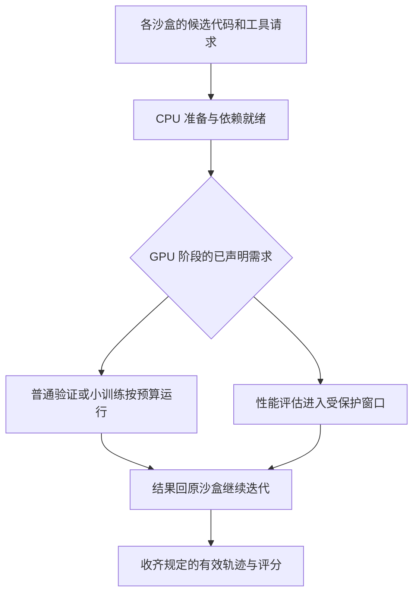
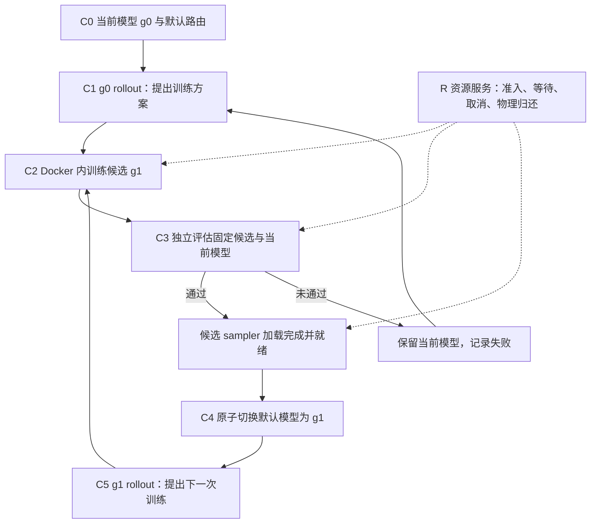

# 基础设施：RSI与GPU沙盒及模型接管

> **核心结论**：训练会写 GPU 程序的 Agent，需要一个能接收命令、安排 GPU、返回可信结果的环境服务。CUDA Agent 展示真实需求，Firepool 提供工业调度对照。PSRL 已有持久沙盒、命令借还、同机命令池和合作式 CPU 准备接口；研究要在这些强基线上证明，怎样更早拿到一批可信反馈。后半篇再讨论一个额外问题：任务里训练出的模型，怎样经过评估并真正接管下一轮 Agent。

核对日期：2026-11-18。本轮复核 Firepool、CUDA Agent 及下文三项本地调度能力，依据主目录 HEAD `c5f2d65a70f6923c992a7be867edd0864db2bd0c` 和当前未提交内容。模型接管部分保留 11 月 17 日的核对范围，尤其 PostTrain 协议文件含工作区修改。文献以一手资料为依据，文中的真实 GPU 结果来自分别注明条件的既有报告。本轮只读核对和更新文档，没有重跑实验。CPU 教学模拟运行于 11 月 17 日。新增调度提案与模型接管仍未接入生产，本次文档修改未提交、推送、合并或部署。

## 目录

- [与 GPU 沙盒调度最相关的工作](#与-gpu-沙盒调度最相关的工作)
  - [我们要调度的三类 GPU 工作](#我们要调度的三类-gpu-工作)
  - [CUDA Agent：最贴近的工业训练场景](#cuda-agent最贴近的工业训练场景)
  - [Firepool：最直接的工业 GPU 沙盒调度系统](#firepool最直接的工业-gpu-沙盒调度系统)
  - [KernelGYM 与 Metal Sandbox：优先看的公开实现](#kernelgym-与-metal-sandbox优先看的公开实现)
  - [NVIDIA 与商业沙盒的相关能力](#nvidia-与商业沙盒的相关能力)
  - [一个与 PSRL 对应的完整例子](#一个与-psrl-对应的完整例子)
- [Firepool 场景与 PSRL 三项能力对照](#firepool-场景与-psrl-三项能力对照)
  - [Firepool 之外哪些场景值得检验](#firepool-之外哪些场景值得检验)
  - [使用 CUDA Agent 场景究竟研究什么](#使用-cuda-agent-场景究竟研究什么)
  - [三项能力目前怎样实现](#三项能力目前怎样实现)
  - [用一个例子区分已有机制与研究增量](#用一个例子区分已有机制与研究增量)
  - [已有结果怎样约束下一步](#已有结果怎样约束下一步)
- [先把你设想的闭环讲清楚](#先把你设想的闭环讲清楚)
  - [一个模型训练另一个模型以后发生什么](#一个模型训练另一个模型以后发生什么)
  - [怎样判断递归改进发生在哪一层](#怎样判断递归改进发生在哪一层)
- [学术方法怎样实现自生成与自改进](#学术方法怎样实现自生成与自改进)
  - [SEAL：学习怎样生成有效的自训练指令](#seal学习怎样生成有效的自训练指令)
  - [Absolute Zero：同一个模型自己出题自己解题](#absolute-zero同一个模型自己出题自己解题)
  - [Agent0：出题模型与执行模型交替进化](#agent0出题模型与执行模型交替进化)
  - [STOP、DGM 与 AIDE²：递归改进 Agent 程序](#stopdgm-与-aide²递归改进-agent-程序)
- [直接与 RSI infra 相关的新工作](#直接与-rsi-infra-相关的新工作)
  - [InfraRSI：让 Agent 优化训练基础设施](#infrarsi让-agent-优化训练基础设施)
  - [RSI-Forge 与 Singularity-Bench：环境和评估也成为产品](#rsi-forge-与-singularity-bench环境和评估也成为产品)
- [业界已经提供哪些闭环组件](#业界已经提供哪些闭环组件)
  - [Tinker 与 Inkling：Agent 自主训练模型的实际案例](#tinker-与-inklingagent-自主训练模型的实际案例)
  - [Prime、ART、SkyRL 与 Atropos 的定位](#primeartskyrl-与-atropos-的定位)
- [PSRL 现在有什么还缺什么](#psrl-现在有什么还缺什么)
  - [现有两层训练与原生权重同步](#现有两层训练与原生权重同步)
  - [从任务权重到下一轮 Agent 的缺口](#从任务权重到下一轮-agent-的缺口)
- [建议的最小接管架构](#建议的最小接管架构)
  - [一次完整代际交接](#一次完整代际交接)
  - [第一版固定哪些边界](#第一版固定哪些边界)
- [为什么这会产生新的 GPU 调度问题](#为什么这会产生新的-gpu-调度问题)
  - [父任务持卡等待子任务会形成资源依赖环](#父任务持卡等待子任务会形成资源依赖环)
  - [尽早完成一个可发布版本比堆积候选更有价值](#尽早完成一个可发布版本比堆积候选更有价值)
  - [版本变化会改变缓存与旧实验的价值](#版本变化会改变缓存与旧实验的价值)
  - [训练状态恢复与模型推理恢复需要分别处理](#训练状态恢复与模型推理恢复需要分别处理)
- [最值得做的研究问题与强基线](#最值得做的研究问题与强基线)
  - [优先方向：训练 infra Agent 的环境 GPU 服务](#优先方向训练-infra-agent-的环境-gpu-服务)
  - [扩展方向一：保持版本语义的嵌套训练与评估调度](#扩展方向一保持版本语义的嵌套训练与评估调度)
  - [扩展方向二：评估通过的模型怎样低成本接管](#扩展方向二评估通过的模型怎样低成本接管)
  - [三个维度分别验收](#三个维度分别验收)
- [从现有框架走到闭环的实施顺序](#从现有框架走到闭环的实施顺序)
- [CPU 教学例子与本次验证](#cpu-教学例子与本次验证)
- [阅读顺序与一手资料](#阅读顺序与一手资料)

## 与 GPU 沙盒调度最相关的工作

本文有一条主线和一个扩展。先读本节与下一节，回答“为什么环境也要用 GPU，已有系统做到哪里，我们还可以优化什么”。后半篇从“先把你设想的闭环讲清楚”开始，讨论训练产物成为下一代 Agent 的条件。只研究环境调度时，可以先读完前两节，不必先理解模型接管。

### 我们要调度的三类 GPU 工作

用户当前关注的场景是：模型学习编写 kernel、优化训练或推理系统，许多训练题目需要在沙盒内执行 GPU 程序。每道题可以只是“编译、验证和测速一个 kernel”，也可以启动一次小规模训练或服务测试。**GPU 环境执行服务是这一类训练的直接依赖，题目无需每次都训练一个子代模型。**

| GPU 用途 | 实际做什么 | 典型持有时间与调度需求 |
|---|---|---|
| 策略训练 | 更新正在学习 infra 能力的模型 | 大批张量运算与优化器状态 |
| 模型 rollout | 模型生成代码、计划和工具调用 | 多轮推理，夹杂等待工具的时间 |
| 任务环境 | 运行候选 kernel、验证模型、做 profiling 或小训练 | 大量不同任务，时长和显存需求变化，常需独立测速 |

第三行就是本项目最直接的切入点。模型可以自主演进，执行服务仍须可靠地处理申请、排队、放置、运行、超时、结果与资源回收。以下排名按与这一问题的接近程度，而非按论文是否使用 RSI 这个名称。

### CUDA Agent：最贴近的工业训练场景

<!-- paper-figure:paper-cuda-agent-fig02 -->
原图将Agent工作目录、生成文件与GPU评估反馈放在一条闭环里。

[](../../_static/img/literature-reviews/paper-cuda-agent-fig02.png)

**原图来源：**Weinan Dai et al.，[原文](https://cuda-agent.github.io/)，图2，PDF第4页，Project PDF, pinned by SHA-256。版权归原作者，作为本文讨论对象节选。仅截取图形区域与等比例显示，中文说明置于图外，访问于2026-11-23。

**怎样读这张图。** 左侧SKILL.md和Workdir告诉Agent怎样操作开发环境；中部生成CUDA代码、绑定代码和Python入口；右侧GPU Pool运行正确性与性能测试，结果再反馈给Agent。模型生成与环境运行由不同步骤承担，评估中还区分候选、eager和compile参考时间。

**与本节的联系。** 这提供了真实场景：同一任务会保留文件并多次调用GPU工具。图里的GPU Pool并未给出我们所需的全部准入、状态版本和物理归还细节，这些需要按本地协议另外验证。
<!-- /paper-figure:paper-cuda-agent-fig02 -->


ByteDance Seed 与清华 AIR 的 CUDA Agent 用多轮 RL 训练模型优化 CUDA kernel。论文 §4.1 明确给出 CPU/GPU 分离的沙盒：Docker terminal 处理编辑、编译等 CPU 工作，skill 脚本将验证与 profiling 发到专门的 GPU 沙盒池，规模为 128 张 H20；执行采用进程隔离与独占资源以稳定测速。[项目官网](https://cuda-agent.github.io/)、[论文 §4.1](https://cuda-agent.github.io/static/pdf/CUDA_Agent_Arxiv_Version.pdf)

这与用户设想的 infra 能力训练直接对应：模型写代码，环境真实运行，执行反馈成为 RL 训练信号。公开材料没有披露完整集群队列策略、跨训推资源借还算法；其公开 agent 工作目录也不能替代这些调度实现。它最适合回答“这样的 GPU 环境需求是否真实存在”。

### Firepool：最直接的工业 GPU 沙盒调度系统

<!-- paper-figure:paper-firepool-fig02 -->
先看原图中“作业”和“预热容器池”怎样连接，再读后面与PSRL的能力对照。

[](../../_static/img/literature-reviews/paper-firepool-fig02.png)

**原图来源：**Ankit Goyal et al.，[原文](https://arxiv.org/html/2611.10832v1)，图2，PDF第3页，arXiv 2611.10832v1。[CC BY 4.0](https://creativecommons.org/licenses/by/4.0/)。仅截取图形区域与等比例显示，中文说明置于图外，访问于2026-11-23。

**怎样读这张图。** 左侧REST API记录作业，底部job store持久保存请求；中间dispatcher从pod tracker选择可用pod；右侧pod agent启动作业，pool controller根据队列和预算准备或回收容器。代码包随作业交给pod，不要求在创建每个pod时就固定好最终任务。

**与本节的联系。** 这里复用的是已经准备好的执行环境。要判断是否还能复用GPU模型，仍需查看作业退出后哪些进程、CUDA上下文和显存被清理，不能从warm pod这个标签直接推出模型常驻。
<!-- /paper-figure:paper-firepool-fig02 -->


LinkedIn 团队的 Firepool 面向 Agent/RL 的隔离 GPU 作业，论文报告内部生产使用。它有排队、优先级、调用方配额与 GPU 预算，按硬件构建共享基础 pod，运行时再装入代码与额外依赖；同调用方可复用 warm pod。零显存 standby 提前准备好容器，在前一作业结束后接班，减少重新建 pod 的等待。[2026-11-07 预印本](https://arxiv.org/abs/2611.10832)、[机制 §3 至 §8](https://arxiv.org/html/2611.10832v1)

pod 是 Kubernetes 分配和运行容器的基本单元，warm 指它已经启动就绪。Firepool 的 GPU gate 每物理卡最多允许一个作业执行；standby 没有 CUDA 上下文与显存。其关键是提前准备与低开销交接，不以多作业同卡计算并行为前提。论文借用配额的回收实验含模拟控制器条件，本次也未找到其自身的公开实现仓库。

**对 PSRL 的分析**：它是“GPU 环境服务池、启动成本与资源预算”的首要工业对照。原生命令借还、容器复用、运行准备和评估资源都应与这种强基线比较。是否进一步联合调度模型 rollout，要另行核对和验证。

### KernelGYM 与 Metal Sandbox：优先看的公开实现

KernelGYM 是 Dr. Kernel 的分布式 GPU 执行环境，作者包括高校与 TikTok 研究者。中央 API 接收任务，Redis 与 scheduler 管理状态，GPU workers 执行并返回正确性、测速等反馈；每卡串行执行，独立子进程隔离 CUDA 错误，监控负责恢复。[论文 §3](https://arxiv.org/html/2602.05885v1#S3)、[公开仓库](https://github.com/hkust-nlp/KernelGYM)

它同时有多轮 RL 训练接线，适合追踪“工具请求怎样入队、拿到 GPU、执行、回传 reward”。公开的任务隔离机制主要是子进程，Docker 的文件与权限隔离、训推共卡准入仍需具体适配。对我们的研究，先比较一个可靠的独立 GPU worker 池，比直接从复杂 RSI 循环起步更容易定位收益。

Metal Sandbox 的公开原型面向 Apple GPU coding Agent：会话保留工作区，规则允许的普通命令并行，需要协调执行或测速的命令进入每节点串行队列，符合条件的等待命令可换到空闲 Mac 执行，结果回原 Agent。它使用原生 App Sandbox，已有 Harbor 集成。[2026-11-12 预印本](https://arxiv.org/html/2611.17294v1)、[公开代码](https://github.com/WangHaoZhe/metal-sandbox)

它与 PSRL 的逐命令资源复用很接近。平台是 Apple Metal，评估包括受控任务和固定 Agent 轨迹重放；跨节点迁移的是尚未执行的命令，不搬运行中的 GPU 状态。

### NVIDIA 与商业沙盒的相关能力

NVIDIA 的 Agent Substrate 官方文章明确提出短时 GPU 研究沙盒，并连接 KAI Scheduler、Dynamo 与环境运行时。需要区分当前组件与设计目标：文中写明 GPU 支持正在基于 DRA，即 Kubernetes 动态资源分配机制重建，部分 Dynamo 集成仍属实验；GPU 暂停恢复也是建设中的方向。[2026-11-10 官方文章](https://developer.nvidia.com/blog/agent-substrate-advancing-kubernetes-for-agents-at-scale/)

商业可用组件中，Modal 的 Sandbox API 明确允许申请 GPU 类型和数量，支持命令执行、生命周期与清理；GPU 沙盒当前使用 gVisor runtime，可能被抢占。它可承载 GPU 题目，公开接口尚不足以判断有逐命令借还或与同一 rollout 卡联合调度的能力。[GPU 沙盒说明](https://modal.com/docs/guide/sandbox-resources)、[Sandbox API](https://modal.com/docs/sdk/py/latest/Sandbox)

截至核对日，上述证据覆盖了 GPU 题目训练和 GPU 沙盒调度。把自主选题、自身参数更新、多代接管及联合资源调度全部打通的完整 RSI 系统，仍需更直接的公开证据。

### 一个与 PSRL 对应的完整例子

以下为教学假设：8 张 GPU，4 张更新策略，2 张做模型 rollout，2 张供环境使用。16 个 Docker 沙盒各自优化一个 kernel，编辑与 CPU 准备阶段不占环境 GPU。

```text
策略模型生成代码与工具调用
             ↓
16 个持久沙盒：编辑、读取、CPU 准备可以并发
             ↓ 只有 GPU 执行命令入队
环境 GPU 服务：校验资源 → 排队 → 选卡 → 验证或测速
             ↓
结果回到原沙盒与 Agent → 修改代码 → 下一次工具调用
             ↓
收集轨迹与 reward → 更新策略模型 → 新参数继续 rollout
```

如果 16 条 GPU 验证命令同时就绪，每条占一张卡 15 秒，两个环境 GPU 串行服务各自的任务，在忽略其他开销的条件下需要 16 × 15 ÷ 2 = 120 秒。其余沙盒可继续执行允许并行的 CPU 工作；正在测性能的 GPU 要遵守测量排他规则。GPU 命令完成并确认释放后，下一条才可获得相应预算，沙盒文件则继续保留。

在这个例子里，调度研究可以直接从“缩短获得一批可信轨迹的时间”开始。系统还可研究多类 GPU 任务之间的排队、模型准备复用，以及有余量时与其他资源池协调。模型以后能够提出自己的训练任务并改善自身时，这个执行服务继续适用。

## Firepool 场景与 PSRL 三项能力对照

<!-- paper-figure:paper-firepool-fig03 -->
原图专门解释跨所有者或复用边界时，备用容器怎样减少下一份工作的启动空档。

[](../../_static/img/literature-reviews/paper-firepool-fig03.png)

**原图来源：**Ankit Goyal et al.，[原文](https://arxiv.org/html/2611.10832v1)，图3，PDF第4页，arXiv 2611.10832v1。[CC BY 4.0](https://creativecommons.org/licenses/by/4.0/)。仅截取图形区域与等比例显示，中文说明置于图外，访问于2026-11-23。

**怎样读这张图。** (a)旧Pod A需要保留或退役，新作业等待新pod创建。(b)同卡提前存在多个standby pod，它们不创建CUDA上下文、不占显存；当前作业结束后，经per-GPU gate把一个备用pod提升为活动者。GPU作业按门禁交接，准备工作在后台提前完成。

**与本节的联系。** 它把“提前准备容器”和“真正获准使用GPU”分开。本地可以借鉴准备前移与交接门禁，但这张图没有承诺多个活动GPU作业并行，也没有使任意旧模型状态都可被安全继承。
<!-- /paper-figure:paper-firepool-fig03 -->


### Firepool 之外哪些场景值得检验

<!-- chapter-figure:chapter-warm-layers -->
先看预热层次，避免把“容器已启动”误当作“GPU模型已加载”。

[](../../_static/img/document-figures/chapter-warm-layers.png)

这是通用层次示意。Firepool保留就绪容器与零显存standby的机制，以本节原文证据为准；它不等于保留任意候选GPU模型。 [放大查看 SVG](../../_static/img/document-figures/chapter-warm-layers.svg)。
<!-- /chapter-figure:chapter-warm-layers -->


**Firepool 可以提供研究场景和强基线，但容器预热、调用方复用、standby 接班和预算控制已经是其已有机制。** pod 是运行容器的 Kubernetes 单元。容器预热解决的是“环境还没准备好”，GPU 中保留模型解决的是“进程与模型状态还没准备好”，二者的成本和生命周期不同。Firepool §5 在每项作业结束时清理整个进程树，确认退出后 CUDA 上下文和显存随之释放。§6 的 standby 保留已就绪的容器，未运行用户 CUDA 程序，每张物理卡最多有一个 pod 执行作业。[Firepool 原文 §5 至 §6](https://arxiv.org/html/2611.10832v1)

因此，以下是基于公开机制推导的两个候选增量，需先找到真实触发条件。

| 候选场景 | 发生什么，为什么现有 warm pod 还不够 | 与 PSRL 的关系及继续条件 |
|---|---|---|
| 环境卡紧张时使用推理卡余量 | 容器已经就绪，环境作业仍拿不到卡。外层推理卡可能容得下环境模型，但计算重叠是否拖慢推理还需观测 | 已有显存余量共享和合作式暂停实验。待研究的是在真实干扰约束下选择何时共置、何时让路。先用其他独立空闲卡，只在这些资源不足时考虑此场景 |
| 多轮命令间保留、释放或重建模型状态 | 同一会话再次用到已加载模型或训练状态。留在显存可少加载一次，却可能阻塞其他会话 | 已有热状态亲和与换卡重建的小实验。通用状态价值判断、淘汰和版本一致性仍未完成，必须先找到实际重复使用且恢复成本可观的命令链 |

第一种场景的教学假设：80 GiB 显存中，推理权重、KV cache 增长等预留 56 GiB，环境任务需 16 GiB，再留 8 GiB 余量。容量上恰好可放下，但这只解决准入。两个程序还会争抢计算单元和显存带宽，随后需要判断推理吞吐或尾延迟是否仍满足约定。Firepool 的借用配额和零显存 standby 并未提供这套与外层推理共置的结论。

对照应包含相同总 GPU 下的固定分区、warm 整卡执行、简单余量共置，以及“有推理便暂停”的规则。我们已经观察到某些任务中共置有益、强制暂停反而更慢，后续应基于干扰选择动作。若推理始终饱和或简单规则已接近最好结果，这个方向的复杂策略空间就很小。详见[常驻计算共享实验](../experiments/06-训推共享_常驻vLLM与环境并行实验.md)。

第二种场景可用“加载模型 → 训练几步 → Agent 阅读日志或改配置 → 继续训练”的命令链理解。保留容器和磁盘 checkpoint，不等于保留显存中的权重、优化器和 CUDA 进程状态。训练还会改变这些状态，不能拿旧版本缓存继续评分。现有[热状态放置实验](../experiments/gpu-benchmarks/04-动态放置_热卡等待与冷卡加载对照.md)已经比较等待热卡与空闲卡重建，继续研究必须超过固定保留时间、LRU 或简单恢复成本规则，并核对[真实状态可复用条件](../research-proposals/04-状态复用_真实任务中的收益空间核查.md)。

### 使用 CUDA Agent 场景究竟研究什么

CUDA Agent 说明了一个真实需求：模型多轮生成 kernel 代码，CPU 沙盒处理编辑与编译，验证和 profiling 交给独立 GPU 池，反馈再进入下一轮和 RL。profiling 在这里指实际运行程序并测量执行时间，直接影响模型判断哪个候选更好。论文 §4.1 使用 128 张 H20 的专用环境池并进行独占执行。[CUDA Agent 论文 §4.1](https://cuda-agent.github.io/static/pdf/CUDA_Agent_Arxiv_Version.pdf)

**我们可以研究这类工作负载的执行服务：在给定卡数、相同评估协议和模型质量要求下，使一批多轮任务更早拿到可信反馈。** 数据集、候选 kernel 和评分规则可以固定，先比较基础设施，不必先复现整套大模型 RL。该方向的输入是多个沙盒提交的命令、资源需求、已声明的执行阶段及当下设备状态，输出是准入时间、目标卡、运行与保护方式。系统不能假设知道模型下一轮会写什么。



图是目标分工。PSRL 已有 CPU 准备、GPU 命令和结果回传入口，统一阶段声明、跨容器保护窗口和按组完成目标派发仍是待补能力。具体入口及边界见下一节。

例如正确性验证可以在允许的共享条件下执行，而性能评估需要更干净的测量条件。候选 A 的无干扰执行时间为 10 微秒，B 为 11 微秒，假设 A 测量时因竞争变成 14 微秒，系统会错误选 B。多跑了多少命令、GPU 利用率多高，都无法补偿这种反馈偏差。教学数字只说明机制，实际误选证据见[反馈压力实验](../experiments/gpu-benchmarks/08-性能反馈_高压力调度实验.md)。

强基线至少包括：CUDA Agent 式独立独占 GPU 池、同样依赖和预热条件下的 FIFO、PSRL 现有命令池与 prepared 接口、简单固定保护与固定采样轮数。观察整批完成时间、每条反馈等待、GPU 秒，以及相对无干扰参考的候选排序损失。新方法必须在相同评分工作量和反馈质量约束下获益。若要声称完整 rollout 或学习加速，再另做对应端到端实验。

已有论文也收窄了贡献空间：[KREX](https://arxiv.org/html/2609.30057v1)已研究命令内测量区域独占、区外并发与上下文复用，[VenusRL](https://arxiv.org/html/2610.03286v1#S4)已直接优化训练所需样本组的就绪时间。将这些目标补进 PSRL 是明确的系统能力增量，独立论文贡献仍需证明超过这些近邻。机制回顾可先读[KREX 精读](03-论文精读_KREX共享GPU测量保护.md)，再看[命令调度提案的新颖性核查](../research-proposals/01-调度研究_Rollout完成时间与反馈保真.md#2026-11-05-新颖性复核与实现取舍)。

### 三项能力目前怎样实现

上一轮的三条应理解为系统目标。它们在 PSRL 中已经有不同程度的实现与验证，不能直接当成三项新的论文贡献。

| 系统目标 | 当前代码怎样处理 | 剩余边界 |
|---|---|---|
| 持久沙盒按需用 GPU | `episode` 模式在会话期间保留 GPU 预算。`command` 模式在显式 GPU 调用时申请，结束后撤销访问并确认物理归还，容器和工作文件继续存在。同机命令池可在兼容 GPU 间重新选卡 | 基础机制已实现。命令池限同节点、direct 后端、独立单 GPU，不透明迁移运行中的 CUDA 进程、显存或优化器状态 |
| 尽早收齐一批有效轨迹 | 当前池内 FIFO，按有效显存占用和亲和关系选卡。有异步提交、查询、等待、取消，区分输出就绪与资源归还。有 prepared 接口将合作式 CPU 准备移到 GPU 准入前 | GPU 排队尚未利用组内依赖、剩余任务或整批关键路径。异步执行接口与上层 RL 样本管理都不自动构成组级 GPU 调度策略 |
| 保护 GPU 测速反馈 | KernelBench 专用 verifier 要求独立单卡、direct、单会话配置，并等待物理归还。研究脚本另验证过协作式测量保护 | 还没有统一的测量阶段协议、跨容器全局测量锁或自动污染检测。单 Router 的限制挡不住其他 Router 或外部 GPU 进程 |

实现阅读导航如下，源码行号依据本轮工作区核对。

| 入口 | 输入、动作与输出 |
|---|---|
| [持有策略与执行入口](../../../psrl/workers/env_service/gpu_execution.py#L9) | `episode` / `command` 决定持有期。执行入口分别计等待和运行预算，返回输出与归还状态 |
| [GPU 命令准入](../../../psrl/workers/env_service/command_gpu.py#L82) | 输入 lease、容器与请求标识，依次检查 FIFO、候选卡和显存预算，成功后返回设备授权 |
| [GPU 命令归还](../../../psrl/workers/env_service/command_gpu.py#L272) | 调用节点撤权并确认物理释放，成功后再移除 GPU 分配，异常时隔离对应资源 |
| [同机池配置约束](../../../psrl/workers/env_service/types.py#L70) | 校验 command、direct、独立单卡条件，拒绝不兼容的资源池组合 |
| [异步作业接口](../../../psrl/workers/env_service/gpu_jobs.py#L61) | 提交后创建作业状态，查询与等待可以观察输出就绪、运行和归还，不提供组级优先级策略 |
| [CPU prepare 与 GPU activate](../../../psrl/workers/env_service/prepared_gpu.py#L24) | 合作式模块先 `prepare(payload)`，就绪后经 GPU 准入激活返回的函数。保留该进程的 CPU 准备，不自动拆解任意 shell 命令 |
| [KernelBench 专用限制](../../../examples/kernel_bench/verifier.py#L8) | 限制测试入口配置并经 `exec_gpu` 执行，不提供集群范围的物理独占保证 |

这些是可配置能力，基础配置中的 [Env Service 开关](../../../psrl/trainer/config/psrl/env_service.yaml#L6)仍为 `False`。同机命令池、MPS、模型余量共享各有适用分支，不能假设在一个默认配置中全部启用。`prewarm` 当前预热节点服务，也不能直接等同于 Firepool 的 warm 容器池。

另一个边界是超时：命令执行已有等待与运行预算，会话准入的 `max_wait_s` 默认仍可无限等待，当前 science runner 未显式传入上限。任务 backstop 在准入后创建，因此整组从提交到收齐的统一 deadline 仍需另行设计。[客户端准入](../../../psrl/workers/env_service/client.py#L159)、[runner 调用](../../../examples/sciaccel_rl/runner.py#L365)

### 用一个例子区分已有机制与研究增量

<!-- chapter-figure:chapter-prepare-gpu -->
CPU先准备、GPU后准入，省掉的是拿着卡等待准备的时间。

[](../../_static/img/document-figures/chapter-prepare-gpu.png)

沿用本节4项、每项6秒准备与2秒GPU的教学条件：16秒变10秒。这属于已有prepared接口可表达的优化，不能再单独作为新贡献。 [放大查看 SVG](../../_static/img/document-figures/chapter-prepare-gpu.svg)。
<!-- /chapter-figure:chapter-prepare-gpu -->


按图中同样四项工作计算：先拿卡再准备时，两卡各做两轮8秒；先并行准备时，第6秒才申请GPU，随后两轮计算共4秒。总工作没少，省掉的是占着GPU等CPU的时间。

先准备后准入正是已有 prepared 接口能够表达的执行方式，已经有真实小对照，不能再把“CPU/GPU 分开”本身作为新贡献。把已有接口接到更广的任务上属于有价值的工程集成。

更进一步的候选增量是：有的命令只做正确性，有的命令用于比较性能，有的作业可能与推理有益重叠。系统怎样根据当前可知信息安排它们，使整组结果更早返回并保持质量？这里涉及阶段声明、保护成本与实际竞争，不只是把四项排进 FIFO。我们仍须先证明真实任务有足够大的可优化空间，并超过强简单策略。

### 已有结果怎样约束下一步

这些是既有条件下的结果，本轮没有重跑。

| 已有证据 | 应怎样使用 |
|---|---|
| [同机命令池与 prepared](../research-proposals/03-动态放置_会话与GPU执行分离.md#14-results真实-ray-与相同工作量对照)：固定卡、池化及 prepared 六组共 288 次正确性测试全部通过。prepared 小对照将 A 的 GPU 预算持有均值减少约 75% | 证明换卡、准备前移与归还机制可用。时序受控且重复少，不直接推出自然多轮 RL 吞吐收益 |
| [六类整任务池化](../research-proposals/07-并发准入_未知命令时长与反馈调度.md#小实验协议和结果)：24 次任务，整批均值从 180.10 秒增至 243.53 秒，慢 35.22% | 整任务串行化会把 CPU 准备一起排队。“有资源池”本身没有普遍加速保证。OFF 是固定旧 runner `0eeead8` 及报告披露的兼容补丁 |
| [运行准备本地化](../research-proposals/08-运行准备_重复准备成本与GPU就绪调度.md#固定旧基线对照结果)：依赖就绪条件下整批少 54.03%，首次复制需 333.40 秒，加回前三批的已知成本后反而慢 23.65% | 先定位准备和 I/O 成本，公平保留缓存条件。前三批合计是历史区块成本拼接，严格冷启动端到端尚未完整计时 |
| [计算共享](../experiments/06-训推共享_常驻vLLM与环境并行实验.md)：长生成与 4B 环境模型的连续请求条件下，合作式暂停相对现有共享多用 72.77% 时间 | 共置可能已带来有益重叠。新的让路策略要观察实际干扰，避免无条件暂停 |
| [测量保护](../experiments/gpu-benchmarks/08-性能反馈_高压力调度实验.md#怎样理解结果与研究价值)：159 组、20,560 次官方计时调用支持简单保护窗口；当前自适应规则在全部主对照与补充对照中均慢于固定两轮 | 保留保护机制和固定两轮强基线。实验是单容器中协作暂停人工后台，尚未成为统一跨容器协议 |

还有一个已经收窄的候选：[最终 verifier 首个必做单元后校准再调度](../research-proposals/01-调度研究_Rollout完成时间与反馈保真.md#收窄候选新代码的验证校准与余量调度)。现有 FlashInfer 子集的首次单元需 4.36 至 5.83 秒，剩余仅 0.33 至 0.38 秒，尚不足以支撑复杂重排。因此它保留为有条件备选，不作为当前通用主线。

**下一步应先做真实命令链的机会判断。** 记录 CPU 准备、GPU 活动、状态重建、Agent 等待、测速窗口和当时资源竞争。先看缓存与现有 prepared 是否已经解决主要等待，再看理想调度的潜在收益能否覆盖保护和交接成本。只有条件成立，才投入新策略或完整 RL。当前设计入口无需因本次文献核对改写能力，本轮没有改变任何执行接口。

## 先把你设想的闭环讲清楚

### 一个模型训练另一个模型以后发生什么

GPU 环境服务之上还可以增加一个闭环：**把环境内训练出来的模型，从“被评分的提交物”变成“下一轮实际做研究、调用工具的主体”。** 这样，模型的改进能够影响后续改进过程。下面单独说明这条扩展，基础环境调度本身不要求每道题都产生子代模型。

先用一个贯穿全文的教学例子。我们有一个 4B 工具调用模型 g0，已经会阅读实验结果、写训练配置和运行命令。它接到“改善自己的代码推理与工具使用能力”的任务，选择一批可执行题目，在 Docker 中调用训练脚本，从自己的 checkpoint 生成候选 g1。系统在独立题集上比较 g0、g1；通过后，下一条研究任务实际发送给 g1，由 g1 决定下一次训练。这时参数谱系与控制权都沿 g0 → g1 延续。

如果外层一直是固定的大模型 A，而 Docker 内改善的是时间序列模型 B，链条就是“自动模型研究”。如果 B 的权重随后接管了外层任务，链条才增加了你关注的递归关系。**训练任务的目标也必须匹配接管职责**：时间序列预测变准，并不会自动让 B 学会设计实验或正确调用工具。

模型不必和训练器处在同一个 Docker 中。模型输出训练计划，可信运行时执行优化器更新，版本服务加载新参数，仍可构成自主改进流程。决定性质的是谁提出下一次改进、改动什么、改进后谁继续工作。

### 怎样判断递归改进发生在哪一层

“RSI”是 Recursive Self-Improvement，即递归自改进。不同论文把它用于不同对象。讨论时最好直接写明循环，避免把某个术语当作统一的能力等级。

| 循环 | 一轮具体改变什么 | 下一轮由谁工作 | 我们怎样理解它 |
|---|---|---|---|
| 同一次回答中自我检查 | 文本或上下文 | 同一固定参数模型 | 推理时修正 |
| 自己采样、评分、更新，再采样 | 参数 θ | 更新后的 θ | 自训练或在线 RL 的基本闭环 |
| 学习生成训练数据、选择更新方式 | 参数及改进策略 | 更新后的模型提出下一次改进 | 与用户设想更接近的学习型改进过程 |
| 修改工具、提示和研究程序 | Agent 程序 P | 新程序 P 调用基础模型 | 程序层面的递归改进 |
| 用新版本继续改善自己的改进过程 | 参数、程序或两者 | 被改进的改进器 | 需要多代与独立任务上的改进能力证据 |

因此，“小模型自己 rollout 下一步”确实关闭了外部教师持续提供行动的依赖，但还要看它下一步在做什么。若训练规则始终固定，这是成熟的自训练循环；若它还会选择数据、修改训练方案，并让更好的自己接着做这些选择，就能研究更强的递归关系。

这里有两个相互独立的问题：**能否自主完成循环**，以及**循环是否持续提高能力或改进效率**。系统论文可以先解决前者和运行成本，再用独立测试衡量后者。外部提供执行器、训练代码与评价标准，是这个实验的基础条件。

## 学术方法怎样实现自生成与自改进

下面选择对我们的执行链最有启发的工作。发表状态和机制分开列出；2026 年秋季的新预印本集中放到后文。

| 工作 | 发表状态 | 更新对象 | 对应的版本图 | 最值得借鉴的地方 |
|---|---|---|---|---|
| SEAL | NeurIPS 2025 主会 | 生成自训练指令的模型 | 父代 → 多个适应分支 → 外层更新 | 候选价值绑定父代参数 |
| Absolute Zero / AZR | NeurIPS 2025 主会 | 共享参数的出题者和解题者 | θg → 出题与解题 → θg+1 | 无持续大模型教师的自生成循环 |
| Agent0 | COLM 2026，作者论文标注 | 出题、执行两个参数分支 | curriculum 与 executor 交替更新 | 多轮工具与双分支生产节奏 |
| STOP | COLM 2024 | 改进器程序 | Pg → Pg+1，基础模型固定 | 改进器自己成为优化对象 |
| Darwin Gödel Machine | ICLR 2026 | Agent 程序与分支档案 | 程序树，基础模型固定 | 分支保留、父代选择与迁移评估 |
| AIDE² | 2026-09-22 预印本 | AI 研究 Agent 程序 | 改研究程序 → 再让它做研究 | 单独检验“改进能力是否变强” |

会议依据：[SEAL 正式页](https://proceedings.neurips.cc/paper_files/paper/2025/hash/6b41e04c41726e2a60e456d0a2b961ab-Abstract-Conference.html)、[AZR 正式页](https://proceedings.neurips.cc/paper_files/paper/2025/hash/9837dc00ff67d176373268ed48042d49-Abstract-Conference.html)、[Agent0 版本与发表标注](https://arxiv.org/abs/2511.16043)、[STOP 论文](https://arxiv.org/abs/2310.02304)、[DGM 正式论文](https://openreview.net/pdf?id=pUpzQZTvGY)。Agent0 的 COLM 状态来自作者论文，本文没有取得独立主会录用页。

### SEAL：学习怎样生成有效的自训练指令

<!-- paper-figure:paper-seal-fig01 -->
先认清原图里的两种更新，后面再看它与模型接管的区别。

[](../../_static/img/literature-reviews/paper-seal-fig01.png)

**原图来源：**Adam Zweiger et al.，[原文](https://arxiv.org/html/2506.10943v2)，图1，PDF第2页，arXiv 2506.10943v2。[CC BY 4.0](https://creativecommons.org/licenses/by/4.0/)。仅截取图形区域与等比例显示，中文说明置于图外，访问于2026-11-23。

**怎样读这张图。** 左侧模型为同一上下文生成多个self-edit，黄色SE是自编辑数据或指令。每条分支经过Optimize得到一个临时适应后的模型，测试结果成为奖励；右侧Policy Update再用这些奖励改善生成self-edit的策略。中间的临时更新与最右侧的外层更新发生在不同位置。

**与本节的联系。** 因此，“训练了一个更好的临时模型”和“把它发布为下一轮Agent”需要分别描述。GPU调度还要为多个适应分支与评估安排资源，版本对应关系不能只用一个“当前模型”字段代替。
<!-- /paper-figure:paper-seal-fig01 -->


SEAL 让模型根据新上下文生成 self-edit，即供自己学习的数据或更新指令。在父代 θg 的临时分支上执行这些指令，得到适应模型 θ′；用 θ′ 的下游表现评价这条指令，再以较好的指令训练外层模型。外层采用采样、筛选、监督更新的 ReST^EM 方法。

~~~text
θg 生成编辑 e → 在 θg 上执行内层训练 → 临时 θ′ → 下游评分
       ↑                                           ↓
       └──────── 外层学习好编辑，得到 θg+1 ────────────┘
~~~

关键在于 **θ′ 与 θg+1 属于不同更新**：临时适应模型用于评价编辑，外层模型学习怎样写好编辑。主流程的自编辑由模型生成；知识上下文与参考任务仍来自外部，知识评估含 GPT-4.1 评分。[SEAL 原文 §3、§5 与附录 B](https://arxiv.org/html/2506.10943v2)

**对 PSRL 的分析**：奖励应记录为 R(父代 θg，编辑 e，评估任务)。同一条“增大学习率”的命令，在新父代上可能产生不同效果。异步调度若把 θg 上的奖励直接当成 θg+1 的改进证据，就改变了学习问题。可以缓存不变的数据和基础文件，而将分支 checkpoint 与奖励按父代区分。

### Absolute Zero：同一个模型自己出题自己解题

Absolute Zero 的具体系统叫 AZR。一个共享参数模型分角色提出代码推理任务、解决任务，Python 执行器负责验证有效性和答案；随后联合更新参数，下一轮继续用新参数出题和解题。题型包括根据程序与输入求输出、根据程序与输出求输入，以及根据输入输出推断程序。[AZR 原文 §3](https://arxiv.org/html/2505.03335v3#S3)

一个简化教学题可以是程序 f(x)=x²+1、输入 3，执行器算出输出 10；模型也可以被要求反推输入。执行器提供落地反馈，模型自己产生训练任务。论文的 Zero Data 指无需额外人工或蒸馏训练题，预训练基座、题型与执行规则仍由外部给定。

**对 PSRL 的分析**：这是最清楚的“更新后的自己生成下一批训练经历”参照。第一版可以保留程序化训练规则，让同一个小模型承担出题、工具调用与解题，先研究模型版本、代码执行反馈和 GPU 训练如何衔接。其执行器未必需要 GPU；要检验我们课题，还需选择确实会在环境内训练模型的工作负载。

### Agent0：出题模型与执行模型交替进化

Agent0 从同一基座初始化两个分支。先固定 executor，训练 curriculum 生成具有挑战性、鼓励工具使用的任务；再固定 curriculum，生成任务池并训练 executor；新 executor 改变下一轮出题者面对的难度。执行器能多轮调用 Python 工具，训练使用自身多次答案的共识形成伪标签。[Agent0 原文 §3、附录 A](https://arxiv.org/html/2511.16043v2#S3)

这里需要区分执行成功与答案正确：Python 可以确认程序运行结果，任意自生成问题的最终答案还可能依赖共识；多个答案一致仍可能出错。独立外部测试用于检验泛化。

**对 PSRL 的分析**：其多轮工具执行与本地 Agent loop 比较贴近，双模型交替又带来明确的同步边界。如果新 executor 已经发布，后台还堆着旧 curriculum 针对旧 executor 产生的题，应按算法规定决定继续用、限制积压或重新生成。调度器需要知道这些数据之间的依赖。

### STOP、DGM 与 AIDE²：递归改进 Agent 程序

STOP 把“调用固定 LLM 来改程序的改进器”本身作为待改程序，并用下游任务上的平均改进效果评价新改进器。新一轮采用新程序继续搜索，模型权重固定。[STOP 原文](https://arxiv.org/abs/2310.02304)

DGM 维护 Agent 程序的分支档案，选父代、修改程序、运行 coding benchmark，再保留可用子代。它改善工具和执行工作流；论文实现还有外部 o1 提供诊断建议，父代选择等外层逻辑固定。跨 benchmark 迁移评估与用于搜索的主分数应分别看待。[DGM 原文 §3、§4.4、附录 C.3](https://arxiv.org/html/2505.22954v3)

AIDE² 进一步把 AI 研究 Agent 程序放入外层优化，再让新程序承担内部研发任务。论文单列 ignition test，检验改进后的 Agent 是否更擅长继续改进自己；结果对自加速的支持仍不确定。这给我们一个很好的评估问题：下游模型更强之后，它是否真的更会选择下一次训练？[AIDE² 原文 §2.1、§3.6](https://arxiv.org/html/2609.26457v1)

**对 PSRL 的分析**：参数演化和程序演化可以分别实现。若小模型暂时不能稳定设计训练，先让 Agent 优化固定训练脚本也有研究价值；这条路径的主要状态是代码、实验与工具版本，权重接管则是另一条工程链。

## 直接与 RSI infra 相关的新工作

### InfraRSI：让 Agent 优化训练基础设施

2026-11-08 的 InfraRSI 与问题名称最接近。它固定工作负载、损失和计时规则，分析基线后，让 LLM 联合修改启动配置与代码；把成功、失败和 OOM 观测用于修正时间、显存预测，重测候选后写入跨硬件经验库。论文在四类训练负载上报告几何平均 1.83× 加速，这是作者实验结果。[InfraRSI 原文](https://arxiv.org/html/2611.11558v1)、[作者代码](https://github.com/TokenRhythm/InfraRSI)

这里的递归主要体现在搜索过程修正经验与跨运行复用经验。公开流程仍由 LLM 提案，没有展示“训练得到的新模型接替提案模型”的多代参数链。它研究的是**用自改进过程优化 infra**；我们可以研究**支持自改进工作负载的 infra**。

对本项目最有价值的借鉴是固定实验语义：Agent 修改 batch、累积步数或计时窗口后，即使每步时间缩短，也必须检查实际工作量和更新是否一致。我们做 GPU 调度时，也要将候选训练、独立评分、资源归还的时间分开记录。

### RSI-Forge 与 Singularity-Bench：环境和评估也成为产品

| 工作 | 当前状态 | 提供什么 | 对 PSRL 的用途 |
|---|---|---|---|
| RSI-Forge | 2026-10-07 预印本 | 从研究论文构造、复现和审查可执行研发环境；论文报告 210 个环境 | 候选任务来源、独立 evaluator 与可复现实验协议 |
| Singularity-Bench | 2026-11-12 预印本 | 覆盖预训练、中期训练、后训练、推理、harness 和集群优化的六类任务 | 挑选后训练与集群任务，研究统一的代码、预算和反馈接口 |

RSI-Forge 的实验中，跨尝试继承代码和笔记，基础模型固定。Singularity-Bench 提供分项研发评测，使用基于 Harbor 扩展的 Breakwater 隔离运行与评价；这些分项还需被应用连接成子代接管链。[RSI-Forge 原文](https://arxiv.org/html/2610.09426v1)、[Singularity-Bench 原文](https://arxiv.org/html/2611.16591v1)

**我的判断**：沙盒环境、真实训练、预算和可信评价正成为 RSI 研发的重要基础层。我们可以直接沿现有 Harbor / Docker 接入方式选小规模任务，不必一开始复现完整大预算 benchmark。本文没有核实这些上游环境在本地的可运行性。

## 业界已经提供哪些闭环组件

### Tinker 与 Inkling：Agent 自主训练模型的实际案例

2026-11-05，Thinking Machines 展示 Inkling 2 Small 自主为 Qwen3.5-4B 做时间序列后训练：读取数据、编写本地 evaluator、尝试 SFT 和 RL、比较 checkpoint。RL 分支使校准与评分下降后，Agent 停止该分支，最终选 SFT checkpoint。官方报告用时约 4 小时 17 分、Tinker 花费 426 美元。外层 Inkling 在案例中保持固定，改善的是被训练的 Qwen。[官方案例与轨迹](https://thinkingmachines.ai/news/inkling-2-small/)

这给“一个 command 可以启动一次真实模型实验”提供了直接的业界参照。Agent 自己写的开发 evaluator 有助于搜索，最后的独立测试负责判断是否泛化；在我们的实验中，这两个评价角色也应保留。

Tinker 将模型计算封装为采样、反向传播、优化和保存接口，环境逻辑由用户程序控制。当前托管服务支持 LoRA 微调，尚不支持全参数微调。尤其值得借鉴其 checkpoint 语义：训练恢复保存权重与优化器状态，sampler checkpoint 只保存固定采样权重，外部导出和分享另有接口。[Tinker 当前能力](https://tinker-docs.thinkingmachines.ai/tinker/index.md)、[checkpoint 文档](https://tinker-docs.thinkingmachines.ai/tinker/howto/checkpoints/)

对应到 PSRL，命令返回 checkpoint 路径之后，还要明确它是“可续训的状态”“可被评测的权重”，还是“已经上线的服务”。分开命名和管理，可以避免把训练结束误当成模型已经接管。

### Prime、ART、SkyRL 与 Atropos 的定位

| 项目 | 已有的相关机制 | 与本项目的结合点 |
|---|---|---|
| Prime verifiers + prime-rl | 环境与评分、orchestrator、trainer、推理及训练内权重广播 | 对照组件边界与长任务流水线 |
| Prime Sandboxes | microVM、文件系统 checkpoint/fork、暂停恢复、持久卷 | 对照环境状态管理；GPU 沙盒仍需专项授权 |
| ART | agent 轨迹训练、LoRA 保存与加载；可共享或分离训推 GPU | 借鉴训练后更新 sampler、版本发布与 checkpoint 分支 |
| SkyRL | 自托管 Tinker API；FSDP/Megatron、vLLM、LoRA 与全参训练 | 可作为可调用训练服务的参照或后端 |
| Atropos | 环境微服务与轨迹队列解耦、参考 trainer | 历史架构参考；仓库已归档 |

当前服务状态有几个会影响选型的细节：

- Prime 的共享多租户 LoRA 托管服务已退休；当前 Hosted Training 使用独立 GPU、全参数训练，旧的 Prime Inference adapter 部署已移除，自管 prime-rl 仍支持 LoRA。其 Sandboxes 文档对 GPU 仍要求专项 grant，普通 GPU 训练服务与通用 GPU 沙盒分属不同能力。[训练服务变更](https://docs.primeintellect.ai/hosted-training/shared-lora-retired)、[Sandboxes 当前文档](https://docs.primeintellect.ai/sandboxes/overview.md)、[prime-rl 架构](https://docs.primeintellect.ai/prime-rl/overview.md)
- ART 给出采样、暂停推理、训练、保存与重新加载的完整流程；专用 GPU 模式允许训推重叠，adapter 版本可服务在途与新请求。这可以参考，但仍需应用接上环境内任意 GPU 任务。[训练循环](https://art.openpipe.ai/fundamentals/training-loop/)、[后端语义](https://art.openpipe.ai/fundamentals/art-backend/)
- SkyRL 隐藏 worker、batch 和权重传输细节，支持自管全参与 LoRA；多租户能力当前主要覆盖 Megatron + vLLM 的 LoRA。其全异步方案还需要处理轨迹与策略版本的陈旧程度。[Tinker API](https://docs.skyrl.ai/docs/tinker/overview)、[全异步训练](https://docs.skyrl.ai/docs/tutorials/fully_async)
- Atropos 官方仓库于 2026-07-04 归档，当前不再维护；适合作为环境与训练器解耦的设计参照。[官方仓库](https://github.com/NousResearch/atropos)

这些资料共同说明，**采样、训练、保存新权重、再采样已经是通用训练底座的基本能力**。我们的研究机会需要落在环境内嵌套 GPU 实验、代际交接成本或算法相关的调度约束上。

## PSRL 现在有什么还缺什么

### 现有两层训练与原生权重同步

先回顾已有完整讲解：[MLGym 两层训练](../knowledge/03-任务接入/04-MLGym与SWE及Serve_任务协议与评分训练.md#两层训练如何串联)解释容器内模型和外层 Agent 分别怎样更新；[权重评分与 Agent 训练](../knowledge/03-任务接入/04-MLGym与SWE及Serve_任务协议与评分训练.md#权重如何评分探索轨迹如何训练-agent)有奖励如何接入外层策略更新的完整算例。

本地已经存在以下链条。A 表示生成命令的外层 Agent 参数，B 表示任务里训练的模型参数：

[](../../_static/img/document-figures/explained-rsi-two-loops-cb6e04f.png)

[](../../_static/img/document-figures/explained-rsi-two-loops-cb6e04f.png)

[](../../_static/img/document-figures/explained-rsi-two-loops-cb6e04f.png)

<!-- explained-source:explained-rsi-two-loops-cb6e04f -->
**读图结论：**训练一个模型作业与让该模型成为下一轮 Agent 是不同流程，后者不由评分自动触发。 当前新参数进入 rollout 的正式路径来自外层 trainer，任务产物接管仍是提案。 [完整解释图（SVG）](../../_static/img/document-figures/explained-rsi-two-loops-cb6e04f.svg) · [原始机制图或实验图](../../_static/img/literature-reviews/rsi-two-loops.png)。
<!-- /explained-source:explained-rsi-two-loops-cb6e04f -->

[查看可放大的 SVG](../../_static/img/document-figures/explained-rsi-two-loops-cb6e04f.svg)。上半部中，B 的训练结果经过评分，分数与交互轨迹进入 PSRL，更新的是 A。A 的新参数再发布到生成服务。下半部红色虚线是额外的接管提案：B 还需具备 Agent 职责、通过评估、服务加载就绪并切换路由，才会由 B 生成后续命令。

例如 A 让容器训练一个分类器 B，B 的准确率成为这次尝试的奖励。PSRL 据此更新 A，让它以后更善于提出训练方案；下一次发命令的依然是 A。这已经是“两层训练”，而“分类器 B 变成下一轮研究 Agent”还要求 B 能理解任务、选择实验并调用工具。将这两条参数流分开，才能判断究竟要修改环境执行、评分，还是模型发布系统。

**当前代码里确实有新参数进入后续 rollout 的路径，但参数来自 PSRL 的外层 trainer。** 本次核对的任务产物没有直接进入该路径。

| 实际动作 | 已读源码 | 它支持的结论 |
|---|---|---|
| 为 Harbor Agent 设置模型名称与 endpoint | [runner](../../../examples/sciaccel_rl/runner.py#L483) | 环境中 Agent 使用外部指定的 rollout 服务 |
| 训练并保存任务模型的可提交参数 | [PostTrain execute](../../../examples/posttrain_bench/local_model.py#L61) | 沙盒任务可产生模型参数文件 |
| 恢复候选模型，生成答案再评分 | [PostTrain verifier](../../../examples/posttrain_bench/judged_model.py#L39) | 参数产物可进入独立评价 |
| 外层 trainer 从训练引擎取参数并推送新版本 | [ray_push_model](../../../psrl/workers/train/engine_train_worker.py#L433) | 原生发布源是外层训练模型 |
| 参数服务保存权重并通知 rollout coordinator | [PS manager](../../../psrl/workers/ps/ps_manager.py#L1144) | 已有训练内模型版本管理 |
| 暂停相关路由，协调实例拉取新版本 | [sync_with_ps](../../../psrl/workers/gen/rollout_coordination/sync_and_migrate/sync_and_migrate_mixin.py#L119) | 已有权重同步协调流程 |
| 确认实际拉取版本，调用引擎加载权重 | [pull_model_for_sync](../../../psrl/workers/gen/vllm_async_server.py#L1378)、[ray_pull_model](../../../psrl/workers/gen/vllm_async_server.py#L1469) | 版本通知与实际加载可分别核对 |
| 给 session 附带版本元数据 | [build_session_headers](../../../psrl/workers/agent_loop/loops/session_agent_loop.py#L46) | 已有请求版本传递基础，具体续跑语义仍取决于配置 |
| GPU 命令执行、超时与归还 | [exec_gpu](../../../psrl/workers/env_service/managed_execution.py#L53)、[执行后端](../../../psrl/workers/env_service/gpu_execution.py#L109)、[物理归还确认](../../../psrl/workers/env_service/command_gpu.py#L272) | 可复用受管理的环境 GPU 生命周期 |

PostTrain 的本地有界协议尤其要按源码理解：它冻结模型其他部分，只训练 `model.norm.weight`，最多取两条样本做两次更新；名为 `adapter.safetensors` 的文件只装这个归一化参数向量。[保存协议](../../../examples/posttrain_bench/local_model.py#L61)、[加载校验](../../../examples/posttrain_bench/local_model.py#L31)。它适合验证参数交付、资源与评价机制；要培养能接管实验的 Agent，还需更合适的训练任务与参数更新范围。

### 从任务权重到下一轮 Agent 的缺口

最关键的新增箭头是：

~~~text
Docker 的候选产物 B′ → 合法可用的 Agent 模型 → 就绪的推理服务
                    → 默认路由切换 → 下一轮真的由 B′ 生成命令
~~~

这条箭头需要四种不同的工作。

第一，**把产物解释清楚**。记录不可变的候选身份、父代、基座、参数差分、tokenizer、对话模板、代码与数据版本。如果要续训，还要有优化器等训练状态。只有一个文件路径，其他组件无法知道怎样恢复模型。

第二，**让训练产物满足接管职责**。候选需要继续完成工具调用和实验选择。最简单的技术边界是固定同一个小模型架构和 tokenizer，做完整 checkpoint 或标准 LoRA；若从大模型 A 换成不同架构的小模型 B，应创建对应服务，现有同构权重加载流程无法自动转换模型结构。

第三，**建立候选评估与发布事务**。训练成功只说明产物完成；独立评估决定是否值得采用；服务实际加载并能接请求后，默认模型才可改变。失败时保留当前已知可用版本。

第四，**决定谁拥有下一代的训练状态**。若直接把任务模型注入现有参数服务，而外层 trainer 仍持有旧 A 与旧优化器，下一次 push 会覆盖它。必须规定接管期间暂停谁、同步谁、从哪个状态继续优化。第一版用独立的候选 rollout 服务，可以更清楚地验证这条链。

这些是本文提出的接入方案。本次只核对上述调用链，没有对整个仓库作“所有任务绝无此功能”的穷尽证明，也没有把方案写入当前能力入口。

## 建议的最小接管架构

<!-- chapter-figure:chapter-model-promotion -->
把工具训练产物接成下一代Agent，需要一条独立的验证与发布路径。

[](../../_static/img/document-figures/chapter-model-promotion.png)

图为尚未生产接入的设计提案。原生策略训练的权重同步，与任意任务产物获得Agent身份，是两种不同的模型更新。 [放大查看 SVG](../../_static/img/document-figures/chapter-model-promotion.svg)。
<!-- /chapter-figure:chapter-model-promotion -->


### 一次完整代际交接

下图为**设计提案**。系统驱动器可以保持固定，它负责执行约定与预算；每代模型负责生成下一次训练方案。这样可以先研究参数与控制权接管。



这里 C2 每次以当前批准的父代生成新候选；图中的 g0、g1 是第一轮示意。候选可以有多个分支，但应先做单候选、整代同步的正确版本。

完整教学过程如下，分数均为假设：

1. 当前 g0 的独立验证分数为 0.60。它提出“增加工具纠错轨迹，用指定训练预算更新自己”的方案。
2. 驱动器把父代 checkpoint 和公开训练数据挂给 Docker，训练输出候选 g1；活动模型仍为 g0。训练资源确认归还后，才可给其他任务记作可用。
3. 独立 evaluator 恢复 g1，在相同协议上得到 0.70，同时检查基本工具调用能力。真实实验需处理评估噪声，不能仅凭一次微小分差发布。
4. 启动 g1 sampler，做有界探活。路由服务在一个提交点将默认身份从 g0 改为 g1。已经开始的请求按预先约定完成或排空。
5. 下一次研究任务通过默认路由送给 g1；日志记录实际服务 checkpoint。g1 提出下一轮训练，生成 g2。
6. g2 分数为 0.65，未通过相对当前 0.70 的发布门，保留 g1。失败实验仍进入成本与经验记录。

“原子切换”指调用方看到一个明确的当前版本，不会在指针更新中途读到半个状态。真实部署还要考虑服务故障、幂等重试与恢复；单机锁只适合后文的教学模拟。

### 第一版固定哪些边界

| 部分 | 第一版建议 | 这样固定的原因 |
|---|---|---|
| 参数谱系 | 同一个小模型基座与架构；不可变候选 ID | 避免同时解决异构模型替换 |
| 候选更新 | 一个清晰的 SFT 或 RL 训练协议 | 能归因训练、评估与接管故障 |
| 循环控制 | 固定驱动器，每代由活动模型提出方案 | 将基础设施与改进策略分开验收 |
| 发布顺序 | 整代同步，评估后接管 | 先获得可比较的算法语义 |
| 资源布局 | 优先用独立空闲 GPU 分离 rollout 与任务训练 | 符合现有资源偏好，先完成真实闭环 |
| 评价职责 | 开发反馈用于搜索，保留独立最终测试 | 防止反复选模型耗尽评估独立性 |
| 预算 | 限定代数、候选数、GPU 时间和失败重试 | 使递归运行有明确停止条件 |

这里“大模型只在初始化阶段帮助小模型具备工具能力”可以作为实验条件。但后续若仍让大模型补写每次失败计划，需要在对照中记录其参与和成本。初始能力不足时，先改善任务与起点，比隐藏教师介入更容易解释结果。

## 为什么这会产生新的 GPU 调度问题

### 父任务持卡等待子任务会形成资源依赖环

<!-- chapter-figure:chapter-nested-deadlock -->
只给等待者加优先级，解不开“父任务占卡等子任务”的环。

[](../../_static/img/document-figures/chapter-nested-deadlock.png)

图只假设一份可用GPU容量。A若必须等B返回，又不归还B所需的容量，双方都无法继续；需要安全释放或预留另一份容量。 [放大查看 SVG](../../_static/img/document-figures/chapter-nested-deadlock.svg)。
<!-- /chapter-figure:chapter-nested-deadlock -->


普通任务队列通常假定：等待任务的提交者不会占着它必须获得的同一份资源。嵌套训练会打破这一条件。

假设唯一可用 GPU 的准入预算是 24 GiB，rollout 服务常驻 20 GiB，Agent 发出的训练命令需要 12 GiB。20 + 12 = 32，无法同时放下。Agent 已经停止生成、等待训练结束；训练又在等推理服务归还显存。如果没有额外 GPU、实际让出机制或受控退出，这个依赖环会一直存在。

~~~text
父 rollout 持有 20 GiB → 等子训练返回
        ↑                      ↓
        └── 子训练等至少 12 GiB ─┘
~~~

这里“暂停生成”只停止新的计算，显存是否可用取决于权重、KV cache 等状态有没有实际释放。第一选择仍是使用满足条件的其他空闲 GPU；资源紧张时才评估共享余量，或者在明确安全点保存状态、实际让出并确认资源，再运行子任务。采用哪一种，需要把恢复成本与推理影响计入对照。

本地环境执行已经区分命令输出就绪与资源归还：[GpuExecutionBackend](../../../psrl/workers/env_service/gpu_execution.py#L109)在返回阶段设置输出，command reservation 的重叠模式可以让归还继续进行；[CommandGpuService._return](../../../psrl/workers/env_service/command_gpu.py#L272)随后确认节点撤销和遥测，再移除分配。闭环中的新一代评估也需要遵守这个边界。

### 尽早完成一个可发布版本比堆积候选更有价值

假设两张空闲 GPU，四个独立候选 A、B、C、D 都在时刻 0 就绪。每个候选训练 8 分钟，独立评估 2 分钟，加载下一轮 sampler 1 分钟；各阶段均占一张卡，忽略传输与切换，所有候选都满足发布门。这是教学工作负载，不是实测。

| 时间 | 先排完全部训练 | 为最早的完整反馈链保留位置 |
|---|---|---|
| 0 至 8 分钟 | 两卡训练 A、B | 两卡训练 A、B |
| 8 至 10 分钟 | 两卡继续训练 C、D | 一卡评估 A；另一卡训练 C |
| 10 至 11 分钟 | C、D 继续 | 一卡加载 A 的 sampler；另一卡继续 C |
| 最早可接管 | 第 19 分钟：16 后才开始评估与加载 | 第 11 分钟 |

这个例子表明“训练吞吐最高”与“最早进入下一代”可能不同。它也暴露了一个很强的简单基线：静态给评估保留资源，或对就绪评估优先。新算法必须超过这些规则，才值得进一步复杂化。若目标是收齐所有候选再择优，就应等待完整比较，不能用提前接管改变对照的决策规则。

真实系统的困难在于阶段时长、显存和候选通过概率未知，还可能共享模型加载。调度器可先使用声明预算和历史分位数，再判断预测是否有增量；没有必要一开始就让大模型在线选择每张卡。

### 版本变化会改变缓存与旧实验的价值

<!-- chapter-figure:chapter-state-dependencies -->
版本变化后，按依赖失效受影响状态，保留仍然有效的准备。

[](../../_static/img/document-figures/chapter-state-dependencies.png)

图中三个版本仅是教学标签。实际需要验证哪些输入影响哪些内存状态，以及输出是否属于本轮候选，不能凭“容器还在”认定缓存正确。 [放大查看 SVG](../../_static/img/document-figures/chapter-state-dependencies.svg)。
<!-- /chapter-figure:chapter-state-dependencies -->


缓存至少分三种：不变的镜像、tokenizer 和基础数据；绑定模型版本的权重及 KV cache；绑定父代与任务的实验结论。它们的复用条件不同。

例如，在 θ0 上训练候选 A 测得 0.68，而当前模型随后推进到 θ1、分数为 0.70。若 0.68 是同一固定测试协议上的绝对分数，A 的测量仍然有效，只是暂时弱于当前模型；A 也可能作为后续搜索父代保留。如果奖励的定义是“编辑 e 用于当前 θ 后带来多少增益”，θ0 上的奖励就不能直接当成 e 在 θ1 上的增益。

因此应让学习算法先声明适用关系，再由调度器决定继续、复验、终止或归档。**统一丢弃所有旧父代分支会浪费有价值的探索；无条件复用所有旧奖励又会破坏算法语义。** 这正是比普通 FIFO 队列更值得研究的部分。

对本地已有的[运行准备与 GPU 就绪研究](../research-proposals/08-运行准备_重复准备成本与GPU就绪调度.md)，可以延伸为：环境准备可跨代复用，模型相关状态按明确版本复用；先测真实加载与重新评价成本，再设计放置策略。

### 训练状态恢复与模型推理恢复需要分别处理

推理只需要足够恢复函数输出的权重与模型配置；继续训练还可能需要优化器动量、随机状态、学习率计划、数据进度以及 RL 缓冲区。文件系统快照可以保存文件，但需要训练程序先把可恢复状态正确写出。

一个说明数量级的例子：4B 参数若全部以每参数 2 字节保存，仅权重约 8 GB；两个 FP32 优化器矩各约 16 GB，再加梯度、可能的主权重和激活，训练状态明显更大。具体布局随分片、精度和优化器变化；LoRA 又会减少可训练状态。这些是估算，不是当前模型的显存实测。

因此，Docker 镜像缓存、模型 checkpoint、CPU 进程暂停和 CUDA 上下文恢复应分别建模。研究跨 GPU 重建时，要比较的是“加载哪些真实状态、花多少时间、保持哪些语义”，可参考本地[热卡等待与冷卡重建](../experiments/gpu-benchmarks/04-动态放置_热卡等待与冷卡加载对照.md)。

## 最值得做的研究问题与强基线

### 优先方向：训练 infra Agent 的环境 GPU 服务

当前最直接的研究问题是：

> 当多轮 rollout 中，大量持久沙盒反复执行 CPU 准备与 GPU 验证、测速、小训练时，怎样分配有限的环境 GPU，使一批可信训练轨迹尽早完成，并控制长期持有与恢复成本？

这是应用层研究问题，尚未确立新的算法贡献。[三项能力对照](#三项能力目前怎样实现)已说明：命令借还、同机换卡与 prepared 属于现有基础，整批组策略与统一测量协议尚缺。首先要测真实轨迹：各阶段的 GPU 时长、显存峰值、命令间隔、测速排他要求、模型和依赖加载成本，以及整批等待最长的任务。CUDA Agent 给出工业场景，KernelGYM 给出独立评估池基线，Firepool 给出预热和预算基线，Metal Sandbox 给出命令级放置参照。

第一阶段先判断机会，再比较固定工作量和独立环境 GPU 池：整会话占卡、GPU worker 池 FIFO、已有逐命令准入与 prepared、相同缓存与预热下的排队策略，以及简单固定测量保护。正确性任务和性能任务采用各自预先声明的干扰要求。整任务池化、无条件暂停与自适应测速已有负结果，应作为约束保留。若提出跨节点命令放置，要计入文件、模型与依赖重新准备成本。

第二阶段只有在独立空闲资源不足时，才研究环境池与训推资源的余量协调，按当前用户偏好保护现有训练和推理。关键对照包括固定分区、简单优先级与可验证余量共享。完整参数 RSI 可以作为应用，但环境调度的实验无需等待多代模型接管。

主要指标是相同任务和预算下的整批有效轨迹耗时、GPU 等待与实际工作、资源持有量、错误恢复，以及评分和测速一致性。若进一步声称改善学习，再测同预算的独立质量结果。

### 扩展方向一：保持版本语义的嵌套训练与评估调度

建议把研究问题写为：

> 当 Agent 的一次工具调用会产生子模型训练与评估，而且父代继续演进会改变部分在途实验的用途时，怎样在有限 GPU 和时间预算内，尽早得到可被下一轮使用的可信结果？

这一表述能继续利用现有 Docker、GPU 租约、任务遥测与权重同步积累，同时增加真实的新约束：父子资源依赖、候选版本依赖、评估就绪和接管成本。

一个可逐步形成的方案是：学习层声明每个候选的父代、数据来源、奖励语义与允许的并发关系；运行时先消除资源依赖环；调度层在已允许的动作中比较训练、评估和加载的优先级。候选只产生条件奖励时，父代推进触发适用性重判；绝对可比较的固定模型继续按统一协议评估。

**研究贡献成立的条件**是：真实工作负载中经常出现上述冲突，简单策略不能消除大部分损失，而新策略在相同资源和算法条件下带来稳定增量。若主要收益来自少复制一次文件或固定评估优先，应诚实收敛为工程优化。

| 必须比较的基线 | 它排除哪种过于容易的收益 |
|---|---|
| 整代同步、固定资源分区 | 仅靠改变算法同步方式得到收益 |
| 共享队列 FIFO 与短作业优先 | 通用排队规则已经能解决的问题 |
| 静态评估配额或就绪评估优先 | 仅给评估插队就能获得的收益 |
| 简单父子任务让出规则 | 仅消除持有等待就能获得的收益 |
| 版本约束相同、缓存相同的简单 DAG 调度 | 把版本正确性或缓存命中独占给新方法 |
| 显存约束下的关键路径优先与回填 | 仅相对弱 FIFO 改善排队，忽略成熟资源策略 |
| 旧分支继续、全部终止、按语义复验 | 检验旧实验管理是否确有价值 |
| ASHA / Hyperband 等资源分配与早停方法 | 分支筛选的收益是否已由超参数搜索方法覆盖 |

这里 DAG 是有向无环的任务依赖图，例如训练完成后才能评估。关键路径指决定整条链何时结束的一串依赖阶段，回填指用暂时空余资源执行不会延误已有安排的任务。Hyperband 与 ASHA 通过先给候选少量预算、筛掉较差候选再追加预算来提高搜索效率，若我们研究分支提前终止，就应把这些相邻方法纳入对照。[Hyperband 原文](https://jmlr.org/papers/v18/16-558.html)、[ASHA / MLSys 2020 原文](https://proceedings.mlsys.org/paper_files/paper/2020/hash/a06f20b349c6cf09a6b171c71b88bbfc-Abstract.html)

后续 Env 系统主基线统一为同次冻结实现的静态环境卡池、episode 持卡、满池排队。Command、共享和其他机制单列消融，旧提交结果仅保留历史含义。 若复查原有 OFF/ON，保留旧提交的资源语义与版本，不把新静态池结果追改成历史 OFF。

### 扩展方向二：评估通过的模型怎样低成本接管

这个方向更容易做出边界清楚的系统原型：候选权重在评估时已经加载过，接管时是否需要再次完整加载？哪些状态能复用，哪些必须重新建立？当同一基座有多个 LoRA 分支，怎样保留少量有用候选、减少切换，同时服务现有请求？

核心要求是先确认真实重复成本。验证器与服务框架、模型布局、进程隔离或数据权限不同，可能无法直接复用显存对象。可以先做相同硬件上的“独立重载”“共享不变基座但重载参数差分”“有限候选驻留”等明确方案；单一引擎热换权重时，旧请求通常需要排空、受控重算或其他版本执行路径。

这个题比“让模型当 GPU 调度大脑”更贴合当前基础：模型只负责提出有价值的实验，可靠调度器执行资源和版本约束。模型辅助预测等想法可参考已有[模型调度大脑调研](07-智能调度_模型决策的已有工作与研究选择.md)，作为后续增量。

### 三个维度分别验收

| 维度 | 主要问题 | 建议指标与证据 |
|---|---|---|
| 功能正确 | 新版本是否真的接管下一轮，失败能否保持原版本 | checkpoint 哈希、实际 sampler 版本、父代、调用日志、资源归还 |
| 系统效率 | 同一份工作或同一搜索规则，多久获得完整可信反馈 | 固定 DAG 完成时间、首个可用反馈时间、GPU 秒、失败成本、加载与评估等待 |
| 学习结果 | 同样总预算，是否获得更强模型或更会改进的 Agent | 独立测试分数、达到固定分数的时间、多代改进能力及统计波动 |

固定工作量的系统比较应保持候选、输入和评估协议一致。若调度策略会提前停止某些分支或改变后续提案，另做相同总预算的自适应搜索比较。二者回答不同问题。

尤其需要四个模型层面对照：固定教师持续规划；教师只做初始化、后续小模型规划；小模型按固定训练方案自 rollout；小模型自行选择训练方案。教师调用、失败尝试、评估与模型切换均计入总成本。这样才能区分起点、训练本身、规划能力与资源调度的作用。

## 从现有框架走到闭环的实施顺序

当前优先路线是选一类真实 infra GPU 题目，记录多轮命令轨迹，在独立 GPU 环境池上比较固定分配与逐命令调度，再根据真实瓶颈扩展预热、准备复用和其他资源池协调。本次没有启动这些 GPU 实验。

如果继续增加模型自身参数接管，按下面的扩展路线实施：

1. **先约定代际协议。** 固定模型架构、候选格式、父代语义、资源预算和评估协议。先用 CPU 模拟检查“训练完成、评估通过、发布完成、下一轮使用”是四个可分辨事件。
2. **用固定外层 Agent 产生一个真实候选。** 通过当前 Docker 执行与独立 verifier 路径训练小模型，补上不可变产物描述和候选 sampler。验收目标是可恢复、可评分、可服务，先使用其他空闲 GPU。
3. **让小模型真正接管下一轮。** 最容易解释的起点是同一个已具备工具能力的小模型，训练内容同时保留工具调用与实验能力；日志确认后续命令实际由新 checkpoint 产生。固定驱动器继续管理预算和接口。
4. **连续运行有界的两到三代。** 检查候选退化、服务启动失败、旧请求排空和资源归还。是否提高独立分数另行记录；用真模型不等于必须每代提高。
5. **收集真实资源冲突后再研究调度。** 先观察是否存在训练挤压评估、父任务等待、重复加载或旧实验浪费，再比较前节强基线。没有显著冲突时应调整选题，而非人为削弱基线。
6. **最后扩展改进策略。** 让新模型选择数据、训练参数或修改训练程序；若要声称更强的 RSI，再检验新 Agent 是否更擅长在独立任务上改进下一代。可参考 AIDE² 对改进能力单独评估的做法。

这条路线的第一项可用性成果是“可追踪、可回滚的自接管循环”。系统研究的下一步则是证明：它确实产生现有资源策略处理不好的重复冲突。

## CPU 教学例子与本次验证

为把关键状态具体化，提供标准库脚本：[rsi_generation_handoff_demo.py](../env-service-verification/scripts/rsi_generation_handoff_demo.py)。从 PSRL 仓库根目录运行：

~~~bash
python docs/env-worker-deep-dive/env-service-verification/scripts/rsi_generation_handoff_demo.py
~~~

脚本复现前面的 24 GiB 预算和 g0 → g1 → g2 例子，关键输出为：

~~~text
[C2] Training completed 'g1' from 'g0'. Active remains 'g0'.
[C3] Independent fixture evaluation: incumbent=0.60, candidate=0.70.
[C4] Approval alone keeps g0 active until a sampler for the exact g1 version is ready.
[C4] Active switched atomically to 'g1'. Existing request remains bound to 'g0'.
[C5] The next rollout uses 'g1' and proposes the next training command.
[C2 C3 C4] Candidate='g2', parent='g1', score=0.65. Promotion rejected, active remains 'g1'.
~~~

| 图中节点 | 教学实现 | 应观察的状态 |
|---|---|---|
| C0、C1、C5 | [ActiveRouter / begin_rollout](../env-service-verification/scripts/rsi_generation_handoff_demo.py#L49) | 请求绑定当时活动模型，后续新请求获得新版本 |
| C2 | [train_child](../env-service-verification/scripts/rsi_generation_handoff_demo.py#L78) | 训练只创建候选，活动指针保持原样 |
| C3 | [independent_evaluate](../env-service-verification/scripts/rsi_generation_handoff_demo.py#L83) | 评价记录候选与当时比较的当前模型 |
| C4 | [publish](../env-service-verification/scripts/rsi_generation_handoff_demo.py#L62) | 通过后在锁内核对父代与 sampler 身份，再切换 |
| R | [资源预算演示](../env-service-verification/scripts/rsi_generation_handoff_demo.py#L116) | 持有等待无法准入，让出后训练可运行，最后账本归零 |

脚本使用固定分数、虚拟 checkpoint、模拟的 sampler 就绪状态和标量资源账本，**演示协议，不测量模型改进**。在途 g0 请求保留的是逻辑绑定；真实系统需旧副本、排空或可靠重载来支撑该语义。资源归还也是假设确认成功后更新账本，没有验证 CUDA 释放。

2026-11-17 已实际运行本节教学脚本，断言通过，退出码为 0，脚本 Ruff、格式及 prose style 检查通过。11 月 18 日没有重跑脚本或 GPU 实验，只更新文献与能力对照，并检查修改文档的本地链接、目录锚点和引用行号。现有实现没有新增能力，因此不改写 [Env架构：现状与完整执行流程](../knowledge/01-架构与执行/01-Env架构_现状与完整执行流程.md)，该页继续作为实际能力入口。

## 阅读顺序与一手资料

研究 GPU 沙盒调度，先读[直接相关工作](#与-gpu-沙盒调度最相关的工作)和[当前优先方向](#优先方向训练-infra-agent-的环境-gpu-服务)。继续研究模型接管时，再按“现有两层训练 → AZR / Agent0 的版本图 → SEAL 的父代条件奖励 → 接管协议”阅读。实验口径见[三个验收维度](#三个维度分别验收)。

| 阅读任务 | 一手入口 | 重点 |
|---|---|---|
| infra Agent 的 GPU 环境需求 | [CUDA Agent](https://cuda-agent.github.io/static/pdf/CUDA_Agent_Arxiv_Version.pdf)、[KernelGYM](https://github.com/hkust-nlp/KernelGYM) | 环境 GPU 验证、测速、任务队列与训练反馈 |
| GPU 沙盒资源服务 | [Firepool](https://arxiv.org/html/2611.10832v1)、[Metal Sandbox](https://arxiv.org/html/2611.17294v1) | 池化、预热预算、命令调度与隔离范围 |
| 参数自生成 | [SEAL](https://arxiv.org/html/2506.10943v2)、[AZR](https://arxiv.org/html/2505.03335v3)、[Agent0](https://arxiv.org/html/2511.16043v2) | 内外更新关系、执行反馈、两个分支的交替 |
| 程序递归改进 | [STOP](https://arxiv.org/abs/2310.02304)、[DGM](https://arxiv.org/html/2505.22954v3)、[AIDE²](https://arxiv.org/html/2609.26457v1) | 改什么、下一轮谁运行、改进能力怎样测 |
| 基础设施与环境 | [InfraRSI](https://arxiv.org/abs/2611.11558)、[RSI-Forge](https://arxiv.org/abs/2610.09426)、[Singularity-Bench](https://arxiv.org/abs/2611.16591) | 固定任务契约、环境构造、预算与独立评价 |
| 可调用训练与发布 | [Tinker checkpoint](https://tinker-docs.thinkingmachines.ai/tinker/howto/checkpoints/)、[Inkling 案例](https://thinkingmachines.ai/news/inkling-2-small/)、[SkyRL API](https://docs.skyrl.ai/docs/tinker/overview) | 训练状态、采样版本、外层实验控制 |
| 环境与长任务组织 | [prime-rl](https://docs.primeintellect.ai/prime-rl/overview.md)、[Prime verifiers](https://github.com/PrimeIntellect-ai/verifiers)、[ART](https://art.openpipe.ai/fundamentals/training-loop/) | 哪层执行任务，哪层训练和发布权重 |
| 本地完整前置解释 | [MLGym 权重评分与外层训练](../knowledge/03-任务接入/04-MLGym与SWE及Serve_任务协议与评分训练.md#权重如何评分探索轨迹如何训练-agent) | 容器内外两套参数与奖励怎样衔接 |
| 与此前调度论文的关系 | [RollArt / DynaRL 精读](02-论文精读_RollArt与DynaRL的Agent调度.md)、[模型调度大脑](07-智能调度_模型决策的已有工作与研究选择.md) | 工具等待、资源迁移、模型辅助决策的边界 |

[返回文献索引](README.md) · [研究提案索引](../research-proposals/README.md) · [环境专题](../README.md)
