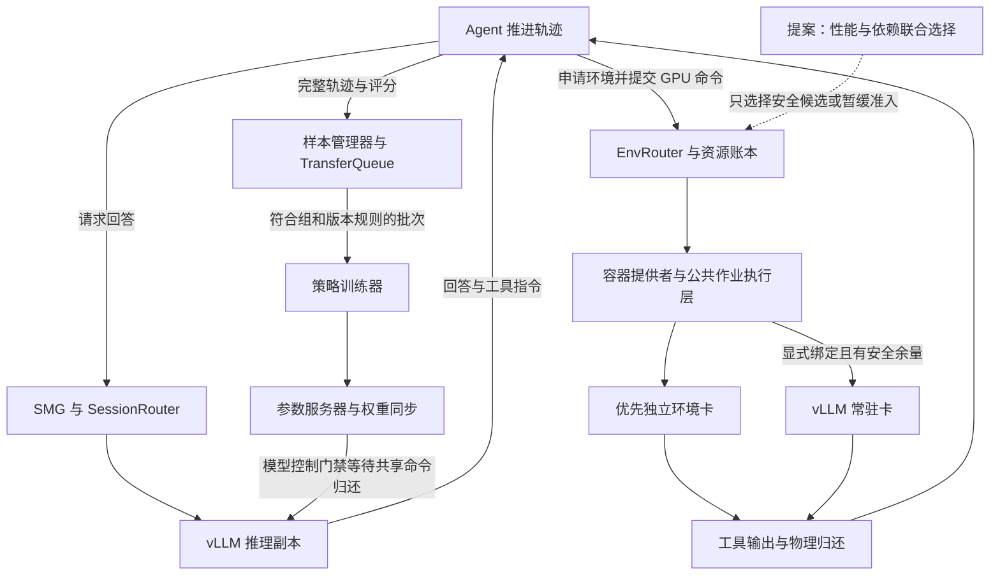

# 调度研究：研究全景与证据详解

**核心结论**：目前已经形成“保留环境会话、按 GPU 命令申请和归还、在同机兼容卡之间重新放置”的执行底座；显式配置后，独立卡拥堵时也能使用 vLLM 常驻卡的安全余量，并已跑过真实 PSRL 训练闭环。研究重心进一步转向：**用硬件模型缩小配置范围，用实测预测共享与准备成本，再按 PSRL 的批次和权重版本依赖选择动作，使同样训练工作更早完成。** 当前完成了离线容量原型，完整在线联合控制器尚未实现。本轮静态与共享两组都固定同样的两张训练卡，实际共享的是推理卡余量。

本图同时保留状态复用、等待／重建、MPS、评分保护等历史探索。状态复用是可选优化支线；与设备或时间敏感评分有关的研究由另一会话继续，本轮主线使用执行时间不进入奖励的任务。已有负结果继续作为取舍依据。

源码主体于 2026-11-19 核对，2026-11-26 补核自动持卡选择与论文证据边界。主目录为 `c5f2d65` 加未提交内容。统一主基线为静态环境池、Episode 持卡、满池排队，Command 静态池单列消融。八卡十步中，完整方案相对 Episode 和 Command 静态的启动至清理时间分别少 27.47% 和 16.77%；后者来自原配置独立补跑，仍有跨运行窗口限制。高显存单步有收益，视觉混合单步略慢，不能概括成所有负载都会加速。当前完整方案指 Command 借还、推理余量共享及整卡借用；启用策略不等于每次都实际借卡。 [当前扩展对照](../experiments/13-扩展对照_八卡单批次与多负载回放.md) · [历史分区报告](../experiments/09-资源分区_静态卡池与推理余量共享.md#实验总览每一轮验证了什么) · [接口现状](../knowledge/01-架构与执行/01-Env架构_现状与完整执行流程.md)

## 目录

- [接下来可以做什么：优先级与验收边界](#接下来可以做什么优先级与验收边界)
- [全局地图与问题背景](#全局地图与问题背景)
- [当前框架与研究控制器的边界](#当前框架与研究控制器的边界)
- [十二条方向一览](#十二条方向一览)
- [资源安全与执行底座](#资源安全与执行底座)
- [状态复用与放置选择](#状态复用与放置选择)
- [可信反馈与整组完成](#可信反馈与整组完成)
- [Results：主要证据怎样解读](#results主要证据怎样解读)
- [沿一个真实例子理解等待与重建](#沿一个真实例子理解等待与重建)
- [当前主线：容量、性能与训练依赖联合决策](#当前主线容量性能与训练依赖联合决策)
  - [用一个 PSRL 例子贯穿三层模型](#用一个-psrl-例子贯穿三层模型)
  - [研究贡献与已有工作的分界](#研究贡献与已有工作的分界)
  - [什么样的比较才足够强](#什么样的比较才足够强)
- [目前该怎样选主线](#目前该怎样选主线)
- [论文还缺什么：自适应持卡的研究切口](#论文还缺什么自适应持卡的研究切口)
  - [当前证据能支持到哪里](#当前证据能支持到哪里)
  - [自动选择模式已经有什么](#自动选择模式已经有什么)
  - [同一组任务为什么短暂保留可能更好](#同一组任务为什么短暂保留可能更好)
  - [把教学例子变成可检验的方法](#把教学例子变成可检验的方法)
  - [最值得补的实验与停止条件](#最值得补的实验与停止条件)
- [希望师兄帮助判断的问题](#希望师兄帮助判断的问题)
- [阅读与复现实验入口](#阅读与复现实验入口)

## 接下来可以做什么：优先级与验收边界

**先补齐比较，再做简单策略，最后检验复杂预测的额外价值。** 统一主基线是同次冻结实现的 episode 静态环境池，满池排队。Command 静态池、调高并发的静态池、简单余量共享都作为额外消融，避免把同一份收益重复记到不同机制。下表是当前下一步的维护入口，后文保留机制、论文边界和历史支线。

| 优先级与问题 | 为什么现在值得做 | 已有基础与尚缺部分 | 怎样判断值得继续 |
|---|---|---|---|
| **P0：对照运行的工程可靠性** | Command 静态十步曾因 10 秒容器查询退出，原配置补跑没有修查询机制 | 主目录已采用直接 Docker API 实时查询、有界只读重试和阶段记录，公共包装层区分整轨迹与操作超时；CPU 与真实容器验证通过。仍缺历史慢因与正式训练中的故障改善证据。 [修复与 trace](../knowledge/01-架构与执行/06-工程审查_待修复问题与优先级.md#容器查询修复与-trace-能回答的问题) | 下一轮三组冻结共同补丁，保留失败、补跑和清理成本；继续补期限、训练兼容与准备阶段预检，不盲目重放 GPU 命令 |
| **P0：强基线与配对归因** | 八卡十步三组已完成，但单次顺序运行仍不能排除窗口和启动差异 | 两步9组与普通十步已齐，先完成已排队的高显存／视觉十步；再轮换顺序重复关键差异，用独立校准集选择静态分卡与并发 | 共同代码、期限和工作量下重复并轮换顺序，分别报告初始化、训练、失败与清理，不把跨次观察当成已隔离的机制贡献 |
| **P1：定位环境准备变慢的条件** | 重叠交接已验证缩短 GPU 交接。首次重叠组两条命令超时，补跑完整完成，两次最长准备分别为 169.59 和 88.47 秒 | 已有两步结果对比。准备波动会影响最慢的一批轨迹，较长的超时只能降低中止风险 | 在相同启动、期限和同轮工作量下比较整批时间，采集慢命令的加载、执行和归还阶段。 [补跑结果](../experiments/09-资源分区_静态卡池与推理余量共享.md#给单条命令更长时间后的补跑) |
| **P1：命令边界的持卡与取回风险** | 立即归还后准入长命令，可能挡住即将返回、能补齐当前批次的任务 | 已有能力驱动的 auto 与等待预测模块；尚无已验证的逐命令保留时长控制。先统计自然任务中这种阻塞是否常见 | 比较立即归还、固定保留时间、仅时长预测、加入批次依赖；检查连续 step 总时间和后续批次饥饿。单独“优先当前批次”已有相关研究 |
| **P2：按实测代价调并发与共享** | 上限四共享未胜过上限五静态，单个解码模型不足以预测完整训练 | 已有单独推理曲线和环境并发扫描，缺“环境并发×推理并发”的阶段画像及在线控制 | 相对调优静态池和低成本阶段规则有增量，预测、画像和决策开销都计入总时间。误差过大就保留简单规则 |
| **P2：完整训练中的恢复与版本内容核验** | 当前只看到借出，没看到负载回升时取回，策略版本通路也不等于权重内容证明 | 恢复代码和 CPU 回归存在，缺真实回升、环境物理归还、重新拉取实际新权重后继续服务的实机证据 | 在有界任务中真正触发恢复，验证物理归还、内容和实际版本，再看额外等待，不能拿组件恢复替代完整训练恢复 |
| 有自然机会再恢复：状态复用支线 | 人工缓存竞争或短评分容易放大不自然的机会 | 等待／重建矩阵有受控收益，通用缓存和跨节点迁移尚无完整生产接入 | 先证明任务确实重复使用合法状态，再比较简单亲和、常驻进程和冷加载，额外副本也记账 |

[](../experiments/env-current-layout.svg)

从图中看两个优先问题：EnvRouter 决定哪个环境命令先用 GPU，训练器却只在题目组和版本条件满足后开始工作。因此给“即将补齐当前批次”的命令机会，可能更早开训。另一方面，权重返回推理时若还要等共享命令，环境局部收益又可能被抵消。研究要把这两边放在同一条时间线判断。

例如 A 是当前批次仅剩的评分，B 是下一批次的新适配。若先执行 B，A 等待期间当前训练器闲着。先执行 A 可能提前当前 step，但 B 推迟也可能拖慢下一步，所以仍要比较多步累计时间。这个例子说明选择需要批次信息，不证明某个优先规则已经更快。

P1、P2 是待实现或待补证据方向，并非已经发布的算法或已证明的新颖研究贡献。优先级是本轮建议，没有为整理文档启动训练。完整已测结果从[实验总览](../experiments/01-实验总览_调度收益与证据范围.md)进入，具体九轮条件在[分区报告](../experiments/09-资源分区_静态卡池与推理余量共享.md)。

## 全局地图与问题背景

Agent 做一道研究工程题，通常会写代码、训练小模型、运行自测、根据输出修改，最后提交给独立评分器。一次完整尝试叫 rollout 或轨迹，同题采样的多次尝试构成一组。GPU 工作可以出现在中途训练、推理、自测，也可以出现在最终 verifier，即独立评分器。资源调度需要服务这些实际计算阶段。在本轮 PSRL 主线中，最终目标固定为：相同资源预算和任务工作量下，完成既定策略训练 step 的总时间，初始化与清理单列。局部排队、模型请求延迟和利用率用来解释这个目标。

<!-- figure:host-and-gpu-ledgers -->
这张图沿同一个场景解释：同机换卡时，容器、CPU、主存、GPU预算和模型状态各自怎样处理？

[](../../_static/img/document-figures/host-and-gpu-ledgers.png)

教学同机布局：首条GPU命令运行20秒，思考10秒，再执行10秒。容器、CPU和主存仍留节点N；GPU预算按命令申请，下一条候选设备来自配置池。图中换卡示意只适用于支持这一执行协议的路径，跨节点与活模型迁移另需实现。 [查看矢量图](../../_static/img/document-figures/host-and-gpu-ledgers.svg)。
<!-- /figure:host-and-gpu-ledgers -->

```text
题目 → Agent 生成操作 → 容器编辑与 CPU 准备
                ↑                 │
                │                 ▼
                └── 工具输出 ← GPU 命令准入、选卡、执行、归还
                                  │ 多轮尝试后提交候选
                                  ▼
                            独立 verifier 评分
                                  │
                                  ▼
同题多条轨迹与评分 → 组内比较 → 更新外层 Agent

研究目标：让需要等待的一组探索，更早获得版本正确、含义可信的反馈
  │
  ├─ A 资源安全与执行底座
  │    A1 显存准入与进程归属
  │    A2 command 借还、同机选卡、CPU 准备前移
  │    A3 MPS 并行
  │    A4 训推余量共享与借还
  │
  ├─ B 状态与时间的选择
  │    B1 批量评估、常驻进程和模型复用
  │    B2 版本有效性、checkpoint 身份、CPU 缓存
  │    B3 模型亲和与跨卡放置
  │    B4 等热卡还是在冷卡重建，以及何时允许预测
  │
  └─ C 反馈与组级目标
       C1 保护计时、控制采样量，保持反馈可信
       C2 考虑整组长尾、依赖和可分段评估

  当前主线连接 A4 与 C2，并新增：
       D1 容量与性能建模：Roofline、实测画像、静态配置选择
       D2 训练闭环决策：预取批次、共享减速、命令归还与权重同步
```

下半部分是研究问题分类，不表示各研究策略都已接入默认执行路径。实际接线和源码见下一节，图中的训练模型与提交物区别详见 [MLGym 两层训练](../knowledge/03-任务接入/04-MLGym与SWE及Serve_任务协议与评分训练.md#权重如何评分探索轨迹如何训练-agent)。

多条轨迹可并发。direct 单会话串行与 MPS 并行是不同配置分支，结果返回与资源释放也是两个事件。详细执行机制沿[当前设计](../knowledge/01-架构与执行/01-Env架构_现状与完整执行流程.md)阅读，下节提供本次核对的源码入口。

## 当前框架与研究控制器的边界

一条轨迹有两条相互交替的执行路径。模型请求交给 SMG，即 PSRL 的推理请求网关；环境命令交给 EnvRouter。两者最终通过轨迹批次和模型版本连接。



实线表示现有调用或数据关系，虚线是尚未接入的在线策略。训练可以和其他批次的采样重叠。当前实验使用完整批次训练：一条轨迹完成后先进入样本管理，凑齐本次训练要求的批次才开始训练；不能理解为每完成一个 episode 就立即更新模型。框架另有细粒度训练策略，本轮未使用。

| 图中位置 | 核对的实现入口 | 由谁负责 |
|---|---|---|
| Agent 发模型请求 | [SessionAgentLoop](../../../psrl/workers/agent_loop/loops/session_agent_loop.py#L46) | 请求带会话、题目及版本信息，模型路由留在 PSRL |
| 环境会话与 GPU 放置 | [EnvRouter](../../../psrl/workers/env_service/router.py#L139)、[命令准入](../../../psrl/workers/env_service/command_gpu.py#L83) | 资源账本检查安全性，命令调度器挑候选卡 |
| 两种容器提供者 | [EnvWorkerEnvironment](../../../psrl/workers/env_worker/harbor.py#L19)、[ManagedDockerEnvironment](../../../psrl/workers/env_service/docker.py#L25) | native 创建单容器，Compose 保留其构建和网络能力，两者继承同一公共执行层 |
| 公共 GPU 作业层 | [ManagedGpuExecution](../../../psrl/workers/env_service/managed_execution.py#L14) | 提交、查询、取消和回收协议一致，后端细节留在相应实现 |
| 共享卡与模型操作互斥 | [GpuHandoffMixin](../../../psrl/workers/gen/gpu_handoff.py#L99) | 可允许常驻推理与环境并存；同步等模型控制操作等待共享命令物理归还 |
| 完整批次训练 | [等待批次](../../../psrl/workers/agent_loop/manager.py#L1918)、[FullBatchStepStrategy](../../../psrl/trainer/ppo/strategies/full_batch.py#L26) | 样本和版本规则决定什么时候可以训练 |
| 权重反馈到推理 | [sync_with_ps](../../../psrl/workers/gen/rollout_coordination/sync_and_migrate/sync_and_migrate_mixin.py#L119) | 协调器暂停分派、执行同步并发布版本，EnvRouter 不接管版本规则 |

**现在能做的动作，以及它们的边界：**

| 能力 | 当前状态 | 关键边界 |
|---|---|---|
| GPU 准入、等待与物理归还 | 已进入资源执行路径 | 账本预约不等于硬件隔离，异常归还期间不能提前复用预算 |
| command 下一条命令重新选卡 | 已实现显式同机池 | 会话的文件、容器、CPU 和主存留在原节点，GPU 分配位置单独记账；没有跨节点迁移运行中进程 |
| 独立卡满后使用推理卡余量 | 已接入正常 Agent／SMG／Trainer 并有历史完整训练对照 | 需显式绑定共享副本和余量，不会扫描任意空闲卡自动加入 |
| 排空推理副本、休眠后借卡 | 研究控制器已有实机组件验证 | EnvPartitionMixin 已接入完整 SMG／Trainer，两步实机观察到借出和环境使用，恢复未触发。训练阶段缩短、完整作业更慢，集中未来请求而不搬迁活动实例 |
| episode／command 自动选择 | 已有基于能力声明的准入时选择 | 独立命令与常驻状态由可信适配器声明，可带成本建议；没有通用识别任意 shell 命令或每轮自动变换模式 |
| direct／MPS | 公共执行协议下的不同后端 | MPS 有明确部署条件，本轮常驻共享实验没有开启 MPS |
| Roofline 与容量选择 | 离线脚本、真实校准与简化回放已实现 | 暂未在线预测混合干扰，也未搜索所有静态分卡比例 |
| 根据训练批次与同步时刻调整共享 | 已有观测来源和设计 | 联合决策器尚未实现，训练卡空窗借给环境也尚未验证 |

默认仍为 [Env Service 关闭](../../../psrl/trainer/config/psrl/env_service.yaml#L6)。显式启用后才按上述资源配置工作。AIRS 等接入路线也有自己的能力边界，不能由这份训练实验推及所有 benchmark。

“统一后端”的准确含义是：**GPU 作业执行协议已经共用，容器生命周期仍有 native 与 Compose 两种提供者。** 保留两种提供者不会迫使策略维护两套 GPU 准入和归还逻辑，也避免把 Compose 的多服务／网络能力硬塞进单容器实现。

## 十二条方向一览

“已有能力”表示本地存在实现或组件验证，“实验信号”表示特定条件下测到效果，“提案”表示下一步研究问题。下表按当前取舍组织。

| 方向 | 核心想法 | 当前得到什么 | 主要问题与取舍 |
|---|---|---|---|
| A1 显存准入与可信归属 | 实测显存加尚未兑现的承诺共同准入，识别哪些进程属于哪个任务 | 压力下减少 OOM，即显存不足失败与重试 | 基础能力；预算不等于物理隔离，低负载未见稳定提速 |
| A2 command 借还与池化 | 保留环境，GPU 只在需要时持有；下一条安全命令可选同机其他卡 | 借还、选卡、异步归还与准备前移已有实现 | 局部等待缩短后，仍须检查整组关键路径 |
| A3 MPS 并行 | 让多个 CUDA 进程共享同卡计算 | 并行、独立取消和回收可工作，计算段有局部改善 | 整体初始化占比高时收益被淹没，竞争也可能扭曲计时 |
| A4 训推余量与借卡 | 独立卡优先，拥堵时共享推理常驻余量，另研究休眠借卡 | 常驻共享和整卡借出均已有真实 PSRL 多步对照 | 请求可能变慢，归还可能阻塞权重同步。整卡完整作业未提速、恢复未触发，训练卡借用未实现 |
| B1 批量与准备态复用 | 复用进程、CUDA 上下文、评估器或公共模型 | FlashInfer 批量评估收益明显，PostTrain 暖请求缩短 | 先把简单进程复用纳入基线，再判断模型缓存增量 |
| B2 状态身份与 CPU 缓存 | 识别哪些准备态仍有效，按预算保留与淘汰 | 找到真实入口旧字节码问题，完成针对性修复 | 四会话 CPU 缓存缺少自然任务支撑，暂停作为主证据；转向真实 checkpoint 绑定 |
| B3 模型亲和与跨卡放置 | 相同模型尽量连续使用，减少冷加载 | 简单亲和显著优于 FIFO，即按到达顺序执行 | 复杂联合枚举未稳定超过亲和，在线到达与状态失效仍待研究 |
| B4 等待／重建与可预测性 | 比较等待、加载、执行成本；进度可信时才使用预测 | 四场景系统矩阵已有重复 GPU 证据；新增门控默认关闭 | 需超越低成本静态画像与阈值，并证明自然覆盖及额外副本代价 |
| C1 性能反馈保真 | 测量窗口保护、批量测量、按需采样 | 竞争确会选错快慢候选，简单保护能改善反馈 | 自适应未胜固定少轮数；选赢家与保全训练奖励向量要求不同 |
| C2 组尾与评估分段 | 优先缩短整组等待，合法分段后让出资源 | 已形成组级目标、依赖模型与小型分段机制探索 | 当前短评估余量小；收益需覆盖交接、重建及反馈延迟 |
| D1 容量与性能建模 | 显存约束筛选，Roofline 选区间，实测预测实际时长 | 解码配置留出误差 2.20%，环境插值误差 21.02%，历史共同上限四和新增静态上限五均已实测 | 单模型解码画像不能外推共卡，已补 3+1 静态及同窗口共享配对，尚未完成最优分卡验证 |
| D2 训练闭环调度 | 结合预取批次、阶段竞争和同步门禁选共享时机 | 已发现跨批次 FIFO 等待及历史同步阻塞；在线算法尚未接入 | 需超越调优静态池、容量共享和已有依赖调度工作 |

## 资源安全与执行底座

**A1 要解决“账面能放下，为什么仍会 OOM”。** 某任务已经承诺要用显存，但还没真正分配，若只看此刻显存空闲就继续放入其他任务，会重复承诺同一块空间。当前准入同时计入实际占用与未兑现预算。准确归属还能避免把同一任务的已分配空间重复相加。看不到可信进程身份时采取保守记账；可选的内核归属路径用于补足容器和 GPU 进程对应关系。它为更紧凑的放置提供可靠输入。

**A2 把“保留环境”和“持续占卡”分开。** episode 是一道题的一次完整环境会话，command 是其中一条执行命令。文件与 CPU 状态可以持续存在，GPU 仅在明确的工作阶段申请。完成命令后，输出先交给 Agent 思考，物理归还与其重叠，下一次准入仍要等归还确认。同机池进一步允许下一条命令使用兼容的另一张卡。它重新选择未来工作的位置，不搬动正在执行的 CUDA 进程。CUDA 是调用 NVIDIA GPU 的计算接口。

CPU 准备前移把导入、数据准备等放在 GPU 准入之前，减少预算空占。但如果其他任务或不可重叠工作控制了结束时间，账本持有缩短并不会带来同等墙钟收益。墙钟是实际经过的时间，这也是后续研究从“省预算”转向“省整组时间”的原因。

**A3 MPS 研究同卡空间共享。** MPS 是 NVIDIA 的多进程服务，使不同 CUDA 进程的工作有机会并行。它与 command／episode 的持有方式是两个维度。现有对照中的普通 CUDA 本来已有并发，MPS 的问题是进一步改变共享效率，而非从完全串行开始。计算带宽、显存带宽与调度争用仍决定能否获益。

**A4 把环境 GPU 放进训推资源安排。** 先使用独立可用设备，再考虑推理常驻状态留出的安全余量。显式借卡则需要推理引擎停止接新请求、完成已有工作、睡眠释放部分状态，环境工作结束并物理归还后再唤醒。短空窗可能不足以支付交接成本。真实 vLLM 组件交接已验证，常驻共享也已完成历史六步训练对照。该对照显示训练计时改善与请求尾延迟增加可以同时发生。整卡调整也已完成两步真实训练，观察到借出和使用，完整作业更慢、恢复未触发，训练卡借用仍是提案。

证据与机制入口：[有效实验结论](../experiments/01-实验总览_调度收益与证据范围.md)、[命令配额](../knowledge/02-资源与调度/02-命令调度_GPU申请归还与状态保留.md)、[动态放置](../research-proposals/03-动态放置_会话与GPU执行分离.md)、[MPS 对照](../experiments/04-MPS训练_并行执行与控制修复对照.md)、[推理 GPU 借还](../knowledge/02-资源与调度/06-训推借卡_Rollout睡眠与归还协议.md)。

## 状态复用与放置选择

**B1 先区分几种复用。** 把多个评估放进一次命令，能少付命令和准入开销；保留一个 Python 进程，还能复用导入与 CUDA 上下文；保留公共模型，又能省加载权重。FlashInfer 的主要收益来自后两类，不能全部归到路由更快。PostTrain 则展示了更细的情况：公共模型已热后，后续候选更快，但完整批次仍输给简单常驻进程重载。因此研究基线应从合理的复用实现开始。

**B2 复用的前提是状态对应当前候选。** 如果 Agent 改了推理实现，旧进程仍可能加载旧代码；同路径权重被覆盖，也可能使评分对象错位。已经发现并修复三个 RE 候选直接入口读取旧字节码的受控问题。通用的代码依赖、活动服务版本和 checkpoint 一致快照仍需各自处理。

这条线也否定了一个过强假设：真实 SWE GPU 题经常改运行时，原评分器还已有组内模型复用，因此“四个会话只改轻量 scorer、共享不变模型”的脚本场景难以代表自然任务。CPU 转换缓存的淘汰成本补齐后，复杂方法没有稳定收益。当前更合理的候选是 PostTrain 中自然的“训练出一份 checkpoint → 绑定一次评估 → 继续训练”循环，先采真实频率与成本，再决定是否做缓存调度。

**B3 状态在哪里，决定下一条命令放哪里。** 模型冷加载可远慢于暖态短执行，FIFO 可能在两张卡反复加载相同模型。模型亲和把相同模型请求聚在一起，已经消除了大量重复加载。联合搜索任务顺序与双卡划分的原型有正有负，说明应把简单亲和作为强基线。真正待回答的是未来请求逐步到达、缓存失效和容量竞争时的取舍。

**B4 亲和有时会等太久。** 已有模型的热卡可能被长命令占住，冷卡虽然没有模型，却能支付一次加载后更早完成。系统矩阵验证了长等复制、短等复用的机制。新增可预测性模块进一步检查工作量、进度身份、新鲜度、速度稳定性、历史误差和可重建条件，并提供 off／observe／auto 三种模式，默认 off。observe 只采集与校准，auto 条件满足时才让预测改变决策。新增门控与服务接线目前主要有 CPU 验证，矩阵 GPU 数字属于此前冻结的研究策略。

模型亲和、等待重建和版本控制互相制约：状态失效就不能直接复用；无进度时要保留未知；另一张卡容量不足时要保留安全等待。这比单独最大化缓存命中率更接近真实问题。

入口：[FlashInfer 批量评估](../experiments/gpu-benchmarks/07-FlashInfer_进程复用与任务合批.md)、[PostTrain 准备复用](../experiments/gpu-benchmarks/05-评分复用_PostTrain准备成本与整批耗时.md)、[真实状态核查](../research-proposals/04-状态复用_真实任务中的收益空间核查.md)、[主存缓存探索](../research-proposals/05-状态调度_主存受限时的准备状态保留.md)、[双卡模型放置](../experiments/gpu-benchmarks/03-动态放置_真实模型驻留与跨卡探索.md)、[等待重建矩阵](../experiments/gpu-benchmarks/04-动态放置_热卡等待与冷卡加载对照.md)、[可预测性门控](../knowledge/02-资源与调度/08-命令预测_适用条件与时长估计.md)。

## 可信反馈与整组完成

**C1 从“能执行”推进到“评估可信”。** GPU 容量足够时，另一进程仍可能争用计算或带宽，使性能测试误判。此时功能正确，反馈却会引导 Agent 选择实际更慢的实现。研究控制器让合作后台停止新提交、等待已提交工作结束，建立受保护的测量窗口。保护、进程复用和减少采样是不同收益来源，应分别对照。

现有实验显示简单保护有效，而自适应轮数始终慢于固定两轮。后续若继续，需要证明相同反馈质量下整体更快，并检查训练所需的完整奖励向量。只保住第一名，还可能改变第二、第三名间的奖励关系，从而影响组内优势。

**C2 从单条请求推进到整组目标。** 同题多条探索需要比较后才能形成完整学习信号。某条命令提前返回，若另一条更长的轨迹仍控制整组结束，训练批次未必更早可用。组级调度需要知道哪些工作已经就绪、哪些评估可合法合并或分段，以及共享状态何时能释放。批量评估节省准备，分段让出 GPU 却可能增加准备，两者有真实冲突。

当前 FlashInfer 分段探索中剩余评估太短，优先停止围绕这类短尾扩大预测器。重新启动这个方向的条件是找到天然可分、剩余工作足够长、状态可正确保留且交接成本可覆盖的任务。

入口：[反馈压力实验](../experiments/gpu-benchmarks/08-性能反馈_高压力调度实验.md)、[组完成时间与反馈研究](../research-proposals/01-调度研究_Rollout完成时间与反馈保真.md)、[KREX 精读](../literature-reviews/03-论文精读_KREX共享GPU测量保护.md)、[YARN 启发](../literature-reviews/04-系统借鉴_YARN资源分配与反馈调度.md)。已有本地文献表明，保护测量、资源池化和状态复用都有相关研究，选题还需说明超越它们的具体问题。本次没有重新检索外部新颖性。

## Results：主要证据怎样解读

Science 历史固定 baseline 为 `0eeead861ffafed6bf31c962d259fd847775dcf9`：静态 GPU Compose、进程内 episode 信号量，没有后来加入的整卡锁。用户为新训推共享研究另外指定了当前代码静态环境池：逐卡 first-fit，容量满则排队，禁止动态共享。它与旧提交是两类不同对照。当前同执行器 OFF、普通 CUDA、FIFO、简单亲和和常驻进程也分别是不同实验的机制基线。旧版同 episode 已保留文件，也可自行保留服务与缓存，详见[状态生命周期](../knowledge/02-资源与调度/07-状态复用_基线状态寿命与版本正确性.md)。

| 方向与实验 | 主要结果 | 回答的问题与条件 |
|---|---|---|
| A1，Science 人工显存压力 | 固定旧版总计 1954.11 → 1415.01 秒，减少 27.59%，OOM 18 → 0 | 同为 3 个策略训练 step、12 条接受轨迹，包含初始化与清理；主要解释等待与重试，非模型学习效果 |
| A1，低负载容器配对 | 213.96 → 217.15 秒，增加 1.49% | 无稳定端到端收益，准入价值随压力变化 |
| A2，同机池化 | 固定卡 → 池化，组均值 37.95 → 35.05 秒 | 同版本受控双卡场景；准备前移减少预算空占后的收益须另看关键路径 |
| A2，SWE CPU 准备前移 | 整组 63.456 → 63.567 秒，预算持有减少约 4.64% | 40 次原检查全过；预算缩短而整组近似持平 |
| A3，MPS | 计算段 22.499 → 20.160 秒，全流程 133.150 → 136.010 秒 | 两个十步 autoresearch 作业，普通 CUDA 对照已并发，初始化吞没局部计算收益 |
| A4，历史真实 PSRL 常驻共享 | 六步训练计时 1937.96 → 1451.87 秒，减少 25.08%；含初始化清理 2607.27 → 2171.39 秒，减少 16.72% | 两组各 48 轨迹／96 命令／144 请求，每独立卡上限两条；模型请求 P95 从 11.97 增到 127.90 秒，不能等同于所有阶段更快 |
| D1，新容量校准 | 同样六任务，单卡并发 1／2／3／4／5 完成时间为 728.14／463.95／299.93／262.01／271.33 秒 | 3 为留出，4 重复为 242.75 秒；扫描实际 37.8 分钟，校准成本也需回收 |
| D1／D2，新四步 PSRL 对照 | 每独立卡上限四条，静态到共享训练计时 1343.00 → 1107.20 秒，缩短 17.56%；成功启动至清理缩短 13.52% | 两组各 48／96／144，31 条命令使用推理卡；请求 P95 13.31 → 189.84 秒，最长同步门禁等待 186.76 秒；历史 3+1 静态为 991.06 秒，更快；新 3+1 配对训练减少 6.89%，含初始化清理减少 0.25%，cap5 已完成 898.98 秒，1+3 因轨迹超时停止，已物理释放 |
| B1，FlashInfer | 分命令均值 125.55 秒，单命令新进程 102.23 秒，单进程评估 25.86 秒 | 两条 RMSNorm 负载，主要来自 Python／CUDA／官方评估器状态复用 |
| B1，PostTrain 候选 A/B/A | 常驻进程重载整批 91.96 秒，保留模型 113.84 秒；暖请求约 9.5 → 4.4 秒 | 同一冻结基模、九次真实评分；模型复用未赢完整批次，逐请求哈希审计成本较高 |
| B2，CPU 转换缓存 | 192 个成本校准回放中，3 GiB 条件复杂策略总时间平均增加 1.48% | 包含淘汰成本后的模拟，单列于 504 条实际 GPU 检查；暂停作为论文主线 |
| B3，双卡模型亲和 | 10 GiB 逻辑缓存，均衡 FIFO 32.10 → 亲和 18.40 秒，偏斜 43.49 → 19.33 秒 | 五套完整四策略配对；复杂联合搜索未稳定超过亲和，逻辑缓存不等于物理显存硬限制 |
| C1，持续反馈压力 | 全程保护前台反馈 18.83 → 1.57 秒，整组 60.52 → 60.47 秒 | 前台显著加速，后台仍决定整体结束；实际出现选中慢 139.6% 候选的共享测量反转 |
| C1，自适应测量 | 27/27 对比均慢于固定保护两轮 | 159 组真实 GPU 控制实验的相关配对，复杂自适应增量未成立 |

**B4 等待重建系统矩阵**是状态放置支线较完整的机制证据。主指标从提交阻塞命令 B 前，到 B 与目标 A 都返回，初始化和画像单列。两张同型 H20，固定模型与输入，训练末层归一化参数，每条命令重置训练状态。每个核心条件有三次时间区块观察。

| 场景，秒 | 固定旧 runner | 亲和等待 | 始终复制 | 预测选择 |
|---|---:|---:|---:|---:|
| 本地小目标 | 3.58 | 3.54 | 13.30 | 3.54 |
| 短等待 | 36.46 | 37.03 | 48.04 | 36.80 |
| 临界等待 | 46.17 | 46.64 | 46.61 | 47.02 |
| 长等待 | 85.29 | 86.11 | 52.75 | 52.80 |

长等待相对亲和减少 38.69%，相对固定旧 runner 减少 38.10%，计入冷副本清理对亲和仍减少 37.31%。预测的价值体现在跨场景选择：长等待与始终复制近似相同，短等待避免白付加载，临界条件比亲和慢 0.81%。四类各取一次的预设累计比较对亲和减少 19.14%，这是一种固定组合，尚无自然任务分布支持同样的平均收益。

48 个核心单元全部完成，总计划 57 个中完成 53 个，四个故障单元未启动，整体保留 incomplete。已完成故障检查显示：十倍高估会错误复制并增加耗时 27.48%，过期进度回退等待，冷卡逻辑预算不足时服务拒绝复制。当前策略通过真实 EnvRouter 的 episode 租约与 EnvWorker 承载，由研究驱动选择常驻服务。矩阵未执行自然 Agent 或完整 PSRL 策略训练。新增可预测性门控不复用这些数字宣称自身 GPU 验证。

## 沿一个真实例子理解等待与重建

以下来自[矩阵第一次长等待决策](../experiments/gpu-benchmarks/04-动态放置_热卡等待与冷卡加载对照.md#4-跟着一次真实决策算收益)，为历史实测而非教学假设：

1. 热卡已驻留目标模型 A，但正在执行 B。B 完成 64/2048 步，进度预测剩余 51.211 秒，事后实际剩余 51.134 秒。
2. 独立画像测得 A 执行约 33.289 秒，冷加载约 11.007 秒。画像就是提前做短测量，建立成本估计。
3. 等热卡预计 `51.211+33.289=84.500` 秒；在空闲冷卡重建预计 `11.007+33.289=44.296` 秒。
4. 冷卡能容纳模型及临时空间，且 `44.296+2<84.500`，超过两秒切换门槛，因此复制 A。
5. B 留在原卡继续执行，A 在另一张卡加载并运行。实际 A 延迟 43.740 秒，两条工作整体 53.000 秒，加冷副本清理 54.466 秒。

收益来自用另一张卡重叠等待与计算。若 B 很快结束，加载就成为额外成本。这也解释了为何不能把“让所有 GPU 都忙”当作最终目标。

进一步的问题是副本会额外占用持续显存，如果稍后来了另一条更重要的请求，当前复制可能挤掉它。矩阵使用已预约的两张卡，只考察当前 A、B；未来请求机会成本尚未进入目标函数。

## 当前主线：容量、性能与训练依赖联合决策

### 用一个 PSRL 例子贯穿三层模型

本轮六卡配置中，两卡训练、两卡推理、两卡独立环境。策略模型为 Qwen2.5-3B，实际训练使用 FSDP2；工具任务使用 PostTrain 组件在 Qwen3-4B 上适配末层归一化参数，以隐藏样本答案概率评分。完整 Megatron 训练共存和原版开放式 benchmark 成绩不在这次验证范围。每个训练 step 消费六个题目组，每题两条轨迹，共十二条。每条轨迹依次经历三次模型请求和两条环境命令，流程为：选参数、GPU 适配、生成检查指令、GPU 评分、总结。四步累计 48 条轨迹、96 条命令和 144 次请求。GPU 适配内部的 448／896 次更新不计为 PSRL 策略训练 step。这些固定比例属于本次有界任务。

假设轨迹 A 完成了适配、正等评分，轨迹 B 属于预取的后续批次、正等适配。独立环境卡此刻忙，推理卡还有显存。调度器面临的选择包括让 A 等独立卡、现在把 A 放进共享卡，以及先执行排在前面的 B。选择需要三个层次的信息。

第一层回答“哪些动作有可能安全执行”。独立环境卡按 90 GiB 预算、每命令 16 GiB 预约，得到并发至多五条这一候选范围。共享卡还要扣除模型实际占用、未兑现承诺和额外余量。Roofline 用运算量和数据搬运量找可能的瓶颈区域，但请求数越过平衡点不等于吞吐立即下降，不能直接变成固定硬上限。

第二层回答“动作执行后会花多久”。本轮校准中，并发由一条增到四条，适配命令平均从 76.32 秒变到 109.74 秒，整批却从 728.14 秒降到 262.01 秒。多任务重叠减少等待，同时每条更慢。准备、计算、物理归还分别影响时长；同卡混合执行还必须预测 vLLM 被拖慢多少。目前只校准了独立环境与独立推理，未完成通用混合干扰模型。

第三层回答“这些时长变化最终影响哪个训练 step”。A 提前完成若能补齐当前批次，价值可能高于单纯缩短 B 的等待。但 A 占着推理卡时，若新权重恰好要同步，门禁会先等 A 归还。模型路由暂停又会影响其他轨迹的下一次请求。这些关系需要放进同一时间线，避免将环境节省和模型损失分别相加而重复计算。

真实静态组显示了第三层的必要性：首条评分准入前，24 条适配已经准入，对应两个提前生成的批次；四步时间为 632.95、6.71、622.25、81.09 秒。单步耗时被预取影响，第二步特别短不表示它的十二条轨迹只花了六秒。实际评分持卡约 84.57 秒，计算约 0.70 秒、准备约 63.60 秒，说明仅预测计算也会错判等待。

新共享组完成后，实际看到了收益与代价同时存在：训练计时缩短 17.56%，环境平均排队从 157.68 降至 51.56 秒，模型请求 P95 却增至 189.84 秒。一次共享命令获准约 2.33 秒后模型请求同步，等待约 186.76 秒才归还。它给“提前识别模型控制阶段”提供了具体优化对象，但这些等待相互重叠，不能逐条相加当作可回收的总时间。

本轮两组生成 token 相差约 1.84%，学习率选择不同；共享前两步策略梯度为零、后两步非零，四次优化器调用均完成。相同条件下工具参数指纹核对一致，实际工具更新次数相同。结果描述这一组运行的调度时间，未检验学习效果提升，原初始化失败成本另列。完整解释见[新成对报告](../experiments/09-资源分区_静态卡池与推理余量共享.md#四步结果加强静态池后共享仍有条件收益)。

### 研究贡献与已有工作的分界

在把同步等待作为研究难点之前，还需验证它是否来自过宽的软件互斥。默认门禁要求环境先归还，显式开启常驻同步重叠后可放宽符合条件的 NIXL 更新；休眠唤醒仍等待归还。独立 CUDA 进程的小实验已观察到计算未结束时完成拷贝。冻结原型已完成两组四步对照，三次同步越过活动环境租约，但均为准备阶段；最长门禁等待接近零、请求 P95 改善，四步训练观察到慢 4.62%，且并行组有额外 GPU 进程占用，不能将时间差直接归于同步策略。后续策略应使用安全同步重叠作为强对照，并继续核对主要计算竞争与权重内容。机制与边界见[同步、抢占和并行](../knowledge/02-资源与调度/05-训推共享_vLLM余量与容量调度.md#模型同步带来的额外依赖)。

泛称“性能建模加动态资源分配”已有强先例。当前深入设计已经阅读 DynaRL、BiDiRL、VenusRL、ROSE 以及推理／环境协同工作相关章节，研究差异集中在：**不透明、难以随时暂停的 GPU 工具命令，既改变共卡服务速度，又影响 RL 权重版本切换，调度器怎样同时处理这两类代价。** 详细论文对照及原始链接维护在[联合设计的研究边界](../knowledge/02-资源与调度/05-训推共享_vLLM余量与容量调度.md#研究价值应落在哪里)，本图不重复维护论文清单，也不宣称已证明独占新颖性。

另一个提案是把空闲训练卡借给“当前训练本来就必须等待的环境前置工作”。若协议保证命令物理归还先于轨迹完成，轨迹完成先于批次就绪，那么这条命令不会在批次已经就绪后再挡住训练。但样本可替换或批次可重组时，这个保证需要重新建立；强制等一个本可替换的慢样本也有代价。训练卡授权、状态静止检查和这种依赖绑定均未实现，不能由推理卡共享实验推及此能力。

### 什么样的比较才足够强

比较强度同时涉及持卡方式、各池卡数和每卡并发。主基线统一保留 episode 静态环境池，再单列 command 静态池和更充分的静态配置。3＋1 command 静态上限五已测 898.98 秒，快于同窗口上限四共享的 965.42 秒，因此不能只对每卡上限二的静态组宣称动态优势。各配置先独立校准并冻结，再做相同工作量对照，避免用测试结果反向选择基线。

之后比较调优静态池、容量满足即共享，以及“训练开始后暂停新共享直到同步完成”这一简单阶段规则，再检查实际性能预测和更细批次依赖是否有额外收益。阶段规则只影响新命令，已运行命令继续执行，也可能造成等待或错过共享机会，目前尚未实现和对照。所有策略用相同工作量与版本约束；初始化、执行、失败修复和清理分开记录。先在影子模式输出建议并校验预测，再让建议改变准入。影子模式只记录“本来会怎样选”，不会改变已运行命令。

## 目前该怎样选主线

| 优先级 | 建议聚焦的问题 | 先补的证据 | 停止或收缩条件 |
|---|---|---|---|
| 当前主线 | 性能预测与训练依赖共同决定是否共享 | 八卡十步动态相对 Episode 完整用时少 27.47%，Command 静态原配置补跑已完成，完整方案相对其完整少16.77%，仍有跨窗口限制。高显存单步动态比 Command 静态少 5.21%，视觉混合多 4.62%且无借卡；高显存第二张借卡完成后没有新命令。两步9组已完成，优先补齐多样长档并分离视觉初始化差异，再检验剩余工作量能否避免无效借卡。 [扩展证据](../experiments/13-扩展对照_八卡单批次与多负载回放.md) | 调优静态配置已消除主要收益，或模型误差大到无法改善实际选择 |
| 直接工程支撑 | 减少准备阶段空占，准确关联轨迹、命令和版本 | 复用现有 prepare 接口，分开记录 CPU 准备、GPU 计算与物理归还；确认跨批次预取 | 只是搬动计时边界，或引入更大主存／存储竞争 |
| 状态放置支线 | 有合法复用状态时，等热卡还是在冷卡重建 | 自然训练／评估循环、简单静态画像基线、额外副本的显存机会成本 | 自然机会少，或简单亲和加阈值已足够 |
| 平行研究范围 | 设备或时间敏感评分的保护调度 | 由另一会话推进，保留已有证据和接口 | 本轮不以改变时间评分条件制造收益 |
| 暂缓 | 人工四会话 CPU 缓存、短 verifier 预测、静态小批次复杂枚举 | 仅在真实任务有足够可回收开销时恢复 | 场景假设不成立，或策略开销超过收益 |

先找真实瓶颈，再估算完美决策最多能省多少，最后扩大算法。正确性修复、资源可用、局部性能改善、整批训练加速和 Agent 学习改善，是不同验收层次。当前实验重点在完整训练的调度时间，未追加模型效果提升目标。

优先补证据的完整方案已并入研究报告。11月26日13:28核对，两步9组和普通AIME十步已完成，高显存十步首组接续初始化，视觉十步排在其后。视觉两步完整方案相对Command静态总时间慢14.42%，训练段慢3.49%；109.02秒总差中101.85秒属于初始化。启动事件已进一步定位：广播后控制连接阶段额外33.47秒，并出现Router首次加载推理依赖；另有约70秒差值分散在更早通用路径。主目录已把控制连接准备提前，完整PSRL提速尚待同版本配对。 [初始化审计](../experiments/13-扩展对照_八卡单批次与多负载回放.md#初始化为什么更久与怎样缩短)

**当前不追加新的模型／benchmark训练矩阵。** 先让已有6个长档组完成，期间用现有日志分解初始化、统计自然命令间隔和取回排队。下一轮优先选择代表场景轮换运行顺序，区分稳定代价和启动波动；再做同总卡数下3环境＋3推理、4＋2、5＋1的独立校准与留出验证。然后才是仅共享／仅整卡／完整方案消融和负载回升恢复。自动Episode／Command选择先检查真实组批规则与自然机会，尚不追加GPU验证。新增实验在场景、步数、时间与停止条件冻结后执行，本轮针对初始化另完成控制连接准备与激活分离、移除无关Harmony词表预加载，并执行有界CPU验证；不追加GPU训练矩阵。 [最新结果与阶段分解](../experiments/13-扩展对照_八卡单批次与多负载回放.md#两步与十步的同场景补测) · [补实验设计](../experiments/12-研究报告_PSRL环境GPU调度的设计与评估.md#62-优先补充的实验)

## 论文还缺什么：自适应持卡的研究切口

**目前已有可用系统和有条件的完整作业收益，尚缺超越调优静态池与简单动态规则的稳定证据。** 自动选择 Episode／Command 值得探索，但仅按任务类型切模式、设置一个固定阈值，不足以单独构成有说服力的方法贡献。更具体的候选问题是：在命令安全结束后，结合下一次 GPU 请求的返回时间、其他命令一旦运行就难以撤回的时长，以及当前训练批次还缺哪些轨迹，决定 GPU 预算应该保留多久、何时归还、交给谁。

以下是 2026-11-26 的研究建议和教学推导，不是已完成的新算法或新 GPU 实验。

### 当前证据能支持到哪里

八卡普通任务十步，完整方案启动至清理 3303.69 秒，Command 静态 3969.46 秒，Episode 静态 4554.87 秒。这证明本次负载中有端到端收益。相对 Command 静态的 16.77% 缩短，比只对 Episode 报告 27.47% 更能说明额外共享与分卡机制的价值，但还不能把两个数字相减当作独立机制贡献。Command 静态是失败后原配置单独补跑，三组没有重复交错测量；故障和补跑边界见[扩展对照](../experiments/13-扩展对照_八卡单批次与多负载回放.md)。

还需保留代价：这组模型请求 P95 从 Command 静态的 8.75 秒增到 11.96 秒，即整批更早完成，部分请求更慢。视觉混合单步完整方案比 Command 静态多用 4.62%，且没有发生推理共享和整卡借用，不能直接把差值归因为借卡开销。当前八卡主对照记录的策略梯度为零，支持执行与调度性能结论，不能支持学习质量不变或提升。历史其他实验的非零梯度不能代替本组证据。

论文因此需要同时回答：哪些负载值得动态调度；收益来自何处；相同资源经过合理静态调优后还剩多少优势；在错误预测、长命令和推理需求回升时付出什么代价。

### 自动选择模式已经有什么

现有 `choose_reservation` 在会话准入前解析一次持卡方式。显式 Episode／Command 配置直接生效；auto 对声明命令能独立归还 GPU 的适配器可以选择 Command，持有跨命令 GPU 状态或能力未知时选择 Episode。已有等待预测接口可以提供选择建议，配置要求预测但缺少预测时退回 Episode。实现见[准入前的模式解析](../../../psrl/workers/env_service/reservation_policy.py#L16)。

这说明我们已经有“根据执行能力选择合法协议”的底座，以及可接入成本建议的接口。它尚不等于每条命令结束后自动选择更快的持卡期限。[既有模式实验](../experiments/08-模式选择_Command与Episode及等待预测.md)中的 auto 没有接入成本预测，实际上与 Command 使用同一协议；人工设置的 6／30 秒空档不能证明自然 Agent 有足够机会。

下一步要分清两个问题。**是否能归还**由执行协议决定：命令结束、物理 GPU 状态已安全清理，才有资格释放；不能根据显存看起来低或 SM 空闲就推断状态可迁移。**何时值得归还**才由性能策略决定：即便能够立即释放，也可以保留一小段容量等待即将回来的请求。这里保留的是 GPU 准入预算，不保证模型还留在显存，更不等于自动获得热状态复用。CPU、主存和容器的生命周期继续按会话管理。

相关工作使贡献范围必须进一步收窄：[DynaRL](https://www.usenix.org/conference/osdi26/presentation/wang-yuanqing) 已研究 RL 组件之间动态资源重分配；[VenusRL](https://arxiv.org/abs/2610.03286) 已优先推进能补齐训练批次的样本组；[Firepool](https://arxiv.org/abs/2611.10832) 已研究 GPU 环境的温热复用、队列预算及与空档匹配的保留期限；[ROSE](https://arxiv.org/abs/2605.06534) 已利用在线推理 GPU 承载 rollout 并保护服务目标。本轮核对这些来源的摘要，足以排除泛称“动态分卡”“批次优先”“保持热环境”“共享推理余量”的新颖性主张；尚不足以证明它们没有覆盖某个更细的联合算法。应继续对照完整算法和公开实现，才能主张差异。

### 同一组任务为什么短暂保留可能更好

下图是固定工作量的教学假设。所有其他环境容量都忙，只剩一份可分配 GPU 容量；另有一张独立训练卡。时刻 0，轨迹 A 刚结束上一条命令，6 秒后模型回复到达，再用 GPU 评分 4 秒即可补齐当前训练批次。B 的 30 秒 GPU 命令已经就绪，它补齐下一批次。两次策略训练各用 20 秒，必须先完成训练 1 再开始训练 2。

[](../experiments/reservation-batch-dependency.svg)

立即归还时，B 在 0—30 秒占卡，A 到第 6 秒回来后等待，30—34 秒才评分完成。训练 1 在 34—54 秒执行；B 虽已完成，训练 2 仍需等训练 1，最后在第 74 秒结束。

短暂保留时，环境卡 0—6 秒暂时空闲，A 在 6—10 秒评分，B 在 10—40 秒执行。训练 1 可以在 10—30 秒执行，与 B 重叠；训练 2 在 40—60 秒执行。相同两步训练提前 14 秒结束，尽管环境工作本身从第 34 秒推迟到第 40 秒才全部完成。

关键是提前完成 A 让训练与 B 有更多重叠。这个例子假设批次固定、不能用其他样本替代 A、没有重载开销且预先知道时长。**当前 PSRL 的普通完成路径实际会优先把合格题目组放入较早的可用缓冲，因此“A 必属当前批、B 必属下一批”不是框架的默认规则。** 本轮配置 `staleness=1` 允许提前放行两批工作，但并不固定两批成员；如果 B 先完成且满足组和版本条件，也可能提前填入当前批次。74／60 秒只属于图中固定成员的教学假设，不能作为现有 PSRL 的实测或算法收益。真实控制器需要估计哪些完整组能补齐下一批，并处理成员可能变化，详见[为什么可以同时收集多批的工作](../../psrl/推理与训练/03-训推协作_异步流水线与版本协调.md#一个-episode-完成后训练什么时候开始)。若没有这两步训练依赖，仅要求 A、B 都完成，立即归还的 34 秒反而优于保留的 40 秒。**该例说明需要什么信息，不证明持卡普遍优于归还。**

### 把教学例子变成可检验的方法

第一版建议只在独立环境池、能够安全归还的命令之间实现，减少与整卡借用和 vLLM 干扰的混淆。每次命令物理结束或新请求到达时，比较“立即释放”“保留一个有上限的短窗口”“交给另一条已就绪命令”三个动作。没有等待者时可延后决定；原任务长时间没有回来时，保留到期必须重新决策，不能无限占着。

预测输入先用可解释的历史统计：这个任务通常隔多久回来、已等多久、候选命令从准备到物理归还多久、哪些合法题目组最接近满足下一步训练需求。对于代码版本和模型变化，要使旧画像失效；未知任务采用保守默认。候选命令的耗时应包含加载与清理，超时和取消样本不能算成快速完成。现有条件剩余空档与代价预测可以复用，但是否足够准确必须在未参与校准的轨迹上检验。

策略不能只比较“A 的等待变少多少”，还要计算保留期间 B 推迟多少，以及这些变化是否真的延迟当前或后续训练。先做短窗口的候选动作时间线估算，同时限制最大保留时间并提高长期等待者的优先级，防止一直牺牲后续批次。相比直接训练一个复杂深度网络，简单分位数统计和规则更容易解释失败原因；只有简单方法系统性错判才值得升级预测器。

后续再扩到推理共享：原本持有资源的“返回者”从 A 换成 vLLM 的新请求或权重切换，仍需估计取回时会等多久。这个扩展还要计入共卡减速、显存安全余量和恢复开销。一般环境命令一旦开始无法随时安全暂停，因此预测只提供风险估计，不能凭预测声称严格的取回时限。若需要硬上限，必须要求任务支持有界检查点、保存恢复或可丢弃重试，并把这些成本记入实验。

潜在论文贡献是：**对会反复返回的 GPU 环境任务，在不可随时撤回的执行约束下，联合决定持有期限与借出对象，并以连续训练完成时间衡量代价。** 这是待检验的研究假设。单独保留超时、优先当前批次、预测命令时长都不是新概念；只有自然工作负载确实让这些选择相互影响，并且联合方法超过各个简单策略，才值得作为中心贡献。第一版无需同时实现跨节点迁移、通用抢占和深度学习调度器。

### 最值得补的实验与停止条件

| 优先级 | 要回答的问题 | 比较与测量 | 支持什么结论 |
|---|---|---|---|
| P0 | 自然任务是否真有可利用的命令空档与取回阻塞 | 记录已有真实轨迹的命令间隔、取回排队、准备与执行、组批关系；区分自然 Agent 与固定脚本 | 场景成立。不能用人为插入空档的结果代替发生频率 |
| P0 | 静态池合理调优后还有多少收益 | 总 GPU 数相同，在独立校准数据上选 x+y 与每卡并发，再冻结测试；保留 Episode、Command 两种静态池 | 排除“基线配置差”的解释。事后选最优静态只可单列上界参照 |
| P0 | 相同任务是否稳定加速 | 现有两步／十步三组补齐；代表场景做至少三次轮换顺序，报告每次值、离散程度及失败 | 两档分别衡量启动摊销与连续执行，不把单次小差异当稳定收益 |
| P1 | 复杂方法是否超过简单规则 | 始终 Episode、立即 Command、固定保留期限、仅预测时长、加入批次依赖；再分离共享／整卡／重叠交接 | 归因于新增决策，不要求把所有参数做庞大笛卡尔积 |
| P1 | 长命令与预测错误会不会反噬 | 负载回升、长尾命令、版本变化和预测偏差；测完整时间、取回等待、排队尾部、超时、饥饿 | 显示风险及回退边界。小样本不声称严格尾延迟保证 |
| P1 | 调度改变是否影响真实学习 | 使用有有效响应、奖励差异与实际参数更新的有界任务，核对样本选择、策略版本、丢弃率和奖励分布 | 短实验验证语义与真实更新；如声称学习质量等价，还需独立多种子学习曲线 |
| P2 | 空闲场景开销与扩展性 | 容量充裕时同后端禁用／启用决策的重复对照，测控制开销；按论文范围增加 worker／节点 | 当前单节点不能支持跨节点规模结论；启动差异单独解释 |

同一批 10 步实验中，“step”指 PSRL 外层策略更新；每步收集若干题目组，每组多条完整轨迹；轨迹交替请求策略模型并运行环境命令。普通八卡十步是每步 10 组、每组 2 条，共 200 条轨迹；每条 2 条 GPU 命令和 3 次模型请求，共 400 条命令、600 次请求。它们是累计工作量，不是同时并发数。环境命令内部的小模型更新不计入这 10 个 PSRL step；不同 benchmark 的比例可以不同，配对组必须相同。

推进顺序应是：先用真实记录确认机会，再用知道未来的离线回放估计值得追求的空间，最后做少量完整闭环对照。离线回放不能替代真实实验：改变共卡并发后，命令本身的速度会变，不能把原耗时当成不变真值；所谓完美决策上界只对明确的回放模型成立。

若自然任务几乎没有关键取回阻塞，或调优静态池／固定保留时间已接近回放参照，就停止扩大自适应算法。若只有借更多整卡产生收益，而细粒度控制没有增量，论文应诚实地聚焦弹性资源配置。当前请求是研究评估，本轮没有另启 GPU 训练，也没有将这里的方案写成已实现能力。

## 希望师兄帮助判断的问题

1. 在总训练时间已经明确为主指标后，不可暂停 GPU 工具、共享干扰和权重同步三者的结合，是否提供了超越现有动态 RL 系统的独立问题？
2. 完整环境任务中，准备、计算和推理交替的变化是否足够大，使一个事先调好的静态分卡也无法适应？
3. 在强静态池、容量共享和简单性能规则之上，加入真实批次及模型版本依赖还能节省多少？
4. 当前有界 PostTrain 组件实验已经接入真实训练，但自然 Agent 的修改、状态寿命和长命令分布还需要怎样补充，才能支持泛化结论？

## 阅读与复现实验入口

只想知道接下来做什么，先看本文[优先级与验收边界](#接下来可以做什么优先级与验收边界)。需要完整展开时，阅读顺序是[交流精简版](04-调度研究_研究全景交流版.md) → 本图 → [容量与闭环设计](../knowledge/02-资源与调度/05-训推共享_vLLM余量与容量调度.md#容量预测与-psrl-依赖联合设计)及[当前训练报告](../experiments/09-资源分区_静态卡池与推理余量共享.md#实验四每卡从两条增至四条后再比较)。状态放置等其他支线从[研究总提案](../research-proposals/01-调度研究_Rollout完成时间与反馈保真.md)进入对应实验。源码与取消／清理链使用[等待重建代码指南](../knowledge/02-资源与调度/09-动态放置_热卡等待与冷卡重建代码.md)，不用把每份实验报告读成完整系统教程。

从仓库根目录可运行已有标准库 CPU 教学脚本：

```bash
python docs/env-worker-deep-dive/env-service-verification/scripts/dynamic_command_placement_demo.py
python docs/env-worker-deep-dive/env-service-verification/scripts/warm_router_study/asyncio_warm_demo.py
```

第一个模拟固定卡、低成本换卡、高成本换卡与忙卡选择，观察队列长度如何不同于剩余工作量。第二个使用真实纯策略模块与模拟设备，演示进度、容量、等待／重建、请求重叠和失败清理。它们帮助理解决策，不测量 GPU 吞吐，真实数据始终回到各实验报告的固定条件与证据文件。
