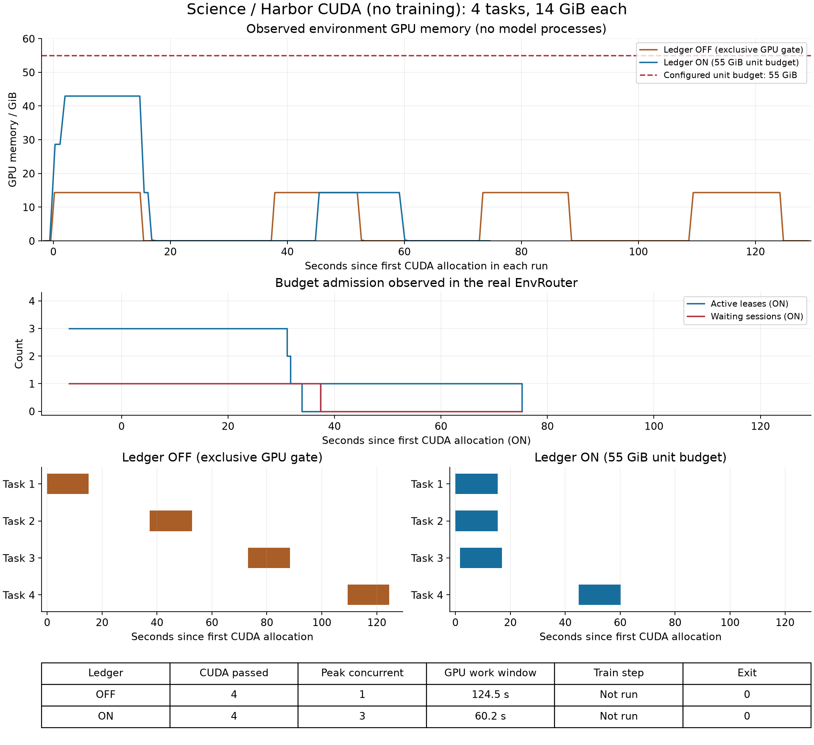

# Science 资源账本对照：unit 余量、GPU 容器与训练验证边界

> **核心结论**：普通 unit 是资源池，每个任务按自己的需求扣账。55 GiB 放三个 14 GiB 任务后剩 13 GiB，第四个同样大小的任务必须等，但更小任务可以申请余量。关闭 EnvRouter 的现有 science 路径仍有整卡独占锁，因此对照是“整卡串行”和“预算内共享”，不能预设对照组一定 OOM（显存不足）。
>
> **完整训练对照未完成**：首次 OFF 超时，一次修正后的 OFF 在奖励配置检查失败；ON 训练未启动。已修复短响应配置并通过 CPU 构造校验，按预算不再重启训练。真实 science runner / Harbor 单 GPU 容器对照已通过：并发峰值 1 → 3，GPU 执行窗口 124.54 → 60.17 秒；它不包含模型推理或训练。本文补充 [unit 配额说明](rollout-gpu-lending.md#13-分配粒度和-unit-配额)，不替代其中的同卡借还实验。

> 用户随后授权的原始 LAPS 训练对照另见 [真实训练曲线与资源账本结果](science-training-router-ab.md#9-释放占位后重新运行真实训练)。最新 OFF / ON 各完成 8 条真实轨迹和 2 step，账本记账与释放通过，但未测出训练速度或 GPU 利用率优势；文中同时保留较早失败实验的 OOM 证据。

## 目录

- [1. 完整链路与源码图例](#1-完整链路与源码图例)
- [2. 剩余 13 GiB 的含义](#2-剩余-13-gib-的含义)
- [3. 实验设计与停止条件](#3-实验设计与停止条件)
- [4. 实测结果与图表](#4-实测结果与图表)
- [5. 结果能证明什么](#5-结果能证明什么)
- [6. 跟着图读源码](#6-跟着图读源码)
- [7. 复现脚本与原始证据](#7-复现脚本与原始证据)

## 1. 完整链路与源码图例

EnvRouter 是统一准入服务，ledger 是其中负责算账的数据结构；lease 是授予一个任务的资源租约，代表预算已预留。必须把失败的训练尝试与后续实际容器链路分开：

```text
训练尝试：science 训练入口 -> Ray / 模型 / 权重同步 -> 奖励模块配置断言失败
                                                        未生成训练轨迹、未更新

本次容器对照：
[1] science_cuda_ab：并发提交四个相同需求
                     |
[2] run_harbor_episode：选择准入分支
          +----------+----------+
          |                     |
[3a] OFF：GpuDeviceGate   [3b] ON：Client -> EnvRouter -> Ledger
     整卡独占锁               累计 CPU / RAM / GPU / 容器名额
     同卡后续任务等           超预算返回 wait，此时没有容器
          |                     |
          +----------+----------+
                     v
[4] Harbor -> Docker -> ProbeAgent
    CUDA 分配 14 GiB，内核返回 42，保持 15 秒，verifier 评分
                     |
[5] runner 清理容器 -> 释放锁 / lease -> 等待者重新申请
                     |
[6] 汇总 CUDA 时间区间、GPU 遥测和账本快照 -> 画图 -> 核实清理
```

图例：图里每个部分对应的源码位置。

| 图中部分 | 职责与源码 |
|---|---|
| 训练尝试 | 原有入口 [`fsdp_qwen35_4b.sh`](../../examples/sciaccel_rl/fsdp_qwen35_4b.sh)，实验启动器 [`science_budget_ab.py`](env-service-verification/scripts/science_budget_ab.py)；失败断言位于 [`DAPORewardManager.__init__`](../../psrl/workers/reward/reward_loop/dapo.py#L30) |
| 1 | [`science_cuda_ab.run_arm`](env-service-verification/scripts/science_cuda_ab.py#L21) 用 asyncio 并发提交四个任务，不启动模型 |
| 2 | [`run_harbor_episode`](../../examples/sciaccel_rl/runner.py#L254)，任务需求由实验传入 |
| 3a | [`runner 旧分支`](../../examples/sciaccel_rl/runner.py#L355)、[`GpuDeviceGate.acquire`](../../psrl/utils/concurrency/gpu_device_gate.py#L117)，通过文件锁独占设备 |
| 3b 的申请与重试 | [`EnvServiceClient.acquire`](../../psrl/workers/env_service/client.py#L159) 请求 Ray actor，wait 时退避重试；[`EnvRouter.try_admit`](../../psrl/workers/env_service/router.py#L119) 调用账本 |
| 3b 的算账与观测 | [`EnvUnitLedger.try_admit`](../../psrl/workers/env_service/ledger.py#L103)、[`_fits_now`](../../psrl/workers/env_service/ledger.py#L349)、[`snapshot`](../../psrl/workers/env_service/ledger.py#L251) |
| 3b → 4 | [`_apply_env_lease`](../../examples/sciaccel_rl/runner.py#L99) 将租约转为容器参数；[`build_lease_overlay`](../../psrl/workers/env_service/overlay.py#L139) 指定设备和标签 |
| 4 | [`ProbeAgent.run`](env-service-verification/scripts/science_probe_agent.py#L14) 在真实容器运行 CUDA 探针，不调用模型；探针由训练实验的 [`prepare`](env-service-verification/scripts/science_budget_ab.py#L36) 生成，两类实验复用同一任务 |
| 5 | [`runner finally`](../../examples/sciaccel_rl/runner.py#L535)，先清理容器再释放预算 |
| 6 | [`采集和清理脚本`](env-service-verification/scripts/science_cuda_ab.py)、[`绘图脚本`](env-service-verification/scripts/plot_science_budget_ab.py) |

这些代码如果有理解上的问题，可以随时追问。四个任务并发申请、异步等待，图不是四个任务依次走完的单线程流程。完整训练原本会由 [`SciAccelAgentLoop._run_harbor_in_thread`](../../examples/sciaccel_rl/agent_loop.py#L358) 调用 runner；本次容器对照直接调用 runner，不能算该上层训练接入已验证。

## 2. 剩余 13 GiB 的含义

先用**教学数字**算一遍：unit 总预算 55 GiB，每个任务需要 14 GiB，其他资源充足。A 获准后剩 41，B 后剩 27，C 后剩 13。D 需要 14，加入后总额 56 超出 55，因此等待。这并非把 14 GiB 向上取整到 unit 大小造成的浪费；即使记账精度细到 1 MiB，D 仍放不进去。GiB 是以 1024 为进位的容量单位，本次配置里的 `14336` MiB 等于 14 GiB。

若新来一个 10 GiB 任务 E，累计 42 + 10 = 52 GiB，可以放下。当前账本对每次申请独立检查，不要求等待中的 D 先执行。这是复用余量的能力，不是保证最优装箱或等待公平性的算法。

这部分已配有 [CPU 演示脚本](env-service-verification/scripts/unit_fragmentation_demo.py)，调用真实生产账本但不分配 GPU。输出和运行状态见[演示结果](env-service-verification/results/unit-fragmentation-demo.json)。演示数字与 GPU 实验使用相同预算，但这段 CPU 结果不能证明容器已实际执行。

人为约束也可能导致额外余量：物理 GPU 本可安全开放 60 GiB，却只给 unit 55 GiB；或显存够用而 `max_containers=1`。这些约束需要按任务峰值和安全余量配置。普通单卡任务适合一张物理卡一个 unit、多个任务按真实需求共享。多卡 unit 当前按总显存算账，并未实现逐卡需求向量；两张卡各剩 13 GiB，并不意味着一个单卡需要 14 GiB 的任务能执行。

另外，“剩 13 GiB”是按声明计算的余额，CUDA 上下文等也占显存。普通 unit 使用累计声明与有效实测占用的较大者，真实可接纳余量可能更少。rollout 借卡 unit 的 `max_containers=1` 则是当前交接协议约束，和这里普通 unit 的多容器共享不同。

## 3. 实验设计与停止条件

**原定训练验收问题**是：同样的 science 训练链路，开启账本后，多个真实 GPU 容器能否在预算内并发、超预算申请能否等待、释放后能否继续，最终是否完成一个训练 step。达到这些结论便停止，不要求模型效果提升、非零梯度、收敛或长期稳定性。

| 条件 | 两组共同配置 |
|---|---|
| 节点 | 实验前检查 Docker 响应、GPU 空闲及 UUID/minor 对应关系的远端节点 |
| 模型 | 已有 Qwen2.5-3B-Instruct；入口文件名虽然含 Qwen35-4B，实际模型路径已覆盖 |
| 训练 / 推理 | 各 1 张 GPU，共 2 个 Ray GPU 份额；推理 TP=1，即模型不跨卡切分 |
| 环境 GPU | 另用同一张 H20；NVML index=7，设备 minor=6，不能把 index 拼成设备路径 |
| 任务 | 1 个固定资源样本，4 条轨迹，每条一次真实模型生成与一次 Docker CUDA 命令 |
| 单任务需求 | CPU=1、主机内存=1024 MiB、显存声明=14336 MiB；CUDA 实际分配 14 GiB |
| unit | GPU 预算 56320 MiB=55 GiB、CPU=4、主机内存=4096 MiB、max_containers=4 |
| 推理 / 训练上限 | 每次模型调用最多 32 token；训练总计 1 step；无评估、无 checkpoint 保存 |
| 任务执行 | GPU 内核返回 42，然后保留分配 15 秒，确保有足够观察并发的时间 |
| 时间预算 | 每组训练子进程上限 720 秒，外层两组上限 1600 秒，另有有界清理时间 |

原定训练对照只切换 `psrl.env_service.enable`。OFF 依旧保留原有整卡锁，不能声称 OFF 无资源保护。ON 的容器名额是 4，CPU 和主机内存也够放 4 个；如果只能容纳 3 个并让第 4 个等，显存预算才是本设计中的限制项。

该环境卡物理显存大于人为设置的 55 GiB。我们没有故意把机器打到 OOM。这样的设置能在安全余量充足时检查“配置预算确实有约束力”，却不能据此宣称已经复现并消除了实际显存崩溃。

**原定方案是真实训练管线加固定资源验证任务，但本次未完成。** 使用现有 `examples/sciaccel_rl` 的 SciAccelAgentLoop、Harbor、模型服务、轨迹回收和训练更新。实验代理调用真实模型，但 Docker 命令固定，不根据模型回答选命令，因此它不衡量原始 science benchmark 的求解质量。所有成功任务奖励均为 1，零优势或零梯度可能出现；只要执行链通过，不会为制造非零梯度追加训练。

首次使用默认多进程推理执行器的 OFF 组，在 720 秒上限内未完成训练，已停止并保留首次日志（本地资料，未随仓库发布）。现场只读堆栈显示，较多时间花在共享文件系统模块导入和插件信息读取。一次修正把单卡推理配置为 `distributed_executor_backend=uni`，减少一个 worker 进程的重复初始化；两组均使用该配置，时间与 GPU 数上限不增加。另修正实验监督脚本，记录本次子进程身份并清理 Ray 退出后遗留的模型进程。共享依赖未改；后续容器实验发现的生产 runner 传参问题见下文。

**修正后的训练仍失败**：第二次 OFF 运行约 503.7 秒，奖励模块初始化报 `max_resp_len must be larger than overlong_buffer.len`。实际配置为响应上限 512、缓冲区 3072。即使 `enable=False`，当前构造函数仍检查两者关系。我在缩小实验时漏配了这个相关参数。实验启动器已显式设置缓冲区长度 0，并在 GPU 启动前构造奖励模块作预检。[CPU 回归结果](env-service-verification/results/reward-config-check.json)复现旧配置断言、确认新配置通过；没有再次运行训练，也不能把它当作完整训练回归。

**容器对照的独立预算**：只使用环境 GPU，Ray 声明 0 个模型 GPU，两个组各四个任务，无模型调用、无优化器更新。直接调用生产 science runner，GPU 需求与训练准备的任务完全相同。每组最多 180 秒，首次外层上限 450 秒。首次在创建容器前暴露旧路径传参缺陷，四个任务均未分配 GPU：`HarborConfig.override_gpus=0` 没有进入 Harbor JobConfig。已修复 [`runner.py`](../../examples/sciaccel_rl/runner.py#L328) 的配置传递，并增加[回归用例](../../tests/examples/sciaccel_rl/test_runner.py#L120)。针对性复测外层上限 360 秒，保存独立目录，不覆盖失败证据。ON 原来已经通过租约路径设置该字段；修正是让旧对照路径能正常运行，并没有拆掉其独占锁。

## 4. 实测结果与图表

**容器对照通过，完整训练对照未完成。两者不能合并成“训练验证通过”。** 以下是 2026-10-16 的新实机数据，来自同一张 H20、同一批 14 GiB CUDA 任务，使用生产 science runner、Harbor 和真实 Ray EnvRouter。

| 指标 | OFF：旧整卡锁 | ON：EnvRouter 账本 |
|---|---:|---:|
| CUDA 成功 / 提交任务 | 4 / 4 | 4 / 4 |
| 真实 CUDA 分配重叠峰值 | 1 | **3** |
| 实测显存峰值 | 14661 MiB，约 14.32 GiB | 43976 MiB，约 42.95 GiB |
| GPU 执行窗口：首次分配到最后释放 | 124.54 秒 | **60.17 秒** |
| 整组任务墙钟：含容器启动、验证与清理 | 154.19 秒 | 112.09 秒 |
| 活动租约峰值 | 不使用该账本 | 3 |
| 累计显存声明峰值 | 不使用该账本 | 43008 MiB = 42 GiB |
| 等待者峰值 | 由独占锁等待，未接账本计数 | 1 |
| 三租约且一等待的遥测样本 | 不适用 | **49 次** |
| 最终租约 / 等待者 | 不适用 | 0 / 0 |
| 两组退出码 | 0 | 0 |
| 本表对应的模型推理 / 训练 step | 未运行 | 未运行 |



[SVG 矢量图](env-service-verification/results/science-cuda-ab-20261016-fixed/comparison.svg)可用于放大或导出。

**怎样看图：** 橙线 OFF 每次只有约 14.32 GiB 占用，四个任务顺序执行。蓝线 ON 首轮升到约 42.95 GiB，三个 CUDA 分配区间重叠；第 4 个必须等，随后单独运行。账本限制是 55 GiB，而 4 × 14 = 56 GiB，因此第四个不能被接纳。CPU、主机内存和容器名额都足够放 4 个，49 次“三租约、一等待”样本和随后成功完成的第四个任务共同证明：显存预算参与了真实准入，释放后能继续执行。八次 CUDA 结果均为 42，记录的物理 GPU UUID 完全一致。

GPU 执行窗口缩短约 **51.7%**，即本次窗口比值约 **2.07 倍**。这不是模型训练吞吐提升 2.07 倍：本轮没有模型，且每个探针主要持有显存、只执行很小的计算。四个相同任务按三并发仍需两轮，加上 Docker 启动、verifier、清理和重试，不能期待四任务整体耗时直接除以三。整组任务墙钟只缩短约 **27.3%**，也说明启动和收尾开销显著。图中显存已释放而租约仍在，是因为 runner 要等容器清理完成才归还预算。

训练尝试的真实状态单列如下，不能把上表的 CUDA 成功填成训练成功：

| 尝试 | 结果 | 覆盖边界 |
|---|---|---|
| 首次 OFF | 720 秒子进程超时，退出 -15；含初始化和收尾约 744.9 秒 | 无训练 step，ON 未启动 |
| 单卡 uni 修正后的 OFF | 奖励模块长度配置断言失败，退出 1；总计约 503.7 秒 | 无训练 step，ON 未启动 |
| 奖励配置修复后 | CPU 构造校验通过 | 按停止边界没有再训练，完整训练对照仍未验证 |

生产 runner 的 GPU override 修复通过 **38 项回归**，原始输出见测试日志（本地资料，未随仓库发布）。真实容器复测的两组均退出 0，提供了该传参修复的实机证据。

**实验已停止并确认物理清理。** [独立清理检查](env-service-verification/results/science-cuda-ab-20261016-fixed/cleanup-verified.json)显示 GPU 0–7 均为 0 MiB，无 GPU 计算进程、无本次容器、无活动 Ray / vLLM / NIXL 进程。本轮没有用“租约归零”替代物理检查。

原始证据：[汇总与范围](env-service-verification/results/science-cuda-ab-20261016-fixed/verification-summary.json)、[可计算明细](env-service-verification/results/science-cuda-ab-20261016-fixed/comparison.json)、OFF 遥测（本地资料，未随仓库发布）、ON 遥测（本地资料，未随仓库发布）、容器运行日志（本地资料，未随仓库发布）、第二次训练失败日志（本地资料，未随仓库发布）、旧路径传参失败日志（本地资料，未随仓库发布）。

## 5. 结果能证明什么

必须区分三件事：

1. **准入不超额**：账本决定是否允许任务创建容器，防止声明总额超过配置预算。等待者此时没有容器，不先占一张 GPU 再等其他资源。
2. **显存有真实使用**：CUDA 探针分配 14 GiB 并执行内核，GPU 遥测能看到实际占用。账本快照的 `containers_running` 实际是活动租约数，包含容器启动和清理阶段，因此需要同时看 CUDA 时间区间，不能只看该字段就宣称任务在并行计算。
3. **计算资源仍会共享**：即使显存预算够用，GPU 的计算单元、显存带宽以及 CPU、磁盘仍可能竞争。账本不是硬显存隔离，任务超出声明或外部进程绕过准入，也不能保证永不 OOM。

容器对照中的 CUDA 内核很小，主要检验显存分配和容器并发，不检验多个高算力任务同时运行时的吞吐。训练总墙钟时间包含 Ray、参数服务器、NIXL 权重传输、SMG 路由和 vLLM 初始化；一次 OFF / ON 配对无法排除缓存和启动波动，因此资源任务执行窗口比总训练时长更适合作为本轮调度现象的对比。

本轮不使用 EnvWorker Path A，也不借用推理 GPU。前者的历史验证、后者的 Docker/vLLM 同卡两轮借还，均不能与本次普通 EnvRouter unit 的训练集成混为一项覆盖。

## 6. 跟着图读源码

| 步骤 | 图中编号 | 函数与源码 | 输入、输出或状态变化 |
|---|---|---|---|
| 1 | 1 | [`science_cuda_ab.run_arm`](env-service-verification/scripts/science_cuda_ab.py#L21) | 四个任务同时提交，需求均为 14 GiB；OFF 不传 EnvServiceClient，ON 传同一个服务的 client |
| 2 | 2 | [`run_harbor_episode`](../../examples/sciaccel_rl/runner.py#L254) | 进入对应准入分支；此时容器尚不存在 |
| 3a | 3a | [`GpuDeviceGate.acquire`](../../psrl/utils/concurrency/gpu_device_gate.py#L117) | OFF 等独占设备文件锁，后续同卡任务等待 |
| 3b | 3b | [`EnvServiceClient.acquire`](../../psrl/workers/env_service/client.py#L159) → [`try_admit`](../../psrl/workers/env_service/ledger.py#L103) | ON 采集显存遥测并申请，granted 会建立租约；wait 异步退避重试 |
| 4 | 4 | [`_apply_env_lease`](../../examples/sciaccel_rl/runner.py#L99) → [`ProbeAgent.run`](env-service-verification/scripts/science_probe_agent.py#L14) | 获准后创建绑定 GPU 的容器，CUDA 探针产生物理执行证据 |
| 5 | 5 | [`runner finally`](../../examples/sciaccel_rl/runner.py#L535) | 成功或异常都清理，确认容器移除后释放资源；异步等待者下一次申请可获准 |
| 6 | 6 | [`science_cuda_ab.main`](env-service-verification/scripts/science_cuda_ab.py#L76) | 保存每组退出码与最终租约，退出自己的 Ray，记录物理 GPU 状态；另做独立清理复查 |

原定训练入口、SciAccelAgentLoop、模型请求与训练更新的完整串联，在本次属于未完成项，不放进上面这条已执行的容器路径。

## 7. 复现脚本与原始证据

只理解余量时可运行 CPU 脚本。先按工作区要求激活项目环境，再从工作区根目录执行：

```bash
PYTHONPATH=./psrl python \
  docs/env-worker-deep-dive/env-service-verification/scripts/unit_fragmentation_demo.py
```

预期依次为：三个 14 GiB 申请 granted，第四个 wait，10 GiB 申请 granted，释放后第四个重试 granted，最终活动租约归零。这是生产账本的 CPU 演示，未模拟 CUDA 实际分配、Docker 启动或遥测延迟。

GPU 脚本需要在已完成[集群预检](../psrl/psrl-run-guide/cluster-preflight.md)的执行节点运行。先激活指定环境，再设置 `PSRL_WORKSPACE` 为当前工作区、`NODE_IP` 为现场核对的节点 IP、`MODEL_PATH` 为已有模型目录。以下配置只适用于已经确认物理 GPU 0、1、7 均空闲的节点，每次换新的输出目录。

```bash
export PYTHONPATH="$PSRL_WORKSPACE/psrl:$PSRL_WORKSPACE/.verification-deps:$PSRL_WORKSPACE/docs/env-worker-deep-dive/env-service-verification/scripts"
export CUDA_VISIBLE_DEVICES=0,1 TMPDIR=/tmp RAY_TMPDIR=/tmp
export VLLM_HOST_IP="$NODE_IP" RAY_NODE_IP_ADDRESS="$NODE_IP"
export VLLM_WORKER_MULTIPROC_METHOD=spawn VLLM_ALLOW_INSECURE_SERIALIZATION=1
export OMP_NUM_THREADS=2 HF_HUB_OFFLINE=1 TRANSFORMERS_OFFLINE=1
unset RAY_ADDRESS
verify_root="$PSRL_WORKSPACE/docs/env-worker-deep-dive/env-service-verification"
timeout -k 30s 1600s python -u "$verify_root/scripts/science_budget_ab.py" \
  --repo "$PSRL_WORKSPACE/psrl" --model "$MODEL_PATH" --node-ip "$NODE_IP" \
  --gpu 7 --timeout 720 --output "$verify_root/results/science-budget-new-run"
```

上面的训练命令已经补齐奖励配置，但本次没有重新验证整个训练命令成功。复现实际容器对照时，使用已生成的同一 `budget-cuda` 任务和 `gpu-overlay.yaml`，只调用：

```bash
export CUDA_VISIBLE_DEVICES=
timeout -k 20s 360s python "$verify_root/scripts/science_cuda_ab.py" \
  --node-ip "$NODE_IP" --task "$TASK_PATH" --overlay "$GPU_OVERLAY" \
  --output "$verify_root/results/science-cuda-new-run"
```

`TASK_PATH` 指固定 14 GiB 任务目录，`GPU_OVERLAY` 必须按执行节点实际 GPU minor 和驱动库生成；脚本当前按本次节点的 GPU index=7、minor=6 配置，不可未经现场核对直接移植。两组完成后，绘图只读取已有记录，不再启动训练：

```bash
python "$verify_root/scripts/plot_science_budget_ab.py" \
  "$verify_root/results/science-cuda-new-run"
```

结果目录保留 `executed-*.py` 执行快照、各组 `launch.json` 的启动范围和退出状态（训练尝试还记录实际命令）、`launcher.log`、Harbor 任务结果、定期 GPU 与账本快照 `telemetry.jsonl`（容器对照每轮采样后等待 0.5 秒，另计命令开销）。绘图脚本汇总生成 `comparison.json`、PNG 和 SVG；CUDA 执行窗口以探针中的分配开始到上下文释放时间计算，两个组分别以第一次分配为时间零点。
