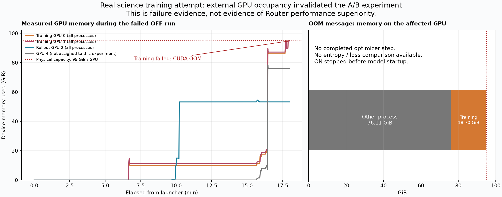
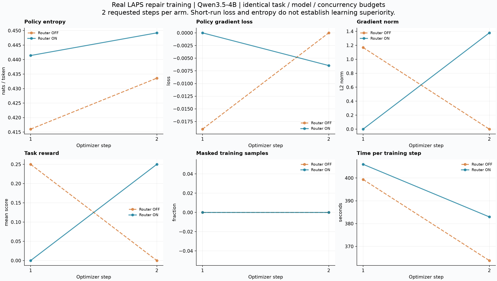
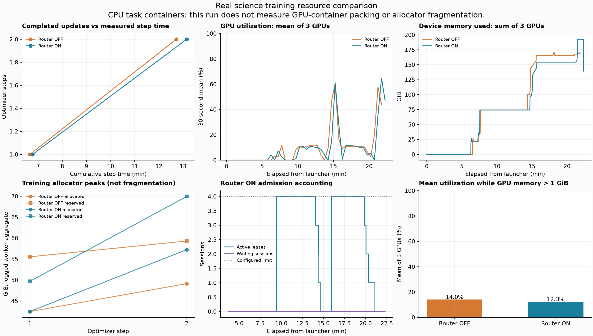

# 真实 LAPS 训练的 EnvRouter 开关对照

> **核心结论（2026-10-16 最终运行）**：真实 OFF / ON 对照已完成，两组各 8 条原始 LAPS 轨迹、2 个训练 step，退出码均为 0。ON 的 782 份账本快照覆盖 8 个会话，峰值 4 个租约、16 CPU、32 GiB，未观察到申报预算越界或记账不一致，最终归零。**没有测出 ON 的速度、GPU 利用率或训练效果优势。**
>
> 最新曲线、指标和验证边界集中在 [第 9 节](#9-释放占位后重新运行真实训练)。第 1–7 节保留较早失败实验的设计与故障证据，第 8 节是之后的现场复查；不能把较早 OOM 或此前固定 CUDA 工作负载的加速数字当作最新训练结果。
>
> 本文补充 [unit 与 GPU 容器对照](science-env-router-comparison.md)。本轮任务容器只用 CPU，模型训练和推理使用 GPU，不覆盖 GPU 容器装箱或 Docker / vLLM 同卡借还。

> **EnvRouter 的意义与证据总评（2026-10-18 复核）**：它把多个执行进程的环境资源申请汇总到同一份预算，按 CPU、主机内存和显存准入，并配合租约与节点清理管理资源生命周期。已有 GPU 容器对照证明预算共享能提高特定任务的并发、缩短完成时间；真实 LAPS 对照证明训练接入和记账成立，尚未证明训练加速。详见 [第 10 节](#10-envrouter-的意义收益与现有证据总评)。本次仅复核本地源码、历史结果，并重跑一次 CPU 账本演示。

> 后续 GPU 压力对照见 [跨任务池 GPU 竞争实验](science-gpu-pressure-ab.md)：它增加了明确标注的 CUDA 压力阶段，不能与本文原始 CPU 容器的实验混算。新实验已观察到显存准入收益，也保留了 ON 后续段错误和未完成四步的事实。

## 目录

- [1. 实际执行链路](#1-实际执行链路)
- [2. 对照配置与停止条件](#2-对照配置与停止条件)
- [3. 实测曲线与结果](#3-实测曲线与结果)
- [4. 怎样解释这些指标](#4-怎样解释这些指标)
- [5. 实验故障与修复](#5-实验故障与修复)
- [6. 跟着图读源码与复现](#6-跟着图读源码与复现)
- [7. 验证边界和资源清理](#7-验证边界和资源清理)
- [8. 本机和远端的现场复查](#8-本机和远端的现场复查)
- [9. 释放占位后重新运行真实训练](#9-释放占位后重新运行真实训练)
- [10. EnvRouter 的意义、收益与现有证据总评](#10-envrouter-的意义收益与现有证据总评)

## 1. 实际执行链路

```text
[1] 相同模型 + 相同原始 LAPS 数据 + 相同训练预算
                       |
[2] 训练器 / AgentLoop：每个任务采样两条独立轨迹
                       |
         +-------------+---------------+
         |                             |
[3a] OFF：进程内信号量         [3b] ON：EnvRouter -> 资源账本
      上限 4 个 episode               CPU / RAM / episode 名额
         |                             |
         +-------------+---------------+
                       v
[4] Harbor / Docker 中的真实 Terminus2 代理
    -> 请求 vLLM 模型 -> 执行终端命令 -> 回传输出 -> 再请求模型
    -> 独立 verifier 检查科学计算结果并评分
                       |
[5] 容器清理，释放信号量或租约，轨迹回传训练器
                       |
[6] 重算概率 / 组内优势 -> 训练前向（本轮 OOM 止于此）
    未完成：反向传播 / optimizer step
                       |
[7] 保存训练指标、GPU 遥测、账本快照 -> 绘图 -> 核实资源回收
```

图例：图里每个部分对应的源码位置。

| 图中编号 | 实现、输入和职责 |
|---|---|
| 1、7 | [实验启动与采集脚本](env-service-verification/scripts/science_training_ab.py)，读取原始 Parquet，固定任务子集，分别运行 OFF / ON |
| 2 | [`SciAccelAgentLoop.run`](../../examples/sciaccel_rl/agent_loop.py#L146)，将数据行转为一次真实任务执行 |
| 3a、3b | [`_run_harbor_in_thread`](../../examples/sciaccel_rl/agent_loop.py#L358)，选择进程内信号量或 EnvService 准入 |
| 3b 需求解析 | [`demand_from_task`](../../examples/sciaccel_rl/env_demand.py#L23)，读取任务声明的 CPU、内存和 GPU 需求 |
| 3b 准入 | [`EnvUnitLedger.try_admit`](../../psrl/workers/env_service/ledger.py#L103)，累计预留资源，返回允许、等待或拒绝 |
| 4、5 | [`run_harbor_episode`](../../examples/sciaccel_rl/runner.py#L253)，启动真实 Harbor Job、读取评分并执行清理 |
| 6 entropy | [`_compute_old_log_prob`](../../psrl/trainer/ppo/ray_trainer.py#L3087)，计算模型在轨迹上的概率和熵 |
| 6 更新 | [`_update_actor`](../../psrl/trainer/ppo/ray_trainer.py#L3192)，调度训练 worker 完成更新 |
| 6 主循环 | [`fit`](../../psrl/trainer/ppo/ray_trainer.py#L3331)，记录 step 指标，达到步数后停止组件 |
| 7 绘图 | [绘图脚本](env-service-verification/scripts/plot_science_training_ab.py)，直接解析本轮日志，缺失指标不补造 |

这些代码如果有理解上的问题，可以随时追问。图中的四个 episode 并发执行，模型请求和容器命令交替推进，不是单线程依次执行四个任务。

## 2. 对照配置与停止条件

两组均使用 Qwen3.5-4B，训练采用两张 GPU，推理采用一张 GPU。训练使用 GRPO，即同一个任务产生多条答案，再按组内奖励差异计算学习方向。科学任务本身是 LAPS 的二维 Fortran 数值代码修复，评分检查计算轨迹是否符合参考结果。

| 配置 | 两组共同值 |
|---|---|
| 原始任务 | `laps-repair-coef-2d-rktmod-l17k1`、`laps-repair-subtle-2d-rktmod-l17k1` |
| 数据 | 原始 L1 提示，含缺陷定位，不改指令、评分器或任务代码 |
| 随机种子 | 数据打乱 seed=17，模型和采样配置相同，异步调度下不保证逐 token 一致 |
| 最终配对预算 | 每组 2 step，每步 2 个任务，每任务 2 条轨迹，计划每组 8 条 |
| 代理 | 项目真实 `TruncatingTerminus2`，关闭思考模式，观测文本最多 4096 字节 |
| 单轨迹边界 | 16 轮、240 秒代理执行上限，评分仍受任务自己的超时约束 |
| 上下文 | prompt 2048 token，response 32768 token |
| 截断处理 | 两组均保留已生成的有效 token 训练，`overlong_filtering=False`，须同时查看截断率 |
| OFF 准入 | 一个 agent worker，进程内 episode 上限 4 |
| ON 准入 | 一个 CPU unit，16 CPU、32768 MiB 主机内存、4 个 episode 名额 |
| 组间变量 | `psrl.env_service.enable`，以及隔离运行必需的输出路径、Ray 地址 |
| 停止 | 训练子进程最多 24 分钟，Ray 初始化时间另记，达到两个 step 即停止，不补跑到奖励变好 |

原始计划是两组各四步、每组至多 45 分钟。首次 OFF 因实验采集器错误提前结束，未完成训练 step。修复后缩小配对重跑预算，没有把失败样本当作成功曲线，也没有增加模型或 GPU 规模。首次运行和重跑使用独立目录。

本轮只使用一个 agent worker，OFF 的信号量也能将并发限制到四个。因而这是**相同有效并发上限下的真实训练接入与开销对照**，没有刻意把 OFF 调成串行，也没有制造资源竞争。CPU 同构任务、单 worker、资源充足时，账本不一定比信号量更快。

## 3. 实测曲线与结果



可下载 [SVG 矢量图](env-service-verification/results/science-training-ab-20261016-retry/failure-evidence.svg) 或 [PDF](env-service-verification/results/science-training-ab-20261016-retry/failure-evidence.pdf)。**这是一张故障证据图，不是 ON 优于 OFF 的性能图。**

左图直接取本轮 `nvidia-smi` 采样。训练使用物理 GPU 0、1，推理使用 GPU 2，灰线 GPU 4 没有分配给本实验。14:32:57 起，GPU 4 开始出现显存占用，随后包括两张训练卡在内的六张卡被外部进程大量占用。训练卡总显存升至接近 95 GiB，首步训练失败。

右图取 OOM 异常中的进程显存数：外部进程 76.11 GiB，本次训练进程 18.70 GiB。当时空闲约 179.38 MiB，下一次请求 198 MiB 无法满足。错误发生于 Qwen3.5 的线性注意力前向计算，不是任务 Docker 使用 GPU，也不是 EnvRouter 的准入拒绝。仅凭本次结果不能证明移走外部进程后完整训练一定通过。

| 本轮结果 | OFF | ON |
|---|---|---|
| 实际启动阶段 | 真实代理、科学计算任务、独立评分、训练前向 | Ray 和启动 shell 初始化后停止，未加载模型 |
| 已完成真实任务评分 | 4 条，奖励均为 0 | 0 条 |
| 训练 buffer | 凑齐 4 条，旧策略 log-prob 重算完成 | 未形成 |
| 完成 optimizer step | 0 | 0 |
| 完整 step 的 entropy / loss | 未输出，不能填 0 | 未输出，不能填 0 |
| 退出情况 | 训练进程 exit code 1，CUDA OOM | 本次实验主动中断，避免继续占用冲突资源 |
| 运行墙钟 | 约 18.93 分钟，含 Ray 初始化 | 约 54 秒，仅初始化 |
| 性能差异、账本训练收益 | **无法比较** | **无法比较** |

四条回传轨迹的 response 序列长度分别为 10732、11451、8393、12778，合计 43354 token。这是多轮拼接序列长度，不是 `response_mask` 中 1 的总数，不能冒充有效训练 token。Harbor 各轮报告的模型 completion token 合计 15892，也不能直接替代训练器最终 mask 计数。由于未完成 step，本轮没有最终的 `termination/trained_tokens` 指标。

完整设备遥测包括外部进程消耗。因此虽然可以计算设备平均利用率，不能把其上升归功于本实验，更不能据此证明训练更快。两组没有同等完成工作量，不输出速度提升百分比，也不拼接历史 entropy / loss 冒充本轮曲线。

原始证据：

- 失败的首次采集日志（本地资料，未随仓库发布）：一次遥测超时错误地中止训练。
- [配对重跑设计](env-service-verification/results/science-training-ab-20261016-retry/design.json)、OFF 完整日志（本地资料，未随仓库发布）、OFF GPU 遥测（本地资料，未随仓库发布）。
- [实际运行时启动器快照](env-service-verification/results/science-training-ab-20261016-retry/science_training_ab.runtime.py) 与 [运行时源码指纹](env-service-verification/results/science-training-ab-20261016-retry/source-hashes.json)，快照 SHA256 已核对一致。
- [结构化实验状态与四条评分结果](env-service-verification/results/science-training-ab-20261016-retry/experiment-status.json)、外部进程占用（本地资料，未随仓库发布）。
- [清理核验](env-service-verification/results/science-training-ab-20261016-retry/cleanup-verified.json)：没有本次路径对应的活进程，没有残留 Docker 容器，外部 GPU 分配保留。

## 4. 怎样解释这些指标

**Entropy（熵）**描述模型输出分布的不确定程度。例如一个教学假设：下一个 token 只有 A、B 两个候选，各 50% 时熵为约 0.693 nats。若变成 99% 和 1%，熵降到约 0.056 nats。低熵意味着更确定，但模型可能更确定地给出错误答案，所以不能把熵下降直接当作任务质量提高。

**Loss（损失）**是优化器当前要优化的目标，本轮关注策略梯度损失。GRPO 使用组内相对奖励，数值可能为负，也可能因为组内奖励相同而为零，不能按监督学习中“越小越好”的直觉简单比较两个调度器。具体教学例子：两条轨迹奖励都是 0，则组均值也是 0，两者相对优势均为 0。即使模型产生很多有效 token，策略梯度仍可能为 0。两条奖励为 0 和 1 时，中心化后优势分别为 -0.5 和 +0.5，才提供相反的学习信号。

因此必须将 loss、梯度范数、奖励和有效 token 一起看。完成一次优化器调用不等于模型权重有非零变化，更不等于模型效果改善。本轮不会为了得到非零梯度无限补采。

**GPU 利用率**来自实际执行节点的 `nvidia-smi`，表示采样窗口内 GPU 忙于执行内核的比例，不等同于有效计算效率。模型推理期间训练 GPU 可能等待，容器运行科学计算时推理 GPU 也可能空闲。资源图同时画三张卡的平均利用率和完成更新的耗时，避免仅凭“忙碌程度更高”判断更快。

**显存占用和碎片不同。** `nvidia-smi` 记录设备占用，训练日志还记录 PyTorch 的 allocated（分配给活跃张量）和 reserved（缓存分配器保留）峰值。reserved 与 allocated 的差还包含可复用缓存，峰值也不一定发生在同一时刻，因此其差不能直接称为碎片。要证明碎片更小，应测量已知任务需求下无法复用的余量、分配失败或分配器的空闲块结构，本轮未采集这种证据。

统计时将启动墙钟时间与训练日志中的 `timing_s/step` 分开。两组生成的 token 数、代理命令和任务运行时长可能不同，即使配置和种子相同，一次短对照的速度差异也不足以完全归因于账本。OFF 先运行、ON 后运行还可能受到缓存和节点负载变化影响。

## 5. 实验故障与修复

首次 OFF 的训练链路已经生成真实轨迹，但采集脚本对 `nvidia-smi` 设置五秒超时，没有捕获 `TimeoutExpired`。一次读遥测超时进入启动器的 `finally`，触发了训练资源回收。错误来源是实验采集器，不是 GPU OOM、EnvRouter 或模型训练异常。

修复后，GPU 采集返回 `gpu_error`，不把缺失观测伪装成零利用率，不终止训练。针对超时和正常返回的定向检查通过。

另一个发现是 science runner 在任务结束后调用全局无标签镜像清理。首次 OFF 日志显示这一旧路径移除了四个无标签镜像，不能确认它们都属于本次任务。现已移除这项隐式全局操作，保留按本次 Compose project 清理容器和镜像。针对性回归验证“清理本次镜像且不调用全局 prune”通过。配对重跑两组均使用这一修复后的代码。

重跑还暴露了物理资源隔离边界：本次启动前八张 GPU 均空闲，但运行期间有外部进程进入。当前进程命名空间看不到这些 NVML 主机 PID 的归属，不能断言它们属于哪个用户或哪个 Ray 集群。本次所有训练进程退出后，这些约 76 GiB 的占用仍在，足以确认它们不属于本次训练进程树。

实验启动器已增加每组 GPU 空闲检查，并在一组失败后停止后续配对运行。空闲、已占用、观测失败和设备缺失四种 CPU 检查通过，见 [GPU 预检回归](env-service-verification/results/science-training-ab-20261016-retry/gpu-preflight-regression.json)。**这些修复没有解决外部作业随时进入同一张物理卡的问题，也没有再次启动训练。** 下一轮有效对照需要调度平台给予同一组 GPU 的独占时间窗口，或所有竞争者共同遵守同一资源分配机制，仅新建 Ray namespace 不足以保证。

遥测修复证据见 [定向检查](env-service-verification/results/science-training-ab-20261016-retry/telemetry-regression.json)，限定清理回归见 pytest 日志（本地资料，未随仓库发布）。当前结果中的失败记录对应运行时脚本，最终复现脚本已包含后续预检和失败即停止修复。

## 6. 跟着图读源码与复现

| 步骤 | 图中编号 | 真实执行路径与状态变化 |
|---|---|---|
| 准备 | 1 | `science_training_ab.prepare` 选取两种原始数据行，重复到本轮步数所需样本数，不生成伪造任务 |
| 启动 | 1、2 | `run_arm` 新建隔离 Ray，核对实际 worker 的依赖来源，调用项目训练 shell |
| 请求 | 2、3 | `SciAccelAgentLoop.run` 为每条轨迹建立会话，`_run_harbor_in_thread` 选择并发准入分支 |
| 算账 | 3b | `demand_from_task` 读取每个任务 4 CPU、8192 MiB，账本累计到 unit 预算 |
| 交互 | 4 | Harbor 启动真实代理。模型发出终端命令，Docker 执行后把观测送回模型，多轮重复 |
| 评分、释放 | 4、5 | verifier 生成真实奖励，runner 清理本次资源后释放名额，等待中的请求才可继续 |
| 训练 | 6 | 训练器取回有效 token，计算熵和组内优势，执行反向传播并记录 step 指标 |
| 收尾 | 7 | 到达 step / 时间上限停止。采集器回收自己的进程，检查 GPU 和容器，绘图脚本解析原始日志 |

以上函数的可跳转源码见开头图例。一个可手算的准入例子：本轮每个任务声明 4 CPU 和 8 GiB 主机内存，四个任务共用 16 CPU 和 32 GiB，恰好达到 unit 上限。第五个同规格请求若到达，需要等待一个已有租约释放。是否在本轮实际出现第五个等待者，以快照为准，不能只凭算式写成实测。

真实 GPU 复现实验必须先获得独占 GPU 时间窗口，再按 [集群运行约束](../psrl/psrl-run-guide/cluster-preflight.md) 检查依赖、Docker 和节点资源。激活项目环境、恢复自己的工作区路径后，在本专题的 `env-service-verification/scripts` 目录运行，路径变量均应设为自己的配置：

```bash
export CUDA_VISIBLE_DEVICES="$SCIENCE_GPU_INDICES"
python science_training_ab.py \
  --repo "$PSRL_REPO" --model "$SCIENCE_MODEL" \
  --dataset "$SCIENCE_DATASET" --output "$SCIENCE_OUTPUT" \
  --node-ip "$SCIENCE_NODE_IP" \
  --steps 2 --task-timeout 240 --turns 16 --timeout 1440
python plot_science_training_ab.py "$SCIENCE_OUTPUT"
```

`SCIENCE_GPU_INDICES` 是获得配额的三个数字设备索引，用逗号分隔。当前绘图脚本针对本轮实际使用的物理 0、1、2 卡，换卡复现应同步调整图中的设备选择。`CUDA_VISIBLE_DEVICES` 只改变本进程能看到哪些卡，不阻止别的作业使用它们。

不需要 GPU 的准入机制演示可运行 [unit_fragmentation_demo.py](env-service-verification/scripts/unit_fragmentation_demo.py)。它调用真实账本、使用教学需求，不启动容器，不是本轮训练的替代证据。

## 7. 验证边界和资源清理

- 任务容器只用 CPU，因此本轮不证明 Docker 与 vLLM 在同一张卡上的 sleep / wake up 交接。
- 账本约束的是申报预算，不是 GPU 显存硬隔离。没有预算越界快照不等于任意任务都不会超用物理资源。
- 一个 episode 可能包含 agent、verifier、网络 sidecar 等多个容器，租约数量不能直接写成 Docker 容器数量。
- 本轮只覆盖两种修复任务和一个随机种子，不是长期稳定性或收敛实验。
- 实验收尾时核验没有本次训练或独立 Ray 进程，没有残留 Docker 容器。当时设备查询仍有六个外部 GPU 进程，每个约 77938 MiB，未终止它们，因此不能把当时的清理状态写成“节点 GPU 全部空闲”。后续现场状态见下一节。
- 本轮 ON 未进入账本准入阶段，没有账本快照，不能写成“本轮预算越界次数为零，所以账本验证通过”。

## 8. 本机和远端的现场复查

2026-10-16 15:54（北京时间）重新检查：当前 shell 所在机器的八张 GPU 均为 0 MiB、0% 利用率，但默认 Docker endpoint 不响应。`docker info` 六秒超时，Docker socket 的 `/_ping` 四秒超时，`dockerd` 和 `containerd` 都显示为 `Z` / `<defunct>`，即进程已退出而尚未被父进程回收。详见 [本机 Docker 复查记录](env-service-verification/results/local-docker-recheck-20261016.json)。

同一时刻，实验所用远端节点的八张 GPU 也均为 0 MiB、0%，Docker 版本查询返回 `26.1.3`，`/_ping` 返回 `OK`。因此外部 GPU 占用是前面实验失败时的状态，不能说现在仍被占用。两个节点的 hostname 恰好相同，已经通过 GPU UUID 区分，不能仅看 hostname 把它们当成同一台机器。

没有把完整 science 实验放在当前机器，直接原因是本机 Docker 服务不可用，而不是 GPU 正在被占用。科学任务需要 Harbor 创建真实 Docker 容器，所以 GPU 空闲本身还不足以运行整条链路。本次只做状态复查，没有重启 Docker、启动容器或重新训练。

## 9. 释放占位后重新运行真实训练

**运行和停止边界。** 用户要求立即把显存占位转换为实际实验。本次于 16:26 启动，16:27:23 核验占位已释放；OFF 于约 16:51 完成，ON 于约 17:19 完成。两组沿用第 2 节的相同模型、原始任务、并发上限和配置，各完成 2 step、8 条轨迹，退出码均为 0，没有延长训练或补采到结果更好。17:27 收尾核验所有 GPU 为 0 MiB，没有 Docker 容器，也没有本次进程遗留。

启动前再次检查 Docker、设备 UUID / minor 映射、driver 和实际 Ray worker 的代码导入来源。指定隔离 veRL 依赖的 position_ids 回归测试 3 项通过。图中全部来自本次 `science-training-ab-20261016-live` 目录，没有拼接先前失败运行。

**训练曲线。** 橙色为 OFF，蓝色为 ON。每条曲线只有两个真实训练 step，不是收敛曲线。



[下载训练图 SVG](env-service-verification/results/science-training-ab-20261016-live/training-curves.svg) · [下载训练图 PDF](env-service-verification/results/science-training-ab-20261016-live/training-curves.pdf)

| 指标 | OFF | ON |
|---|---:|---:|
| 完成训练 step / 真实轨迹 | 2 / 8 | 2 / 8 |
| step 1 → 2 entropy | 0.4160 → 0.4336 | 0.4414 → 0.4492 |
| step 1 → 2 策略 loss | −0.01900 → 0 | 0 → −0.00645 |
| step 1 → 2 梯度范数 | 1.1681 → 0 | 0 → 1.3781 |
| step 1 → 2 平均训练奖励 | 0.25 → 0 | 0 → 0.25 |
| 全部 8 条的平均训练奖励 | 0.125 | 0.125 |
| 两步累计计时 `timing_s/step` | 763.15 秒 | 788.95 秒 |
| 最终日志的有效训练 token 合计 | 34860 | 31572 |
| 达到 240 秒代理时限的轨迹 | 3 / 8 | 2 / 8 |

**这些结果怎样解释。** 两组各有一个含组内奖励差异的 batch，出现非零 loss 和非零梯度；另一个 batch 的训练奖励全为零，因此策略梯度为零。两组均完成优化器调用及权重推送，但不能把零梯度步骤说成模型发生了有效学习。不同运行生成的轨迹和长度不同，两个 step 的 entropy / loss 高低不证明调度器的学习效果好坏。

这里“训练奖励”明确取 `reward_repair`，由数据中的 `extra_info.reward_key` 指定。ON 有一条 Harbor 原始 `reward=0.5` 的轨迹，其 `reward_repair=0`，因此不会让训练奖励均值变成 0.1875。选择逻辑见 [`compute_score`](../../examples/sciaccel_rl/reward.py#L44)，字段证据见 [实际数据的奖励键](env-service-verification/results/science-training-ab-20261016-live/training-reward-keys.json)。这些代码若有理解上的问题，可以随时追问。

例如，OFF 第一步四条训练奖励是一个 1 和三个 0，平均为 0.25；ON 的这个情况出现在第二步。按两个 step 各四条等权合计，两组平均奖励均为 0.125。不能因为 ON 第二步的奖励曲线向上，就说方案改善了模型效果。

**资源曲线与速度。** 下图包含三张实验卡的利用率、显存占用、训练分配器峰值和账本租约变化。



[下载资源图 SVG](env-service-verification/results/science-training-ab-20261016-live/resource-comparison.svg) · [下载资源图 PDF](env-service-verification/results/science-training-ab-20261016-live/resource-comparison.pdf)

| 实测资源指标 | OFF | ON |
|---|---:|---:|
| 三卡全运行窗口平均利用率 | 9.83% | 8.84% |
| 三卡显存合计 > 1 GiB 窗口平均利用率 | 14.01% | 12.30% |
| 三卡显存合计峰值 | 171.12 GiB | 192.56 GiB |
| 运行器记录的墙钟，含初始化及清理 | 1379.79 秒 | 1399.19 秒 |

ON 的两步累计计时比 OFF 多 25.80 秒，约 3.38%；这次没有训练加速，也没有更高的 GPU 利用率。只有一对运行，生成的 token 数也不同，不能把这 3.38% 全部归因于 Router 开销。墙钟还包含不同的驱动显存释放等待：ON 记录了额外约 12.57 秒的释放观测，OFF 原启动器没有该等待，因此墙钟不是纯调度性能指标。

GPU 曲线为设备级指标，并不隔离其他用户的进程。监控记录过少量约 320 MiB 的外部 GPU 上下文，也记录过未分配给本实验的卡被其他进程占用；未出现上轮约 76 GiB 的同卡挤占导致的 OOM。两组都没有 OOM，但不能用一次未发生竞争的结果证明系统能拦住任意外部作业。

显存峰值不是碎片指标。ON 峰值更大，且两组实际序列长度和 PyTorch 缓存形态不同。本轮没有收集空闲块结构或任务装箱浪费，不能证明 GPU 碎片更小；原始任务的 Docker 容器也没有 GPU 需求。

**账本实际验证到什么。** 782 份 ON unit 快照中，8 个会话都被观测到，峰值为 4 个租约、16 CPU、32768 MiB；预算越界样本和记账不一致样本均为 0。每份快照都满足 `cpu_used = 4 × 活动租约数`、`memory_used_mb = 8192 × 活动租约数`，且会话列表长度与租约数相等。最后活动租约、CPU、内存均归零。

一个实际观测的释放过程是：四个任务在运行时账本为 `4 / 16 CPU / 32 GiB`；一个任务完成并清理后变成 `3 / 12 CPU / 24 GiB`；全部退出后归零；下一批又升到四个。图中的两段平台和下降阶梯对应这两批真实任务，不是模拟值。

现场 Docker inspect 还确认四个主容器均有正确的 `psrl.env_unit` / `psrl.env_lease` 标签，每个主容器限制为 4 CPU、8 GiB。网络 sidecar 同样带归属标签，但 CPU / 内存硬上限为 0，表示没有单独设置上限。**因此，本轮证明申报资源的准入、归属和释放有效，不证明整个容器集合的所有物理消耗都被硬隔离。** 证据见 [Docker 实际配置](env-service-verification/results/science-training-ab-20261016-live/on/docker-admission-evidence.json)。

等待队列峰值为 0：工作负载最多同时请求四个租约，恰好等于配置上限。因此没有真实触发“第五个请求因预算不足而等待”，也没有证明跨多个 agent worker 的竞争被避免。OFF 自身已有每 worker 四任务的信号量；本轮的结论是账本可以接入真实训练并正确记账，而不是 ON 在这个同构、资源充足场景下必然优于 OFF。

**本次修复与回归。** OFF 正常退出后，驱动还短暂报告训练卡的显存占用。紧接着启动的 ON 被预检拒绝，尚未加载模型或执行任务。保留该记录于 [on-preflight-rejected](env-service-verification/results/science-training-ab-20261016-live/on-preflight-rejected/launch.json)，然后核实显存清空，仅继续尚未运行的 ON，没有重跑 OFF。

实验脚本增加了 [`wait_for_gpu_release`](env-service-verification/scripts/science_training_ab.py#L225)：只在本次进程清理后有界观察显存释放，不杀其他用户进程；下一组仍需通过空闲检查。延迟释放、预算内仍未释放两项定向检查通过，ON 收尾也实际观察到显存从约 70 GiB 降至 3 MiB。绘图脚本同时去掉“未完成运行一律标为历史 OOM”的硬编码，避免把别次失败原因套入新结果。

**原始材料与复现。** 执行路径、源码映射及通用命令沿用第 1、6 节；本次精确运行脚本和图表均保留：

- [完整启动脚本](env-service-verification/results/science-training-ab-20261016-live/run.sh)、[仅继续 ON 的脚本](env-service-verification/results/science-training-ab-20261016-live/continue-on.sh)、[实际设计](env-service-verification/results/science-training-ab-20261016-live/design.json)。
- [OFF 运行时脚本快照](env-service-verification/results/science-training-ab-20261016-live/science_training_ab.runtime.py)、[ON 运行时脚本快照](env-service-verification/results/science-training-ab-20261016-live/science_training_ab.on.runtime.py)。二者的训练配置相同，差异是收尾释放核验；没有修改训练算法或任务评分器。
- OFF 完整日志（本地资料，未随仓库发布）、ON 完整日志（本地资料，未随仓库发布）、[图表数据](env-service-verification/results/science-training-ab-20261016-live/comparison.json)、[轨迹与账本统计](env-service-verification/results/science-training-ab-20261016-live/experiment-status.json)。
- 张量回归结果（本地资料，未随仓库发布）、[显存交接定向检查](env-service-verification/results/science-training-ab-20261016-live/handoff-regression.json)。
- 进程与容器观测（本地资料，未随仓库发布）、[物理资源清理核验](env-service-verification/results/science-training-ab-20261016-live/cleanup-verified.json)。

验收证据已齐备，本次不再继续训练。

## 10. EnvRouter 的意义、收益与现有证据总评

**先看完整关系。** 下面是当前 science / Harbor 路径的机制图，不代表本次重新运行了训练。EnvRouter 是环境资源的准入控制服务；Harbor 是创建任务环境、运行代理和评分的执行框架；Docker 提供实际容器。EnvWorker 是另一条沙箱执行路径，不能因为这组文档叫 EnvWorker 专题，就把所有收益归给 EnvWorker 或假定它与 Harbor 已统一。

```text
[1] 训练器创建同一个 EnvRouter，配置节点与资源池 unit
                         |
       多个 AgentLoop worker（执行任务的进程）
                         |
[2] science runner → EnvServiceClient：提交任务需求 demand
                         |
[3] EnvRouter → EnvUnitLedger：检查并登记 CPU / 内存 / 显存 / 名额
       ├─ 当前不足：wait → 客户端退避重试，此时尚未创建任务容器
       ├─ 永远装不下或节点不允许：reject → 结束该次申请
       └─ 可容纳：granted → 发租约 lease，并启动后台心跳
                         |
[4] runner 把租约写成容器配置 → Harbor → Docker 执行任务、评分
                         |
[5] 正常结束：清理本次容器 → release → 后续申请可使用归还的预算
    异常分支：worker 消失 → 心跳过期 → 节点服务按标签清理容器
              清理未确认时，真实 Router 阻止该节点新任务准入
```

图例：图里每个部分对应的源码位置。

| 编号或箭头 | 职责与函数 | 已核对源码 |
|---|---|---|
| 1 | `_init_env_service` 从训练配置建立共享服务 | [ray_trainer.py:549](../../psrl/trainer/ppo/ray_trainer.py#L549) |
| 1 → 2 | `_run_harbor_in_thread` 选择 EnvService 或原有进程内信号量 | [agent_loop.py:358](../../examples/sciaccel_rl/agent_loop.py#L358) |
| 2 → 3 | `EnvServiceClient.acquire` 上报需求、轮询、拿到租约后启动心跳 | [client.py:159](../../psrl/workers/env_service/client.py#L159) |
| 3 | `RayEnvRouter.try_admit` 先检查节点清理，再调用账本；`EnvUnitLedger.try_admit` 选择 unit、登记租约 | [router.py:273](../../psrl/workers/env_service/router.py#L273)、[ledger.py:103](../../psrl/workers/env_service/ledger.py#L103) |
| 3 的预算判断 | `_fits_now` 同时检查四类预算；`_effective_gpu_mb` 处理声明与有效实测显存 | [ledger.py:349](../../psrl/workers/env_service/ledger.py#L349)、[ledger.py:330](../../psrl/workers/env_service/ledger.py#L330) |
| 3 → 4 | `run_harbor_episode` 在创建任务前申请；`_apply_env_lease` 写入设备、资源与归属配置 | [runner.py:337](../../examples/sciaccel_rl/runner.py#L337)、[runner.py:98](../../examples/sciaccel_rl/runner.py#L98) |
| 4 → 5 | runner 的 `finally` 先清容器，再归还租约 | [runner.py:535](../../examples/sciaccel_rl/runner.py#L535) |
| 5 的异常分支 | Router 后台回收过期租约；节点服务按租约标签删容器并核实 | [router.py:88](../../psrl/workers/env_service/router.py#L88)、[node.py:47](../../psrl/workers/env_service/node.py#L47) |

这些代码如果有理解上的问题，可以随时追问。多个任务并发申请；心跳和过期清理是后台协程，异常分支不是正常结束后必经的下一步。

**为什么要增加这一层：原来的限制看不见同一组资源的全部使用者，也不能充分表达任务大小。**

旧 science CPU 路径的信号量，是“这个进程最多同时跑几个任务”的计数器。它有保护作用，但另一个进程有自己的计数器。教学假设：一台机器给环境任务留 16 CPU、32 GiB 主机内存，每个任务要 4 CPU、8 GiB。两个 worker 都允许本进程运行四个任务，则各自合法却合计申请 32 CPU、64 GiB。这里描述的是独立计数器的局限，不是声称这次 LAPS 实验实际超用了这些资源。

接入同一个 Router 后，两边都从同一个 unit 扣账，合计四个任务即达到 16 CPU、32 GiB，第五个申请等待。unit 是登记了资源上限的池，lease 是某个任务已经预留资源的凭证。例如任务 A 获得租约后，其他任务就不能再把 A 的 4 CPU 和 8 GiB 当作空闲资源；即便 A 的容器还在启动，也应保留这份额度。相同 session 重试会取得原租约，避免重复扣账，见 [ledger.py:135](../../psrl/workers/env_service/ledger.py#L135)。

GPU 的旧路径还有整卡文件锁，并非没有防冲突。整卡锁适合独占，代价是一个小任务也会锁住整张卡。Router 允许同一 unit 内按需求共享：预算 55 GiB，A、B、C 各申请 14 GiB，共 42 GiB；D 再申请就达到 56 GiB，必须等。此时 13 GiB 余量还可以接纳一个 10 GiB 的 E，达到 52 GiB。GiB 是以 1024 为进位的容量单位，代码中这些预算按 MiB 记账，1 GiB = 1024 MiB。

这个例子说明两类收益：**资源够时允许更多任务，资源不够时把新任务挡在容器创建之前。** 等待仍有客户端协程和轮询开销，不能说完全没有成本；但没有为等待者提前创建任务容器、占用该任务的 GPU 资源。当前等待是客户端退避重试，不是保证先来先服务的公平队列。后到的 E 能先于 D 获准，也意味着不能据此宣称最优装箱或无饥饿保证。

这里的“全局”仅指**所有连接同一个 Router、共用这些 unit 的调用者**。创建函数使用具名 Ray actor（由 Ray 托管、保存状态并接受远程调用的对象），见 [create_env_router](../../psrl/workers/env_service/router.py#L302)。它没有自动接管独立 Ray 集群、其他命名空间或绕开本服务的 GPU 作业，也不是整个机群的物理独占分配平台。

**现有实验要分四类评价。以下 GPU、Ray、训练和故障注入均是历史记录，本次没有重跑。**

| 要回答的问题 | 已有证据 | 能下的结论与边界 |
|---|---|---|
| 同卡共享是否有实际收益 | 10 月 16 日真实 Harbor / Docker CUDA：4 个任务各分配 14 GiB，预算 55 GiB；OFF 并发峰值 1，ON 为 3；执行窗口 124.54 → 60.17 秒，整组墙钟 154.19 → 112.09 秒 | 已看到本负载的并发及耗时收益；探针以持有显存为主，不代表高算力任务或模型训练同样加速 |
| 超预算是否真的等待 | 同一 CUDA 实验：ON 等待峰值 1，49 次采样同时看到 3 个租约和 1 个等待者；四个任务最终全部成功 | 显存预算实际参与准入，释放后可继续；没有通过故意打爆显存证明“消除了 OOM” |
| 多进程是否共用同一上限 | 早期真实 Ray 专项报告：7 个进程发 24 次申请，容量 4，4 次获准、20 次等待 | 报告记录了跨进程准入机制；该项不是完整训练吞吐对照，本次只复核报告及对应脚本，未重跑 |
| 能否接入真实训练 | 最新原始 LAPS OFF / ON 各 8 条轨迹、2 step、退出 0；ON 有 782 份快照、8 个会话，峰值 4 租约 / 16 CPU / 32 GiB，最后归零 | 真实训练链路与资源记账成立；等待峰值 0，没有验证这轮训练中的超额竞争 |
| worker 崩溃能否清理 | 修复后的实机故障注入：心跳过期且没有新 acquire，原容器消失；独立评分程序运行时杀 worker，两个带标签容器均被回收 | 已覆盖这些 worker 死亡场景；收益来自 Router、租约、容器标签和节点/actor 回收机制共同工作，不是 Router 单独删除容器 |

证据入口：[GPU 容器可计算明细](env-service-verification/results/science-cuda-ab-20261016-fixed/comparison.json)、[Ray 专项报告（第 4 节）](env-service-verification/README.md)、[Ray 专项脚本](env-service-verification/scripts/ray_actor_checks.py)、[真实训练明细](env-service-verification/results/science-training-ab-20261016-live/comparison.json)、[训练账本汇总](env-service-verification/results/science-training-ab-20261016-live/experiment-status.json)、[崩溃回收原始记录](env-service-verification/results/fixed-crash-recovery/evidence.json)。

GPU 容器实验的执行窗口缩短约 51.7%，时间比约 2.07；含启动、评分、清理的整组时间缩短约 27.3%，时间比约 1.38。汇报时应同时给两种计时边界，不能只保留较大的 2.07。显存分配区间重叠证明多个任务同时持有分配，不足以证明 GPU 计算吞吐同比提高。

**为什么真实 LAPS 训练没有体现优势。**

| 最新训练指标 | OFF | ON |
|---|---:|---:|
| 两个 step 累计时间 | 763.15 秒 | 788.95 秒 |
| 三张卡全运行窗口平均利用率 | 9.83% | 8.84% |
| 平均训练奖励，按 `reward_repair` | 0.125 | 0.125 |
| 有效训练 token 合计 | 34860 | 31572 |

ON 两步累计多 25.80 秒，约 3.38%；这次没有测出训练加速、GPU 利用率提升或平均奖励优势。只跑一对且生成文本长度不同，不能把差异全部归因于 Router 开销，也不能据此认定 Router 总是更慢。

原因首先在实验触发条件，而非“曲线还不够好看”：环境任务只用 CPU，所以不触发 GPU 容器共享；同时最多四个申请，预算刚好容纳四个，等待者为零，所以不触发超额准入；OFF 原本已有每 worker 四任务信号量，在该负载下也能运行这四个任务。两边实际并行度没有因为新增预算层而提高，Router 又不改变模型前向、反向或任务算法，就没有理由预期它凭空带来训练加速。

因此该实验适合回答“能否在真实训练中使用并正确释放资源”，不适合单独回答“资源竞争时是否更高效”。782 个一致快照是记账证据；只有四个请求时都不越界，并不能证明第五个请求被挡住，更不能证明跨 worker 的竞争已在本轮训练中发生并被解决。

**不要把几种相近的收益混用。**

- 把一张卡的剩余容量分给多个任务，是设备容量利用改善；它不等于减少 PyTorch 内部的显存碎片。后者涉及空闲块能否满足分配，本轮训练没有测量这种结构。
- 普通 unit 按声明累计，并参考仍有效的实测显存，两者取较大值；这能辅助避免过量准入，却不限制任意 CUDA 分配。任务超申报、外部程序绕过服务、遥测延迟，以及主/辅助容器未完整计入的开销，都使“预算不越界”不等于“绝不会显存不足”。训练现场的网络辅助容器也没有单独 CPU / 内存硬上限。
- 租约 TTL（心跳失联后允许的存活时长）过期只是登记状态变化，还要清理物理容器。现有节点服务会检查删除结果，失败保留待办。整机故障、Router 重启后的持久化恢复和长期稳定性没有被上述故障注入证明。
- 与模型轮流使用同一张 GPU 是另一项借还协议。已有[两轮真实 Docker / vLLM 借还](rollout-gpu-lending.md#14-真实-gpu-验证结果2026-10-15)证据，但未覆盖训练侧权重传输和完整模型请求路由，不能与普通 unit 共享或最新 LAPS 训练拼成一个完整验证。

**跟着图读源码。**

| 步骤 → 图中编号 | 文件、行号、函数 | 输入 / 输出或状态变化 |
|---|---|---|
| 初始化 → 1 | [ray_trainer.py:549，`_init_env_service`](../../psrl/trainer/ppo/ray_trainer.py#L549) | 配置与训推节点 → Router 句柄与 unit 节点集合 |
| 任务进入 → 2 | [agent_loop.py:358，`_run_harbor_in_thread`](../../examples/sciaccel_rl/agent_loop.py#L358) | 任务路径 → 解析需求并调用 runner |
| 等待或取得配额 → 2、3 | [client.py:159，`acquire`](../../psrl/workers/env_service/client.py#L159) | session + demand → 异步重试或租约句柄；拒绝转为申请失败 |
| 统一记账 → 3 | [router.py:273，`try_admit`](../../psrl/workers/env_service/router.py#L273) → [ledger.py:103，`try_admit`](../../psrl/workers/env_service/ledger.py#L103) | 节点清理检查有异步等待；账本最终检查与登记之间没有 await，多个请求不会在这段读写间插入 |
| 执行 → 4 | [runner.py:98，`_apply_env_lease`](../../examples/sciaccel_rl/runner.py#L98) | lease → 设备与归属配置 → Harbor 创建、运行任务 |
| 正常退出 → 5 | [runner.py:535，`run_harbor_episode` 的 finally](../../examples/sciaccel_rl/runner.py#L535) | 删除本次容器，随后 release，配额可再使用 |
| 后台异常分支 → 5 | [router.py:88，`_reap_forever`](../../psrl/workers/env_service/router.py#L88) → [node.py:47，`cleanup`](../../psrl/workers/env_service/node.py#L47) | 心跳失效 → 过期租约 → 标签清理与确认；未确认则新准入等待 |

**可运行的最小演示与本次验证边界。**

复用 [unit_fragmentation_demo.py](env-service-verification/scripts/unit_fragmentation_demo.py)。它使用真实生产账本，申请数字是教学输入；没有 Ray 服务、Docker 或真实 GPU 分配。注释中的图 2 → 3 对应申请与记账，图 5 对应释放；它只验证上述流程的账本部分，不能代替多进程或物理清理实验。

先激活工作区指定的项目环境，再在工作区根目录运行：

```bash
PYTHONPATH=./psrl timeout 45s python \
  docs/env-worker-deep-dive/env-service-verification/scripts/unit_fragmentation_demo.py
```

`PYTHONPATH` 固定本地源码优先级，`timeout` 给演示设置 45 秒上限。预期先输出三个 `granted` 和一个 `wait`；10 GiB 小任务 `granted`，声明累计 52 GiB；释放一个 14 GiB 租约及小任务租约后，原来的第四个大任务重试 `granted`；最后活动租约为 0。

2026-10-18 本次执行退出 0，实际输出与上述一致，确认导入的是本工作区 `psrl/psrl/workers/env_service/ledger.py`。结果单独保存在 [CPU 复核记录](env-service-verification/results/unit-fragmentation-review-20261018.json)，未覆盖早期实验数据。未启动训练、Ray 集群或容器。

**对是否值得保留的判断。** 在多个执行进程共享资源、任务需求大小不同、GPU 小任务能够共卡、需要统一追踪和回收的场景，已有实现与实验足以支撑 EnvRouter 的工程价值。若长期只有一个 worker、同规格 CPU 任务、并发永远不超过旧信号量上限，则当前数据没有显示它能提高速度；新增服务也带来远程调用、轮询、心跳和维护成本，不能无条件宣称划算。

若后续需要证明训练收益，应先让实验真实触发目标机制：固定同一组任务工作量，多个 worker 共用有限 unit，申请总数超过预算，保留 OFF 已有保护，测完成数、失败数、排队时间、物理资源峰值及一致计时边界。若目标是高算力 GPU 任务吞吐，则要使用相应计算负载，不能用持有显存的探针代替。这里是后续实验设计建议，本次没有启动这些实验。
