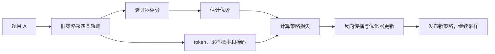

# 强化学习：PPO与GRPO及DAPO

> **核心结论**：先给模型生成的尝试评分，再计算“比基准好多少”的优势，最后用优势调整已采 token 的生成概率。PPO 常用价值网络和 GAE 估计优势，GRPO 改用同题多次尝试的组内比较，DAPO 进一步调整裁剪、有效组采样、token 权重和超长反馈。理解这条主线所需的机制、手算与数值推导集中在本篇。

阅读建议：第一次按第 1 至 5 节走完一次更新，需要检查探索约束或极端概率时，再读第 6、7 节。第 8 节把原理映射到 PSRL 配置与源码。

证据范围：教学数字与公式用于解释机制。2026-11-16 回读本地分组、TITO、奖励组装、优势计算、概率重算和 Science 公共启动脚本，没有启动训练。历史 Qwen2.5 demo、外部 veRL 摘录与现行配置分别标注，外部依赖版本应以运行时导入来源为准。

## 目录

- [1. 从评分到更新的完整链路](#1-从评分到更新的完整链路)
  - [RLVR 与 RLHF：奖励从哪里来](#rlvr-与-rlhf奖励从哪里来)
  - [同题四次回答贯穿全文](#同题四次回答贯穿全文)
  - [奖励为什么能训练生成命令的模型](#奖励为什么能训练生成命令的模型)
- [2. PPO：优势估计与裁剪更新](#2-ppo优势估计与裁剪更新)
  - [价值网络提供比较基准](#价值网络提供比较基准)
  - [GAE 怎样把后续奖励传给早先动作](#gae-怎样把后续奖励传给早先动作)
  - [用三步奖励手算 GAE](#用三步奖励手算-gae)
  - [概率比与 PPO 裁剪](#概率比与-ppo-裁剪)
- [3. GRPO：用同题回答互相比较](#3-grpo用同题回答互相比较)
  - [组内优势怎样计算](#组内优势怎样计算)
  - [采样量与训练批量怎样对应](#采样量与训练批量怎样对应)
  - [PSRL 怎样保存分组身份](#psrl-怎样保存分组身份)
- [4. DAPO：四项机制怎样配合](#4-dapo四项机制怎样配合)
  - [Clip-Higher：放宽正优势方向的裁剪](#clip-higher放宽正优势方向的裁剪)
  - [Dynamic Sampling：过滤并补采有效组](#dynamic-sampling过滤并补采有效组)
  - [Token-level Loss：按有效 token 聚合](#token-level-loss按有效-token-聚合)
  - [Overlong Reward Shaping：长度反馈](#overlong-reward-shaping长度反馈)
  - [PPO、GRPO、DAPO 对照](#ppogrpodapo-对照)
- [5. 一条多轮轨迹怎样变成训练损失](#5-一条多轮轨迹怎样变成训练损失)
  - [token、掩码与奖励各提供什么](#token掩码与奖励各提供什么)
  - [生成概率、训练锚点和当前概率](#生成概率训练锚点和当前概率)
  - [rollout correction 与版本滞后](#rollout-correction-与版本滞后)
  - [把四条回答走完一次更新](#把四条回答走完一次更新)
- [6. 熵与 KL：探索和参考模型约束](#6-熵与-kl探索和参考模型约束)
  - [熵项与稳定 softmax](#熵项与稳定-softmax)
  - [KL 估计量与采样条件](#kl-估计量与采样条件)
  - [k3 的控制变量推导](#k3-的控制变量推导)
  - [k3+ 的前向数值与反向梯度](#k3-的前向数值与反向梯度)
  - [KL 加在奖励里与加在 loss 里](#kl-加在奖励里与加在-loss-里)
- [7. 深入理解裁剪与共享参数](#7-深入理解裁剪与共享参数)
  - [log prob 怎样变成有限的概率比](#log-prob-怎样变成有限的概率比)
  - [Dual-Clip 怎样保护负优势分支](#dual-clip-怎样保护负优势分支)
  - [共享参数为什么会改变单个样本的概率方向](#共享参数为什么会改变单个样本的概率方向)
  - [正优势与极小概率比的取舍](#正优势与极小概率比的取舍)
- [8. 配置、源码与适用范围](#8-配置源码与适用范围)
  - [当前入口怎样对应原理](#当前入口怎样对应原理)
  - [历史 DAPO demo 与现行配方](#历史-dapo-demo-与现行配方)
  - [后续查系统或故障时读什么](#后续查系统或故障时读什么)

## 1. 从评分到更新的完整链路

### RLVR 与 RLHF：奖励从哪里来

RLVR 是使用可验证奖励的强化学习。它用答案校验、测试程序或隐藏数据集评测提供奖励，适合有明确验收标准的任务。RLHF 使用人类反馈，常见做法是先从偏好标注训练奖励模型，再由奖励模型评分。它们描述反馈来源，PPO、GRPO、DAPO 则描述怎样利用反馈更新策略。

例如代码题有 10 个测试，通过 8 个可以按配方给 0.8 分，也可以要求全部通过才给 1 分。评分规则决定奖励的含义。只覆盖正数的测试可能漏掉负数错误，模型还可能利用规则漏洞得高分，这叫 reward hacking。因此应交代测试覆盖、隐藏依据和修改权限。

### 同题四次回答贯穿全文

下面统一使用教学例子：题目 A 是“3 盒铅笔，每盒 4 支，一共有多少支？”，验证器检查答案是否为 12。

<!-- figure:group-relative-advantages -->
这张图沿同一个场景解释：同一道题的多次尝试，怎样变成鼓励或抑制某条回答的信号？

[](../_static/img/document-figures/group-relative-advantages.png)

[](../_static/img/document-figures/group-relative-advantages.png)

教学组含四条回答，奖励为 1、1、0、0，使用总体标准差，暂不考虑额外稳定项。 组内优势表达相对好坏。全零策略梯度可能来自相同反馈，不自动说明程序崩溃。 教学简化。分组、标准化、稳定项与同奖励过滤以实际算法配置为准。 [查看矢量图](../_static/img/document-figures/group-relative-advantages.svg)。
<!-- /figure:group-relative-advantages -->

| 尝试 | 最终答案 | 奖励 $R_i$ |
|---|---:|---:|
| A1 | 12 | 1 |
| A2 | 12 | 1 |
| A3 | 7 | 0 |
| A4 | 10 | 0 |

同一道题的四次尝试构成一个 group（组）。一次尝试可以只有一段回答，也可以包含“生成命令 → 工具执行 → 再生成”的完整多轮 trajectory（轨迹）。



这是算法教学图。PSRL 对应入口集中在[第 8 节源码表](#当前入口怎样对应原理)，组件并发与权重同步另见[训推协作](推理与训练/03-训推协作_异步流水线与版本协调.md)。

### 奖励为什么能训练生成命令的模型

<!-- chapter-figure:chapter-ppo-credit -->
判题奖励、优势、概率比和裁剪，各解决一步，不要混成同一个数字。

[](../_static/img/document-figures/chapter-ppo-credit.png)

图先交代奖励怎样给生成动作提供方向。后文继续用同题四次回答手算优势与更新；具体PPO、GRPO差异以下面推导为准。 [放大查看 SVG](../_static/img/document-figures/chapter-ppo-credit.svg)。
<!-- /chapter-figure:chapter-ppo-credit -->


策略 $\pi_\theta$ 表示模型在当前上下文 $s$ 中生成动作 $a$ 的概率。给一条已采轨迹一个优势 $A$ 后，最基本的策略梯度信号是：

$$
\nabla_\theta J \approx
A\sum_{t:\,m_t=1}\nabla_\theta\log\pi_\theta(a_t\mid s_t).
$$

$m_t$ 表示该位置是否属于要训练的模型输出。正优势倾向提高已采动作的概率，负优势倾向降低它。优势和奖励在这次更新中作为已算好的数值使用，梯度沿模型的对数概率回传。

因此验证器可以执行测试、加载 checkpoint 或调用环境。外部执行只需返回分数。以 MLGym 为例，Agent 生成训练命令，任务内模型训练并提交权重，验证器评分后，用 Agent 的 token 轨迹更新 Agent 策略。任务内模型与 Agent 的两层训练，见[MLGym 完整例子](../env-worker-deep-dive/knowledge/03-任务接入/04-MLGym与SWE及Serve_任务协议与评分训练.md#权重如何评分探索轨迹如何训练-agent)。

## 2. PPO：优势估计与裁剪更新

### 价值网络提供比较基准

PPO 是近端策略优化。常见 actor-critic 配方由 actor 生成动作，critic 预测当前状态后面还能得到多少奖励，记为价值函数 $V(s)$。优势比较实际结果与这一预测，让模型区分“题本来容易”和“这次确实做得更好”。

最简单的完整回报例子：critic 预测价值 0.3，实际得到 1 分，优势为 $1-0.3=0.7$。critic 另用回报或价值目标训练，逐渐改善预测。语言模型 PPO 通常对每个生成位置估计优势，而非把这个简化差值无条件用在所有位置。

PPO 的裁剪目标可以配合不同优势估计方法。这里先解释常用的 GAE，再解释共同使用的概率比与裁剪。

### GAE 怎样把后续奖励传给早先动作

GAE 是广义优势估计，把后续各步的 TD 残差按距离衰减后相加。TD 残差表示“收到这一步反馈后，价值预测需要修正多少”：

$$
\delta_t=r_t+\gamma V(s_{t+1})-V(s_t).
$$

$r_t$ 是本步奖励，$\gamma$ 折扣未来奖励。前两项合起来是“眼前奖励 + 对后续奖励的新预测”，再减去原预测。用后续状态的价值预测接续未来，称为 bootstrap。

对一条在 $T$ 真正终止的轨迹：

$$
\hat A_t=\sum_{l=0}^{T-1-t}(\gamma\lambda)^l\delta_{t+l},
\qquad
\hat A_t=\delta_t+\gamma\lambda\hat A_{t+1}.
$$

| $\lambda$ | 用到的反馈 | 取舍 |
|---|---|---|
| 0 | 只用当前 TD 残差 | 更依赖下一状态价值预测 |
| 0 到 1 之间 | 逐步衰减的后续残差 | 折中预测误差和采样波动 |
| 1 | 完整终止轨迹中得到折扣回报减当前价值 | 更充分使用实际采到的后续结果 |

较小 $\lambda$ 通常减少远处采样波动，同时增加对中间价值预测的依赖。实际偏差与方差还受价值预测质量、奖励相关性和截断方式影响。$\gamma$ 定义奖励的折扣，$\lambda$ 控制估计参考反馈的距离，两者作用不同。

### 用三步奖励手算 GAE

设 $\gamma=1$，三个动作后任务真正结束，终止状态价值为 0。

| 时刻 | $r_t$ | $V(s_t)$ | $V(s_{t+1})$ | $\delta_t$ |
|---|---:|---:|---:|---:|
| 0 | 0 | 2 | 2 | 0 |
| 1 | 0 | 2 | 1 | -1 |
| 2 | 3 | 1 | 0 | 2 |

第一个动作的优势：

- $\lambda=0$：$\hat A_0=0$。
- $\lambda=0.5$：$\hat A_0=0+0.5(-1)+0.25(2)=0$。
- $\lambda=1$：$\hat A_0=0-1+2=1$，也等于总奖励 $3$ 减原预测 $2$。

这个例子展示最终反馈怎样影响早先动作。比较方差还需要重复采样多条轨迹。实现时要区分真正终止和时间限制导致的截断：前者后续回报为 0，后者可能仍需边界价值接续。

### 概率比与 PPO 裁剪

采到一批数据后，固定旧策略 $\pi_{\mathrm{old}}$ 作为本批更新的锚点，比较当前策略对同一个已采 token 的概率：

<!-- figure:ppo-clipped-objective -->
这张图沿同一个场景解释：PPO 的裁剪到底在哪一边停止奖励继续变化？

[](../_static/img/document-figures/ppo-clipped-objective.png)

[](../_static/img/document-figures/ppo-clipped-objective.png)

[](../_static/img/document-figures/ppo-clipped-objective.png)

教学条件：概率比 r，优势 A，裁剪区间 [0.8, 1.2]，图画待最大化的单项目标。 目标是 min(rA, clip(r)A)。乘上负优势后大小关系反向，不能只把 r 截断来理解。 只画策略项。实际最小化损失时有负号，还可能包含熵、KL、mask 与其他项。 [查看矢量图](../_static/img/document-figures/ppo-clipped-objective.svg)。
<!-- /figure:ppo-clipped-objective -->

$$
\rho_t(\theta)=
\frac{\pi_\theta(a_t\mid s_t)}
{\pi_{\mathrm{old}}(a_t\mid s_t)}
=\exp(\log\pi_\theta-\log\pi_{\mathrm{old}}).
$$

最大化的 PPO 目标为：

$$
J_t=\min\left(
\rho_t\hat A_t,\,
\operatorname{clip}(\rho_t,1-\epsilon,1+\epsilon)\hat A_t
\right).
$$

训练程序通常最小化 $\ell_t=-J_t$。设 $\epsilon=0.2$：

| 优势 | 概率比 | 未裁剪目标 $\rho A$ | 裁剪分支 | 最终目标 |
|---|---:|---:|---:|---:|
| $A=+1$ | 1.1 | 1.1 | 1.1 | 1.1 |
| $A=+1$ | 1.5 | 1.5 | 1.2 | 1.2 |
| $A=-1$ | 0.5 | -0.5 | -0.8 | -0.8 |
| $A=-1$ | 1.5 | -1.5 | -1.2 | -1.5 |

正优势时，提高概率比超过上界不再提高这一项收益。负优势时，降低概率比越过下界不再提高这一项收益。这样限制的是损失对继续移动的激励。实际概率由所有样本的共享参数更新共同决定，深入算例见[第 7 节](#7-深入理解裁剪与共享参数)。

## 3. GRPO：用同题回答互相比较

### 组内优势怎样计算

GRPO 是组相对策略优化，用同一题多条回答的奖励构造基准，省去独立 critic。常见形式为：

$$
\bar R=\frac1G\sum_{i=1}^G R_i,\qquad
\hat A_i=\frac{R_i-\bar R}{\operatorname{std}(R_1,\ldots,R_G)+\varepsilon}.
$$

在题目 A 的 $[1,1,0,0]$ 中，均值为 0.5，减均值得到 $[0.5,0.5,-0.5,-0.5]$。教学上按总体标准差 0.5 归一化，则得到 $[1,1,-1,-1]$。实际实现的标准差约定与归一化开关会改变尺度。

有的配方只减均值，例如现行 Science 公共脚本关闭标准差归一化。无论哪种，A1、A2 得正优势，A3、A4 得负优势。结果奖励场景通常将同一条尝试的优势广播给其有效模型 token。

同样得到 1 分，若全组都是 1，减均值后全为 0。对于标准多样本组，这部分相对奖励策略梯度没有区分信号，KL 或熵等附加项仍按配置生效。单样本组的特殊约定见[源码与配置范围](#当前入口怎样对应原理)。

### 采样量与训练批量怎样对应

假设训练需要两个有效组，每组四条回答：

| 题目 | 四条奖励 | 组内相对信号 |
|---|---|---|
| A | 1、1、0、0 | 有正有负 |
| B | 0、0、0、0 | 全为 0 |
| 补采的 C | 1、0、1、0 | 有正有负 |

普通 GRPO 可以消费 A、B 共 8 条。若启用 DAPO 零方差组过滤，B 被丢弃，再补采 C，最终训练仍用 A、C 共 8 条，实际已生成 12 条。补采应有时间、样本数和重试预算。

计算组内优势需要整组奖励。优势固定后，前向和反向可以按显存拆成 micro-batch。算法的信息依赖、流水线要求的分组对齐，以及一次 GPU 计算多大批次，需要分别理解。

PSRL 常见批量字段：

- $B=$ `data.train_batch_size` 是训练问题数，脚本也称 `train_prompt_bsz`。
- $G=$ `gen_actor_rollout_ref.rollout.n` 是每题采样数，名义轨迹量为 $B\times G$。
- `ppo_mini_batch_size` 控制训练批次划分，micro-batch 和 token 预算控制每次前反向的规模。

例如 $B=16,G=4$ 对应名义 64 条尝试，过滤、冗余生成和多输出轨迹会影响实际计数。`training/global_step` 表示训练主循环进度，一轮内部可能有多个优化器更新，也可能通过梯度累积完成一次更新。配置语义继续见[批量说明](psrl-run-guide/01-PSRL运行_准备启动与监控.md#train_prompt_bsz-对应哪个配置是什么意思)。

### PSRL 怎样保存分组身份

每条尝试用 `uid` 标识，同题多条尝试共享 `parent_id`。以题目编号 3、每题 4 次为例：

| `request_idx` | `uid = prompt_id × rollout_n + request_idx` | `parent_id` |
|---:|---:|---:|
| 0 | 12 | 3 |
| 1 | 13 | 3 |
| 2 | 14 | 3 |
| 3 | 15 | 3 |

这些请求可以独立异步生成，由不同推理副本处理，完成时间也可以不同。因此日志会出现相同 prompt 的多个轨迹文件。优势计算按组标识汇总，生成调度无需同时完成全部成员。

当前 [Manager](../../psrl/workers/agent_loop/manager.py#L1381)构造标签，[worker](../../psrl/workers/agent_loop/worker.py#L574)在单次采样输入只含 `uid` 时补齐 `parent_id`。一个 AgentLoop 若产生多段输出，[多轨迹优势入口](../../psrl/trainer/ppo/utils.py#L292)先选每个请求对应的最终输出进行组内比较，再把优势传播到该请求的其他输出，避免把同一次尝试的多个片段算成多次独立采样。

## 4. DAPO：四项机制怎样配合

DAPO 是解耦裁剪与动态采样策略优化。沿用组内相对优势的主线，分别处理更新范围、有效样本、token 权重与长度反馈。实现中这些选项可以分别配置，配方名称还需要与实际开关一起看。

### Clip-Higher：放宽正优势方向的裁剪

将 PPO 对称区间改成：

$$
[1-\epsilon_{\mathrm{low}},\,1+\epsilon_{\mathrm{high}}],
\qquad \epsilon_{\mathrm{high}}>\epsilon_{\mathrm{low}}.
$$

例如 low=0.2、high=0.3，区间为 $[0.8,1.3]$。若一个正优势 token 的旧概率为 0.01，当前概率为 0.0125，概率比为 1.25。对称 0.2 的目标已进入常数分支，high=0.3 则仍有提高该项收益的空间。

放宽上界有助于给低概率但有用的动作更多提升空间，探索是否改善还受数据和其他配置影响。Dual-Clip 是另一个针对负优势极端概率比的机制，详见[第 7 节](#dual-clip-怎样保护负优势分支)。

### Dynamic Sampling：过滤并补采有效组

按评分指标检查同题组的奖励差异，过滤缺少相对信号的组，再补采到目标有效批量。上文 A、B、C 的 12 条生成、8 条训练，就是完整例子。

PSRL 提供[组过滤器](../../psrl/utils/post_processor/group_post_process/filter.py#L28)和[缓冲区过滤器](../../psrl/utils/post_processor/buffer_post_process/filter.py#L32)，需结合实际启用入口检查。单样本处理细节也随路径不同。只设置 `name=dynamic_sampling_filter`，还需要对应 `enable` 开关生效。

冗余采样预备额外轨迹、降低等待，动态采样按奖励差异过滤，二者选择数据的条件不同。

### Token-level Loss：按有效 token 聚合

先对每条回答内平均，再对回答平均，会使长短回答获得相同总权重。DAPO 的 token-level 聚合将整批有效 token 的损失相加，再除以有效 token 数：

<!-- figure:token-loss-weighting -->
这张图沿同一个场景解释：两条长短不同的回答，先按回答平均和按全部 token 平均有何不同？

[](../_static/img/document-figures/token-loss-weighting.png)

[](../_static/img/document-figures/token-loss-weighting.png)

教学条件：短回答有 2 个有效 token，长回答有 6 个，只有 mask 有效位置参与。 聚合方式改变不同长度样本的总权重。看见 mean 还需确认在哪个维度、使用什么分母。 权重算例，不替代具体损失配置。轨迹截断、mask 和组归一化还会改变有效贡献。 [查看矢量图](../_static/img/document-figures/token-loss-weighting.svg)。
<!-- /figure:token-loss-weighting -->

$$
L_{\mathrm{token}}=
\frac{\sum_i\sum_t m_{i,t}\ell_{i,t}}
{\sum_i\sum_t m_{i,t}}.
$$

沿用图中短回答2个、长回答6个有效token。先条内再条间平均时，短回答每个token的权重为 $1/4$，长回答每个为 $1/12$。统一token平均时，每个权重均为 $1/8$，长回答总权重由 $1/2$ 变成 $6/8$。这里调整的是训练目标中不同长度轨迹的权重。

分布式与梯度累积实现还要保证分母覆盖正确批次，不能简单把多个不同 token 数微批的均值等权平均。

### Overlong Reward Shaping：长度反馈

超长响应软惩罚在接近上限时逐步扣分，避免把长度问题全部混为固定任务失败。PSRL 的 [DAPO reward loop](../../psrl/workers/reward/reward_loop/dapo.py#L98)使用：

$$
R_{\mathrm{length}}
=\min\left(-\frac{L-(L_{\max}-L_{\mathrm{buffer}})}
{L_{\mathrm{buffer}}}\,c,\,0\right).
$$

假设硬上限 4096、缓冲长度 2048、惩罚系数 $c=1$：

| 有效响应长度 | 长度项 |
|---:|---:|
| 1024 | 0 |
| 2048 | 0 |
| 3072 | -0.5 |
| 4096 | -1 |

长度项加到任务分数上。截断轨迹是否参与训练还由过滤配置决定，论文配方中的超长样本处理应结合这些选项看。当前 Science 公共脚本关闭此软惩罚，见[配置对照](#历史-dapo-demo-与现行配方)。

### PPO、GRPO、DAPO 对照

| 问题 | 常见 PPO 配方 | 原始 GRPO 主线 | DAPO 主线 |
|---|---|---|---|
| 优势基准 | critic，常配 GAE | 同题组内奖励统计 | 同题组内相对优势 |
| 是否要求同题多采样 | 算法无此要求 | 需要组内比较信息 | 需要有效组 |
| 更新目标 | PPO clipped objective | 沿用裁剪策略目标 | 分开设置上下裁剪边界 |
| 损失聚合 | 按配方决定 | 原论文先条内再条间平均 | 按有效 token 统一聚合 |
| 采样处理 | 按配方决定 | 基础组内比较 | 动态过滤与补采 |
| 长度处理 | 按配方决定 | 按配方决定 | 超长过滤与软长度反馈 |

这些列描述典型算法主线，项目可以组合其中的组件。例如使用 GRPO 优势和非对称裁剪，同时关闭动态组过滤。

## 5. 一条多轮轨迹怎样变成训练损失

### token、掩码与奖励各提供什么

沿一次代码任务，模型先生成“运行测试”，工具回传“测试失败”，模型再生成修复命令。训练需要保存实际 token，以及哪些 token 来自模型：

| 片段 | 作为后续上下文 | `response_mask` | 直接计算生成策略损失 |
|---|---|---:|---|
| 初始任务 prompt | 是 | 单独保存 | 否 |
| 模型的测试命令 | 是 | 1 | 是 |
| 工具返回的失败日志 | 是 | 0 | 否 |
| 模型的修复命令 | 是 | 1 | 是 |

工具输出仍影响后续预测。mask=0 表示不把该位置的文本当作模型这次选择的动作来计算策略损失。

当前 [TITO 数据构造](../../psrl/utils/tito/training_data.py#L42)保留 prompt、模型与环境 token 的边界。教学简化片段如下，省略边界修剪和对齐校验：

```python
all_response_ids.extend(env_ids)
all_response_mask.extend([0] * len(env_ids))
all_response_ids.extend(output_ids)
all_response_mask.extend([1] * len(output_ids))
```

token id 提供“模型实际选了哪个动作”，mask 提供“哪些位置训练”，奖励和优势提供“朝哪个方向训练”。[Reward Manager](../../psrl/workers/reward/reward_manager.py#L353)把结果奖励写入 `rm_scores` 张量末列，其他位置为 0。GRPO 按行求和取结果分数，再广播组内优势。张量末列与最后有效 token 的关系需结合布局和 padding 理解。

### 生成概率、训练锚点和当前概率

训练对已经生成的序列做 teacher forcing：给定实际历史 token，一次并行前向计算各位置的预测概率，随后取实际已采 token 的 log prob。三类概率分别是：

| 字段 | 来源 | 用途 |
|---|---|---|
| `rollout_log_probs` | 生成引擎采样时记录 | 描述行为策略给已采 token 的概率 |
| `old_log_probs` | 本批更新前固定的锚点，按分支重算或复用采样值 | PPO 比值的分母 |
| 当前 `log_prob` | actor 更新时的前向 | PPO 比值的分子，参与求导 |

重算路径让训练锚点和更新中的策略使用相同训练计算路径。生成与训练引擎可能有数值差异，异步采样还可能来自更早权重版本。当前 [_compute_old_log_prob](../../psrl/trainer/ppo/ray_trainer.py#L3117)也支持 bypass 分支复用采样概率，并配套相应损失与修正设置。

### rollout correction 与版本滞后

重算路径可用采样修正权重补偿行为分布与训练锚点的差异。历史 veRL 的逐 token 截断形式为：

$$
w_t=\min\left(
\exp\big(\operatorname{clip}(
\log\pi_{\mathrm{old}}-\log\pi_{\mathrm{rollout}},-B,B)\big),
\tau\right).
$$

例如采样时概率为 0.2，锚点概率为 0.3，则 $w_t=1.5$。若上限 $\tau=2$，原始比值为 3 时用 2。随后先乘 token 策略损失，再按 mask 聚合。

完整重要性采样恒等式要求采样分布覆盖目标动作。截断权重和逐 token 修正有各自近似条件，不能据此保证任意陈旧轨迹都适合训练。

三个控制分别解决不同问题：

| 控制 | 作用对象 | 例子 |
|---|---|---|
| staleness，版本滞后上限 | 允许消费的样本版本 | 训练版本 12，是否接收版本 10 的轨迹 |
| PPO clip | 当前策略相对固定锚点的目标激励 | 正优势 ratio 超过 1.2 后截住该项收益 |
| rollout correction | 行为策略与训练锚点的概率差异 | 用 0.3/0.2 重新加权 |

版本数不能直接换算为分布距离。系统怎样约束版本和消费样本，见[训推协作](推理与训练/03-训推协作_异步流水线与版本协调.md#概率比值版本滞后与修正分别做什么)。

### 把四条回答走完一次更新

回到题目 A，使用只减均值的组内优势，暂不加熵、KL 或采样修正：

1. 旧策略生成四条回答，评分为 $[1,1,0,0]$。
2. 保存每条实际 token、mask 与采样 log prob，计算本批固定锚点。
3. 减组均值得到 $[0.5,0.5,-0.5,-0.5]$，广播到各自有效 token。
4. 更新前当前策略与锚点一致，概率比均为 1。A1、A2 的模型 token 获得鼓励方向，A3、A4 获得抑制方向。
5. 后续更新若 A1 某 token 的 ratio=1.4，采用 low=0.2、high=0.3 时，其目标为 $\min(1.4\times0.5,1.3\times0.5)=0.65$。
6. 对全部有效 token 聚合负目标，反向传播，优化器更新，再发布新权重继续采样。

一个容易误读的细节：第一次前向中正负项可能恰好相消，显示策略 loss=0，但梯度仍可能非零，因为不同 token 的对数概率导数不同。反过来，执行优化器也不自动意味着策略已提升，需要另看有效信号、梯度和任务评测。

## 6. 熵与 KL：探索和参考模型约束

### 熵项与稳定 softmax

加入可选约束后的 actor 损失可写为：

$$
L_{\mathrm{actor}}=L_{\mathrm{PG}}
-\beta_H H(\pi_\theta)
+\beta_{\mathrm{KL}}D_{\mathrm{KL}}(\pi_\theta\Vert\pi_{\mathrm{ref}}).
$$

熵描述同一上下文下下一 token 分布的不确定性：

$$
H=-\sum_v p_v\log p_v.
$$

两种 token 概率为 $[0.5,0.5]$ 时，熵约 0.693 nat。为 $[0.99,0.01]$ 时约 0.056。最小化损失中减去熵，会鼓励保留更多分布多样性，任务效果仍要看奖励与评测。日志报告熵和实际开启熵正则是两个配置问题。

数值实现常用 logits $z$ 的等价表达：

$$
\log p_v=z_v-\operatorname{logsumexp}(z),\qquad
H=\operatorname{logsumexp}(z)-\sum_v p_vz_v.
$$

其中 $\operatorname{logsumexp}(z)=m+\log\sum_v e^{z_v-m}$，$m=\max_vz_v$。减最大值避免直接指数溢出，表达式也避免先把极小概率舍入成 0 再取 log。历史 veRL 摘录：

```python
pd = torch.nn.functional.softmax(logits, dim=-1)
entropy = torch.logsumexp(logits, dim=-1) - torch.sum(pd * logits, dim=-1)
```

这里 logits 来自最终 hidden state 经 LM head 的词表投影，生成时逐步解码，训练重算时可整段并行。它们与注意力内部的 Query 向量处在不同计算环节。

### KL 估计量与采样条件

参考策略 $\pi_{\mathrm{ref}}$ 通常冻结，用 KL 散度衡量当前分布相对它的偏离：

$$
D_{\mathrm{KL}}(\pi\Vert\pi_{\mathrm{ref}})
=\sum_a\pi(a)\log\frac{\pi(a)}{\pi_{\mathrm{ref}}(a)}.
$$

它与 PPO 锚点不同：锚点随本批数据和更新阶段确定，参考策略用于较长期的分布约束。精确求和需要完整词表概率，实际常用采到的 token 估计。

设 $d=\log\pi(a)-\log\pi_{\mathrm{ref}}(a)$，以下无偏性讨论假设 $a\sim\pi$，且分布有共同支持。旧策略采样、数值截断和反向传播代理需要分别分析：

| 名称 | 单样本值 | 性质 |
|---|---|---|
| k1 | $d$ | 对上述 KL 无偏，单样本可为负 |
| abs | $\lvert d\rvert$ | 一种偏差度量，通常不等于 KL |
| k2 | $\frac12d^2$ | 非负，接近分布时是二阶近似，通常有偏 |
| k3 | $e^{-d}+d-1$ | 未截断时对上述 KL 无偏，逐样本非负 |
| full | 全词表求和 | 精确分布 KL，需额外数据与计算 |

历史 veRL 摘录的 `full` 分支未实现。此处保留原知识记录，不据此断言任意现装版本的能力。k3 在分布接近时可消除 k1 的一阶波动，任意分布下的方差仍取决于概率比。

### k3 的控制变量推导

令 $u(a)=\pi_{\mathrm{ref}}(a)/\pi(a)$，则 $k_1=-\log u$。构造零均值控制变量：

$$
\mathbb E_{a\sim\pi}[u-1]
=\sum_a\pi(a)\frac{\pi_{\mathrm{ref}}(a)}{\pi(a)}-1=0.
$$

加上它不会改变期望：

$$
k_3=-\log u+(u-1),\qquad
\mathbb E_\pi[k_3]=D_{\mathrm{KL}}(\pi\Vert\pi_{\mathrm{ref}}).
$$

非负性来自 $\log u\le u-1$。也可令 $f(u)=u-1-\log u$，有 $f'(u)=1-1/u$、$f''(u)=1/u^2>0$，最小值在 $u=1$，恰为 0。

为什么接近分布时能减少波动？令 $u=1+\eta$：

$$
k_1=-\eta+\frac12\eta^2+\cdots,\qquad
k_3=\frac12\eta^2-\frac13\eta^3+\cdots.
$$

k1 含一阶波动，k3 用零均值项消掉这一阶，保留与近邻 KL 同阶的二阶项。k2 也从 $\eta^2/2$ 起步，但没有相同的全局无偏恒等式。

例如 $u=2$ 时，k1=$-\log2\approx-0.693$，k3=$2-1-\log2\approx0.307$。单样本 k1 为负与整个分布的 KL 非负可以同时成立。

历史实现先把 $\log u$ clamp 到 $[-20,20]$，再将 k3 截到上限 10。截断可以控制极端值，但改变了理论估计量，不能再直接沿用未截断无偏性的结论。

### k3+ 的前向数值与反向梯度

历史 veRL 的 `k3+` 可使用以下 straight-through（直通）组合：

```python
backward_score = 0.5 * (logprob - ref_logprob).square()
return backward_score - backward_score.detach() + forward_score.detach()
```

前向时前两项相消，数值等于 `forward_score` 的 k3。反向时 detach 项不传梯度，只有 k2 的 `backward_score` 产生导数。

这让前向数值与反向代理可以分别选择。一个估计量的期望正确，并不自动保证把采样动作固定后直接求导就得到完整期望目标的梯度。梯度性质还取决于采样分布、是否包含分布变化项及具体目标。

### KL 加在奖励里与加在 loss 里

项目可以在计算优势前对逐 token 奖励扣除 KL 项，也可以在 actor loss 中直接加入 KL 正则。两条路径影响学习信号的方式不同，应分别核对开关，避免无意重复加重约束。

历史 `AdaptiveKLController` 的比例反馈为：

```python
proportional_error = np.clip(current_kl / target_kl - 1, -0.2, 0.2)
mult = 1 + proportional_error * n_steps / horizon
self.value *= mult
```

当前 KL 超过目标时，下一阶段惩罚系数增大，反之减小。例如当前 KL 是目标的 1.5 倍，误差先截为 0.2，若 `n_steps/horizon=0.1`，系数乘以 1.02。它调节惩罚强度，实际稳定性还受采样噪声与更新延迟影响。

## 7. 深入理解裁剪与共享参数

### log prob 怎样变成有限的概率比

用 $\rho=\exp(\log\pi_\theta-\log\pi_{\mathrm{old}})$ 计算比值，避免分别计算极小概率再相除。历史实现还对 log 比值 clamp 到 $[-20,20]$，再取 exp，限制极端输入导致的溢出。

$e^{20}\approx4.85\times10^8$，仍是非常大的比值。这个数值防护与 PPO 的目标裁剪承担不同作用。超出数值范围的截断会改变目标与梯度，也不能保证后续所有运算都有限。

### Dual-Clip 怎样保护负优势分支

将最大化目标改写为最小化损失：

```python
loss_raw = -advantage * ratio
loss_clipped = -advantage * clamp(ratio, 1 - low, 1 + high)
loss_ppo = max(loss_raw, loss_clipped)
loss_dual = min(-advantage * c, loss_ppo)
loss = loss_dual if advantage < 0 else loss_ppo
```

这是教学伪代码，对应历史 Dual-Clip 实现，`c>1`，当时示例配置使用 3。设 $A=-1$、low=high=0.2：

| ratio | 原损失 | clip 分支 | 标准 PPO 损失 | Dual-Clip，$c=3$ |
|---:|---:|---:|---:|---:|
| 0.01 | 0.01 | 0.8 | 0.8 | 0.8 |
| 1 | 1 | 1 | 1 | 1 |
| 5 | 5 | 1.2 | 5 | 3 |

负优势且 ratio 很小时，标准 PPO 已有常数分支。负优势且 ratio 很大时，标准损失随 ratio 增长，Dual-Clip 用 $|A|c$ 封住这一项。历史报告的梯度尖峰是否经过此路径，需看实际 token 的 ratio、优势与分支，单凭曲线无法确定。

### 共享参数为什么会改变单个样本的概率方向

固定旧概率与优势，对未裁剪的损失有：

$$
\nabla_\theta(-A\rho)
=-A\rho\,\nabla_\theta\log\pi_\theta(a\mid s).
$$

来源是 $\nabla\rho=\rho\nabla\log\pi_\theta$。单看负优势项，梯度下降会倾向降低该动作的概率。一次真实更新还会合并其他位置的梯度。

用三 token 词表 $\{A,B,C\}$、二维 hidden state 和可训练 LM head 手算。初始所有权重为 0，各 token 概率为 $1/3$，只训练 LM head，固定 hidden state：

| 位置 | hidden state | 已采 token | 优势 |
|---|---|---|---:|
| ① | $h_1=(1,0)$ | A | -1 |
| ② | $h_2=(0.9,0.1)$ | A | +2 |

第一次更新 ratio=1。softmax 有：

$$
\frac{\partial\log\pi(a)}{\partial z_v}
=\mathbf1[v=a]-\pi(v),\qquad
\frac{\partial\log\pi(a)}{\partial w_v}
=(\mathbf1[v=a]-\pi(v))h.
$$

因此对 $w_A$：

$$
\nabla\ell_1=(2/3,0),\qquad
\nabla\ell_2=(-1.2,-0.1333),\qquad
\nabla(\ell_1+\ell_2)=(-0.5333,-0.1333).
$$

取学习率 $\alpha$，梯度下降使 $w_A$ 增加 $\alpha(0.5333,0.1333)$，于是位置①的 A logit 增加 $0.5333\alpha$。

还要看其他词表行：本例 $w_B,w_C$ 各变化 $\alpha(-0.2667,-0.0667)$，位置①的 B、C logit 均下降 $0.2667\alpha$。所以位置①的 A 概率确实增加。若 $\alpha=0.1$，新概率约为：

$$
\pi_{\mathrm{new}}(A\mid h_1)
=\frac{e^{0.05333}}{e^{0.05333}+2e^{-0.02667}}
\approx0.3513>1/3.
$$

位置②较强的正向信号通过共享参数影响位置①，压过它自己的负向信号。这个教学例子解释了为什么 clip 和单个优势方向无法保证每个位置最终概率的变化方向。

### 正优势与极小概率比的取舍

当 $A>0,\rho\to0$ 时，未裁剪损失 $-A\rho$ 以及对应梯度系数趋近 0。PPO 的选择分支仍可保留它，意味着已经极少采到的好动作可能难以恢复。

把目标换成一个常数裁剪分支，也会产生零梯度，因此仅靠换上下界无法凭空恢复学习信号。探索、参考约束、更新次数与目标设计需要一起考虑。对 ratio 加下限时也应检查截断区间的真实梯度。

## 8. 配置、源码与适用范围

### 当前入口怎样对应原理

下表为 2026-11-16 实际阅读的本地入口。策略损失、KL 和部分优势函数由外部 veRL 提供，不能把历史 `third_party/verl` 行号当成当前工作区路径。

| 问题 | 当前源码入口 | 读取的数据与结果 |
|---|---|---|
| 同题尝试怎样标识 | [Manager](../../psrl/workers/agent_loop/manager.py#L1381)、[worker](../../psrl/workers/agent_loop/worker.py#L574) | prompt、请求序号转为 uid、parent_id |
| 模型与工具 token 怎样区分 | [TITO](../../psrl/utils/tito/training_data.py#L42) | 交互记录转为 token、mask、log prob |
| 分数怎样放进张量 | [Reward Manager](../../psrl/workers/reward/reward_manager.py#L353) | 标量奖励转为 rm_scores |
| 长度项怎样计算 | [DAPO reward loop](../../psrl/workers/reward/reward_loop/dapo.py#L98) | 有效长度与缓冲配置转为额外奖励 |
| 是否丢弃同分组 | [组过滤](../../psrl/utils/post_processor/group_post_process/filter.py#L28)、[缓冲区过滤](../../psrl/utils/post_processor/buffer_post_process/filter.py#L32) | 分组指标转为保留或丢弃 |
| PPO 与 GRPO 怎样选择优势 | [优势分支](../../psrl/trainer/ppo/utils.py#L191) | GAE 使用 values，GRPO 使用 parent_id |
| 多段输出怎样避免重复计组 | [多轨迹优势](../../psrl/trainer/ppo/utils.py#L292) | 最终输出评分转为同一请求各段优势 |
| 重算与 bypass 怎样选择 | [概率分支](../../psrl/trainer/ppo/ray_trainer.py#L3117) | 采样值或训练前向转为固定锚点 |
| 采样修正何时加入 | [训练器](../../psrl/trainer/ppo/ray_trainer.py#L3011) | 奖励、概率和配置转为优势与修正权重 |

已有[组标识 CPU 回归](../../tests/agent_loop/test_training_group_metadata.py)覆盖单次与多次采样的载荷。此前记录的本地固定 veRL 对单样本组使用均值 0、标准差 1，使其优势约等于奖励，这是特定实现的便利分支。标准多样本 GRPO 的零方差结论按第 3 节理解。运行前仍应核对实际 veRL 来源，本次未重跑这些回归。

### 历史 DAPO demo 与现行配方

历史 `DAPO-Qwen2.5-3B-fsdp-singlenode-demo-staleness_3` 与 `fsdp_qwen2.5_3b_laps.sh` 的配置按原知识记录保存，后一个脚本已不在当前仓库。原记录核对到：

| 机制 | 历史记录 |
|---|---|
| Clip-Higher | low=0.2、high=0.28 |
| Dynamic Sampling | group 与 buffer 过滤均关闭，日志历史位置为 994、938 行 |
| 冗余采样 | 开启，alg_rollout_n=4、redundant_rollout_n=4、alg_global_batch_size=16 |
| token 聚合 | token-mean |
| 超长软惩罚 | 开启，最大长度 4096、缓冲 2048、系数 1，历史日志位置 1127 行 |
| 熵与 KL | laps 记录中 entropy_coeff=0、loss 与 reward 两条 KL 路径关闭 |
| 概率与修正 | laps 记录走重算，rollout_is=token，阈值 2 |

以上是历史配置摘录。本地当前 [Science 公共脚本](../../examples/sciaccel_rl/fsdp_qwen35_4b.sh#L147)使用 GRPO、每题 8 次采样、只减组均值、裁剪 0.2/0.3、token-mean。组过滤默认由 `GROUP_FILTER=False` 关闭，超长软惩罚、熵正则与 KL 路径也关闭，开启 token 采样修正。因此看到 reward manager 叫 `dapo`，仍需逐项看完整算法配置。

MLGym 入口如何调用公共脚本及映射任务奖励，见[MLGym 权重评分与 Agent 训练](../env-worker-deep-dive/knowledge/03-任务接入/04-MLGym与SWE及Serve_任务协议与评分训练.md#当前-mlgym-入口实际启用了什么)。脚本默认值、完整执行链路通过和学习效果改善是不同证据层次。

### 后续查系统或故障时读什么

本篇覆盖原理主线。以下文档用于各自独立的阅读任务：

- [PSRL 训推协作](推理与训练/03-训推协作_异步流水线与版本协调.md)：进程分工、样本缓冲、版本滞后与权重分发。
- [Agent Loop、Harbor 与 TITO](01-PSRL原理_AgentLoop与工具调用.md)：工具调用如何变成真实训练输入。
- [DAPO 历史退化诊断](05-训练排障_DAPO退化诊断.md)：奖励、长度、梯度、验证结果与效率指标怎样联合排查。
- [运行与批量配置](psrl-run-guide/01-PSRL运行_准备启动与监控.md#监控批量与排障)：实际脚本参数和日志字段。

进一步阅读原始资料：[GAE 论文](https://arxiv.org/abs/1506.02438)、[DAPO 论文](https://arxiv.org/abs/2503.14476)、[KL 估计量作者说明](https://joschu.net/blog/kl-approx.html)、[Dual-Clip 原始论文](https://arxiv.org/abs/1912.09729)。本文合并既有讲解并保留推导条件，未重新验证这些论文的性能结果。
