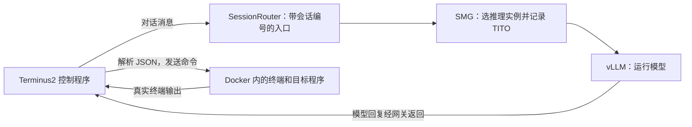
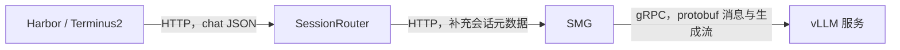

# PSRL rollout 阶段的"工具调用"：Agent Loop、Harbor、TITO 是怎么串起来的

第一次接触这套系统，可以先读 [第 7 节：用一个修代码例子从零理解](#7-用一个修代码例子从零理解)，再回看前面的实现细节。

## 一句话结论

在 sciaccel_rl 这类任务里，rollout 阶段模型确实会"调用工具"，但不是 OpenAI 风格的结构化 `tool_calls`，而是通过第三方 agent 框架 **Harbor**（独立 pip 包，非 psrl 自研代码），用**纯文本 JSON 协议**驱动一个跑在真实 Docker 容器里的终端（tmux session）；所谓"工具"本质上只有一个——一台真实终端，不是多个 function schema。psrl 自己不参与这套工具调用协议，只是通过自研的 **TITO（Token-In-Token-Out）** 机制在旁路逐轮记录模型真实吃进/吐出的 token，episode 结束后重建成标准 RL 训练样本。

## 整体架构

```
PSRL 训练主流程 (Ray Trainer)
  └─ N × PSRL_AgentLoopWorker (Ray actor, 每个跑一个 asyncio busy-loop)
        └─ 每条 prompt → asyncio.create_task 并发跑一个 agent loop 实例
              (agent_name="sciaccel" → SciAccelAgentLoop, 由 sciaccel_agent_config.yaml 注册)
                 │
                 │ 1. create_session() → SessionRouter (独立 FastAPI 服务进程)
                 │        └─ 转发给 SMG (rollout gateway, gRPC) 创建 TITO session
                 │
                 │ 2. 把 session_api_url("/sessions/{id}/v1") 作为 api_base
                 │    交给 Harbor: run_harbor_episode() → harbor.job.Job.create/run
                 │        │
                 │        ├─ 起 Docker Compose: agent 容器 + verifier 容器 (真实沙箱)
                 │        ├─ TruncatingTerminus2 驱动循环，通过环境接口操作容器内终端
                 │        │     for episode in range(max_turns):
                 │        │        prompt(上轮终端输出/任务说明)
                 │        │           → LiteLLM chat.chat() → HTTP POST api_base/chat/completions
                 │        │                → SessionRouter（注入路由头）→ SMG → vLLM 推理
                 │        │           ← 模型输出 JSON {analysis,plan,commands,task_complete}
                 │        │        解析 commands → tmux.send_keys() 真实执行 shell 命令（容器内）
                 │        │        终端输出 → _limit_output_length(截断,4096B) → 作为下一轮 prompt 拼回
                 │        │        (task_complete 连续两次为 true，或到 max_turns/超时 → 结束)
                 │        └─ verifier 容器对任务结果打分 → reward dict
                 │
                 │ 3. SMG 在整个过程中通过 gRPC chat pipeline 增量记录 TITO：
                 │        accumulated_token_ids + 每轮 {prompt_token_count, output_logprobs, finish_reason}
                 │
                 │ 4. episode 结束后 SciAccelAgentLoop.get_training_data(session_id)
                 │        → GET /sessions/{id} (SessionRouter → SMG)
                 │        → build_training_data() 还原 prompt_ids/response_ids/response_mask/logprobs
                 │
                 │ 5. compute_reward_score()（结合 Harbor verifier 的 reward）→ TokenOutput
                 │
                 └─ delete_session()，写入 TransferQueue，供训练侧消费
```

## 1. Agent Loop 整体机制

**核心角色分工**（`psrl/workers/agent_loop/`）：

| 类/模块 | 文件 | 作用 |
|---|---|---|
| `PSRL_AgentLoopWorker` | `psrl/workers/agent_loop/worker.py` | `@ray.remote` 类，日志里的 `AgentLoopWorker_I{worker_id}`。每个 worker 是一个 Ray actor，内部跑 asyncio busy-loop（`_launch_agent_loop`），从 `pending_program_queue` 取 prompt，并发起多个 agent loop 实例（互不阻塞）。`agent.num_workers=2` 就是控制起几个这样的 actor |
| `PSRL_AgentLoopManager` | `psrl/workers/agent_loop/manager.py` | 管理 worker 集合 |
| `AGENT_LOOP_REGISTRY` / `register()` | `psrl/workers/agent_loop/loops/utils.py` | 全局注册表，`agent_loop_config_path` 里每一项都注册进这里；`default_agent_loop` 决定默认用哪个 |
| `AgentLoopBase` | `psrl/workers/agent_loop/loops/base_agent_loop.py` | 所有 agent loop 的抽象基类：`generate_sequence` 向 SMG `/generate` 端点发 token-native 请求，`compute_reward_score` 发给 reward worker 算分，`run_with_termination_handling` 统一处理超时/异常/trajectory dump |
| `SessionAgentLoop` | `psrl/workers/agent_loop/loops/session_agent_loop.py` | "session/TITO 风格"agent loop 基类：不直接发 `/generate`，而是先创建 TITO session，把 `session_api_url()` 交给第三方黑盒 agent 自己发多轮请求；结束后调用 `get_training_data()` 一次性拉取 |
| `SciAccelAgentLoop` | `examples/sciaccel_rl/agent_loop.py` | 具体到 sciaccel_rl 的实现：启动 Harbor Job、等待跑完、取 TITO 数据、算 reward、判定终止原因 |

**谁发 LLM 请求 / 谁执行工具 / 谁判断回合结束**（sciaccel_rl 场景）：

- **发 LLM 请求**：不是 psrl 发的，是 Harbor 内部的 `Terminus2` agent（通过 LiteLLM，`model_name="openai/<model>"`, `api_base=<TITO session 的 v1 地址>`）自己跑 while 循环反复调用 chat completion。psrl 只是把 `session_api_url(session_id)` 塞给 Harbor 当 `api_base`，本质是把 SessionRouter 伪装成标准 OpenAI 端点。
- **执行工具（终端命令）**：Harbor 自己在它启动的 Docker 容器里，通过 tmux session 真实执行 shell 命令，不是模拟。
- **判断回合结束**：Harbor 的 `Terminus2._run_agent_loop` 自己判断（`task_complete: true` 连续两次、或到 `max_turns`、或异常/超时）；psrl 侧还有一层外部约束——`max_turns`、`task_timeout_sec` 传给 Harbor 作硬上限，`SciAccelAgentLoop.run()` 还会判断 `num_tokens >= response_length` → `MAX_RESPONSE_LENGTH_EXCEEDED`，context 溢出时提前结束但保留已产生的部分轨迹用于训练（这就是 [`hf-config-context-window.md`](hf-config-context-window.md) 里那次训练卡死时日志出现的 `Episode hit context overflow, training partial trajectory` 的来源）。

## 2. Harbor 是什么，和 psrl 是什么关系

Harbor 是一个**独立的第三方 Python 包**（`harbor==0.22.0`，装在 conda env `psrl_smg_new` 的 site-packages 里），不属于 psrl 代码库。它是一个"terminal-use agent benchmark/执行框架"，内部结构：

- `harbor/agents/`：内置 `terminus_2`、`nop`、`oracle`、`dspy_rlm` 等 agent
- `harbor/environments/{docker,daytona,singularity,vercel}`：真实沙箱/容器执行后端
- `harbor/verifier`：任务打分
- `harbor/job.py`：`Job.create/run`，负责起容器、跑 agent、跑 verifier、收集结果

**psrl 如何嵌入 Harbor**：`examples/sciaccel_rl/runner.py::run_harbor_episode()` 构造一个 `harbor.models.job.config.JobConfig`（含 `AgentConfig(name=..., model_name="openai/<model>", kwargs={api_base, model_info, llm_kwargs, ...})`），调用 `harbor.job.Job.create(config)` 再 `job.run()`。这条调用路径在 AgentLoopWorker 的 Harbor 专用线程里驱动 Job，Harbor 再通过环境后端管理容器并执行终端命令。控制程序与做题容器应分开理解。两项主要的业务对接是：

1. `api_base` 指向 psrl 的 `SessionRouter`（让 Harbor 内部的模型请求打到 psrl 控制的网关，而不是真的 OpenAI）；
2. 最终 `TaskConfig`/`verifier_result.rewards` 返回打分结果。

工具调用结果如何喂回模型这一步完全由 Harbor 自己内部处理，psrl 侧完全不参与拼接过程，只是被动地通过 TITO 抓取 Harbor 发给 SessionRouter 的每一轮 chat completion 请求/响应里的 token。

## 3. sciaccel 这个具体 agent loop：注册了哪些"工具"，怎么执行

配置文件：`examples/sciaccel_rl/config/sciaccel_agent_config.yaml`

```yaml
- name: sciaccel
  _target_: examples.sciaccel_rl.agent_loop.SciAccelAgentLoop
  harbor:
    agent_name: examples.sciaccel_rl.agent:TruncatingTerminus2   # 本地子类，覆盖截断长度
    max_observation_bytes: 4096
    max_concurrent_episodes: 16
  task_timeout_sec: 2700.0
  verifier_timeout_sec: 900.0
```

`agent.py::TruncatingTerminus2(Terminus2)` 是唯一的本地定制：把 Harbor 硬编码的 `_limit_output_length(output, max_bytes=10000)` 默认值改成可配置的 `max_observation_bytes`（这里配成 4096），另外把"prompt 超出上下文窗口"这类异常转成 `ContextWindowExhausted` 提前终止 episode（而不是无限重试）。这正是日志里 `"TruncatingTerminus2 capping observations at 4096 bytes (harbor default 10000)"` 这条 info 日志的出处（`examples/sciaccel_rl/agent.py:61-65`）。

**"工具"本质上只有一个：一台真实的 Linux 终端（tmux + Docker 容器）**，不是多个 function/tool schema。模型每轮被要求输出这样的 JSON（模板见 `harbor/agents/terminus_2/templates/terminus-json-plain.txt`）：

```json
{
  "analysis": "...",
  "plan": "...",
  "commands": [{"keystrokes": "ls -la\n", "duration": 0.1}],
  "task_complete": false
}
```

`TerminusJSONPlainParser` 把这段 JSON 解析成 `Command(keystrokes, duration_sec)` 列表，`Terminus2._execute_commands()` 通过 `TmuxSession.send_keys()` 真实发送到跑在 Docker 容器（docker-compose 启动）里的 tmux pane 中执行，再截获终端增量输出（真实执行，非模拟）。所以严格说这不是"注册了若干个 tool schema"，而是**一个隐式的、单一的"终端"能力**，通过纯文本协议驱动，执行环境是**真实的 Docker 容器沙箱**（每个 episode 一个独立 Compose project，结束后由 `psrl/utils/common/docker_utils.py` 强制清理容器/镜像）。

Harbor 出于兼容性/可分析性，会把解析出的命令**回填**成 `ToolCall(function_name="bash_command", arguments={"keystrokes","duration"})` 和 `ToolCall(function_name="mark_task_complete")` 写进它自己的 trajectory JSON 里（`harbor/agents/terminus_2/terminus_2.py:1430-1491`），但这只是**离线可分析格式（ATIF, Agent Trajectory Interchange Format）**，不是发给模型或模型输出的真实协议。

## 4. 工具调用结果如何拼回多轮 prompt

**不是 OpenAI 风格的 `tool_calls`/`tool` role 消息**，而是纯文本拼接进普通的 `user`/`assistant` 轮次：

- Harbor 内部维护一个 `Chat`（`harbor/llms/chat.py`）对象，只有 `system / user / assistant` 三种角色。
- 每一轮：`chat.chat(prompt)` 把当前 `prompt`（= 上一轮的"终端输出"字符串，或首轮的任务说明）作为一条 **user** 消息发给模型，模型回复整段 JSON 文本作为一条 **assistant** 消息。
- 模型输出的 JSON 被解析、命令在容器里真实执行后，`Terminus2._execute_commands()` 拿到的终端增量输出会被 `_limit_output_length()` 截断，然后作为**下一轮的 `prompt`**（即下一条 **user** 消息的 `content`）原样拼回去（`terminus_2.py:1403-1424, 1540`）。也就是说"工具结果"就是普通对话里的下一条 user 文本，没有专门的 tool-role 消息、没有 `tool_call_id` 关联——那个 `ToolCall`/`tool_call_id` 只存在于离线 trajectory JSON 里，不进真正发给模型的 messages。

这也解释了 [`hf-config-context-window.md`](hf-config-context-window.md) 里分析过的"multi-turn 累积增长"问题的具体机制：每一轮的终端输出都是原样拼进下一轮 user 消息，轮数越多、命令输出越多，prompt 就滚得越大。

## 5. TITO 与 "multi_thinking" 模板

**TITO = "Token-In-Token-Out"**，是 psrl 自研的 SMG（rollout gateway）内置能力，跟"工具调用"本身无关——它是让第三方黑盒 agent（如 Harbor）能够在完全不感知 RL 训练的情况下，仍然产出可训练的 token 级数据的机制。

- 实现位置：SMG 内部的 gRPC chat pipeline。对每个 session，SMG 增量记录：累计 token 序列（`accumulated_token_ids`）+ 每轮记录（`prompt_token_count`, `output_logprobs`, `finish_reason`）。
- psrl 侧读取路径：`SessionAgentLoop.get_training_data()` → `GET /sessions/{id}`（`SessionRouter`，一个 FastAPI 代理）→ `psrl/utils/tito/training_data.py::build_training_data()`，把这些记录还原成 `prompt_ids / response_ids / response_mask(1=assistant,0=env) / logprobs / num_turns`。
- 与工具调用的关系：TITO 完全不关心"工具"，只按 chat completion 请求边界忠实记录 token。Harbor 在两次模型调用之间做了什么（执行了什么命令、往 prompt 里塞了什么终端输出）对 TITO 是透明黑盒——它只看到"这轮 prompt 变长了、多出来的 token 就是 env/tool 部分"（`build_training_data` 里 `response_mask=0` 的那些"env_ids"，就是 Harbor 把终端输出拼回 prompt 后新增的那部分 token）。

**"multi_thinking" 模板**（`psrl/utils/agent/thinking.py`）：`thinking_template` 是 psrl 引入的、关于"如何在多轮之间搬运 CoT（`<think>...</think>`）"的策略，取值之一是 `MULTI_THINKING = "multi_thinking"`，做两件事：

1. 通过 `harness_extra_body(mode)` 在发给 SMG 网关的请求里加 `extra_body={"separate_reasoning": False}`，让网关的推理解析器关闭，模型的 `<think>` 内容原样保留在 `content` 字段里（而不是被拆到单独的 `reasoning_content`）；
2. 需要配一个"累积式"的 chat template（`psrl/utils/tito/templates/qwen3.5_fixed.jinja` 等）把历史轮次里的 `<think>` 块原样重放，这样 TITO 做 token 前缀匹配时不会因为丢了 think 内容而在同一个 session 里"分叉"出新的 trajectory（`MULTI_TRAJ` 模式才允许分叉，`multi_thinking` 是为了避免分叉）。

日志里 `"TITO data (multi_thinking): 1 trajectory, num_turns=16, response_tokens=30548"` 就是 `SciAccelAgentLoop.run()` 里打印的（`examples/sciaccel_rl/agent_loop.py:197-205`）：`thinking_template` 取自 `psrl.agentic_rl.thinking_template`，配的是 `multi_thinking`；`select_trajectories()` 因为不是 `LONGEST_TRAJ` 模式所以原样返回 TITO 抓到的全部（这里恰好只有 1 条）trajectory，`num_turns=16` 是 16 个 assistant 回合，`response_tokens=30548` 是该 episode 训练用的 response token 总数。

## 6. 常见误解澄清：Docker 容器是"用来训练模型"的吗

**不是**。容易产生这个误解，是因为 Harbor 确实会在 agent 调用工具（执行终端命令）时真实起一个 Docker 容器，但这个容器的作用和"训练模型"是两件完全不同的事：

- **Docker 容器里跑的是什么**：容器里装的是**待修复的目标代码库**（比如 LAPS、MITgcm、Athena++ 这类科学计算代码），以及一个真实的 Linux 终端（tmux session）。模型输出的 shell 命令在这个容器里真实执行（`ls`、`cat`、改文件、跑编译、跑测试……），容器只是**沙箱化的执行环境**，让模型能安全地"动手"修 bug，而不会碰坏主机或搞坏别人的环境。修复完成后另一个 verifier 容器会重新编译、跑测试来打分，产出 reward。
- **模型本身的训练在哪里发生**：完全在这些 Docker 容器**之外**——是 psrl 主进程通过 Ray 在 GPU 节点上用 FSDP2/Ulysses 做的常规梯度更新（见 [psrl-training-script-source-map.md](psrl-training-script-source-map.md)）。容器和 GPU 训练进程之间没有直接联系，容器不装权重、不跑反向传播，甚至不知道自己产生的数据将被用来训练。
- **两者是怎么连起来的**：Harbor 只知道把每一轮 LLM 请求发到一个看起来像 OpenAI 端点的 `api_base`。这个 `api_base` 实际上是 psrl 的 `SessionRouter`，它把请求转发给真正的 vLLM 推理引擎，同时 psrl 自研的 **TITO** 机制在旁路把每一轮的 token、logprob 都记录下来（见上面第 5 节）。episode 结束后，psrl 用这些记录 + verifier 打的分重建出标准的 `(prompt_ids, response_ids, reward)` 训练样本，喂给训练进程。**Harbor/Docker 只负责"生成轨迹和打分"，不参与、也不知道"训练"这一步。**

一句话类比：Docker 容器相当于给模型的"考场"和"作业本"（在里面答题、改代码），而"打分+更新大脑"（算 reward、反向传播更新权重）完全是 psrl/Ray/GPU 侧另一套流程,和容器无关。

## 7. 用一个修代码例子从零理解

一句话结论：模型提出操作，程序执行操作并回传结果，循环直到交卷，评测程序打分，PSRL 用整段过程和分数训练模型。

### 7.1 先把“做题”和“学习”分开

假设任务是：“修复 `calculator.py` 中的 `add(a, b)`，让测试通过。”初始代码故意写错了：

```python
def add(a, b):
    return a - b
```

下面是教学用的小例子，不是实际 SciAccel 任务文件。实际任务可能是修复 Fortran 科学计算程序、编译、比较数值结果和测量性能，但交互方式相同。

做题过程中，模型不断根据新信息选择操作。做完后，训练程序才使用收集到的数据计算梯度、更新模型权重。执行一次 shell 命令本身不会更新模型参数。

异步 PSRL 可以让不同批次的做题和训练同时进行，因此这里区分的是职责与数据依赖，不是要求所有任务都先做完再统一训练。

### 7.2 第一轮：模型提出查看代码和运行测试

模型看到任务说明后，输出一段 JSON 文本：

```json
{
  "analysis": "需要先查看实现和失败的测试。",
  "plan": "读取文件，然后运行测试。",
  "commands": [
    {"keystrokes": "cat calculator.py\n", "duration": 0.1},
    {"keystrokes": "pytest -q\n", "duration": 1.0}
  ],
  "task_complete": false
}
```

JSON 是一种程序容易解析的文本格式。`commands` 是命令列表，`keystrokes` 是要输入终端的字符，`\n` 相当于按回车，`task_complete` 表示模型是否准备交卷。`duration` 是发送命令后等待、观察输出的时间，不保证命令在这个时间内完成，也不是整个任务的超时上限。

此时模型只是生成了文本。Harbor 中的 Terminus2 读取 JSON，再通过终端接口真正执行命令，得到类似输出：

```text
def add(a, b):
    return a - b

FAILED test_add
Expected: 5
Actual: -1
```

`TruncatingTerminus2` 是 PSRL 这边使用的 Terminus2 子类，主要添加终端输出长度限制和上下文溢出处理。它不是另一个语言模型。

### 7.3 第二轮：把真实结果交回模型，模型再决定下一步

Harbor 把终端输出追加到对话中，再次请求模型。省略模板标记后，对话像这样：

```text
system: 你可以通过指定 JSON 格式操作终端。
user:   修复 add(a, b)，让测试通过。
assistant: 第一轮 JSON，要求查看文件、运行测试。
user:   文件内容以及 Expected: 5、Actual: -1 的终端输出。
```

`system` 是行为说明，`user` 在这里也可以是程序自动填入的反馈，`assistant` 是模型输出，不要求每条 user 消息都来自真人。

模型看到实际代码后，可能返回：

```json
{
  "analysis": "加法函数误写成了减法。",
  "plan": "替换运算符并重新运行测试。",
  "commands": [
    {"keystrokes": "sed -i 's/return a - b/return a + b/' calculator.py\n", "duration": 0.1},
    {"keystrokes": "pytest -q\n", "duration": 1.0}
  ],
  "task_complete": false
}
```

`sed -i` 在这里修改文件内容，`pytest -q` 运行 Python 测试。假设反馈是 `3 passed`，模型下一轮可以声明完成。如果测试仍失败，就继续读日志、改代码、再测。

这就是 Agent Loop：观察结果，调用模型决定动作，执行动作，再观察。一个模型回复里可以包含多个命令，因此 turn 数不等于命令数。当前 Terminus2 还有完成确认机制，首次声明完成后会再询问确认。

### 7.4 几个容易混淆的“任务单位”

| 名词 | 在这个例子中的意思 |
|---|---|
| Task | “修复 add”这道题及其文件、环境和评测规则 |
| Turn | 一次模型请求和回复，可能给出多条命令 |
| Episode | 从拿到题目到结束的一次完整尝试，可包含很多 turns |
| Rollout | 让当前策略模型实际尝试任务、收集交互数据的过程 |
| Trajectory | 一次交互的记录，包括模型输出和环境反馈，TITO 特定配置下一个 session 也可能产生多条轨迹 |
| Session | 给相关模型请求挂上的会话编号，用来关联状态和记录 |
| Worker | 执行这些工作的程序进程，一个 worker 可以并发管理多个 episodes |

一个任务可以重复尝试多次，得到不同的命令和修复结果。Harbor 的 trial 对应一次尝试，job 可以管理一组 trials；本例 PSRL wrapper 的配置是一个任务、一个 agent、一次尝试。

### 7.5 Docker、tmux、Harbor 各自增加了什么

**Docker** 提供带独立文件和进程视图的执行环境，里面有待修复代码、解释器或编译器等依赖。可以把 image 理解为环境模板，container 是从模板启动的一次运行实例。容器共享宿主机内核，并不是另一台完整虚拟机。它用于执行目标程序，本例的 LLM 权重由推理服务加载。[Docker 容器入门](https://docs.docker.com/get-started/docker-concepts/the-basics/what-is-a-container/)

**tmux** 维护一个持续存在的终端会话。例如第一轮执行 `cd /app`，下一轮还可以在同一个 shell 的工作目录中继续操作。长时间编译也能继续运行，agent 之后再读取输出。这里只把它作为程序可操作、可读取的终端。

**Harbor** 把准备环境、运行 agent、执行评测和收集结果串起来。它是框架，**Terminus2** 是其中一种 agent 控制程序，**Qwen** 等模型则提供“下一步做什么”的生成能力。[Harbor 核心概念](https://docs.harborframework.com/core-concepts)

**Docker Compose** 用配置文件描述并启动相关容器服务。在采用 separate verifier 的任务中，做题环境与评测环境可以分开，不能由此推断所有 Harbor 任务都固定使用两个容器。

### 7.6 模型实际在哪里，SessionRouter 和 SMG 为什么在中间



可以把模型服务理解成一个接收请求、返回结果的网络服务。`api_base` 就是它的服务地址，`POST /chat/completions` 表示向指定接口提交一份对话，请求下一条回复。

PSRL 给 Harbor 的地址形如 `http://gateway.example/sessions/demo/v1`，这里只是占位示意，不是可运行地址。LiteLLM 是 Harbor 使用的模型客户端适配库，它按约定发送 HTTP 请求。SessionRouter 保存会话关联信息并转发，SMG 选择哪个 vLLM 实例服务，vLLM 在 GPU 上运行模型权重，生成回复。

“OpenAI-compatible”表示接口的格式兼容，例如有 `messages`、`model` 等字段，并不意味着请求必须发到 OpenAI。此处实际服务的是 PSRL 部署的模型。

网关和引擎之间使用的 gRPC 也是一种跨进程通信方式，接口和数据类型通常通过 protobuf 预先定义。理解整体流程时，先把 HTTP 和 gRPC 都视为程序之间传消息即可。

SessionRouter 和 SMG 不是语言模型。它们负责会话、路由和记录，不负责思考如何修代码，也不负责执行 `pytest`。

### 7.7 “工具调用”为什么能只是文字

它的基本机制是约定一个可解析的格式，再由程序执行。当前配置中，模型回复的 `content` 包含 JSON，Harbor 解析其中的 `commands`。

另一种实现会使用独立的 `tool_calls` 字段指定工具名和参数。两者都需要外部程序真正执行工具。这里应区分“HTTP 返回体本身是 JSON”和“模型的回复文本恰好也是 JSON”这两层。

能读文件、改文件、编译、测试，是因为终端能启动各种程序。当前 SciAccel 配方的主要工具入口是一台终端，并不是每种 shell 命令都要单独注册一个工具 schema。这不代表 Harbor 所有 agent 都只有终端能力。

### 7.8 谁来打分，分数又如何变成训练信号

模型说 `task_complete: true` 只表示申请结束。Verifier 按任务定义的规则检查最终结果并产出 reward。例如教学任务可以约定测试全通过得 1，失败得 0；科学计算任务可能还检查数值等价和运行速度，具体公式由任务决定。

模型自己运行的测试提供过程反馈，最终 verifier 提供训练使用的评测结果。二者可能运行不同的检查。SciAccel 的 `reward.py` 主要从 Harbor 返回的 reward 字典中取配置指定的分数字段，并不是另一个神经网络评分模型。[Harbor verifier 说明](https://docs.harborframework.com/core-concepts/tasks/verifier)

假设同一道题采样四次，分数是 `[1.0, 0.0, 0.5, 1.0]`。GRPO 可以比较组内结果，计算相对优势，再更新模型，使高优势输出在相似上下文下更容易出现。实际更新还受损失公式、概率比率和裁剪等约束，并不是把每个成功命令直接记成标准答案。

### 7.9 为什么 TITO 不只记录聊天文字

模型实际处理的是 token ID。Tokenizer 把文字拆成 token，再映射到整数编号；一个 token 不固定等于一个汉字或一个英文单词。Chat template 还会添加角色和轮次标记，因此训练需要与真实生成对应的 token 序列。

TITO 即 Token-In-Token-Out，它在 SMG 模型请求路径上记录真实输入输出，以及模型生成这些 token 时的 logprob。比如某 token 概率是 0.2，自然对数约为 -1.61。记录生成时的概率有助于训练侧比较策略变化、做配置要求的概率修正。具体哪份 logprob 用作损失中的 old policy，应以训练配置为准。

对上面的修代码过程，可以把最终数据简化成：

```text
prompt_ids:
  [任务说明和首轮提示]

response_ids:
  [第一轮模型 JSON][终端报错][第二轮模型 JSON][测试通过反馈][完成回复]

response_mask:
  [      1       ][   0    ][      1       ][     0      ][   1    ]

reward:
  1.0
```

这里每个括号表示一段 token，实际 mask 为每个 token 提供一个值，并按模板边界对齐。模型生成部分用 1，环境注入部分用 0。环境反馈必须保留为后续决策的上下文，但不应作为模型主动生成的动作计算 policy loss。

因此 `response_ids` 不一定全是模型回复，它可以包括轮间工具反馈。`mask=0` 也不表示零计算、零显存，环境 token 仍然参与后续上下文计算。

TITO 记录经 PSRL 转换后，通过 TransferQueue 交给训练侧。TransferQueue 可以理解为生产者与消费者之间的数据交接处，rollout 生产样本，训练进程读取样本。训练侧做前向、计算损失、反向传播和优化器更新，之后新权重再同步到推理实例。

### 7.10 为什么多轮 prompt 越来越长

模型不会直接看到容器文件系统。想让它知道文件内容，需要执行读文件命令，再把输出传入下一轮请求。为了理解后续行动，它通常也需要之前的对话记录。

```text
第 1 轮输入：任务说明
第 2 轮输入：任务说明 + 回复 1 + 终端反馈 1
第 3 轮输入：任务说明 + 回复 1 + 终端反馈 1 + 回复 2 + 终端反馈 2
```

教学估算：初始提示 1000 tokens，每轮增加 500 tokens 模型回复和 800 tokens 工具反馈，完成 3 轮后，下轮输入约为 `1000 + 3 × (500 + 800) = 4900` tokens，尚未计入模板额外开销。

当前配方限制单次终端 observation 为 4096 bytes，bytes 是字节，不是 tokens；限制一次输出不能限制所有轮次之和。KV cache 可以复用历史计算，但不让历史上下文长度归零。

`multi_thinking` 还要求保留历史模型生成的 thinking 文本并用相应模板重放，使 TITO 能匹配先前的 token 前缀。它的目的不是额外执行一次工具，而是保持多轮训练记录的一致性。这也会占用上下文预算。

### 7.11 为什么有 Ray actor 和 asyncio

PSRL 同时收集很多任务的样本，用 Ray 把 worker 分布到进程或机器上。Ray actor 可以理解成一个由 Ray 管理、保留内部状态的远程对象，其方法在相应 worker 进程中执行。

每个 worker 又可能同时管理多个 episodes：任务 A 等待模型回复时，可以处理任务 B 的终端输出。`asyncio` 让等待网络、子进程等 I/O 的任务交替推进，避免一个任务等待时整个 worker 停下来。它不会自动让 CPU 密集的 Python 代码获得多核并行。

所以 `agent.num_workers=2` 表示两个 agent worker，既不等于只做两道题，也不等于两张推理 GPU。当前 SciAccel 的 episode semaphore 限制每个 worker 内的并发数，vLLM 实例数和 GPU 分配由另一组部署配置控制。

### 7.12 建议的阅读顺序

1. [Harbor 基础名词](https://docs.harborframework.com/core-concepts)：理解 task、agent、trial、job、trajectory。
2. [Docker 容器入门](https://docs.docker.com/get-started/docker-concepts/the-basics/what-is-a-container/)：理解运行环境。
3. [Harbor 任务目录](https://docs.harborframework.com/core-concepts/tasks/overview)：查看任务说明、环境和评测如何组织。
4. [PSRL 中的 SMG 分工](psrl-env-service-envworker-design.md#8-smg-和-sessionrouter-在哪把模型这条路与工具这条路分开看)：通过请求路径和实例选择例子，理解模型服务与任务环境的分工。
5. [PSRL 的路由与 TITO 设计](../design/router_tito.md)：理解模型交互如何变成训练记录。

在线 Harbor 文档用于解释通用概念，本项目行为应以当前安装的 Harbor 和 PSRL 调用配置为准。

## 8. gRPC 是什么，为什么还需要 SessionRouter

一句话结论：gRPC 解决不同程序怎样调用彼此的功能，SessionRouter 解决 PSRL 怎样识别和管理一整次多轮做题过程。这是通信机制与业务组件两个不同层次。

### 8.1 从本地函数调用理解 RPC

在同一个程序里，可以直接调用 `result = add(2, 3)`。如果计算发生在另一台机器或另一个进程，就需要把参数发过去，让对方执行，再接收结果。

RPC 是 Remote Procedure Call，即远程过程调用。gRPC 提供相应的接口定义、客户端与服务端代码生成、消息编码和网络通信机制。调用方使用生成的客户端代理，通常称为 stub，看起来像调用对象方法，但底层仍有网络传输和失败的可能。[gRPC 官方介绍](https://grpc.io/docs/what-is-grpc/introduction/)

```text
调用者：调用远程方法并传入参数
  -> 客户端把参数编码成字节
  -> 网络传输
  -> 服务端解码，运行相应方法
  -> 将结果编码并返回
  -> 客户端还原结果
```

这不会把调用方的任意 Python 函数发送到远端执行。远端提供哪些方法，需要事先约定，并由服务端实现。

### 8.2 protobuf 和流式返回分别是什么

protobuf 是常用的接口与消息定义方式。`.proto` 文件声明方法名称、参数类型、返回类型等，再据此生成双方使用的代码。PSRL 使用的 SMG 依赖中，vLLM 服务包含如下真实接口声明：

```proto
service VllmEngine {
  rpc Generate(GenerateRequest) returns (stream GenerateResponse);
}
```

`GenerateRequest` 和 `GenerateResponse` 是另外定义的消息类型。`stream` 表示一次调用可以持续返回多条消息，例如分段返回生成结果，不必等全部生成完再一次性返回。每条消息不一定恰好对应一个 token。

下面仅示意调用方式，不是项目可直接运行的代码：

```python
request = GenerateRequest(...)  # 请求字段按 .proto 定义填写
for chunk in client.Generate(request):
    handle(chunk)
```

gRPC 支持一次请求一次响应、服务端流、客户端流和双向流。接口还支持 deadline、取消与状态码等机制，但实际超时值与应用处理逻辑仍需配置。[gRPC 核心概念](https://grpc.io/docs/what-is-grpc/core-concepts/)

### 8.3 为什么 PSRL 的内部通信适合用 gRPC

SMG 网关的核心是 Rust，vLLM 服务侧是 Python。统一的消息定义便于两种语言准确交换 token ID、logprob、请求状态等数据，生成代码减少手工维护字段格式的工作。流式接口也适合持续传输模型生成结果。

原生 gRPC 通常基于 HTTP/2，默认使用 protobuf 二进制编码。它和“HTTP + JSON 接口”是两种常见的 API 实现方式，不能简单说成 gRPC 不用 HTTP，也不能断言它对所有负载都更快。HTTP API 同样可以支持流式输出。[gRPC FAQ](https://grpc.io/docs/what-is-grpc/faq/)

项目中的模型调用路径是：



SessionRouter 是 FastAPI HTTP 服务，不是 gRPC 专用转换器。SMG 接收模型 API 请求并调用 gRPC 推理后端。

### 8.4 为什么只有模型 API 还不够

假设同一道题“修复 add”同时尝试两次：尝试 A 第一轮查看文件，第二轮修改代码；尝试 B 第一轮直接运行测试，第二轮再查看代码。

单次 chat 请求可以携带足够的对话让模型生成回复，但 PSRL 还需要明确知道它属于哪一次尝试、使用什么版本约束、应该记录到哪条训练会话，以及是否允许进入下一轮。不能靠任务文字猜测，因为两个尝试的初始任务可能完全相同。

SessionRouter 为这种关联提供一个稳定入口：

```text
尝试 A 的 api_base：.../sessions/A/v1
尝试 B 的 api_base：.../sessions/B/v1
```

这里 A/B 是教学用编号。实际由 PSRL 先通过 SessionRouter 创建 SMG TITO session，再把得到的 session URL 交给 Harbor。Harbor 继续使用普通模型客户端发起请求。

SessionRouter 从 URL 获取 session ID，加入例如 `x-smg-tito-session-id` 的 HTTP header，再转发给 SMG。Header 是请求附带的元数据，类似包裹上的标签，不会因此自动变成模型 prompt 的文字。

### 8.5 SessionRouter 对外隐藏了哪些 PSRL 细节

| 需求 | 它所做的事 | 修代码例子 |
|---|---|---|
| 关联一次完整尝试 | 保留 session、request、prompt 等编号 | 把 A 的查看、修改和测试几轮关联起来 |
| 保持版本约束 | 记录返回的版本标签并传给后续请求 | 后续轮次不能随意退回不满足要求的旧版本实例 |
| 提供实例提示 | 记住服务过的实例并传递提示，sticky 行为由配置决定 | 下一轮有机会复用前一轮的 KV 前缀 |
| 控制轮次入口 | 根据 coordinator 指令执行 hang/continue | A 的下一轮暂时等待，允许恢复后再发送 |
| 管理生命周期 | 统计在途请求，关闭时等待它们结束，再删除 session | 避免生成还没结束就删掉相关状态 |
| 读取训练记录 | 代理读取 SMG TITO session | 做题结束后取回多轮 token 与 logprob |

挂起会话不会杀掉已在容器中运行的测试，也不会强制中断当前生成。此处 hang 在轮次边界生效，容量驱动的自动 hang/continue 策略需要启用相应配置。

TITO 的 token 记录保存在 SMG 侧，SessionRouter 负责入口和控制状态。选择具体 vLLM 实例也主要由 SMG 完成。

### 8.6 必须单独有这个组件吗

普通单次模型推理不需要 SessionRouter。理论上，可以让每种 agent 都自行管理 session、路由 header、版本信息、暂停恢复与清理，也可以把这些入口统一实现进 SMG。

当前 PSRL 把这些逻辑集中到 SessionRouter，使第三方 agent 主要通过配置一个 `api_base` 就能接入 session 型训练流程，减少每个 agent 集成时重复修改的代码。代价是多一层代理和需要维护的进程内状态，并不是无成本的加速手段。

session ID 不是模型的长期记忆，也不是 KV cache 本身。当前 Harbor 仍然维护对话并发送所需历史，SMG/TITO 用 session 来关联记录，vLLM 单独管理 KV cache。三者的职责不同。

### 8.7 延伸阅读

- [gRPC 官方入门](https://grpc.io/docs/what-is-grpc/introduction/)
- [gRPC 的调用类型、生命周期和 deadline](https://grpc.io/docs/what-is-grpc/core-concepts/)
- [gRPC 和 HTTP/2 的关系](https://grpc.io/docs/what-is-grpc/faq/)
- [PSRL 的 Router / SessionRouter / TITO 说明](../design/router_tito.md)
- [SessionRouter 源码](../../psrl/workers/gen/session_router.py)

## 关键文件路径一览

**psrl 仓库内**：

- `psrl/workers/agent_loop/worker.py` — `PSRL_AgentLoopWorker`
- `psrl/workers/agent_loop/manager.py` — `PSRL_AgentLoopManager`
- `psrl/workers/agent_loop/loops/base_agent_loop.py` — `AgentLoopBase`
- `psrl/workers/agent_loop/loops/session_agent_loop.py` — `SessionAgentLoop`
- `psrl/workers/agent_loop/loops/utils.py` — `AGENT_LOOP_REGISTRY`, `register()`, `TerminateReason`
- `examples/sciaccel_rl/agent_loop.py` — `SciAccelAgentLoop`
- `examples/sciaccel_rl/agent.py` — `TruncatingTerminus2`
- `examples/sciaccel_rl/runner.py` — `run_harbor_episode`，构造 Harbor `JobConfig`
- `examples/sciaccel_rl/config/sciaccel_agent_config.yaml`
- `psrl/utils/tito/training_data.py` — `build_training_data()`
- `psrl/utils/agent/thinking.py` — `MULTI_THINKING` 等模板策略
- `psrl/workers/gen/session_router.py` — `SessionRouter`
- `psrl/docs/design/router_tito.md` — TITO 官方设计文档（细节更多，建议直接看）

**Harbor（外部第三方包，不属于 psrl 仓库，供参考）**：

- `harbor/agents/terminus_2/terminus_2.py` — `Terminus2`，核心 agent loop `_run_agent_loop`
- `harbor/agents/terminus_2/templates/terminus-json-plain.txt` — 模型响应 JSON 协议模板
- `harbor/job.py`, `harbor/models/job/config.py` — `Job`, `JobConfig`, `AgentConfig`
- `harbor/environments/docker/` — 真实 Docker Compose 沙箱执行后端

## 延伸

- multi-turn 累积增长导致 `max_model_len` 撞墙的具体案例分析，见 [hf-config-context-window.md](hf-config-context-window.md)
- vLLM 推理机制、multi-turn response_mask/reward 打标签，见 [vllm-and-training-parallelism.md](vllm-and-training-parallelism.md)
