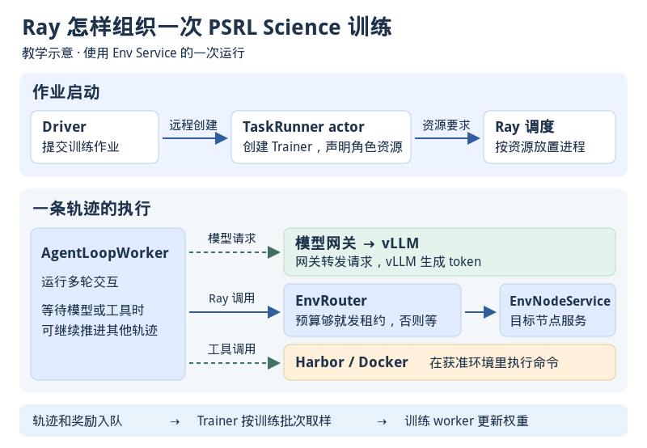

# PSRL运行：准备启动与监控

> **核心结论**：一次运行按“准备环境与数据 → 核对预检 → 启动 Ray 和训练入口 → 检查 rollout 与训练进度 → 解释批量及故障”推进。完整日常流程集中在本篇，固定故障证据与集群执行约束按用途单列。

执行前必须阅读[集群预检与实验约束](02-集群预检_依赖地址与GPU资源核验.md)。[启动故障复盘](03-启动排障_单机与多机故障复盘.md)与[Docker 事件复盘](incidents/01-Docker故障_2026年10月20日存储挂起.md)保留各自历史条件。本次仅整合已有说明，没有重新启动训练或刷新历史验证日期。

## 目录

- [准备与启动](#准备与启动)
  - [项目结构速览](#项目结构速览)
  - [安装](#安装)
  - [运行前准备](#运行前准备)
  - [逐段拆解示例脚本 `examples/dapo_trainer/qwen2.5_3b_fsdp.sh`](#逐段拆解示例脚本-examplesdapo_trainerqwen25_3b_fsdpsh)
  - [监控指标](#监控指标)
  - [实操建议](#实操建议)
  - [延伸阅读](#延伸阅读)
  - [单机 Demo 脚本与常用 bash 语法：`qwen2.5_3b_fsdp_singlenode_demo.sh`](#单机-demo-脚本与常用-bash-语法qwen25_3b_fsdp_singlenode_demosh)
- [Ray 角色与 Rollout 流程](#ray-角色与-rollout-流程)
  - [Ray 的基础职责与 Actor 协作](#ray-的基础职责与-actor-协作)
  - [Ray Core 的通用概念](#ray-core-的通用概念)
  - [Ray 的资源调度与应用启动流程](#ray-的资源调度与应用启动流程)
  - [为什么 RL rollout 会有“生成耗时不均”（long-tail latency）](#为什么-rl-rollout-会有生成耗时不均long-tail-latency)
- [监控、批量与排障](#监控批量与排障)
  - [如何阅读训练日志、抓取每步指标](#如何阅读训练日志抓取每步指标)
  - [`train_prompt_bsz` 对应哪个配置、是什么意思](#train_prompt_bsz-对应哪个配置是什么意思)
  - [查一个训练 pid 的运行情况：去哪儿看、看什么](#查一个训练-pid-的运行情况去哪儿看看什么)

## 准备与启动

一个 PSRL 训练任务需要模型、题目数据、生成服务、训练进程和评分逻辑共同工作。先确认这些角色及路径，再按目标选择最小运行规模。本页以仓库 DAPO 脚本解释参数；Science 的当前源码链路另见[训练源码地图](../07-源码阅读_从Science脚本到训练流程.md)。

<!-- figure:experiment-preflight-node -->
这张图沿同一个场景解释：driver 能看到 GPU，为什么实际 worker 的容器仍可能运行失败？

[](../../_static/img/document-figures/experiment-preflight-node.png)

[](../../_static/img/document-figures/experiment-preflight-node.png)

一次任务跨越 driver → Ray worker → Docker 容器，三处看到的路径和依赖可能不同。 在真正执行的位置验证能力。设备文件存在与 CUDA 内核可运行是两件事。 只做本次验收所需的最小预检。历史节点空闲或历史成功不替代现场核验。 [查看矢量图](../../_static/img/document-figures/experiment-preflight-node.svg)。
<!-- /figure:experiment-preflight-node -->

### 项目结构速览

| 位置 | 用途 |
|---|---|
| `examples/` | 各类任务的启动脚本与配置 |
| `psrl/trainer/main_ppo.py` | 解析配置、连接 Ray、创建训练任务 |
| `psrl/trainer/ppo/` | 调度采样与训练阶段 |
| `psrl/workers/` | 生成、训练、评分、参数服务器等执行角色 |
| `docs/` | 使用说明、机制解释与历史证据 |

Ray 是跨进程、跨机器的任务管理框架；Hydra 是把默认配置与命令行覆盖项合并的工具。先知道它们分别管执行位置和运行参数即可，后面再按问题深入。

### 安装

新环境的安装与版本要求统一读[安装说明](../../tutorial/installation.md)。本工作区使用共享环境时，先按[集群检查](02-集群预检_依赖地址与GPU资源核验.md)激活指定环境、确认实际导入路径，依赖修复放到本次隔离副本。

`pip install -e` 会改变所用 Python 环境的源码指向，适合个人新环境；共享环境应沿用已经约定的导入与隔离方法。原文中的重复安装命令移除，避免和安装入口维护两份版本要求。

### 运行前准备

先确认下面五件事：

1. 验收目标：只查配置、验证容器，还是确实需要训练更新；写清时间、GPU、步骤与重试上限。
2. 文件：目标模型目录、训练/验证 Parquet、输出目录都由本次任务明确指定。
3. 环境：source 后检查 `PSRL_WORKSPACE`，再确认 driver 与 worker 的 PSRL、veRL 等导入来源。
4. 节点：核对路由地址、Ray 节点和目标 GPU UUID，确认实际占用与 Docker 能力。
5. 收尾：明确本次进程、容器、租约和日志归属，结束后核实物理释放。

Parquet 是列式数据格式，题目和元信息还需要正确的嵌套类型；上下文长度和训练显存也分别计算。具体最小检查见[运行前五项](02-集群预检_依赖地址与GPU资源核验.md#开跑前先完成这五项)。

### 逐段拆解示例脚本 `examples/dapo_trainer/qwen2.5_3b_fsdp.sh`

以下依据 2026-11-16 实际阅读的[仓库脚本](../../../examples/dapo_trainer/qwen2.5_3b_fsdp.sh)。它保留了早期环境假设：source 后使用工作区路径，通过 `import psrl` 定位代码，地址依赖外部 `LOCAL_IP`，并会重设 shell 的家目录变量。原文所说“该脚本已自动保护全部路径并自算 IP”与当前源码不符，现已修正。

这份脚本适合用来理解参数。准备真实任务时，先按上述检查固定环境和路径，并核对选用脚本的实际行为。

#### 1. 基本变量与路径

脚本读取 `PSRL_WORKSPACE` 下的环境、模型和数据。例如工作区为教学路径 `/my-work` 时，模型预期位于 `/my-work/models/Qwen2.5-3B-Instruct`，数据位于 `/my-work/data/gsm8k/`。这些路径表示目录关系。

`staleness=${1:-3}` 表示第一个脚本参数作为版本滞后设置，缺省为 3。滞后允许生成和训练在有限版本差距内推进，详细机制见[训推协作](../推理与训练/03-训推协作_异步流水线与版本协调.md)。

共享环境脚本可能覆盖工作区变量，应在实际启动前检查 source 后的值。环境脚本作用见[activate 说明](../../tools/系统基础/01-运行环境_Shell与Python及Conda.md#lhyactivate-脚本说明与新-tunnel-启动配置)。

#### 2. 集群拓扑（几节点、几卡，谁做生成谁做训练）

脚本设置 2 节点、每节点 8 GPU：一个节点生成，一个节点训练。生成 `TP=1,PP=1`，所以 8 张生成卡对应 8 个单卡实例。

```text
16 GPU = 8 GPU 训练池 + 8 GPU 生成池
生成实例数 = 生成 GPU 总数 / 每实例使用 GPU 数 = 8 / 1 = 8
```

训练侧另配置验证实例，训练与验证的切换按相应资源管理配置处理。Ray 负责把这些角色安排到资源池；改变节点数时，要一起重算角色数量与资源声明，详见[Ray 调度](#ray-角色与-rollout-流程)。

#### 3. 算法超参（DAPO/GRPO 相关）

脚本设置 GRPO 优势估计，64 道题每题采 8 条回答，目标工作量为 512 条轨迹。动态采样组处理开关为 `False`；冗余采样、部分 rollout 则另有自己的配置。

非对称裁剪范围参数为 0.2/0.28，按 token 平均损失；回答上限 4096，超长惩罚缓冲为 2048。每项的计算例子见[分组采样与损失](../02-强化学习_PPO与GRPO及DAPO.md#4-dapo四项机制怎样配合)。

#### 4. 核心 PSRL 命令（真正的启动命令）

实际入口是 `python -m psrl.trainer.main_ppo`，后面一长串 `字段=值` 是 Hydra 配置覆盖。下面按前缀读即可：

| 前缀 | 管什么 | 例子 |
|---|---|---|
| `psrl.*` | 调度、部署、权重版本 | 生成实例数、PS 模式 |
| `gen_actor_rollout_ref.*` | 生成引擎 | TP、批量 token 预算 |
| `train_actor_rollout_ref.*` | 训练与验证模型 | 学习率、分片、验证采样 |
| `reward.*` | 评分和奖励处理 | 超长惩罚 |
| `data.*` | 文件与数据预算 | 训练文件、每批题目数 |
| `algorithm.*` | 优势与修正算法 | `adv_estimator=grpo` |
| `trainer.*` | 总步骤、日志和保存 | 该脚本 200 步、每 200 步保存 |

这里只解释真实脚本，不拼接带省略号的伪可运行启动命令。选定任务后应从实际脚本和最终解析配置核对具体值。

#### 5. 运行时会发生什么

加载配置、连接 Ray 后，训练器创建生成、训练、参数服务器等角色。生成请求经网关到模型执行，回答获得奖励后进入样本队列；训练侧计算概率、优势和损失，更新参数，再发布新权重。

TransferQueue 是保存与传递样本字段的队列；参数服务器则传递模型权重，两者内容不同。沿一条回答阅读这条链路，见[完整训练路径](../推理与训练/03-训推协作_异步流水线与版本协调.md#一条回答的完整路径)。

### 监控指标

先看训练 step 是否推进、退出码和异常，再看奖励、验证准确率、回答长度、熵和梯度是否协调。熵下降和奖励上升都需要结合任务阶段解释，单个数字无法保证训练质量。方法见[日志与批量配置](#监控批量与排障)。

### 实操建议

先用能回答目标的最小检查。如果目标要求真实训练，缩小规模时同时核对模型容量、数据批量、角色资源池与运行预算。使用共享集群时沿用已分配资源，集群级停止或重建需明确归属。

`examples/ray/ray_start.sh` 包含面向目标节点的清理与启动操作，使用前应先阅读脚本；运行指南不再把重建共享 Ray 当成普通启动步骤。

### 延伸阅读

- 按代码定位：[训练源码地图](../07-源码阅读_从Science脚本到训练流程.md)。
- 准备 Science 环境：[Env 当前设计](../../env-worker-deep-dive/knowledge/01-架构与执行/01-Env架构_现状与完整执行流程.md)。
- 处理启动报错：[历史故障复盘](03-启动排障_单机与多机故障复盘.md)。

### 单机 Demo 脚本与常用 bash 语法：`qwen2.5_3b_fsdp_singlenode_demo.sh`

这个名称来自早期本地四卡 Demo，当前仓库未提供该文件。历史记录为 2 卡生成、2 卡训练、3 个训练 step，故障证据保存在[单机复盘](03-启动排障_单机与多机故障复盘.md#单机-demo-踩坑记录两处根因与修复)。

阅读类似脚本时，几个语法就足够入门：`${VAR:-默认值}` 为未设置变量提供默认值，`export` 将变量传给子进程，`$((...))` 做整数计算，行尾反斜杠表示续行，`2>&1 | tee 文件` 将输出显示并写日志。`source` 对当前终端环境的作用见[进程示例](../../tools/系统基础/01-运行环境_Shell与Python及Conda.md#source让环境设置留在当前终端)。


## Ray 角色与 Rollout 流程

Ray 是 PSRL 的分布式运行时。它按 CPU、GPU 名额和节点约束放置进程，允许一个进程调用另一个进程里的方法，并把结果或异常传回调用方。PSRL 在这些进程中组织采样、评分和训练，EnvRouter 根据环境任务的资源需求和可用预算决定何时准入。

### Ray 的基础职责与 Actor 协作

启动 Science 训练时，**driver** 是提交作业的 Python 进程。它建立或连接 Ray 集群，创建 `TaskRunner` 并调用它的 `run` 方法。`TaskRunner` 在自己的 worker 进程中创建 Trainer、安排训练和推理资源池，并开始采样与训练。像 `TaskRunner` 这样由 Ray 承载、方法能被其他进程调用的对象叫 **actor**。同一个 actor 可以在多次调用之间保留状态。[启动入口](../../../psrl/trainer/main_ppo.py#L127)

[](../../_static/img/psrl-ray-science-roles.svg)

跟着图中的一条 Science 轨迹看。开启 Env Service 后，AgentLoopWorker 会通过 Ray 调用 EnvRouter 申请环境资源。预算够时，EnvRouter 发放**租约**，也就是允许该任务使用这份资源的凭据。资源不足时，申请方等待再试。轨迹在模型生成与环境执行之间交替推进。模型请求经网关发给 vLLM，工具命令在 Harbor 管理的任务环境中执行。轨迹及奖励交回 PSRL，Trainer 按训练批次取样，再调用训练 worker 更新模型。[Science 执行链](../07-源码阅读_从Science脚本到训练流程.md#3-模型请求与工具执行) · [环境准入与节点关系](../../env-worker-deep-dive/knowledge/01-架构与执行/01-Env架构_现状与完整执行流程.md#21-先声明环境资源范围再分派和申请)

| 角色 | 由什么机制承载 | 决定或执行什么 |
|---|---|---|
| TaskRunner、Trainer | Ray actor 承载 TaskRunner，Trainer 在其内部运行 | 创建各角色，按 PSRL 策略组织采样、更新和权重同步 |
| PSManager | Ray actor | 管理模型版本、读写协调与采样名额 |
| 训练与推理 worker | Ray 放置 worker，GPU 后端执行计算 | 训练侧更新模型，推理侧由 vLLM 生成 token |
| AgentLoopWorker | 异步 Ray actor | 驱动多条轨迹与模型、环境交互，等待其中一条时可继续处理其他轨迹 |
| EnvRouter、EnvNodeService | Ray actor，节点服务固定到目标节点 | Router 维护预算、发租约，节点服务查看本机资源并协调执行和清理 |

### Ray Core 的通用概念

| 概念 | 怎样理解 |
|---|---|
| **Task** | 用 `@ray.remote` 包装函数，再用 `f.remote(...)` 提交一次执行。Ray 为各次调用找合适的 worker，适合能独立执行的工作，比如并行预处理多份数据。 |
| **Actor** | 用 `@ray.remote` 包装类，再用 `C.remote(...)` 创建常驻对象。后续调用同一个实例的方法时，方法可以共享这个实例里的状态。例如各条轨迹向同一个 EnvRouter 申请资源，Router 能根据前面发过的租约更新剩余预算。 |
| **ActorHandle 与 ObjectRef** | 句柄让调用方找到 actor。`ref = router.snapshot.remote()` 提交一次查询并拿到 `ObjectRef`，也就是这次查询的结果引用。`ray.get(ref)` 等待并取回具体结果，异步代码也可用 `await ref`。 |
| **Head 与 Raylet** | Head 是运行集群控制服务的节点。每个 Ray 节点上的 Raylet 负责本机调度和 worker 管理。提交作业的 driver 可以在另一个进程和节点上。 |

多个调用者可以持有同一个远程对象的引用，所需数据由 Ray 按需传给使用者。PSRL 的 `cpu_ref` 权重路径利用 Ray 对象引用和对象存储，`nixl_cpu` 路径则用 PS Worker 的 CPU 缓冲区和 NIXL 传输大块权重。调用服务和搬运数据可以分别选择适合的机制。[Ray Core 基本概念](https://docs.ray.io/en/releases-2.49.0/ray-core/key-concepts.html) · [参数服务器设计](../../design/parameter_server.md)

### Ray 的资源调度与应用启动流程

#### 用四张卡理解角色与资源声明

以图中作业的训推部分为例，假设两张卡给训练、两张卡给生成，每个生成实例使用一张。PSRL 用 Ray 的 **Placement Group** 为 worker 成组预留资源。需要两张卡共同启动的训练组，可以整组等到资源到位，再启动组内 worker。节点亲和性则可以要求某个角色放到指定节点，例如让 `EnvNodeService` 在真正管理的那台机器上读取本机设备状态。[节点服务创建入口](../../../psrl/workers/env_service/router.py#L545)

`num_gpus` 是 Ray 的逻辑资源名额。用 `num_gpus=1` 启动推理 worker 时，Ray 从账本扣掉一个 GPU 名额，vLLM 再在分配到的设备上申请权重和 KV cache 所需的显存。如果这张卡还有物理显存且配置允许共享，EnvRouter 会根据显存预算和并发限制判断能否再放入一条环境命令。共用计算单元后的速度变化需要用实际运行测量。[Ray 资源声明](https://docs.ray.io/en/latest/ray-core/scheduling/resources.html#physical-resources-and-logical-resources) · [推理卡余量共享](../../env-worker-deep-dive/knowledge/02-资源与调度/05-训推共享_vLLM余量与容量调度.md)

#### 从入口到运行中的 worker

提交 actor 后，Raylet 还要启动 worker，等它加载运行库并完成注册，才可运行 actor 的业务代码。日志中的 worker 注册超时定位在这一步。业务代码中的导入错误则可以通过远程调用异常传回 driver。近期实验的两类日志见 [Ray 启动排障](03-启动排障_单机与多机故障复盘.md#近期env实验ray启动失败与导入阻塞)。

多机连接时，传入的服务地址必须与 Ray 注册的可路由地址一致。`127.0.0.1` 只表示各进程自己的本机；多网卡环境应查询到目标节点的路由，并核对 `NodeManagerAddress`。

`examples/ray/ray_start.sh` 包含停止和重建目标节点 Ray 的操作。使用现有共享集群时，先确认归属与分配，不把它当成每次任务的准备命令；完整执行约束见[集群检查](02-集群预检_依赖地址与GPU资源核验.md)。

#### 在哪里看进程、日志和 checkpoint

driver、TaskRunner 与 GPU worker 可能位于不同节点。先从 Ray 状态和日志确认各进程位置，再到对应节点查询 PID 与设备，方法见[监控与批量](#监控批量与排障)。

checkpoint 是否保存取决于配置及实际触发。当前 DAPO 示例设置 `save_freq=200,total_training_steps=200`；较早 Demo 使用过关闭定期保存的配置，历史值不适用于所有脚本。核对最终解析配置、保存日志和实际产物后，再报告可恢复的权重位置。

本节于 2026-11-25 按 `c5f2d65` 的工作区源码核对启动入口、Trainer、Science Agent Loop 与 EnvRouter 创建路径。图展示启用 Env Service 的教学场景。

### 为什么 RL rollout 会有“生成耗时不均”（long-tail latency）

#### 结论

这里的“生成耗时不均”是指：同一轮 RL 采样中，不同 prompt/轨迹完成 rollout 的时间差很大；少量极慢的轨迹（stragglers）形成长尾。同步式训练必须等到这一批要求的样本全部完成，所以本轮的等待时间由最慢者决定，而不是平均耗时决定。

若一轮采样有 `m` 条轨迹，其完成时间为 `t_1, ..., t_m`，同步边界近似为：

```text
rollout_step_time = max(t_1, ..., t_m)
```

因此，哪怕 95% 的请求已经结束，只要最后 5% 还在生成，其余生成 GPU、reward 计算和训练侧都可能处于等待或低利用率状态。

#### 为什么 LLM 的 RL 特别容易出现

这里先解释后文术语：prefill 是一次处理已有输入，decode 是逐个生成新 token；KV cache 保存历史注意力计算所需的数据。staleness 是样本落后当前训练参数多少个版本，buffer 是暂存一批样本的缓冲区。

1. **输入和输出长度本来就不同。** Prefill 成本随 prompt/token 上下文增长；decode 成本又随生成 token 数、采样到 EOS 的时机而不同。一个立即答完的数学题和一个一路生成到 `max_response_length` 的题，耗时可以相差很多。
2. **RL 采样具有随机性。** 相同 prompt 在不同采样下会得到不同长度的回复；PPO/GRPO/DAPO 常为每个 prompt 采样多条 response，组内也可能只有一条特别长，仍会拖住整组。
3. **Agentic RL 的轨迹长度更不规则。** 一条轨迹可能直接回答，另一条可能经历多轮「生成 -> 工具调用/环境交互 -> 再生成」。工具响应、代码执行、网页或沙箱 I/O 的差异会进一步放大尾部延迟。
4. **推理服务是共享资源。** vLLM 会做 continuous batching、KV cache 管理和请求排队。长上下文、缓存未命中、不同 GPU 上的排队长度、显存压力或实例性能差异，都使相同 token 数的请求实际完成时间不同。
5. **训练早期常有异常长轨迹。** 模型可能重复、走错工具调用分支，或迟迟不输出 EOS，直到长度上限；这类少数低质量轨迹尤其容易成为长尾。

#### 一个直观例子

假设一步 GRPO 需要 `64` 个 prompt，每个采样 `8` 条回复。大多数回复在 3--8 秒结束，但有两条进入重复循环，分别需要 45 秒和 60 秒。若算法要求完整 batch，训练更新只能在约 60 秒后开始；前面已完成的绝大多数结果不能让这一步立刻完成。这就是“平均耗时不高，但吞吐很差”。

#### PSRL 怎样处理，而不是消灭差异

PSRL 通过流水线、版本缓冲和调度减少慢请求造成的全局等待，以下机制按实际配置启用：

- **异步与 staleness**：允许 rollout 比训练领先有限个模型版本，把某个 buffer 的长尾隐藏在训练其他已完成 buffer 的计算期间。代价是样本相对当前参数略旧，因此需要限制 staleness，并可采用 rollout correction。
- **Fine-grain overlap**：已完成的小块样本先进入训练侧的可提前计算阶段，不必等整个 buffer 填满。
- **Partial rollout**：当实例需要同步新权重时，中断尚未完成的长生成，但保留已生成 token；请求随后继续路由，避免“等它结束”或“全部丢弃”。
- **Redundant rollout**：多生成一些 prompt 或每 prompt 多生成几条 response；足够组成算法所需 batch 后终止最慢的冗余请求。它以额外算力换尾延迟，但若长轨迹本身更有学习价值，系统性丢弃会带来训练偏差。
- **路由与迁移方向**：按负载、预测耗时或缓存状态放置请求，是进一步减少长尾的研究方向。当前具体使用的路由策略需查 SMG 与协调器配置，本节未验证所有预测和迁移能力。

这些机制分别改善生成实例内的空位、训练侧的整批等待和请求路由。观察效果时，应按相同工作量记录采样、训练及总耗时，保留算法需要的分组条件。


## 监控、批量与排障

监控需要回答三个问题：任务推进到哪里，模型输出是否改善，时间花在哪个阶段。进程、GPU 与训练指标分别提供部分信息，放在一起看才能判断下一步。

2026-11-16 核对本地批量解析和示例脚本，整理监控方法；未启动训练或读取新的运行指标。下面样本行与数字为教学数据。

### 如何阅读训练日志、抓取每步指标

#### 先按角色与阶段读日志

合并日志常交织多个 Ray actor 的输出。先看行首角色：TaskRunner/Trainer 多用于阶段和汇总；训练 worker 查看模型加载与更新；vLLM 查看生成执行；PS/协调器查看版本和样本等待；环境日志查看工具与评分。

| 问题 | 重点字段 | 怎样解释 |
|---|---|---|
| 到第几步 | `training/global_step`、退出码 | 对照目标步数与完成记录 |
| 更新是否数值稳定 | loss、`actor/grad_norm` | 查 NaN/Inf 与突变，结合概率比和输入定位 |
| 输出是否有变化 | `actor/entropy`、真实回答 | 熵是分布多样程度，升降需结合正确率 |
| 反馈是否改善 | `critic/score/mean`、rewards、验证指标 | 先确认评分键与奖励整形，再比较趋势 |
| 组内是否有区分 | `group/zero_variance_fraction` | 同分组的相对奖励优势可能为零 |
| 长度是否触顶 | `response_length`、截断比例 | 抽取回答与结束原因，区分长推理和重复 |
| 时间花在哪里 | `timing_s/step`、生成等待、update_actor | 按相同计时范围比较采样与训练 |

例如训练分数上涨、验证准确率下降，同时回答越来越长，应该检查评分与输出内容，而不能用单一上升曲线判断效果。真实历史联合退化见[DAPO 诊断](../05-训练排障_DAPO退化诊断.md)。

#### 把指标提取成表

下面是自包含 Python 示例。默认解析两条教学日志并打印表格；将 `lines` 换成实际日志迭代器即可分析保存的数据。先去掉 ANSI 颜色控制码，再提取 `key:value`。

```python
import re

lines = [
    "step:1 - training/global_step:1 - actor/entropy:0.30 - critic/score/mean:0.25",
    "step:2 - training/global_step:2 - actor/entropy:0.28 - critic/score/mean:0.50",
]
keys = ["training/global_step", "actor/entropy", "critic/score/mean"]
ansi = re.compile(r"\x1b\[[0-9;]*m")
print("\t".join(keys))
for raw in lines:
    line = ansi.sub("", raw)
    if not re.search(r"\bstep:\d+", line):
        continue
    fields = {}
    for item in line.split(" - "):
        if ":" in item:
            key, value = item.split(":", 1)
            fields[key.strip()] = value.strip()
    print("\t".join(fields.get(key, "-") for key in keys))
```

预期输出两步，熵为 0.30/0.28，分数为 0.25/0.50；`-` 表示该行缺失的字段。实际日志格式与版本有关，先抽几行确认，再批量提取。已有 W&B 或 TensorBoard 时，也可直接查看曲线并保留配置与原始日志。

### `train_prompt_bsz` 对应哪个配置、是什么意思

示例脚本将 `train_prompt_bsz` 传给 `data.train_batch_size`，表示一批多少道题。每题采样数为 `rollout.n`，因此目标题目组数和轨迹条数需要分别算。

#### 从题目数算到一次更新

教学例子：64 道题，每题 8 条回答，目标共 512 条轨迹。若 mini-batch 配为 16 道题，对应每个 mini-batch 128 条轨迹，整批可划为 4 个 mini-batch。

| 层次 | 作用 | 本例 |
|---|---|---|
| 全局题目批量 | 一批数据含多少题 | 64 题 × 8 = 512 条 |
| Mini-batch，优化小批量 | 划分优化器更新的数据范围 | 16 题 × 8 = 128 条，4 组 |
| Micro-batch，显存小批量 | 将一次更新拆为可放入显存的小块 | 多次前后向累积梯度，随后更新 |

这是常规完整批处理路径的教学说明；策略、PPO epoch、过滤与分块方式会改变实际更新安排。动态 token 打包按 token 预算形成计算块，和“需要多少题形成算法分组”是不同层次。

本地[批量解析](../../../psrl/utils/config.py#L21)计算 `full_batch_samples = train_batch_size * rollout_n`、`mini_samples = ppo_mini_batch_size * rollout_n`，并按所选策略检查分组和并行对齐。配置修改后应核对最终解析值；实际采样量还可能受冗余和过滤影响。

更详细的组内统计与计算拆分，见[四条回答的例子](../02-强化学习_PPO与GRPO及DAPO.md#采样量与训练批量怎样对应)。

### 查一个训练 pid 的运行情况：去哪儿看、看什么

先确认 PID 属于哪台节点及哪个任务。仅在终端所在机器执行 `ps`，可能看不到远端 worker。

| 层面 | 取什么证据 | 回答什么 |
|---|---|---|
| 进程 | PID、创建时间、命令和退出码 | 本次进程是否仍在 |
| Ray | 节点列表、资源池和 actor 状态 | 角色是否已创建，实际在哪台机器 |
| 阶段日志 | 初始化、采样、评分、更新与清理标记 | 推进到哪一步 |
| 设备 | UUID、归属进程、显存和计算利用率 | 本次角色是否在实际用卡 |
| 质量 | 有效 token、奖励、验证与样本内容 | 已完成什么学习或验证 |

GPU 显存占用高可来自模型权重与缓存预留，利用率低可来自等待、初始化或工具阶段，均应结合时间段解释。Ray dashboard 主要查看资源与任务，模型质量查看训练记录系统及真实样本。

#### 怎样区分推进缓慢与缺少进展

按预先设置的阶段预算，看新 actor、模型加载、完成轨迹或训练 step 是否出现。进度条短时不动时先检查当前阶段；超过约定预算仍缺少推进证据时，保存对应 actor 日志并按任务停止条件处理。

运行中单次遥测超时记为缺失；训练失败依据独立的错误、退出码和预算判断。清理按本次进程和容器归属执行，最后核实物理资源。完整规则见[集群检查](02-集群预检_依赖地址与GPU资源核验.md)。
