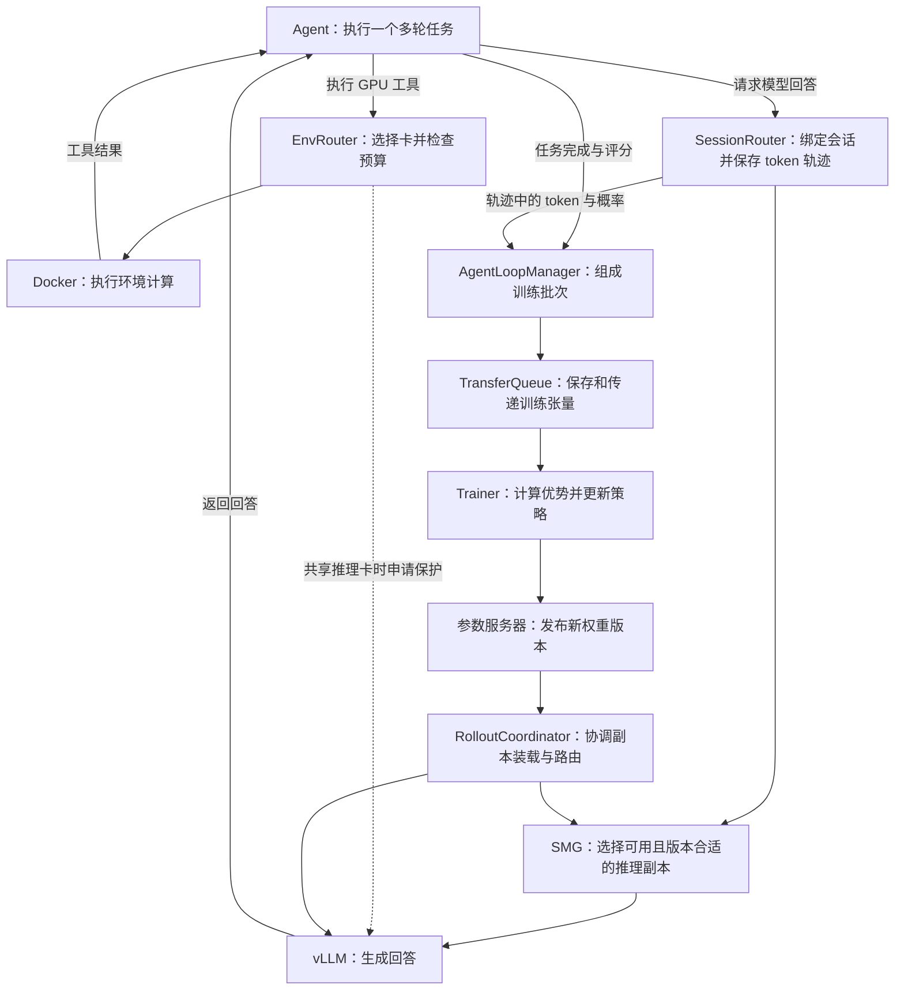
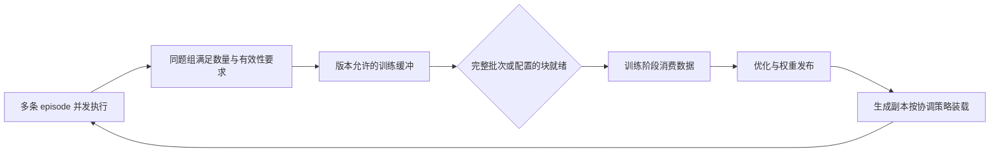

# 训推协作：异步流水线与版本协调

PSRL 把“生成回答”和“用回答训练”组织成可重叠的流水线。生成侧持续做题并收集反馈，训练侧消费已准备好的样本、更新参数，再把新权重交给生成侧。版本控制限制两边走得太远，让并发执行有明确边界。

本页沿一道题解释数据流、版本协调和权重切分。PPO、GRPO、DAPO 的原理与手算集中在[完整训练原理](../02-强化学习_PPO与GRPO及DAPO.md)。2026-11-16 核对本地训练入口、概率重算分支及参数服务器设计；2026-11-18 补充 SMG 与环境调度的真实六步配对训练，验证范围与结果见[实验报告](../../env-worker-deep-dive/experiments/09-资源分区_静态卡池与推理余量共享.md#实验三把余量共享接入六步真实训练)。

[返回专题索引](README.md)。

## 目录

- [六、RL 后训练场景（PSRL）](#六rl-后训练场景psrl)
  - [6.0 "同时在线"具体怎么理解（以 PSRL 为例）](#60-同时在线具体怎么理解以-psrl-为例)
  - [一条回答的完整路径](#一条回答的完整路径)
  - [SMG 与环境调度如何接入同一条训练链](#smg-与环境调度如何接入同一条训练链)
  - [一个 episode 完成后训练什么时候开始](#一个-episode-完成后训练什么时候开始)
  - [PPO 与 GRPO 怎样判断该鼓励哪些回答](#ppo-与-grpo-怎样判断该鼓励哪些回答)
  - [概率比值、版本滞后与修正分别做什么](#概率比值版本滞后与修正分别做什么)
  - [预训练和在线强化学习怎样比较](#预训练和在线强化学习怎样比较)
  - [6.1 权重同步与 Resharding](#61-权重同步与-resharding)
  - [6.1b PP+TP 二维网格：训练端 shard 到底是什么](#61b-pptp-二维网格训练端-shard-到底是什么)
  - [6.2 Rollout 长尾](#62-rollout-长尾)
  - [6.3 资源分配的两难](#63-资源分配的两难)

## 六、RL 后训练场景（PSRL）

强化学习（RL）根据反馈调整模型行为。一次 rollout（采样轨迹）可以是一道题的一次回答，也可以是“生成→工具执行→继续生成”的多轮尝试。训练把这次尝试的反馈转成参数更新。

<!-- figure:rollout-batch-training -->
这张图沿同一个场景解释：一条 episode 结束后，为什么模型不一定马上开始训练？

[](../../_static/img/document-figures/rollout-batch-training.png)

[](../../_static/img/document-figures/rollout-batch-training.png)

固定批次教学：四条轨迹分别在第 3、5、6、8 秒完成，更新需要这四条。 优化单条延迟需要连到批次关键路径。完成一条轨迹与执行一次训练更新不是一一对应。 数字为教学假设。分块、冗余与异步配置可能改变消费条件，按实际配置说明。 [查看矢量图](../../_static/img/document-figures/rollout-batch-training.svg)。
<!-- /figure:rollout-batch-training -->

### 6.0 "同时在线"具体怎么理解（以 PSRL 为例）

在常见分离部署中，vLLM 负责生成，FSDP 或 Megatron 后端负责训练，两边使用分别配置的 GPU 资源池。它们可以在同一节点的独立 GPU，也可以跨节点。参数服务器（PS）保存可供生成侧取得的权重版本。

```text
题目 → 生成回答 → 工具与评分 → 样本缓冲区
           ↑                       ↓
       获取新权重 ← 参数服务器 ← 训练更新
```

系统允许在限定版本差距内消费略早版本产生的样本。这样训练在处理一批已完成样本时，生成侧可以继续处理其他题。资源、样本或版本边界不足时，相关环节仍会等待。

缓冲区采用 Reserve→Occupy→Consume 协议：先预留样本名额，完成后登记结果，训练侧再消费。它把“哪些样本属于哪批”和“允许使用哪个版本”组织起来，具体机制见[版本滞后控制](../../design/staleness_control.md)。

### 一条回答的完整路径

下面用“1+1 等于几”作教学例子，分数和版本均为假设：

| 步骤 | 谁执行 | 输入与结果 |
|---|---|---|
| 1. 采样 | 生成引擎，版本 10 | 输入题目，生成“2”，记录生成 token 及其概率 |
| 2. 评分 | 规则或环境校验器 | 比较答案与标准答案，得到 reward=1 |
| 3. 组装样本 | Agent Loop 与缓冲区 | 保存题目、回答、奖励、版本和参与损失的 token 标记 |
| 4. 准备训练 | 训练侧 | 收集一批数据，按配置重算概率、参考概率或价值 |
| 5. 估计优势 | PPO / GRPO 对应算法 | 判断这次回答相对基准有多好 |
| 6. 更新 | 训练后端，假设当前版本 12 | 计算损失、反向传播、执行优化器，得到版本 13 |
| 7. 同步 | 训练侧、PS、生成侧 | 发布版本 13，生成侧按同步策略装载 |

`response_mask` 是逐 token 的参与标记：模型生成的位置通常为 1，工具输出等上下文位置为 0。上下文仍会影响模型理解，但这些位置不直接计算生成策略损失。构造方法见[多轮轨迹与损失](../02-强化学习_PPO与GRPO及DAPO.md#token掩码与奖励各提供什么)。

`log prob` 是概率的对数。训练通常用整段已知轨迹并行计算每个位置的概率，这叫 teacher forcing（给定历史真实 token，预测下一个）。本地[_compute_old_log_prob](../../../psrl/trainer/ppo/ray_trainer.py#L3117)提供两条路径：重算得到固定训练锚点，或通过 bypass 分支使用采样时记录的概率并选择相应损失。具体选择需与修正配置配套。

### SMG 与环境调度如何接入同一条训练链

**SMG 是模型请求网关，EnvRouter 是环境资源调度器。** Agent 在“需要模型回答”和“需要执行 GPU 工具”时分别调用它们。二者管理的队列不同，但可能使用同一张 GPU，因此必须在模型服务内部协调显存和控制操作。这里的网关可以理解为统一入口：Agent 不必知道每个 vLLM 副本的地址，发给网关后，由框架选择合适的副本。



SessionRouter 的“保存轨迹”使用 TITO 数据，即实际送入和生成的 token，而不是事后把聊天文本重新编码来猜训练序列。工具输出也是后续模型请求的上下文，但通常只有模型生成的 token 参与策略损失。TransferQueue 负责传递这些训练数据；参数服务器负责传递模型权重，两者保存的是不同东西。

沿一个具体的 GPU 工具任务看：Agent 先问模型选哪个学习率，SMG 把请求交给某个 vLLM 副本。Agent 解析选择后，请 EnvRouter 执行一个训练适配参数的环境命令。容器可能在独立环境卡上，也可能在独立池拥堵时使用一张显式允许共享的推理卡。命令结束并确认设备归还后，Agent 把结果放进下一轮模型输入；最终私有评分随轨迹提交，整个 episode 才算完成。

这个例子有两层“训练”，需要分开计数。**环境里的适配参数更新是工具任务本身；PSRL 更新的是发出选择的策略模型。** 比如环境执行 448 次小适配参数更新，只产生一次工具结果；PSRL 可以等 4 个题目组、每组 2 条完整轨迹都到达，再做一次策略训练 step。不能把环境内部 448 次更新当成 PSRL 训练了 448 步。

常驻共享时，EnvRouter 不修改 SMG 的普通请求路由，也不主动让 vLLM 休眠。获得共享授权后，vLLM 仍能生成，模型控制门禁会暂缓权重替换、休眠等操作，直到环境确认物理归还。由此有两类代价：普通推理可能因计算资源竞争而变慢；某个权重更新也可能因为环境命令未结束而等待。只测环境命令结束时间，会漏掉后者。

同步还会影响网关。当前[同步协调器](../../../psrl/workers/gen/rollout_coordination/sync_and_migrate/sync_and_migrate_mixin.py#L152)先暂停 SMG 分派，再等待各副本进入同步状态。若环境持有共享卡，副本的 `pause_for_sync` 会等物理归还，全局网关暂停也随之延长。因此，环境平时没有主动暂停 vLLM，仍可能在训练发布新版本时让后续模型请求等待。2026-11-18 的完整训练对照已记录到约 50 秒以及最高约 125 秒的这种等待，详见[真实时间线](../../env-worker-deep-dive/experiments/09-资源分区_静态卡池与推理余量共享.md#为什么一次权重同步会等约五十秒)。

教学例子：一条环境命令在第 20 秒占用共享卡，到第 60 秒完成。若 vLLM 在第 30 秒收到普通生成请求，它仍能执行，实际快慢取决于两者竞争；若框架在第 35 秒要求替换权重，则可能要先等环境约 25 秒，再执行权重操作。常驻共享保留了生成能力，同时仍有可观察的控制等待。`max_command_s` 的作用是限制共享命令持有时间，超时会清理对应环境；它不提供任意 CUDA 程序的无损暂停与续跑。

代码阅读路径如下，实验结果维护在[固定池与动态分区报告](../../env-worker-deep-dive/experiments/09-资源分区_静态卡池与推理余量共享.md)。

| 图中动作 | 源码入口与适用范围 |
|---|---|
| 启动两层模型入口 | [RolloutGateway](../../../psrl/workers/gen/rollout_gateway.py#L123) 分别启动 SMG 和 SessionRouter |
| 创建会话、调用模型、获取轨迹 | [SessionAgentLoop](../../../psrl/workers/agent_loop/loops/session_agent_loop.py#L65)，外部 Agent 只需使用会话 API URL |
| 将推理卡接入环境准入 | [训练器绑定](../../../psrl/trainer/ppo/ray_trainer.py#L608)核对真实 GPU 归属并校验 vLLM 的显存 profile |
| 逐命令选卡与归还 | [GpuCommandScheduler](../../../psrl/workers/env_service/command_gpu.py#L83)，容器主存与 CPU 归属不随 GPU 选择变化 |
| 共享期间保护模型控制 | [GpuControlGate](../../../psrl/workers/gen/gpu_handoff.py#L10)，推理普通请求与模型权重控制使用不同准入条件 |
| 收齐批次开始训练 | [FullBatchStepStrategy](../../../psrl/trainer/ppo/strategies/full_batch.py#L26)，下节解释具体就绪条件 |

### 一个 episode 完成后训练什么时候开始

**默认行为是先收集一个可消费批次，再开始该批次的训练。** 一个 episode 结束，只说明一条尝试结束，它还需要提交轨迹及有效 token 标记，满足组和版本约束。评分的等待位置取决于是否开启异步奖励，更新所需奖励最终必须齐备。当前训练器默认的 [FullBatchStepStrategy](../../../psrl/trainer/ppo/strategies/full_batch.py#L26) 在 `wait_for_gen` 计时内调用 `wait_for_training_batch(buffer_id)`，拿到批次后才执行概率计算、优势和策略更新。2026-11-18 的六步对照实际使用这一完整批次策略，每步四组、每组两条轨迹；下面其他配置分支仍为源码核对范围。

具体有四个相邻但不同的完成点：

1. **一条轨迹完成。** Agent 完成多轮推理和环境交互，返回轨迹。环境命令结束而 Agent 还要继续推理时，轨迹仍未完成。
2. **一个题目组可用。** 同题采样多条轨迹时，要达到配置要求的条数，并通过有效 token 与组处理。冗余采样可配置生成较多条、选其中足够数量，普通路径不能随意忽略组内慢样本。
3. **一个训练批次可消费。** 已完成题目组经过版本与缓冲分配，登记到指定批次，达到就绪条目数后通知训练器。
4. **模型完成更新。** 训练器还要计算概率、奖励或优势等字段，执行优化步骤，按策略发布新权重。启用异步奖励时，完整批次路径可以先计算概率，再等待奖励返回。样本入队与优化器执行之间有实际工作与等待。

[AgentLoopManager](../../../psrl/workers/agent_loop/manager.py#L1291) 对被接受的题目组逐个增加批次计数。普通路径的门槛是 `psrl.staleness_buffer_entries`，冗余采样路径使用配置的算法全局组数，见[初始化](../../../psrl/workers/agent_loop/manager.py#L139)。因此解释训练批次时不能只看一个 episode 的结束日志，或仅凭 `data.train_batch_size` 猜测实际就绪门槛，应核对最终配置的组数、每组采样数和过滤规则。

教学例子：配置每批 4 个题目组，每组需要 2 条轨迹。A、B、C 三组已经完整结束，D 组第一条已结束、第二条仍在等 GPU 环境命令。此时收集了 7 条轨迹，但只有 3 个完整组。默认训练器仍然等待。D 的环境命令完成后，它可能还要让 vLLM 生成最终回答，再评分、提交，最后一组才可就绪。

若 D 在第 40 秒结束，而训练器到第 50 秒才完成前一批，则下一批已提前准备好，D 没让训练器额外等待。若前一批第 20 秒完成、D 第 80 秒才结束，训练器可能等待约 60 秒，另加数据准备开销。调度目标应看这种训练侧空等，而非单独比较环境队列长度。



源码中的细粒度策略允许更早启动一部分训练工作，但需要区分具体分支：

| 配置 | 收到部分组后能做什么 | 优化器何时执行 |
|---|---|---|
| `granularity=none`，默认 | 等对应完整批次就绪 | 批次就绪并完成前处理后 |
| 开启分块，`overlap_scope=recompute` | 一个完整块到达后先做概率重算等逐样本工作，与后续采样重叠 | 块拼成完整批次后做优势与更新 |
| `mini_batch` 且 `overlap_scope=pre_step` | 按块推进概率、优势和更新 | 满足一个 mini-batch 块后可更新，受算法与配置检查约束 |

默认值见 [fine_grain_overlap.yaml](../../../psrl/trainer/config/psrl/fine_grain_overlap.yaml)，执行分支见 [FineGrainOverlapStrategy](../../../psrl/trainer/ppo/strategies/fine_grain_overlap.py#L61)。块的大小按完整题目组定义，`pre_step` 有算法数学条件，不能等同于任意 episode 到达即训练。权重发布也有最终步协调，不能将每次局部优化理解为所有 vLLM 副本立刻切换版本。

异步框架能让不同 episode、环境调用、数据准备以及允许的训练阶段重叠，但版本窗口限制采样能领先多少。当前公共配置的 `psrl.staleness` 为 0，实际 recipe 可覆盖。更大的窗口增加流水线自由度，也引入样本版本滞后，不能为调度实验偷偷改变它。[版本控制专题](../../design/staleness_control.md)解释预留位置、完成后登记和训练消费如何配合。

**为什么同时存在超过一个训练批次所需的 rollout？** 2026-11-26 核对的八卡两步实验使用 `staleness=1`，允许采样侧领先一批。每步需要 10 个题目组，每组 2 条轨迹，也就是 20 条轨迹；初始化版本为 V0 时，分派窗口可以放行累计两批的 20 个题目组、40 条轨迹。放行只代表允许进入执行流水线，实际同时使用 GPU 的数量仍由模型请求和环境准入限制。第一批收集时，其余轨迹就可以做模型请求、CPU 准备或排队等待 GPU。这样第一步训练开始后，采样侧仍能准备下一步的数据，减少第二步开始前的空等。

| 同一个两步例子 | 采样侧 | 训练侧 |
|---|---|---|
| V0 开始采样 | 在版本窗口内逐步放行最多两批的任务；完成顺序由实际执行决定 | 等第一个批次的 10 个合格题目组 |
| 第一个批次就绪 | 其余已放行轨迹继续执行和登记 | 消费第一个批次，执行第一次策略更新 |
| 更新得到 V1 | 部分剩余轨迹已经完成；V0 样本仍可在允许的一步版本差内使用 | 第二个批次就绪后执行第二次更新，否则继续等 |

这不需要提前知道 V1 的权重。提前运行的任务使用当时可用的模型，版本控制允许训练侧在规定范围内消费旧版本生成的样本。严格要求全部数据使用更新后的策略时，应收紧版本窗口，相应流水线机会也会减少。

**“下一批的数据”不等于启动时已经固定划分第二批成员。** 当前普通完成路径会在版本允许范围内优先填入较早的可用缓冲，见[完成后放置](../../../psrl/workers/ps/staleness_controller.py#L1060)和[已有预留的完成放置](../../../psrl/workers/ps/staleness_controller.py#L1103)。因此先完成的 B 所在题目组若合法且完整，也可能补齐当前批次；不能仅按启动顺序认定必须等 A。组内条数、过滤、版本和已有缓冲状态共同决定能否替代。调度研究应关注“哪个完整题目组能更快补齐一个合法批次”，而不是未经核实给每条轨迹贴固定批次标签。

实机依据：本轮 Command 静态日志在第一个缓冲就绪前，已经记录 `request_counter=40`；第一个缓冲达到 10/10 后训练启动，同时第二个缓冲继续从 1/10 累积。两步分别用 920.65 和 37.97 秒，第二步很短包含了预先完成的采样工作，不能解释成第二批的 20 条轨迹只执行了 37.97 秒。分派窗口计算见[版本节流](../../../psrl/workers/agent_loop/manager.py#L861)，完整实验及计时边界见[八卡补测](../../env-worker-deep-dive/experiments/13-扩展对照_八卡单批次与多负载回放.md#两步与十步的同场景补测)。

框架还有冗余采样和批次补齐策略，但都需要明确配置。当前 [proactive_filter_strategy](../../../psrl/trainer/config/psrl/rollout_coordination/proactive_filter_strategy.yaml) 默认 `method: null`。[handle_waiting_buffer](../../../psrl/workers/agent_loop/manager.py#L1746) 的 `retry` 路径尝试从其他可用缓冲迁入满足条件的组并补采，`truncate` 路径仍抛出未实现异常。模型的 partial rollout 能处理受支持的生成中断，不能自动保存并撤回任意 Docker CUDA 命令。

这对 Env 调度的启发是：给命令附带它属于哪个组、哪个缓冲，以及该批次还缺多少组，可以识别真正挡住下一次训练的工作。计算准入、模型借卡和恢复代价的完整例子见[从计算上限到整批完成时间](../../env-worker-deep-dive/knowledge/02-资源与调度/05-训推共享_vLLM余量与容量调度.md#16-从计算上限到整批完成时间)。目前这是调度研究方向，尚未接入训练批次驱动的自动借卡策略。

### PPO 与 GRPO 怎样判断该鼓励哪些回答

训练器在样本准备好后计算优势，再交给 actor 更新。PPO 常用 critic 与 GAE，GRPO 则按同题多次尝试的奖励比较。这个阶段需要的奖励、组编号、价值或概率字段随算法配置不同。

完整的 GAE 手算、GRPO 分组、PPO 裁剪和 DAPO 机制统一维护在[训练原理](../02-强化学习_PPO与GRPO及DAPO.md)，本页继续说明这些计算怎样接入并发流水线。

### 概率比值、版本滞后与修正分别做什么

版本滞后按训练版本数限制样本的新旧程度，PPO clip 控制当前策略相对固定锚点的损失激励，rollout correction 处理采样分布与训练锚点之间的概率差异。版本数无法直接量化分布距离，三者需要按配置配合。

例如训练在版本 12 消费版本 10 的轨迹，先由缓冲协议判断是否允许消费，再由训练阶段准备概率锚点并应用相应修正。概率比的数值例子与适用条件见[原理中的采样修正](../02-强化学习_PPO与GRPO及DAPO.md#rollout-correction-与版本滞后)。

### 预训练和在线强化学习怎样比较

| 训练方式 | 数据怎样来 | 一次训练需要什么 |
|---|---|---|
| 常规预训练 | 读取已有文本 | 已知序列前向、损失、反向与优化器更新 |
| 在线 PPO / GRPO | 当前或近邻策略采样，再获得反馈 | 先生成与评分，再进行前向、损失、反向与更新 |

在线强化学习多了一条反复生成新数据的链路。独立推理引擎便于优化服务吞吐，也增加了权重同步、数值实现与采样版本的协调工作。共用执行引擎也是可行设计，部署方式取决于资源和性能目标。

DPO（直接偏好优化）通常从已有的偏好数据对训练，可减少在线采样与奖励模型这部分工程，但仍需关注数据来源、覆盖与质量。更深入的 on-policy（贴近当前策略采样）与 off-policy（使用其他行为策略样本）区别，可以从上面的重要性加权例子继续追问。

### 6.1 权重同步与 Resharding

Shard 是分片；resharding 是把训练端的权重切分方式转换成生成端所需的切分方式。训练可能按 FSDP 或 Megatron 切分，生成按 vLLM 的并行配置装载，分片边界未必相同。

`nixl_cpu` 路径通过 PS Worker 的 CPU 驻留缓冲区传递权重，控制消息与大块数据分开处理。NIXL 为已登记内存提供传输能力，具体同机或跨机通道取决于环境。其他 PS 模式使用不同路径，见[参数服务器设计](../../design/parameter_server.md)和 [NIXL 入门](../04-高速传输_NIXL内存搬运机制.md)。

教学估算：140 GB 权重通过有效 50 GB/s 的单通道传送，纯数据时间约 `140/50=2.8 s`。真正同步还包括布局转换、多个接收者、版本协调与装载；流水化可以重叠部分过程，但应分别记录实际成本。

### 6.1b PP+TP 二维网格：训练端 shard 到底是什么

PP（流水线并行）按层划分，TP（张量并行）在每层内部切矩阵。假设模型有 8 层，`PP=2,TP=2`：

| 进程坐标 | 负责的层 | 层内权重 |
|---|---|---|
| stage 0，TP rank 0 | 第 0–3 层 | 这些层的第 0 份矩阵切片 |
| stage 0，TP rank 1 | 第 0–3 层 | 第 1 份切片 |
| stage 1，TP rank 0 | 第 4–7 层 | 第 0 份切片 |
| stage 1，TP rank 1 | 第 4–7 层 | 第 1 份切片 |

因此每个进程拥有“若干层 × 层内一份切片”。传输与重排需要知道这些切片的来源和目标。具体是否临时聚合、怎样跨切分转换，取决于训练后端与 PS 同步实现。详细矩阵例子见[张量并行](02-训练并行_模型切分与通信带宽.md#31-张量并行让两次矩阵乘只通信一次)。

### 6.2 Rollout 长尾

<!-- chapter-figure:chapter-pipeline-overlap -->
长尾为何重要，可以先从三个批次的共同时间轴看。

[](../../_static/img/document-figures/chapter-pipeline-overlap.png)

图中采样12秒、训练4秒是教学假设；重叠必须满足版本与算法约束。真实长尾若影响训练所需最后一组，省下别处等待也可能没缩短这一批。 [放大查看 SVG](../../_static/img/document-figures/chapter-pipeline-overlap.svg)。
<!-- /chapter-figure:chapter-pipeline-overlap -->


假设 64 道题各采 8 条回答，大部分 3–8 秒完成，少数工具多轮轨迹需要 60 秒。若训练必须等待指定整批完成，启动时间会被慢轨迹拖到约 60 秒。

vLLM 连续合批让空出的生成位置处理其他请求；PSRL 的框架流水线进一步利用已准备好的样本、版本缓冲与分块处理，减少训练侧等待。各层改善不同范围的等待，应分别看采样完成时间、训练忙碌时间与总吞吐。

更多冗余采样可以换取较短等待，也增加实际生成工作量；若总是舍弃长轨迹，还应评估数据分布变化。机制与启用条件见[异步架构](../../design/architecture.md)。

### 6.3 资源分配的两难

共置部署可以分时复用同批 GPU，需处理显存切换和执行干扰；分离部署允许训练和生成独立推进，需处理权重传输和两侧容量匹配。

PSRL 的 TMS 配置关注训练与验证的资源切换，常规生成池有独立资源规划。环境工具任务又有自己的资源需求。查看一种复用配置时，应分别确认它作用于训练、验证、生成还是工具容器，具体入口见[训练源码地图](../07-源码阅读_从Science脚本到训练流程.md)。
